# scienceview

[](https://github.com/neurono-ml/scienceview/actions/workflows/ci.yml)
[](https://crates.io/crates/scienceview)
[](https://docs.rs/scienceview)
[](https://www.rust-lang.org)
[](LICENSE-MIT)

Scientific visualization for Rust: builder-style figures with styling, interactivity and streaming updates across native, HTML, WebAssembly and terminal targets.

`scienceview` covers the capabilities of the most popular Python plotting libraries — the same styling and interactivity — plus streaming data updates. It is the visualization companion of [`sciencekit`](https://github.com/neurono-ml/sciencekit) (ML library, [docs](https://neurono-ml.github.io/sciencekit/)): `sciencekit` learns the models, `scienceview` draws them.

## Quick start

```toml
[dependencies]
scienceview = { version = "0.1", features = ["render-svg"] }
```

```rust
let figure = SVFigure::builder()
    .backend(SVBackendKind::Svg)
    .execution_mode(SVExecutionMode::Automatic)
    .build();
figure.render();
```

Every figure is built through a builder, and every builder requires an explicit backend selection via `backend(...)` — there is no automatic backend. Enabling a backend feature only makes that backend available; the rendering form is always chosen deliberately.

## Backends

Rendering is commanded by the `SVRenderBackend` trait. Each backend is a Cargo feature mapping 1:1 to a workspace crate under `crates/scienceview_*`, so new backends — including third-party crates — plug in without touching the core.

| Feature | Crate | Output |
|---|---|---|
| `render-svg` | `scienceview_svg` | Self-contained SVG, zero extra dependencies |
| `render-html` | `scienceview_html` | Self-contained HTML page embedding the figure |
| `render-tui` | `scienceview_tui` | Terminal rendering (`ratatui`/`crossterm`) |
| `render-native` | `scienceview_native` | CPU pixels (`softbuffer`) in a native (`winit`) window |
| `render-react` | `scienceview_react` | React component |
| `render-vue` | `scienceview_vue` | Vue.js component |
| `render-angular` | `scienceview_angular` | Angular component |
| `render-tauri` | `scienceview_tauri` | Tauri native window |
| `render-dioxus` | `scienceview_dioxus` | Dioxus native component |
| `wasm` | `scienceview_wasm` | WebAssembly canvas target |

## Workspace layout

The root `scienceview` package is a facade over a Cargo workspace:

- `crates/scienceview_core` — the figure model, the data boundary, the kernels
  and the layout; the only always-compiled dependency of the facade.
- `crates/scienceview_<backend>` — one crate per rendering backend (`svg`,
  `html`, `tui`, `native`, `wasm`, `react`, `vue`, `angular`, `tauri`,
  `dioxus`), each reached through the matching feature.

Every crate is published separately and documented on docs.rs.

## Examples

Every example below is a runnable program under `examples/` whose figure is generated by the tool itself and checked in under `docs/figures/`. Regenerate them with:

```sh
cargo run --example line_plot_svg
cargo run --example bar_chart_svg
cargo run --example scatter_svg
cargo run --example regression_plot --features render-svg
cargo run --example rug_plot --features render-svg
cargo run --example band_plot
cargo run --example box_plot
cargo run --example strip_plot --features render-svg
cargo run --example step_plot
cargo run --example ecdf_plot --features render-svg
cargo run --example scatter_plot --features render-svg
cargo run --example line_plot
cargo run --example area_plot
cargo run --example density_contour_plot
cargo run --example density_plot --features render-svg
cargo run --example hexbin_plot --features render-svg
cargo run --example image_plot --features render-svg
cargo run --example heatmap_plot --features render-svg
cargo run --example parallel_categories_plot --features render-svg
```

Line plot (`examples/line_plot_svg.rs`) renders a built figure through the
registered SVG backend:

```rust
use scienceview_core::sv_backend::SVBackendKind;
use scienceview_core::sv_data::SVColumnView;
use scienceview_core::sv_figure::SVFigureBuilder;
use scienceview_svg::sv_register_svg_backend;

sv_register_svg_backend();
let figure = SVFigureBuilder::new()
    .data_source(SVColumnView::Dense(&samples))
    .backend(SVBackendKind::Svg)
    .title("Sine wave")
    .build()?;
let bytes = figure.render()?.bytes;
```

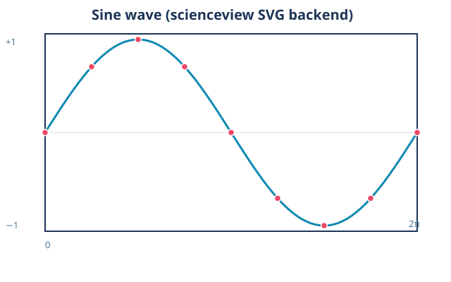

Line plot recipe (`examples/line_plot.rs`) builds the `SVLinePlot` recipe from a
named in-memory source and renders it through the configured backend:

```rust
use scienceview::sv_recipes::sv_relational::sv_line_plot::SVLinePlotBuilder;
use scienceview_core::sv_data::{SVColumnRole, SVDataTable};

let table = SVDataTable::builder()
    .with_column("x", SVColumnRole::X, &x)
    .with_column("y", SVColumnRole::Y, &y)
    .with_column("series", SVColumnRole::Grouping, &series)
    .build()?;

let plot = SVLinePlotBuilder::new()
    .data_source(&table)
    .x("x")
    .y("y")
    .series("series")
    .markers(true)
    .line_width(SVLength::absolute(2.0))
    .title("Damped oscillation by series")
    .backend(SVBackendKind::Svg)
    .build()?;

let bytes = plot.render()?.bytes;
```

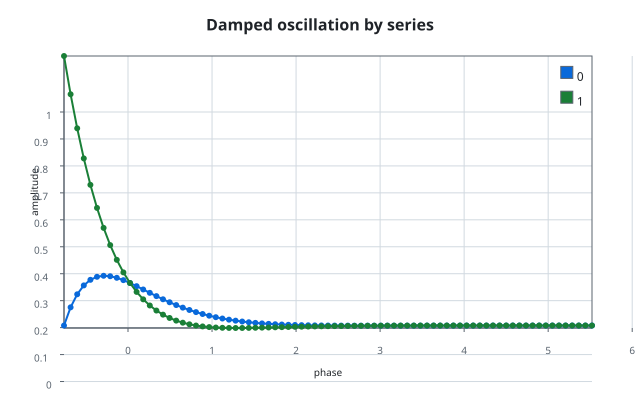

Bar chart (`examples/bar_chart_svg.rs`):

```rust
let figure = SVFigure::builder()
    .backend(SVBackendKind::Svg)
    .execution_mode(SVExecutionMode::Automatic)
    .build();
figure.render();
```

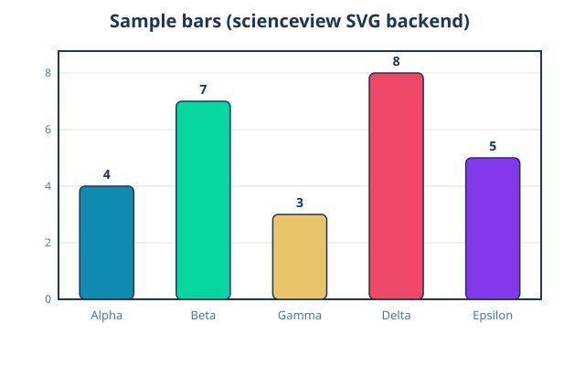

Scatter plot (`examples/scatter_plot.rs`) drives the `SVScatterPlot` recipe,
which composes the scales, the dot marks, the series palette and the
decorations, then serializes the backend-agnostic scene through the public
`to_svg()` method:

```rust
let scene = SVScatterPlot::builder()
    .data_source(&table)
    .x("sepal_width")
    .y("petal_length")
    .series("species")
    .series_labels(&["setosa", "versicolor", "virginica"])
    .size("body_mass")
    .alpha(0.85)
    .title("Sepal width against petal length")
    .backend(SVBackendKind::Svg)
    .build()?
    .compose()?;
let document = scene.to_svg()?;
```

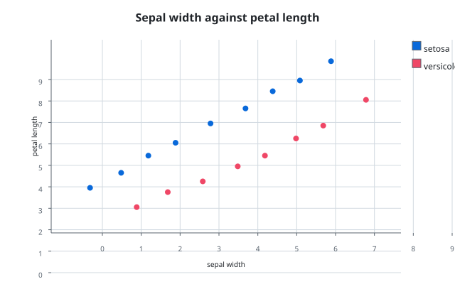

Regression plot (`examples/regression_plot.rs`) composes the real
`SVRegressionPlot` builder: one fit per series, an optional confidence band,
and the scatter, line and ribbon marks sharing one axes and one legend.

```rust
use scienceview::sv_recipes::sv_relational::SVRegressionPlotBuilder;
use std::path::Path;

let plot = SVRegressionPlotBuilder::new()
    .data_source(&table)
    .x("petal length")
    .y("sepal width")
    .series("species")
    .confidence(0.95)
    .title("Sepal width against petal length")
    .backend(SVBackendKind::Svg)
    .build()?;
plot.save(Path::new("regression_plot.svg"))?;
```

Model selection is a value of `SVFitModel` (`Linear`, `Polynomial`,
`Logarithmic`, `Exponential`, `Power`); the fit itself always comes from
`SVStat::Fit`, so the coefficients and the confidence band are the kernel's.

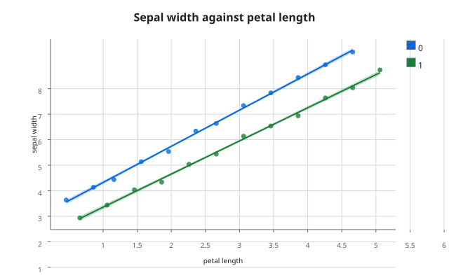
Band plot (`examples/band_plot.rs`) composes the `SVBandPlot` recipe in its
derived mode: `SVStat::Aggregate` turns observations into a mean and a
standard-deviation interval per group, and the recipe fills the region between
the two boundaries, one band per series:

```rust
use scienceview::sv_recipes::sv_relational::sv_band_plot::SVBandPlotBuilder;

let plot = SVBandPlotBuilder::new()
    .data_source(&table)
    .x("time")
    .derive()
    .values("load")
    .series("scenario")
    .border(true)
    .centre_line(true)
    .title("Load interval by scenario")
    .backend(SVBackendKind::Svg)
    .build()?;

let output = plot.render()?;
```

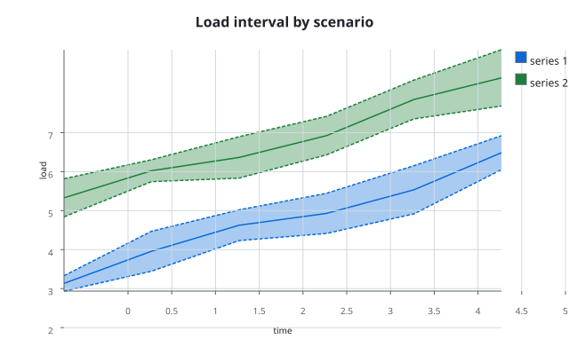
Bar plot (`examples/bar_plot.rs`) composes the `SVBarPlot` recipe: the aggregate
kernel turns observations into one value (and optional interval) per category
and series, the move kernel dodges or stacks the series, and one bar is drawn
per group:

```rust
use scienceview::sv_recipes::sv_distribution::sv_bar_plot::SVBarPlotBuilder;

let plot = SVBarPlotBuilder::new()
    .data_source(&table)
    .value("measurement")
    .category("station")
    .series("scenario")
    .error(SVAggregateErrorKind::StandardError)
    .backend(SVBackendKind::Svg)
    .build()?;

let output = plot.render()?;
let document = output.to_svg()?;
```

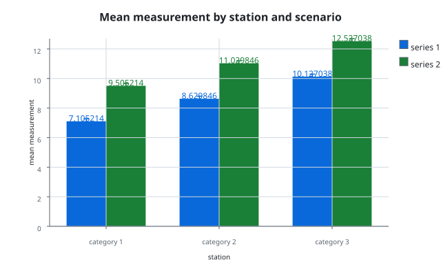
An image plot (`examples/image_plot.rs`) maps a computed field through a colour
map and places it on its data extent, with a colour bar:

```rust
use scienceview::sv_backend::SVBackendKind;
use scienceview::sv_data::{SVColumnRole, SVDataTableBuilder};
use scienceview::sv_recipes::sv_matrix::sv_image_plot::{
    SVImageExtent, SVImagePlot, SVImageSource, SVRasterDimensions,
};
use scienceview::sv_scale::sv_default_colour_map;

let values: Vec<f64> = (0..36)
    .flat_map(|row| (0..48).map(move |column| ((row + column) as f64).sin()))
    .collect();
let data = SVDataTableBuilder::new()
    .with_column("intensity", SVColumnRole::Weight, &values)
    .build()?;
let dimensions = SVRasterDimensions::new(36, 48)?;

let scene = SVImagePlot::builder()
    .data_source(&data)
    .raster(SVImageSource::intensity("intensity", dimensions))
    .colour_map(sv_default_colour_map())
    .extent(SVImageExtent::new(0.0, 48.0, 0.0, 36.0)?)
    .colour_bar(true)
    .backend(SVBackendKind::Svg)
    .build()?
    .compose()?;
let document = scene.to_svg()?;
```

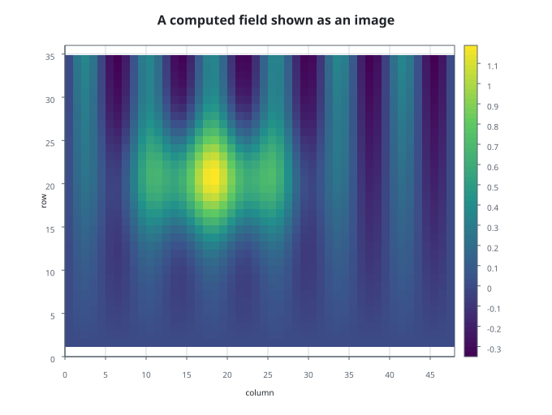
Heatmap (`examples/heatmap_plot.rs`) composes the `SVHeatmapPlot` recipe: a
long table is pivoted into a matrix, the continuous colour scale colours every
cell, optional annotations print the values, and the colour bar describes the
same scale the cells use:

```rust
use scienceview::sv_backend::SVBackendKind;
use scienceview::sv_recipes::sv_matrix::sv_heatmap_plot::SVHeatmapPlot;

let scene = SVHeatmapPlot::builder()
    .data_source(&table)
    .row("row")
    .column("column")
    .value("correlation")
    .annot(true)
    .centre(0.0)
    .title("Correlation matrix")
    .backend(SVBackendKind::Svg)
    .build()?
    .compose()?;

let document = scene.to_svg()?;
```

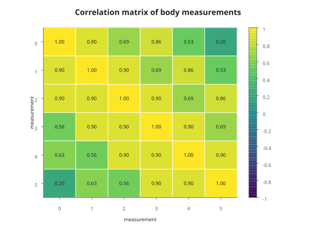
Point plot (`examples/point_plot.rs`) composes the `SVPointPlot` recipe: the
aggregate kernel turns observations into one point estimate (and interval) per
category and series, the move kernel dodges the series, and an optional line
joins the points of one series across the categories:

```rust
use scienceview::sv_recipes::sv_distribution::sv_point_plot::SVPointPlotBuilder;

let plot = SVPointPlotBuilder::new()
    .data_source(&table)
    .value("measurement")
    .category("station")
    .series("scenario")
    .estimator(SVAggregateMethod::Mean)
    .error(SVAggregateErrorKind::StandardError)
    .join(true)
    .backend(SVBackendKind::Svg)
    .build()?;

let output = plot.render()?;
let document = output.to_svg()?;
```

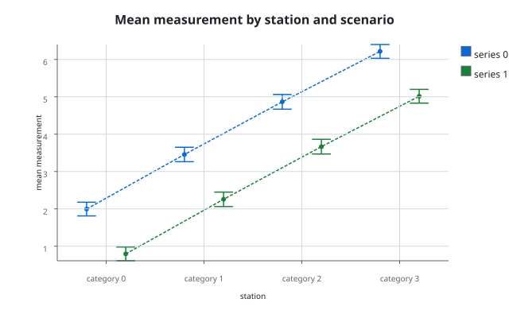
Hexbin plot (`examples/hexbin_plot.rs`) composes the `SVHexbinPlot` recipe: the
recipe bins two continuous columns into a pointy-top hexagonal lattice, counts
the observations in every cell (or averages an optional value column through
`SVStat::Aggregate`) and paints the occupied cells through a continuous colour
scale with a colour bar:

```rust
use scienceview::sv_recipes::sv_matrix::sv_hexbin_plot::SVHexbinPlot;

let plot = SVHexbinPlot::builder()
    .data_source(&table)
    .x("first measurement")
    .y("second measurement")
    .grid_size(28)
    .min_count(2)
    .backend(SVBackendKind::Svg)
    .build()?;

let document = plot.compose()?.to_svg()?;
```

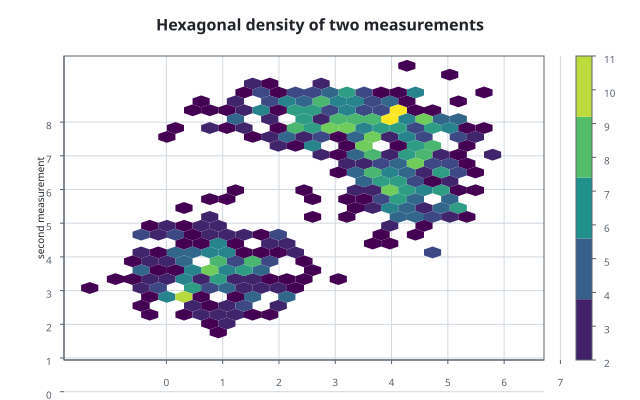
Box plot (`examples/box_plot.rs`) composes the `SVBoxPlot` recipe: the
percentile kernel supplies the quartiles and the median, the whisker rule
chooses the ends and the outliers, and the dodge places one box per series
inside each category:

```rust
use scienceview::sv_recipes::sv_distribution::sv_box_plot::{
    SVBoxPlotBuilder, SVWhiskerRule,
};

let plot = SVBoxPlotBuilder::new()
    .data_source(&table)
    .value("measurement")
    .category("station")
    .series("scenario")
    .show_mean(true)
    .whisker(SVWhiskerRule::Tukey)
    .backend(SVBackendKind::Svg)
    .build()?;

let output = plot.render()?;
let document = output.to_svg()?;
```

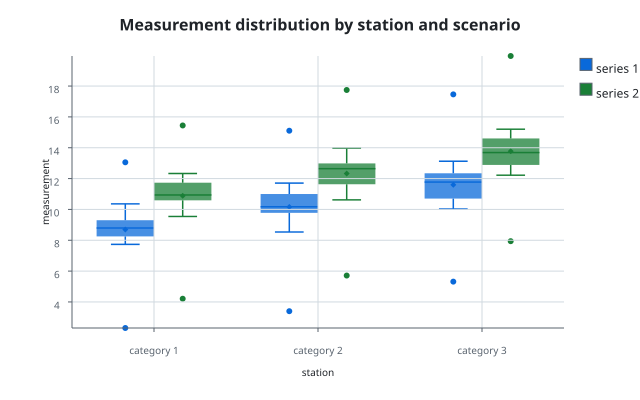
Count plot (`examples/count_plot.rs`) composes the `SVCountPlot` recipe: the
counting kernel supplies the count of every category, the dodge places one bar
per series inside the slot, and the nominal axis shows the supplied labels:

```rust
use scienceview::sv_recipes::sv_distribution::sv_count_plot::{
    SVCountMultiple, SVCountPlot,
};

let scene = SVCountPlot::builder()
    .data_source(&table)
    .category("species")
    .category_labels(&["Adelie", "Chinstrap", "Gentoo"])
    .series("island")
    .series_labels(&["Biscoe", "Dream", "Torgersen"])
    .multiple(SVCountMultiple::Dodge)
    .title("Penguins observed per species and island")
Swarm plot (`examples/swarm_plot.rs`) composes the `SVSwarmPlot` recipe: the
swarm move lays each category out without overlap, and the width of the swarm
reads the density of the sample:

```rust
use scienceview::sv_recipes::sv_distribution::sv_swarm_plot::SVSwarmPlot;

let scene = SVSwarmPlot::builder()
    .data_source(&table)
    .value("bill_length")
    .category("species")
    .series("sex")
    .title("Bill length of penguins by species")
    .backend(SVBackendKind::Svg)
    .build()?
    .compose()?;

let document = scene.to_svg()?;
```

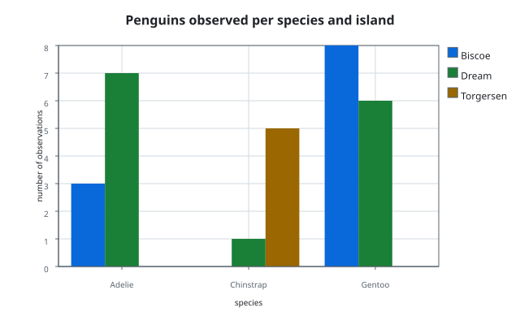

Parallel categories plot (`examples/parallel_categories_plot.rs`) composes the
`SVParallelCategoriesPlot` recipe: every axis is counted with `SVStat::Count`,
observations are aggregated into ribbons between adjacent axes, and the band
gap and opacity shape the result:

```rust
use scienceview::sv_recipes::sv_multivariate::sv_parallel_categories_plot::SVParallelCategoriesPlot;

let scene = SVParallelCategoriesPlot::builder()
    .data_source(&table)
    .variables(&["delivery", "region", "outcome"])
    .variable_labels(&["Delivery", "Region", "Outcome"])
    .category_labels("delivery", &["online", "campus", "hybrid"])
    .category_labels("region", &["north", "south", "east"])
    .category_labels("outcome", &["completed", "withdrew", "failed"])
    .band_gap(0.24)
    .opacity(0.62)
    .title("Course outcomes across delivery, region and result")
    .backend(SVBackendKind::Svg)
    .build()?
    .compose()?;

let document = scene.to_svg()?;
```

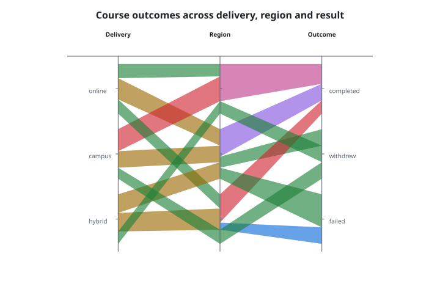
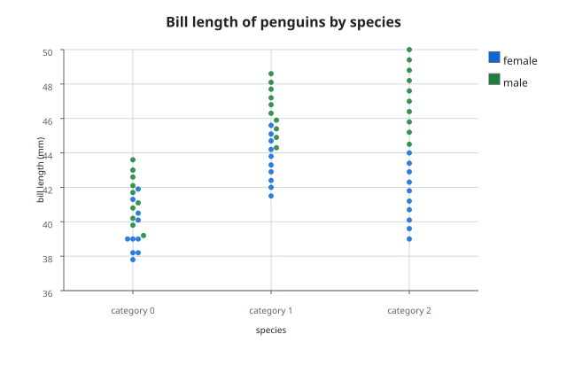
Boxen plot (`examples/boxen_plot.rs`) composes the `SVBoxenPlot` recipe: the
percentile kernel supplies the nested letter values, the tail rule derives how
many levels to draw, and the dodge places one nest per series inside each
category:

```rust
use scienceview::sv_recipes::sv_distribution::sv_boxen_plot::SVBoxenPlotBuilder;

let plot = SVBoxenPlotBuilder::new()
    .data_source(&table)
    .value("measurement")
    .category("station")
    .series("scenario")
    .show_outliers(true)
Violin plot (`examples/violin_plot.rs`) composes the `SVViolinPlot` recipe:
`SVStat::KernelDensity` estimates the density of every category, the recipe
mirrors it around the category centre, and an optional inner box shows the
quartiles and median:

```rust
use scienceview::sv_recipes::sv_distribution::sv_violin_plot::{
    SVViolinPlotBuilder, SVViolinScale,
};

let plot = SVViolinPlotBuilder::new()
    .data_source(&table)
    .value("measurement")
    .category("station")
    .bandwidth_adjustment(0.9)
    .width(0.72)
    .scale(SVViolinScale::Area)
    .show_box(true)
    .backend(SVBackendKind::Svg)
    .build()?;

let output = plot.render()?;
let document = output.to_svg()?;
```

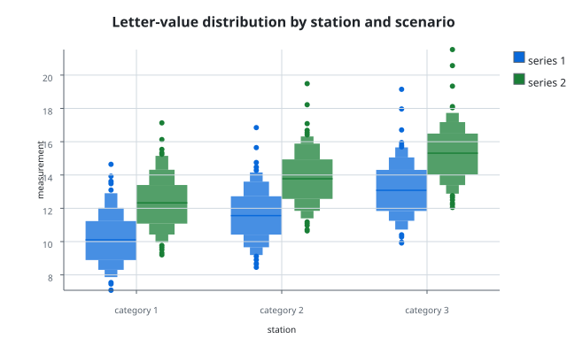
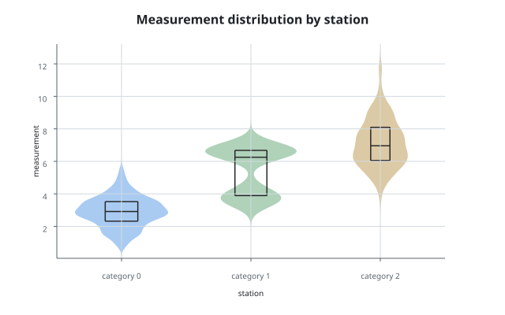
Step plot (`examples/step_plot.rs`) composes the `SVStepPlot` recipe: the
value holds between samples, the riser sits at the next `x` (`After`), and one
line is drawn per series:

```rust
use scienceview::sv_recipes::sv_relational::sv_step_plot::SVStepPlot;

let plot = SVStepPlot::builder()
    .data_source(&table)
    .x("time")
    .y("temperature")
    .series("sensor")
    .title("Temperature held between samples")
    .backend(SVBackendKind::Svg)
    .build()?;

let composition = plot.compose()?;
let mut document = SVSvgDocument::new(composition.viewport());
document.push_decoration_primitives(composition.decorations_before_marks());
for geometry in composition.mark_geometries()? {
    document.push_mark_geometry(&geometry);
}
document.push_decoration_primitives(composition.decorations_after_marks());
```

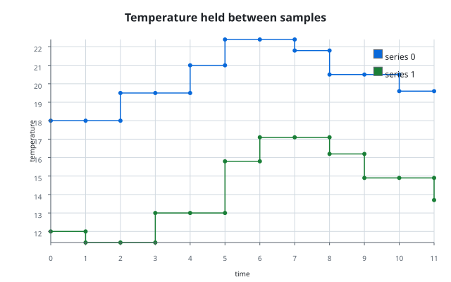

Rug plot (`examples/rug_plot.rs`) composes the `SVRugPlot` recipe: one small
tick per observation, in the margin of the axis the values occupy, coloured by
the optional `series` column:

```rust
use scienceview::sv_recipes::sv_distribution::sv_rug_plot::SVRugPlot;

let scene = SVRugPlot::builder()
    .data_source(&table)
    .value("body_mass")
    .series("species")
    .series_labels(&["Adelie", "Gentoo"])
    .height(0.08)
    .alpha(0.85)
    .title("Body mass of penguins")
    .value_label("body mass (g)")
    .backend(SVBackendKind::Svg)
    .build()?
    .compose()?;
let document = scene.to_svg()?;
```

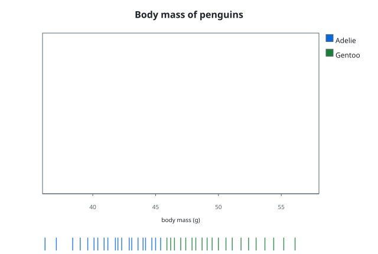

Strip plot (`examples/strip_plot.rs`) composes the `SVStripPlot` recipe: one dot
per observation, jittered along its category so overlapping points remain
visible, coloured by the optional `series` column:

```rust
use scienceview::sv_recipes::sv_distribution::sv_strip_plot::SVStripPlot;

let scene = SVStripPlot::builder()
    .data_source(&table)
    .value("body_mass")
    .category("island")
    .series("sex")
    .series_labels(&["female", "male"])
    .jitter(0.18)
    .seed(42)
    .alpha(0.75)
    .title("Body mass by island and sex")
    .value_label("body mass (g)")
    .backend(SVBackendKind::Svg)
    .build()?
    .compose()?;
let document = scene.to_svg()?;
```

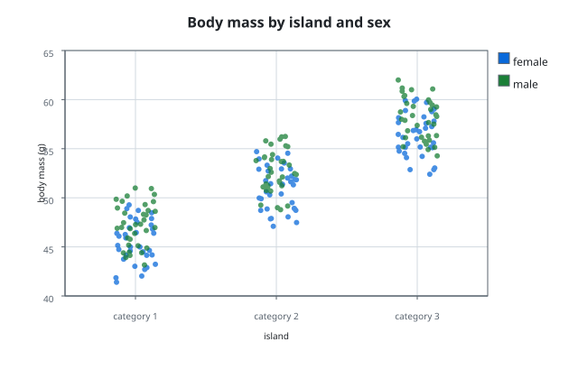

ECDF plot (`examples/ecdf_plot.rs`) composes `SVStat::EmpiricalCdf`: the curve
is a non-decreasing step that reaches one at the maximum observation, and one
curve is drawn per series:

```rust
use scienceview::sv_recipes::sv_distribution::sv_ecdf_plot::SVECdfPlotBuilder;

let document = SVECdfPlotBuilder::new()
    .data_source(&table)
    .value("error")
    .series("model")
    .title("Residual distribution by model")
    .backend(SVBackendKind::Svg)
    .build()?
    .render()?
    .to_svg()?;
```

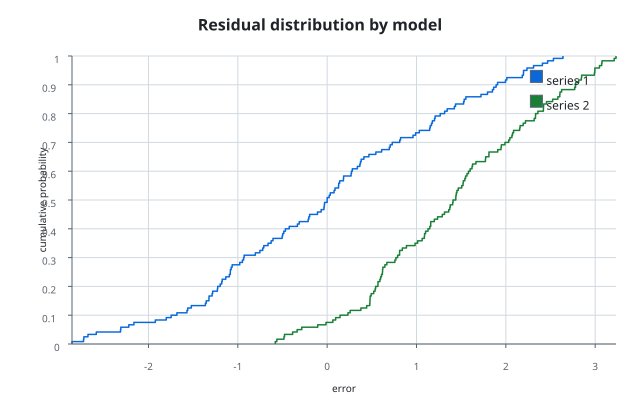

The SVG backend is `scienceview_svg`: zero extra dependencies, deterministic
byte-identical output, accessible metadata (`role`, `aria-label`, `<title>`,
`<desc>`), escaped text, and large point sets grouped into one `<path>`.

## Area plot

`examples/area_plot.rs` builds a stacked three-series `SVAreaPlot` and writes
the composed primitives through the SVG document serializer:

```rust
use scienceview::sv_recipes::sv_relational::sv_area_plot::SVAreaPlot;

let plot = SVAreaPlot::new()
    .data_source(&table)
    .x("month")
    .y("revenue")
    .series("channel")
    .stack(true)
    .opacity(0.55)
    .line(true)
    .title("Stacked revenue by channel")
    .backend(SVBackendKind::Svg)
    .build()?;
let rendering = plot.rendering()?;
```

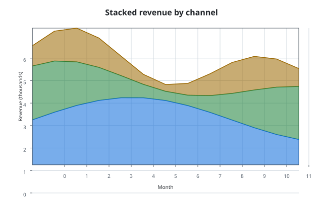

## Density contour plot

`examples/density_contour_plot.rs` builds an `SVDensityContourPlot` recipe, which
derives the joint density with the bin kernel, isolates the levels with marching
squares and fills each band from the lowest level up:

```rust
use scienceview::sv_recipes::sv_distribution::sv_density_contour_plot::SVDensityContourPlot;

let plot = SVDensityContourPlot::builder()
    .data_source(&table)
    .x("first measurement")
    .y("second measurement")
    .grid_count(96)
    .bandwidth(0.35)
    .levels(9)
    .backend(SVBackendKind::Svg)
    .build()?;
let composition = plot.compose()?;
```

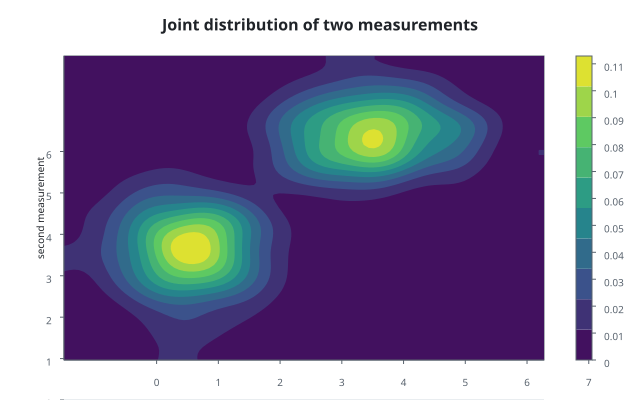

## Density heatmap plot

`examples/density_heatmap_plot.rs` builds an `SVDensityHeatmapPlot` recipe, which
derives the two bin edges with the bin kernel, folds the observations into the
cells with the aggregate kernel and paints one rectangle per cell through a
continuous colour scale:

```rust
use scienceview::sv_recipes::sv_matrix::sv_density_heatmap_plot::SVDensityHeatmapPlot;

let plot = SVDensityHeatmapPlot::builder()
    .data_source(&table)
    .x("first measurement")
    .y("second measurement")
    .bin_count_x(48)
    .bin_count_y(32)
    .backend(SVBackendKind::Svg)
    .build()?;
let composition = plot.compose()?;
```

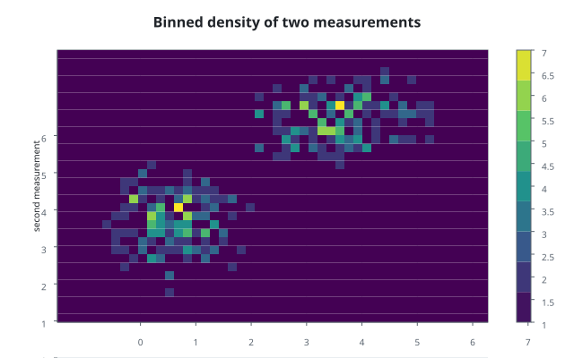

## Density plot

`examples/density_plot.rs` composes the `SVDensityPlot` recipe: one
`SVStat::KernelDensity` estimate per series, a filled curve and its outline,
sharing one pair of axes:

```rust
use scienceview::sv_recipes::sv_distribution::sv_density_plot::SVDensityPlot;
use scienceview_core::sv_backend::SVBackendKind;
use std::path::Path;

let plot = SVDensityPlot::new()
    .data_source(&table)
    .value("measurement")
    .series("group")
    .fill(true)
    .bandwidth_adjustment(1.2)
    .title("Two smoothed distributions")
    .backend(SVBackendKind::Svg)
    .build()?;
plot.save(Path::new("density_plot.svg"))?;
```

The kernel supplies the grid, the density and the bandwidth; `bandwidth`,
`bandwidth_adjustment`, `kernel`, `grid_count`, `cut` and `normalise` select the
estimate.

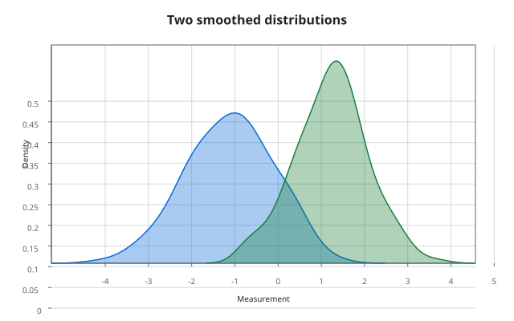

## Contour plot

`examples/contour_plot.rs` composes the `SVContourPlot` matrix recipe: a
row-major matrix is read as a scalar field, marching squares isolates the
requested levels and the filled style paints nested bands through the
continuous colour scale:

```rust
use scienceview::sv_recipes::sv_matrix::sv_contour_plot::{SVContourPlot, SVContourStyle};

let scene = SVContourPlot::builder()
    .data_source(&table)
    .value("response")
    .matrix(41, 41)
    .x_range(-3.0, 3.0)
    .y_range(-3.0, 3.0)
    .levels(6)
    .style(SVContourStyle::Filled)
    .labels(true)
    .title("Response surface")
    .backend(SVBackendKind::Svg)
    .build()?
    .compose()?;

let document = scene.to_svg()?;
```

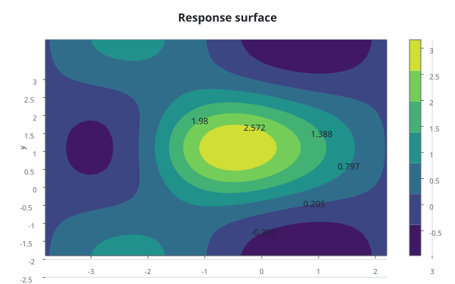

## Scatterplot matrix

`SVSplomPlot` draws one scatter cell per pair of variables, with the
observations shared across the grid and a univariate distribution on the
diagonal:

```rust
let plot = SVSplomPlot::builder()
    .data_source(&table)
    .variables(&["height", "weight", "age", "resting pulse"])
    .colour("group")
    .diagonal(SVSplomDiagonal::Density)
    .backend(SVBackendKind::Svg)
    .build()?;
let document = plot.compose()?.to_svg()?;
```

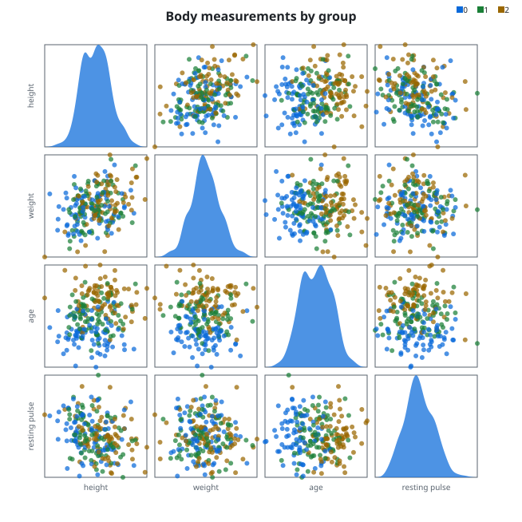

## Features

Borrowed slices are the core data model — no heavy algebra or GUI toolkit is required to describe a figure. Everything else is an opt-in Cargo feature:

- `data-ndarray`: zero-copy views over `ndarray` arrays.
- `data-sprs`: zero-copy views over `sprs` sparse vectors.
- `spec-serde`: JSON serialization of the figure specification.
- `theme`: the authored theme compiled at build time into backend-independent
  design tokens, palettes and colour maps (`theme-runtime-compilation` adds
  recompilation while the program runs).
- `streaming`: live updates over standard-library channels.
- `streaming-tokio`: live updates over Tokio watch channels.

Requires Rust 1.85+, edition 2024.

## Documentation

- Book (API, usage examples with tool-generated figures, every function): <https://neurono-ml.github.io/scienceview>
- API reference: <https://docs.rs/scienceview>
- Product requirements and architectural principles: see [`docs/PRD.md`](docs/PRD.md).
- Sister project `sciencekit`: <https://github.com/neurono-ml/sciencekit> ([docs](https://neurono-ml.github.io/sciencekit/))
- Contributor workflow: see [`AGENTS.md`](AGENTS.md).

## License

Licensed under either of [MIT](LICENSE-MIT) or [Apache-2.0](LICENSE-APACHE) at your option.
