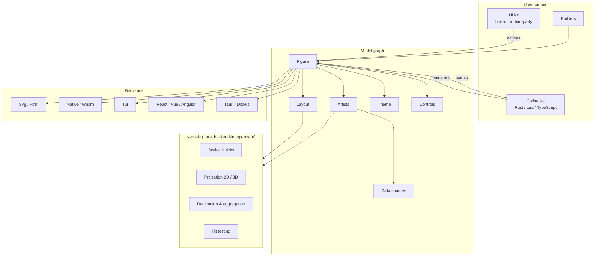

# scienceview — Product Requirements

> Status: foundation draft. This document is the product source of truth for
> `scienceview`. Where it disagrees with `AGENTS.md`, this document prevails.
> The normative, testable form of the requirements lives in the OpenSpec
> capabilities under `openspec/specs/`; this document explains the product,
> the principles behind it and the roadmap.
>
> Section map: references in `AGENTS.md` and `openspec/config.yaml` that use
> the numbering of the pre-foundation draft resolve as follows — workspace and
> crate layout: §4.2; naming and prefix rules: §3.8; representation parity:
> §3.3; acceptance criteria: §9; roadmap: §6.

## 1. Vision

`scienceview` is a Rust visualization library that covers the capabilities of
the most popular Python plotting libraries — Plotly and Bokeh — with the same
styling and interactivity, and adds streaming data updates, a coherent
theming system, runtime scripting and a dashboard composition model.

It is two products in one library, and both must be first class:

1. **An immediate figure.** One call, one render, one figure — for analysis,
   notebooks, reports, a quick look at a dataset. No ceremony, no server, no
   runtime.
2. **A dashboard.** Many linked figures sharing data, filters and updates, in
   real time, driven by events or timers, assembled from the same building
   blocks.

The library is a *library*, not a framework: it renders, it does not own the
application. A figure can be embedded in a React page, a terminal
application, a Tauri window or a standalone SVG file, and the same figure
model can drive any of them.

The sister project [`sciencekit`](https://github.com/neurono-ml/sciencekit)
learns the models; `scienceview` draws them.

## 2. Users and scenarios

| User | Scenario | What they need |
|---|---|---|
| Analyst | A quick line plot of a Polars frame | Immediate figure, zero configuration, export to SVG/HTML |
| Scientist | Streaming sensor data updating live | Streaming source, non-blocking render, bounded memory |
| Application developer | A figure inside a React dashboard | Backend that embeds, in-place update, shared filters |
| Tooling author | A new rendering target | Public backend contract, no core changes |
| Author | A custom visualisation | Public source contract, public action vocabulary |
| Designer | A branded look across every target | One authored theme, consistent identity |

## 3. Architectural principles

These principles are the reason the API looks the way it does. They are
enforced by the capabilities in `openspec/specs/`.

### 3.1 Open traits at the boundary, closed enumerations in the middle

Every extension point is a public trait — `SVDataSource`, `SVScriptEngine`,
`SVRenderBackend` — and every trait is funnelled into a small closed
enumeration before computation begins, most importantly `SVColumnView`
(`Dense` / `Sparse` / `Streaming`).

This gives third parties full extension without giving up exhaustive dispatch
and zero-copy access inside the kernels. The kernel never learns what Polars
is; it sees a view.

### 3.2 The rendering form is always a deliberate choice

Every builder requires an explicit `backend(...)` selection. There is no
automatic variant, and enabling a Cargo feature makes a backend *available*,
never *selected*. The selection is a runtime value, the figure stays
non-generic apart from an optional scalar parameter, and every operation
records the configured kind in its observability span.

### 3.3 Zero-copy and representation parity

Public APIs take borrowed views, never owned arrays. An artist that tolerates
more than one representation accepts dense, sparse and streaming input on every
public operation, dispatches on the representation exactly once per operation,
never densifies a sparse input and never blocks the render thread on a stream.

The single exception is an artist whose mathematics genuinely requires
full-data geometry. Such an artist rejects a streaming view up front with an
explicit unsupported-representation error naming a documented alternative path
— typically a windowed or aggregated view — and the change that introduces it
states why the exception applies and names that path.

### 3.4 Rust is the brain

Events always travel up to the Rust runtime; mutations always travel down as
serialized deltas. Scripts run host-side by default. The documented
exceptions are a script engine embedded in the WebAssembly artifact, and
JavaScript/TypeScript engines for web-native integration — both opt-in.

### 3.5 Interaction is an intent, not a side effect

User input becomes a semantic *action*, actions become transactional
*mutations*, mutations emit *events*. The action vocabulary is the integration
contract for third-party user-interface frameworks in Rust and in the browser.

### 3.6 One vocabulary everywhere

Actions, events, deltas, design tokens and lengths are shared by figures, the
UI kit, dashboards and every backend. A control built for the built-in kit and
a control built with a third-party framework are the same thing seen from two
sides.

### 3.7 Dependency-light core, everything else optional

The core depends on `thiserror` and `tracing` only. Every capability —
alternate data sources, alternate script engines, alternate backends — is a
Cargo feature. The core requires no async runtime.

### 3.8 Consistency over cleverness

Same names, same prefixes, same shapes across the whole surface: `SV` for
public types and traits, `sv_` for free functions, variables and public
modules, no abbreviations except the project prefix. Methods — functions inside
an `impl` block — carry no prefix.

### 3.9 Mechanical organization of the source

The source layout is decided by rule, not by taste:

- A `.rs` file longer than 200 lines becomes a standardized folder module
  (`mod.rs`, `builder.rs`, `core_implementation.rs`, `fitting_logic.rs`,
  `*_tests.rs`).
- A folder `mod.rs` is a pure dispatcher: it declares submodules and
  re-exports their public items, and holds no implementation logic.
- Tests live in companion `*_tests.rs` modules beside the implementation, with
  mock data in borrowed slices and synthetic streams; there is no global
  `tests/` directory.
- Any inline `#[cfg(test)]` block sits at the end of its file, so the
  implementation reads top-down.

### 3.10 Asynchrony without blocking

The core requires no async runtime. Heavy computation runs on `rayon`, I/O and
stream updates on `Tokio`, and no CPU-bound work ever blocks an async thread.
Iteration over data uses `.map()` / `azip!()` / `par_azip!()` rather than
manual index loops.

## 4. Capability catalogue

Every capability named in this catalogue is governed by a durable OpenSpec
capability, and every OpenSpec capability of this change has its home here.
The mapping is:

| Section | OpenSpec capability |
|---|---|
| §4.1 The figure model | shared substrate, not a capability of its own — `model-events`, `layout-engine`, `ui-kit`, `theming`, `scripting`, `backend-selection` |
| §4.2 Rendering backends | `backend-selection`, `backend-capabilities` |
| §4.3 Data sources | `data-view-boundary` |
| §4.4 Events, actions and scripting | `model-events`, `event-payloads`, `scripting` |
| §4.5 Theming and palettes | `theming` |
| §4.6 Layout and responsiveness | `layout-engine` |
| §4.7 The interactive UI kit | `ui-kit` |
| §4.8 Dashboards | `dashboard` |

### 4.1 The figure model

```
Figure ── owns ── Artists (one per series / mark type)
   │              │
   │              └── references columns by name in a DataSource
   ├── Layout (axes, legend, colour bar, decorations)
   ├── Controls (buttons, sliders, tools)
   ├── Theme (tokens)
   ├── Scripts (named, reloadable)
   └── Backend kind (explicit, runtime value)
```

Figures are built through builders; direct constructors are private. Every
builder exposes `backend(...)` and `execution_mode(...)`; the execution mode
defaults to `Automatic`, while the backend has no automatic variant at all.

### 4.2 Rendering backends

| Backend | Target | Notes |
|---|---|---|
| `Svg` | file / embedded | Self-contained, no dependencies, primary documentation target |
| `Html` | page | Self-contained document embedding the figure |
| `Native` | desktop window | From-scratch CPU renderer |
| `Wasm` | browser canvas | WebAssembly target of the from-scratch renderer |
| `Tui` | terminal | Cell grid rasterization |
| `React` / `Vue` / `Angular` | component | Web framework components |
| `Tauri` / `Dioxus` | native application | Rust-native component targets |

Every backend is a workspace crate implementing `SVRenderBackend`. Third-party
crates may add backends the same way. Backends declare a capability matrix —
events, scripting, streaming, in-place update, export formats — and the
builder fails early when an unsupported combination is requested.

Interactive backends must support **in-place update**: dashboards, callbacks
and streaming are impossible without it, so it is a first-class obligation
rather than a later feature.

### 4.3 Data sources

`SVDataSource` is the ingestion contract; `SVColumnView` is the computation
boundary.

| Source | Feature | Notes |
|---|---|---|
| Borrowed slices, `Vec` | core | The reference implementation |
| `ndarray` arrays | `data-ndarray` | Zero-copy views |
| Sparse (indices + values) | core | Never densified |
| Standard-library channels | `streaming` | Non-blocking, bounded window |
| Tokio channels | `streaming-tokio` | Async producer behind a synchronous view |
| Arbitrary streams | `streaming` | Same shape as channels |
| Polars | `data-polars` | Zero-copy through Arrow buffers; inert, so reactivity is manual or observed |
| Apache DataFusion | `data-datafusion` | Record batches map naturally onto the streaming representation |

Reactivity is explicit per source: `Static`, `Observed`, `EventDriven`,
`Manual`.

### 4.4 Events, actions and scripting

```
gesture ──► action ──► mutation batch ──► event ──► callbacks
 (backend)  (semantic)  (atomic, delta)  (payload)
```

Events carry data *and* pixel coordinates, the affected ranges, the camera
state in three-dimensional figures, the selection geometry and the identity of
the originating source. Callbacks are written in Rust or in a script.

`SVScriptEngine` is pluggable; Lua and TypeScript/JavaScript engines ship
first. Scripts are named resources: they can be replaced and reloaded at
runtime, run sandboxed by default, and report failures without taking the host
program down.

### 4.5 Theming and palettes

A theme is authored in Sass and compiled to CSS at build time or at runtime.
The compiled result resolves into backend-independent design tokens —
colours, typography, spacing, radii, shadows — so that native and terminal
backends share the visual identity of web backends. Web backends emit the
stylesheet so the user can override individual rules.

Palettes cover discrete, continuous and data-derived cases.

### 4.6 Layout and responsiveness

Sizing is a first-class value: absolute lengths, fractions of the parent,
intrinsic size, aspect ratio and fill, with minimum and maximum constraints.
Responsiveness modes are explicit: fixed, fit-to-parent, aspect-ratio
constrained, content-derived.

Layout is resolved in two passes — measure from the environment, solve against
constraints — in a backend-independent coordinate system. Each backend
rasterizes the result on its own grid. Ticks adapt to the space available.

### 4.7 The interactive UI kit

Controls are model objects, not artists. They are configurable (label, size,
style, behaviour), styled from the theme, and dispatch semantic actions.

The built-in minimum set: zoom in, zoom out, reset view, pan toggle, series
visibility toggle, axis range slider, region selection, plus the usual input
controls (checkbox, radio, select, text, colour picker).

The action vocabulary is the contract that lets a button from `egui`, `iced`,
`ratatui`, React, Vue or Angular drive a `scienceview` figure exactly like a
built-in control, and observe the same events. Controls can be placed inside
the figure frame or in an external host arrangement.

### 4.8 Dashboards

The dashboard is a separate crate. It composes figures in a grid, shares data
sources between cells, turns selections into linked filters applied without
copying the underlying data, exposes filter state to the host application, and
supports event-driven and timed refresh cycles.

## 5. System shape



The flow is deliberately narrow: only the kernels know about geometry, only
the backends know about pixels, and only the model graph knows about
configuration. Everything crosses the boundaries as data — views, deltas,
tokens, actions.

## 6. Roadmap

| Phase | Content | Exit criterion |
|---|---|---|
| 0 | Foundation: this document and the capability specs | Specs validated, product requirements published |
| 1 | Workspace, core model graph, events and actions, first kernels | A figure model exists with a working event loop and no backend |
| 2 | First figure and artist on the SVG backend | A real figure rendered, exported and documented with a tool-generated figure |
| 3 | Layout engine, theming, palettes, ticks | Responsive, themed figures on the SVG and HTML backends |
| 4 | Data source adaptors (ndarray, channels, Polars, DataFusion) | Representation parity proven across dense, sparse and streaming |
| 5 | Remaining backends (native, wasm, TUI, web frameworks) | Each backend renders and updates in place |
| 6 | UI kit and third-party UI integrations | A third-party control drives a figure identically to a built-in one |
| 7 | Scripting (Lua, TypeScript), runtime theming and editing | Scripts reload at runtime; themes recompile at runtime |
| 8 | Dashboard crate | Linked figures, shared filters, coordinated updates |

Each phase follows the repository's iterative rule: naive implementation,
then tests, then performance, then streaming.

## 7. Open decisions

These are deliberately unresolved. They are recorded so that later phases can
settle them without re-opening the foundation.

| # | Decision | Current leaning |
|---|---|---|
| P1 | Canonical set of semantic actions | Around twenty core actions, extensible through a serialized custom payload |
| P2 | Dashboard layout model | Grid with spans, in the spirit of CSS Grid |
| P3 | Export formats beyond SVG and HTML | PNG, PDF and CSV of the underlying data are candidates |
| P4 | Web interoperability without WebAssembly | A JSON or message bridge as an alternative to the compiled bridge |
| P5 | Accessibility baseline | Keyboard navigation, focus handling and ARIA annotations on web backends |
| P6 | First-party support for Rust UI frameworks | `egui` and `ratatui` before `iced` and `slint` |
| P7 | Theme token hierarchy | Three levels: primitives, semantic roles, component tokens |
| P8 | TypeScript engine implementation | A pure-Rust transpiler feeding an embeddable JavaScript engine |
| P9 | Print and multi-page output | Fixed axis policy, page size, several figures per page |

## 8. Non-goals

- Owning the application: the library renders and reacts, it does not manage
  the host's state, routing or persistence.
- A general-purpose data-analysis runtime: computation belongs to
  `sciencekit` or to the host.
- A hosted service, an account system or a store of published dashboards.
- Binding to one rendering technology: the trait-based design is the point.

## 9. Acceptance criteria for a shipped capability

Every figure and artist that ships must demonstrate, per the repository's
acceptance rules:

- rendering with small and large data sets;
- correct behaviour under concurrency;
- export of the figure in the formats its backend declares;
- the streaming update path exercised, with render metrics reported;
- the figures shown in the documentation generated by the tool itself, never
  hand-drawn.
