# Chapter 1 — The product foundation

> This chapter explains the foundation of `scienceview` from zero: what the
> library is for, who it serves, the two structural decisions that everything
> else follows from, and what was deliberately left undecided.
>
> It is written for a reader who has never written Rust and has never had to
> think about numerical computing. No code is required to follow it.

## 1. The problem this library solves

Imagine you have measured something — the temperature of a room, the price of a
stock, the output of a simulation — and you want to *see* it.

Almost every tool that lets you see it makes you pay for the privilege in a way
you did not expect.

- Some tools are wonderful for a static picture and useless for a live one.
  You can draw a chart of your measurements, but as new measurements arrive
  there is no way to redraw the same chart; you export a new file every time.
- Some tools are wonderful for a live application and heavy for a quick look.
  To plot a sine wave once, you have to start a server, write a dashboard
  layout, and keep it running.
- Some tools render beautifully on a web page and have no idea what a terminal
  is, so they cannot be used on a machine without a browser — a remote
  training box, a cluster head node, a CI job.
- And almost none of them let *you* decide how the picture is drawn. You get
  their idea of what a chart is, with a handful of knobs for the parts they
  happened to think about.

`scienceview` is an attempt to build the plotting library that does not make
you choose. One library, several rendering forms, and an explicit — never
automatic — choice between them.

## 2. Two audiences, one core

The hardest part of designing a library like this is that it serves two quite
different people, and the temptation is to build two libraries.

| Audience | What they are doing | What they need |
|---|---|---|
| The analyst | Plotting one dataset, right now | One call, one render, one figure. No ceremony. |
| The application developer | Building a live dashboard of many linked figures | Shared data, filters that propagate, updates that arrive continuously |

The temptation is to write a "simple plotting API" and a "dashboard
framework" and let them drift apart. The result is always the same: the
dashboard ends up reimplementing, badly, everything the simple API already
did.



The decision recorded in the product requirements is that **both audiences are
first class, and they share one core**. The analyst's single figure and the
developer's dashboard are the same objects at different scales. A dashboard
cell *is* a figure. A figure *is* a piece of the model graph. The extra
machinery a dashboard needs — linking figures, sharing sources, coordinating
refreshes — is built *on top of* the figure, never instead of it.

That is also why the dashboard is a separate crate rather than a module: it
must be able to grow without ever forcing a change on the core.

## 3. The first structural decision: open at the edges, closed in the middle

This is the single most important idea in the architecture, so it is worth
taking slowly.

### The question

Suppose you want to plot data that lives in a Polars dataframe, and tomorrow
someone else wants to plot data that lives in your company's internal
time-series store. Should the core library know about Polars? About your
internal store?

The obvious answer — "yes, add support for both" — is the one that kills
libraries. Every new data system forces a change to the core, the core grows
dependencies nobody uses, and eventually two users want incompatible things.

### The answer: two kinds of "extension point"

The foundation splits the world in two.

**At the edges, the library is open.** A *trait* is a public promise: "here
is what you must provide, and here is what you get back." The library
publishes three such traits:

- `SVDataSource` — how data gets in.
- `SVRenderBackend` — how a figure gets drawn.
- `SVScriptEngine` — how a script gets run.

If you want to support your internal time-series store, you implement
`SVDataSource`. You do not ask the library for permission, and the library's
core does not change, does not gain a dependency, and does not gain a
conditional branch for your system.

**In the middle, the library is closed.** Once data is inside, it is turned
into one of exactly three shapes, and the shape is an *enumeration* — a closed
list of alternatives the compiler knows completely:

```text
SVColumnView
├── Dense      — a plain, contiguous run of numbers
├── Sparse     — numbers plus the positions they occupy
└── Streaming  — numbers that arrive over time
```



### Why both, and not just one

The tempting simplification is to pick one mechanism.

**Traits alone** (everything is a trait object) is very flexible: any source
can do anything. But the *inside* of the library — the part that actually
draws a line, places a tick, decides which pixels to paint — then has to ask
"what kind of data am I holding?" at every step, with no way for the compiler
to check that every case was handled. Slow, and full of silent bugs.

**Enumerations alone** (everything is one of a fixed list) is fast and safe:
the compiler can verify every case is handled. But then every new data system
requires a change to the core library — which is exactly what we wanted to
avoid.

The split gives both. A kernel — the pure piece of code that turns numbers
into geometry — sees only three shapes. It matches on them exhaustively
exactly once per operation, and the compiler will refuse to compile if a
future shape is added and forgotten. Meanwhile the *ingestion* side stays wide
open, so a thousand data systems can plug in without touching the core.

### The three promises that come with it

This split is not just an internal arrangement; it is a contract with the
people using the library, and the specifications make it testable:

1. **A sparse input is never densified.** If you give the library sparse
   data, it will not quietly expand it into a dense buffer behind your back.
   Sparse data is usually sparse *because* it is huge, and expanding it would
   defeat the point.
2. **A stream never blocks the renderer.** If data arrives over time, the
   renderer draws with whatever is available *at that instant* and moves on.
   It never parks waiting for the next chunk.
3. **The same picture comes out either way.** If an artist can mathematically
   handle more than one shape, then feeding it dense data, sparse data or
   streaming data produces the same result, within a stated tolerance. This is
   called *representation parity*, and it is the property that makes it safe
   to change the shape of your data without changing what your chart looks
   like.

There is exactly one escape hatch, and it is deliberately awkward: an artist
whose mathematics genuinely requires the whole dataset at once — some kinds of
three-dimensional projection, for instance — may reject a streaming input
outright. When it does, the error must say so explicitly *and name the
alternative path* to use instead (typically a windowed or aggregated view).
Silent degradation is never allowed.

## 4. The second structural decision: an interaction has four stages

Now the second big idea: what happens when a user drags a slider, or clicks a
point.

The naive design is that the widget changes the figure's fields directly. This
is what most plotting libraries do, and it is why they become hard to extend:
the moment you want a button made in a different UI framework to drive your
plot, you need to expose your internals to it.

The foundation instead splits every interaction into four stages, and the
vocabulary of these stages is the *integration contract*.



### The four stages

| Stage | What it is | Who owns it |
|---|---|---|
| **Gesture** | The raw thing the user did: a click, a drag, a key press | The backend — only a backend knows about pixels and devices |
| **Action** | The *meaning* of the gesture: "zoom in", "select this region" | The core — a shared vocabulary of intents |
| **Mutation batch** | The concrete change to the figure's state, applied atomically | The core — queued, then committed as one unit |
| **Event** | The published fact that something changed, with its payload | The core — delivered to whoever is listening |

### Why the middle two are separate

The action is the interesting one. It is a *semantic* — "zoom in on the x
axis" — with no pixels, no devices, no coordinates. That means:

- A button drawn by the built-in control kit and a button drawn by a
  third-party UI framework (in Rust or in the browser) dispatch **the same
  action**, and the figure cannot tell them apart. One implementation of
  "zoom" serves all of them.
- A gesture captured in a desktop window and the same gesture captured in a
  browser produce **the same action**, so the behaviour of a figure does not
  drift between backends.
- An action is a small, serializable value. It can be logged, replayed,
  tested, or sent across a process boundary.

The mutation batch is separate from the action for a second reason:
**atomicity**. If an action needs to change three things, and the second one
fails, the figure must not be left half-changed. So mutations are queued
while the action is applied, and committed together, or not at all. Observers
see the change once, after the whole batch, never in the middle of it.

### Rust is the brain — with two documented exceptions

The default rule is: **events travel up to the Rust runtime, mutations travel
down as serialized deltas.** The figure's state has exactly one authority,
the Rust program that owns it. There is no shadow copy of the state living in
a web page that could drift out of sync.

There are two situations where this is deliberately overridden, and both are
opt-in:

1. A script engine embedded in the WebAssembly artifact, for web backends
   where the interaction genuinely has to be resolved in the browser to feel
   responsive.
2. JavaScript and TypeScript engines, for teams whose web front end is
   written in those languages.

Both are choices the user makes explicitly; neither is the default.

### The cascade budget

One consequence of the action/mutation split deserves its own mention,
because it is the kind of bug that is very hard to find later.

A callback is allowed to request changes. Those changes produce new events.
Those events can trigger other callbacks, which request more changes… and
the cycle never ends.

The foundation bounds this in two ways:

- A callback that mutates something it itself observes is **not** re-invoked
  because of its own mutation. The change still happens; the callback just
  does not chase its own tail.
- Cascades are bounded by an explicit **depth budget**. When the budget is
  exceeded, the cascade stops and an error describing the cycle is reported,
  rather than the program hanging.

## 5. Naming, shape and other consistency rules

Everything durable in this project follows a few mechanical rules, so that the
library reads as one thing rather than a pile of contributions.

- **Public types and traits start with `SV`** — `SVFigure`, `SVLinePlot`,
  `SVDataSource`. **Free functions, variables and modules start with `sv_`** —
  `sv_create_figure`. **Methods** — functions inside an `impl` block — carry
  no prefix, because the type already says who they belong to.
- **No abbreviations**, with exactly one exception: the project prefix
  `sv`/`SV`. `maximum_number_of_points`, not `max_pts`.
- **Builder pattern, always.** Direct constructors are private. Every builder
  takes an explicit `backend(...)` and an `execution_mode(...)`; the execution
  mode defaults to `Automatic`, but the backend has **no** automatic variant
  at all.
- **Zero-copy public APIs.** Public functions take borrowed views of your
  data, never owned copies of it.
- **A dependency-light core.** The core depends on `thiserror` and `tracing`
  and nothing else. Every other capability — alternate data sources, script
  engines, backends — is behind a Cargo feature, so an unused capability
  costs no compile time and no binary size.
- **The rendering form is always a deliberate choice.** Enabling a Cargo
  feature makes a backend *available*; it never *selects* one. The selection
  is made by an explicit `backend(...)` call, it is a runtime value rather
  than a type parameter, and every operation records the selected backend in
  its observability span.

That last rule is worth a word, because it is unusual. Many libraries offer
an "automatic" backend that picks whatever is available. `scienceview` does
not, because an automatic choice hides a real difference in cost and in
output: an SVG file, a terminal cell grid and a WebAssembly canvas are not
interchangeable, and a user who cares should have to say which one they
want.

## 6. What this foundation deliberately leaves open

A foundation document that pretends to have settled everything is hiding
something. The following decisions are recorded as *open*, on purpose, with a
current leaning attached, so that later phases can settle them without
re-opening the foundation:

| # | Open question | Current leaning |
|---|---|---|
| P1 | The exact set of core semantic actions | About twenty, extensible through a serialized custom payload |
| P2 | The dashboard layout model | A grid with spans, in the spirit of CSS Grid |
| P3 | Export formats beyond SVG and HTML | PNG, PDF and CSV of the underlying data are candidates |
| P4 | Web interoperability without WebAssembly | A JSON or message bridge as an alternative to the compiled bridge |
| P5 | Accessibility baseline | Keyboard navigation, focus handling and ARIA annotations on web backends |
| P6 | Which Rust UI frameworks get first-party support | `egui` and `ratatui` before `iced` and `slint` |
| P7 | The hierarchy of theme tokens | Three levels: primitives, semantic roles, component tokens |
| P8 | How the TypeScript engine is implemented | A pure-Rust transpiler feeding an embeddable JavaScript engine |
| P9 | Print and multi-page output | Fixed axis policy, page size, several figures per page |

Two things are *not* open, and are worth repeating because they are the
decisions everything else hangs from: the rendering backend is always chosen
explicitly, and data enters through open traits but is computed on a closed
enumeration of shapes.

## 7. Where this foundation goes next

This chapter describes the *shape* of the library. The work is delivered in
the order the roadmap in the product requirements describes:

1. The workspace and the core model graph — the objects this chapter talks
   about, existing in code.
2. A first figure and artist on the SVG backend — a real chart, exported and
   documented.
3. The layout engine, theming and palettes.
4. The data source adaptors, proving representation parity in practice.
5. The remaining backends: native, WebAssembly, terminal, and the web
   framework components.
6. The UI kit and the third-party UI integrations.
7. Scripting, runtime theming and runtime editing.
8. The dashboard crate.

Each of the remaining chapters of this book covers one of these, in order, and
each one walks through the real code and the real tests of the change that
delivered it.

> **A note on this chapter.** It describes a foundation that is specified but
> not yet implemented: the change that produced it
> (`foundation-core-architecture`) delivered the product requirements
> document and the ten capability specifications, and deliberately no runtime
> code. That is why this chapter grounds itself in the *specifications*
> rather than in companion `*_tests.rs` modules — the modules do not exist
> yet. Every later chapter walks through real tests, as the book promises.

## Further reading

- The product requirements document — `docs/PRD.md` in the repository — is the
  source of truth for the vision, the principles, the capability catalogue,
  the roadmap and the open decisions summarised above.
- The capability specifications under
  `openspec/changes/foundation-core-architecture/specs/` are the normative,
  testable form of every rule in this chapter: one directory per capability,
  each with requirements and concrete scenarios.
