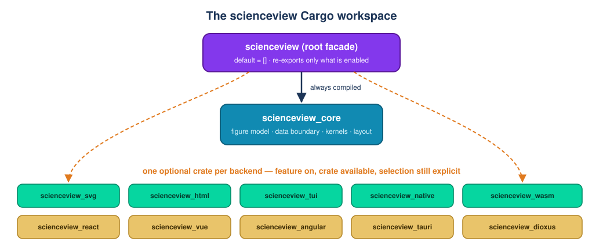

# Chapter 2 — Bootstrapping the workspace

> This chapter explains how `scienceview` got its first line of compilable
> code: why the repository became a Cargo workspace, why there is one crate per
> rendering backend, what a *feature* and a *facade* are, and how the project
> makes sure the answers stay true over time.
>
> Like chapter 1, it assumes no Rust and no build-tooling background.

## 1. The problem: a plan with nothing to compile

Chapter 1 described a library that serves two audiences and draws figures in
many rendering forms. The repository already contained the plan — the product
requirements, the capability specifications, the chart records — but almost no
code. `src/lib.rs` was nothing but documentation, and the list of features in
`Cargo.toml` named crates that did not exist.

That state is comfortable to write and impossible to review. A specification
can say "the SVG backend draws a line"; nothing can prove it until there is a
box that the compiler accepts and that a test can open. Every later change —
the figure model, the data boundary, the ten backends, all the charts — needed
that box first.

So this first change did the least interesting and most enabling thing:
it built the boxes.

## 2. Three words to know

**A crate.** A crate is the unit Rust compiles. It has a name, a directory and a
`Cargo.toml` file describing what it needs. Everything else in this chapter is
vocabulary laid on top of that one idea.

**A workspace.** A workspace is a set of crates that are built together but stay
separate. They share one lockfile and one build directory, yet each keeps its
own dependencies. This is exactly what we want: the terminal renderer should
not drag a browser engine into the build.

**A feature.** A feature is a named switch in `Cargo.toml`. Turning it on
enables extra code or an extra dependency; leaving it off means the code is not
compiled at all. Features are how a single library offers optional heavy
capabilities without making every user pay for them.

## 3. The shape that was chosen

Two decisions, both fixed by the product requirements, define the workspace.

**One core crate.** `scienceview_core` holds the figure model, the data
boundary, the kernels and the layout. It depends only on `thiserror` and
`tracing`. It knows nothing about windows, terminals or browsers.

**One crate per rendering backend.** Each way of drawing a figure is its own
crate: `scienceview_svg`, `scienceview_html`, `scienceview_tui`,
`scienceview_native`, `scienceview_wasm`, `scienceview_react`,
`scienceview_vue`, `scienceview_angular`, `scienceview_tauri` and
`scienceview_dioxus`. A backend is reached only through its feature.



The root package, `scienceview`, is a **facade**: the small front door users
depend on. It re-exports the core crate and whichever backend crates their
features enabled, and nothing else. If nobody enables a backend, its crate is
never compiled.

### Why not one big crate?

A single crate would have to depend on `winit` (windows), `ratatui`
(terminals), `wasm-bindgen` (browsers) and the web frameworks all at once.
Every user would compile all of it to draw one SVG. It would also make the ten
backend changes collide in one `Cargo.toml` instead of living in ten separate
directories.

### Why not make the roots automatic?

A tempting shortcut is to let enabling a feature also *choose* that backend.
The product requirements forbid it: there is no `Automatic` backend. Enabling
`render-svg` makes the SVG backend available; the figure still has to say
`backend(SVBackendKind::Svg)`. A picture is too important to be drawn by an
accident of dependency resolution.

## 4. The switchboard: features that map 1:1 to crates

The root `Cargo.toml` declares `default = []` and one feature per backend:

```toml
[features]
default = []
render-svg = ["dep:scienceview_svg"]
render-html = ["dep:scienceview_html"]
# ... one line per backend ...
wasm = ["dep:scienceview_wasm"]
```

Each feature enables an *optional path dependency* — "optional" means "only
build it if this feature is on". The core crate, by contrast, is a required
dependency: the facade cannot exist without it.

This one-to-one shape is the whole contract. A new backend later means a new
crate, a new feature and a new line here — never a change to the core.

## 5. A compiler everyone agrees on

Rust changes. A library that compiles on one machine may fail on another with a
different compiler version, and the error often appears deep inside a
dependency where it is impossible to understand.

`rust-toolchain.toml` prevents that:

```toml
[toolchain]
channel = "1.85"
components = ["rustfmt", "clippy"]
profile = "minimal"
```

Every toolchain-aware command in the repository — locally and in CI — uses
Rust 1.85 with two companions: `rustfmt`, which formats code so that reviews
discuss behaviour instead of whitespace, and `clippy`, which points out
suspicious code. Every crate also inherits `rust-version = "1.85"` from the
workspace, so an older compiler fails with a clear "this crate needs 1.85"
message rather than a confusing one.

## 6. Gates, and why they are part of the foundation

The specifications say formatting, static analysis, tests and figures are
required on every pull request. CI turns those words into a step that can fail:

| Gate | Command | What it protects |
|---|---|---|
| Formatting | `cargo fmt --all --check` | Reviewers read behaviour, not whitespace |
| Static analysis | `cargo clippy --workspace --all-targets -- -D warnings` | A warning never enters `main` |
| Tests | `cargo test --workspace --all-targets` | Every crate and every example still runs |
| Figures | rerun every example, then `git diff --exit-code -- docs/figures` | Documentation never shows a picture the tool no longer produces |

The last gate deserves a sentence. The examples under `examples/` are real
programs, and their SVG output is checked in under `docs/figures/`. The gate
runs the programs again and fails if anything changed: a picture in the
documentation can only be the picture the tool actually draws.

## 7. The tests that keep this chapter honest

The change shipped two companion test modules. They are deliberately simple,
because their job is to pin decisions that are easy to undo by accident.

`src/workspace_tests.rs` does six things:

1. **`core_crate_is_reachable_through_the_facade`** — calls
   `scienceview_core::sv_crate_name()` both directly and through the facade
   (`crate::scienceview_core::...`). If the facade ever stops re-exporting the
   core, this test stops compiling.
2. **`backend_features_are_off_by_default`** — walks the ten backend features
   and asserts none is enabled. This is the executable form of `default = []`.
3. **`toolchain_is_pinned_to_the_declared_minimum`** — reads
   `rust-toolchain.toml` and requires channel 1.85 with `rustfmt` and `clippy`.
4. **`lint_configuration_denies_warnings`** — reads the root manifest and
   requires `[workspace.lints.rust] warnings = "deny"` and
   `[workspace.lints.clippy] all = "deny"`.
5. **`readme_presents_the_project_badges_and_workspace_layout`** — keeps the
   CI, crates.io, docs.rs and Rust-version badges and the workspace section in
   the README.
6. **`changelog_records_the_workspace_bootstrap`** — keeps the change listed
   under `[Unreleased]`.

`crates/scienceview_core/src/crate_map_tests.rs` covers the core crate's own
documentation. It walks every workspace crate name and every feature and
asserts the documentation mentions it. Documentation has a habit of drifting
away from the manifest; this test makes the drift fail the build instead.

Notice the pattern: every test is a **companion module** beside the code it
describes (chapter 1 introduced this rule), not a separate `tests/` directory.
And every test was written first, watched to fail, and only then made to pass.

## 8. Roads not taken

- **A single crate with everything inside.** Rejected: the default build would
  pay for every backend, and ten parallel changes would collide in one file.
- **Feature selection as backend selection.** Rejected by the product
  requirements: the rendering form is always a deliberate `backend(...)` call.
- **No CI until the code "matters".** Rejected: gates added later are gates
  bolted onto a pile of accumulated warnings. They were part of the foundation.
- **Ten crates that already contain placeholder behaviour.** Rejected: an empty
  crate is an honest boundary; a fake implementation is a lie that later code
  inherits.

## 9. What this change makes possible

Every later change now has a place to live and a way to be wrong:

- the figure and artist core goes into `scienceview_core`;
- each backend goes into its own crate and its own change;
- every chart recipe composes the core and reaches a backend through a feature;
- a pull request that breaks formatting, lints, tests or a documented figure is
  stopped before review.

The next chapter explains the figure builder itself — the first real object
that uses this skeleton.
