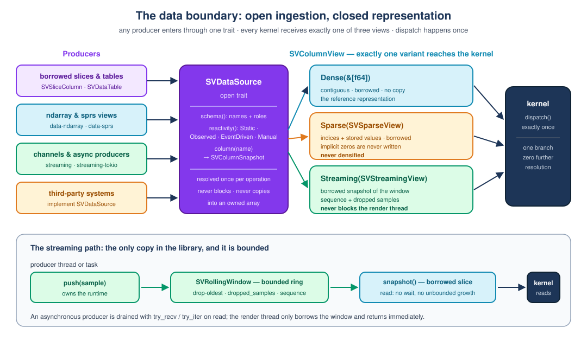

# Chapter 3 — The data boundary

> This chapter explains how data gets into `scienceview`: why a chart cannot
> simply accept a `Vec<f64>`, what a *borrowed view* is, what "dense", "sparse"
> and "streaming" mean, why a sparse matrix is never turned into a dense one,
> how a live plot reads data without ever freezing, and how the library proves
> that all three ways of presenting the same numbers draw the same picture.
>
> It assumes no Rust and no numerical-computing background. It follows
> chapter 2, which built the crates.

## 1. The problem: three very different kinds of data

Imagine three users of the library.

The first has one thousand temperature readings in a plain array. They are all
there, they never change, and drawing them should copy nothing.

The second has a one-million-row design matrix from a machine-learning run in
which almost every entry is zero. Only forty thousand values are actually
stored. Expanding that matrix to a million dense cells would allocate eight
megabytes of zeros and compute nothing useful.

The third has a sensor that reports a new sample every hundred milliseconds.
The plot must show the most recent values and must never wait for the sensor;
if the plot keeps every sample that ever arrived, it eventually exhausts
memory.

A naive library accepts one shape — usually the first — and forces the others
to copy, densify or block. That is exactly what `scienceview` refuses to do.
The data boundary is the small, carefully designed layer that lets all three
reach the same drawing code.



## 2. Four words to know

**A borrowed view.** A view is a pair of numbers that describes *where* data
lives and *how much* of it there is, without owning it. In Rust a borrowed
slice, written `&[f64]`, is such a view: it points at memory someone else
allocated and promises not to modify it. Borrowing costs nothing — no
allocation, no copy — which is why the book repeats the phrase *zero-copy*:
the chart looks at the user's data in place.

**A representation.** "Dense", "sparse" and "streaming" are three ways of
describing the same logical column of numbers. Dense means "all values, next to
each other in memory". Sparse means "only the non-zero values, plus where each
one sits". Streaming means "the current window of a sequence that keeps
arriving".

**A trait.** A trait is a contract: a set of functions a type promises to
provide. In `scienceview`, `SVDataSource` is the contract every data producer
implements — including code in other crates that the library has never seen.

**A window.** A window is a fixed-size buffer that keeps only the most recent
samples. When a new sample arrives and the buffer is full, the oldest one is
thrown away. The buffer can never grow, so a fast producer cannot exhaust
memory, and the plot always shows the newest data.

## 3. Two halves: an open door and a closed room

The most consequential decision of this layer is a split.

The **door** is open. `SVDataSource` is a public trait; anyone can implement it
for their own storage engine and pass it to any artist. `scienceview` does not
need to know what your database is, and no core file has to change.

The **room** is closed. Inside the library, data is always exactly one of three
representations, described by the `SVColumnView` enumeration. A new shape of
data would be a change to the library itself, reviewed like any other.

Why close the room? Because drawing code must be predictable. If the
representation were extensible, every kernel would have to answer "what if a
fourth kind of data shows up?" forever. With three fixed variants, the compiler
guarantees that a kernel handles all of them, and a reviewer can see the whole
space at once.

```rust
pub enum SVColumnView<'a> {
    Dense(&'a [f64]),
    Sparse(SVSparseView<'a>),
    Streaming(SVStreamingView<'a>),
}
```

The `'a` is Rust's way of writing "this view borrows something that outlives
it". The enumeration owns nothing; it is a description of borrowed data.

## 4. Dense: the reference implementation

Dense is the simplest case and the yardstick for the other two.

```rust
SVColumnView::Dense(&values)
```

Nothing is copied. The companion test
`dense_view_borrows_the_slice_without_copying` proves it by comparing the
pointer of the values inside the view with the pointer of the original array:

```rust
assert!(std::ptr::eq(
    view.dense_values().expect("dense is contiguous").as_ptr(),
    values.as_ptr()
));
```

If those two addresses differ, a copy happened — and the test fails.

## 5. Sparse: indices, values, and the zeros that do not exist

A sparse column stores two arrays: the *indices* where a non-zero value sits,
and the *values* themselves. A column of length one million with two stored
entries is tiny in memory and still describes a million logical positions.

```rust
pub struct SVSparseView<'a> {
    indices: &'a [usize],
    values: &'a [f64],
    length: usize,
}
```

Two rules make it trustworthy.

First, construction validates. Indices must be strictly increasing, inside the
column, and there must be exactly one value per index. A caller that passes
garbage gets an error, not a silently wrong plot: `SVDataError::
SparseIndicesNotIncreasing`, `SparseIndexOutOfRange`, or
`MismatchedSparseLengths`.

Second — and this is the rule the whole capability is named after — a sparse
view is **never densified**. There is no function anywhere that turns it into a
`Vec<f64>`. Asking for a contiguous slice returns an error that names the
alternative:

```rust
SVColumnView::Sparse(_) => Err(SVDataError::UnsupportedRepresentation {
    operation: "dense_values",
    representation: SVRepresentation::Sparse,
    alternative: "iterate over the sparse stored entries with `stored_entries`",
}),
```

A kernel that can work with indices uses them directly. A kernel that cannot
says so, with a message that tells the user what to do instead. The companion
test `dense_values_rejects_a_sparse_view_instead_of_densifying` asserts exactly
that error, and `a_sparse_view_never_materialises_implicit_zeros` proves that a
column with a single stored value can still claim a length of one million.

## 6. Streaming: a window, not a channel

The third representation is where most libraries cheat. It would be easy to
give a plot the receiving half of a channel and let it wait for the next
sample. That is not allowed here: a plot that blocks on data is a frozen user
interface.

The core owns no async runtime and never waits. Instead, the producer — a
thread, a Tokio task, a database stream — pushes samples into a bounded rolling
window, and the plot reads a *snapshot* of whatever is in the window at that
moment.

```rust
pub fn push(&mut self, value: f64) {
    if self.values.len() >= self.capacity() {
        match self.policy.overflow() {
            SVWindowOverflow::DropOldest => { /* evict, count the drop */ }
            SVWindowOverflow::DropNewest => { /* reject, count the drop */ }
        }
    }
    // ...
}
```

The window exposes three facts that make a live plot debuggable:

- `sequence()` — how many samples were accepted so far. It stays flat when no
  data arrives, so a stalled producer is visible.
- `dropped_samples()` — how many samples were already evicted. A number that
  keeps growing means the renderer is slower than the producer.
- `snapshot()` — the retained samples as one contiguous borrowed slice.

The read side carries a guard, `SVWindowReadGuard`, because the window lives
behind a mutex: the producer may push while the plot reads. The guard holds the
lock for the duration of the read, hands out a borrowed slice, and is released
immediately afterwards. No copy into an owned array, no waiting.

Two tests carry the promise. `a_read_never_blocks_when_the_producer_is_idle`
measures the elapsed time of a read and fails if it approaches even a small
delay. `a_producer_thread_and_a_consumer_thread_share_a_window_without_deadlock`
runs a real producer thread and a real consumer thread and checks that the
window stays bounded and the sequence never goes backwards.

The channel adapters — `SVChannelColumn` for standard-library channels and
`SVTokioChannelColumn` for Tokio channels — do one thing on every read: they
drain whatever already arrived with `try_iter` or `try_recv`, push it into the
window, and hand out the snapshot. "Already arrived" is the whole contract.

What is bounded is *retention*, not necessarily the producer's queue. A
standard-library channel has no bounded variant, so a producer that keeps
sending while no read happens can grow that queue, and a read then drains all
of it in one go. Backpressure therefore remains the producer's concern: pace
it, or use a bounded Tokio channel with `SVTokioChannelColumn`. The window
still guarantees that memory held by the plot itself stays inside its capacity.

## 7. Dispatch exactly once

A kernel receives one view and must resolve its representation exactly once.
The library makes that the only convenient thing to do:

```rust
pub fn dispatch<Result>(
    &self,
    on_dense: impl FnOnce(&'a [f64]) -> Result,
    on_sparse: impl FnOnce(&SVSparseView<'a>) -> Result,
    on_streaming: impl FnOnce(&SVStreamingView<'a>) -> Result,
) -> Result
```

Exactly one closure runs. The test `dispatch_runs_exactly_one_branch_once`
passes three closures that each increment a counter and asserts that only the
matching one ran. A kernel that dispatched twice — say, once to check the type
and again to read it — would show two increments and fail.

## 8. Where the adapters live, and why they are features

The built-in adapters implement the same public trait as third-party code.

| Adapter | Storage | Feature |
| --- | --- | --- |
| `SVSliceColumn` | a borrowed `&[f64]` | always |
| `SVDataTable` | several borrowed columns, validated | always |
| `SVNdarrayColumn` | an `ndarray` view | `data-ndarray` |
| `SVSparseColumn` | an `sprs` sparse vector | `data-sprs` |
| `SVChannelColumn` | a standard-library channel | `streaming` |
| `SVTokioChannelColumn` | a Tokio channel | `streaming-tokio` |

A feature is a switch in `Cargo.toml`. Leaving `data-ndarray` off means the
`ndarray` crate is not compiled at all, so a user who only needs slices pays
nothing for it. The core's only mandatory dependencies remain `thiserror` and
`tracing`.

The `ndarray` adapter demonstrates the zero-copy rule in an awkward case. An
`ndarray` view can be strided — for instance a column of a row-major matrix —
and a strided view cannot be borrowed as one contiguous slice. Rather than
silently copying, the adapter returns `SVDataError::NonContiguousView` with the
alternative spelled out: call `.to_owned()` and pass the contiguous buffer.
The test `a_non_contiguous_view_names_the_alternative_instead_of_copying`
asserts the error.

## 9. Many columns, validated at build time

A chart usually needs more than one column: an x, a y, a grouping key. Those
columns must share a length, or every later loop is a bug. The table builder
makes that impossible to get wrong:

```rust
let table = SVDataTable::builder()
    .with_column("latitude", SVColumnRole::X, &LATITUDE)
    .with_column("temperature", SVColumnRole::Y, &TEMPERATURE)
    .build()?;
```

`build` validates duplicate names and mismatched lengths *before* anything is
read; the test `columns_of_different_lengths_are_rejected_before_any_read`
asserts the exact error and the exact expected-versus-actual lengths. A table
that exists is always well formed — the same "fail at build time" principle the
figure builder follows.

## 10. Proving that the three representations agree

The most important sentence of the capability is: *for the same data, dense,
sparse and streaming inputs produce the same result within the documented
tolerance*. A sentence in a specification proves nothing. A harness does.

`SVRepresentationParityHarness` takes one dataset and builds all three
representations: the dense slice itself, a sparse view holding only the
non-zero entries, and a rolling window replayed with the same dataset. It then
runs a kernel against each and compares:

- **dense against sparse, exactly** — the values and their positions are
  identical, so any difference is a defect, not rounding;
- **dense against streaming, within the tolerance** — a window may accumulate
  values in a slightly different order, so a margin is allowed;
- **when the window is smaller than the dataset, against the retained tail** —
  which is what the window genuinely holds.

The tolerance is a policy, not a magic number. `SVRepresentationTolerance::
DEFAULT` is one part in a trillion, absolute and relative; a kernel that needs
more raises it explicitly with `with_tolerance` and records why in its Feature
Description Record. `SVRepresentationTolerance::EXACT` accepts no difference at
all.

A harness is only useful if it fails when it should. Two tests prove that:

- `the_harness_rejects_a_kernel_that_treats_streaming_differently` runs a
  deliberately broken kernel and expects the panic;
- `the_harness_rejects_a_sparse_result_that_differs_at_all` adds one millionth
  to the sparse result and expects the exact comparison to catch it.

The proof of concept ships in
`parity_harness_tests::the_reference_kernel_agrees_across_the_three_representations`:
a mean kernel written once, with `dispatch`, over the three branches.

## 11. What was not done, and why

- **A trait-object representation.** An extensible `Box<dyn SVDataView>` would
  let third parties add representations. It was rejected: dispatch would move
  from compile time to run time on every kernel, and the "exactly three
  representations" guarantee would disappear.
- **An owned interchange array.** Converting everything to `Vec<f64>` up front
  is the simplest API and the worst library: it copies dense data, densifies
  sparse data and defeats streaming. Rejected.
- **An async read.** Letting a kernel `await` the next sample ties every
  backend to a runtime and lets a plot block. Rejected; the producer drain is
  the alternative.
- **Unbounded buffering.** A live plot that keeps every sample eventually dies.
  The window drops the oldest sample and counts the loss.
- **An out-of-core dataset.** Describing data that does not fit in memory would
  need a fourth representation. It is deferred, and would be a change to the
  boundary itself.

## 12. What comes next

Nothing draws yet. The next changes consume this layer: the scale kernel maps
views into screen coordinates, the layout solver places the axes, and every
chart recipe adopts the parity harness in its own tests. From this chapter
onward, "accepts dense, sparse and streaming" is a checked property, not a
promise.

The executable specification is the companion tests under
`crates/scienceview_core/src/data/` and `crates/scienceview_core/src/window/`.
Read them in the order this chapter presents them.
