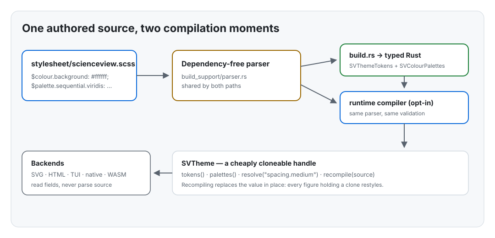
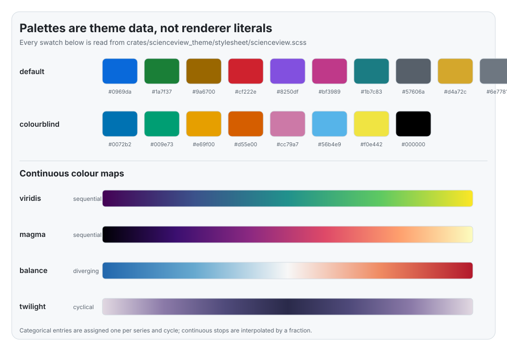

# Chapter 3 — One theme, many backends: design tokens from zero

A figure is drawn by marks on a canvas: a line is a path, a bar is a rectangle,
an axis is a line plus labels. If every renderer chose its own colours, font
sizes and spacing, the same figure would look different on every target — SVG in
a browser, a terminal grid, a native window, a WebAssembly canvas. It would also
be impossible for a user to say "use my brand colours" once and have it hold
everywhere.

This chapter explains the decision that prevents that: one authored **theme**
compiled into typed, backend-independent **design tokens**, plus the palettes
and motion values that make a figure feel like one product. It walks through
`crates/scienceview_theme`, its build-time compiler and the companion tests that
are the executable specification.

## The problem, in one sentence

If the first backend hardcodes `#0969da` for the accent colour, the other nine
backends will copy that literal, and the library will never agree with itself
again.

The fix is not "a shared constant file". It is a boundary:

- a **source** that a designer can read and edit;
- a **compiled value** that a renderer can use without parsing anything;
- a **resolution path** that turns a name into a typed value and reports an
  unknown name instead of panicking.

## What a design token is

A design token is a named decision. "The background is white" becomes
`colour.background = #ffffff`; "medium spacing is 16 pixels" becomes
`spacing.medium = 16`. A renderer asks for the decision, never for the raw
value: it draws with `theme.tokens().spacing().medium()`, not with a literal
`16.0`.

Tokens come in families, and the theme carries all of them:

| Family | Examples | Used by |
| --- | --- | --- |
| Colours | `colour.background`, `colour.accent`, `colour.grid` | marks, axes, controls |
| Typography | `typography.family`, `typography.size.body` | labels, titles |
| Spacing | `spacing.small`, `spacing.medium` | margins, padding |
| Radii | `radius.small`, `radius.large` | control corners |
| Shadows | `shadow.none`, `shadow.overlay` | tooltips, popovers |
| Motion | `motion.duration.normal`, `motion.easing.standard` | transitions |

The rule that makes this useful is simple: **no renderer contains a literal
colour or size**. If a value is needed twice, it is a token; if it is a token,
it is authored once.

## The source: a stylesheet, not a Rust constant

The theme is authored in
`crates/scienceview_theme/stylesheet/scienceview.scss`. It looks like Sass:
line comments and `$group.name: value;` declarations. The format was chosen
because designers already read it, and because CSS custom properties — the way a
web backend exposes overrides — map onto it directly.

```scss
$colour.background: #ffffff;
$colour.accent: #0969da;
$spacing.medium: 16;
$motion.duration.normal: 240;
$motion.easing.standard: cubic-bezier(0.2, 0.0, 0.0, 1.0);
```

The compiler accepts a deliberately small subset: declarations, list values
(colour palettes), and `cubic-bezier(...)`. Mixins and nesting are out of scope.
That is a trade-off: a real Sass toolchain would add a dependency to every build
just to produce a handful of numbers. The project's rule is a dependency-light
core, so the parser is owned by the crate and is shared by both compilation
paths.

## Two compilation moments

The same source compiles in two places, shown below.



**At build time**, `build.rs` reads the stylesheet, parses it, validates every
required token, and writes a Rust function returning
`SVThemeTokens` and `SVColourPalettes`. The generated code is typed:

```rust
colour: crate::tokens::SVColourTokens {
    background: crate::tokens::SVColour::new(255, 255, 255, 255),
    // ...
}
```

A missing required token, an invalid colour or a malformed shadow fails the
build with the offending source line. The failure happens at compile time, not
when a user renders a figure.

**At runtime**, the opt-in `theme-runtime-compilation` feature parses the same
source through the same parser and builds the same value. The two paths are
tested against each other:
`runtime_compilation_reproduces_the_build_time_theme` compiles the checked-in
file at runtime and asserts the tokens and palettes equal `sv_default_theme()`.
That test is what stops the duplicated conversion logic from drifting.

## The compiled value and its handle

`SVThemeTokens` is a plain Rust struct, not a stringly-keyed map. Each family is
its own struct with typed accessors, so a backend reads a field and the compiler
checks the type.

`SVTheme` is a handle around that value, cheap to clone:

```rust
let theme = sv_default_theme();
let spacing = theme.tokens().spacing().medium();
assert_eq!(spacing, 16.0);
```

The handle matters for restyling. A figure stores a clone of the handle;
`recompile(source)` replaces the value inside the shared `Arc<RwLock<_>>`, and
every clone sees the new tokens on its next read. The figure is not rebuilt —
which is exactly the `theming` requirement "the figure adopts the recompiled
theme without being rebuilt". The test `recompilation_adopts_new_tokens_without_rebuilding_the_figure`
pins it down with a small stand-in figure that holds a clone.

A broken source never half-applies: `recompile` validates and converts first,
and only then swaps. The test `a_broken_recompilation_keeps_the_previous_tokens`
asserts the old tokens survive.

## Panics are not an error model

`resolve` turns a dotted name into a typed `SVTokenValue`:

```rust
theme.resolve("colour.background") // Ok(Colour(#ffffff))
theme.resolve("colour.missing")    // Err(UnknownToken { .. })
```

Every token lookup returns a `Result`; there is no indexing panic and no
`unwrap` on the render path. The compiler's `SVThemeError` covers syntax errors
with a line number, missing required tokens, invalid values, duplicate
declarations and empty palettes.

## Palettes: three cases, three types

Series colours and colour scales are configurable, and the theme carries both
the named palettes and the rules that derive colours from data. The three cases
are separate types because their animation rule differs: a nominal colour
assigned by a discrete palette must stay stable when new data arrives, while a
continuous colour interpolates.



- `SVDiscretePalette` assigns one entry per series and cycles when there are
  more series than entries. `colour_at_index(10)` on a ten-entry palette returns
  entry zero.
- `SVContinuousPalette` holds ordered stops and interpolates at a fraction.
  Endpoints are exact, the midpoint is the middle stop when the stop count is
  odd, and out-of-range or non-finite fractions are clamped instead of panicking.
- `SVDerivedPalette` turns values into fractions with one of three rules:
  `EqualInterval` (linear across the observed range), `Rank` (position in the
  sorted series, robust to outliers) or `Quantile` (empirical distribution).

The tests spell out each rule numerically. For example, a rank-derived palette
over `[1000.0, 1.0, 50.0]` assigns the last colour to the first value, the first
colour to the second, and the middle colour to the third — because rank follows
position, not magnitude.

The `interpolate` method is component-wise on the authored, gamma-encoded
channels. The midpoint of black and white is `#404040`, not a linear-light
value; that is the behaviour a designer expects from a swatch, and it is
documented on the method.

## Motion is theme data, and accessibility is a theme concern

Durations and easings are tokens:

```scss
$motion.duration.fast: 120;
$motion.duration.normal: 240;
$motion.easing.standard: cubic-bezier(0.2, 0.0, 0.0, 1.0);
$motion.reduced: false;
```

When the theme declares `reduced: true`, **every duration resolves to zero**
inside `SVMotionTokens::duration`. The transition layer does not need a
per-call check, and cannot forget one: it asks the theme for a duration and
receives `Duration::ZERO`. Easings stay readable, because a backend may animate
a non-duration property.

The test `reduced_motion_collapses_every_duration_to_zero` checks the accessor,
and `reduced_motion_collapses_durations_at_the_token_boundary` checks that
`resolve("motion.duration.slow")` also returns zero — so the guarantee holds for
both the typed and the named access path.

## Names, prefixes and file layout

The crate follows the repository conventions:

- public structs and enums carry the `SV` prefix (`SVTheme`, `SVColourPalette`);
- free functions carry `sv_` (`sv_default_theme`, `sv_theme_builder`,
  `sv_resolve_token`, `sv_compile_theme`);
- methods do not (`tokens()`, `resolve()`, `colour_at()`);
- names are spelled out (`normal_milliseconds`, not `n_ms`);
- a file that would exceed 200 lines becomes a folder module with a pure
  `mod.rs`, and tests live in companion `*_tests.rs` modules declared at the end
  of their `mod.rs`.

There is no `unsafe`, and the crate has no dependencies at all.

## What a wave-2 change will do with this

The layout solver and the chart decorations are the first consumers. They will
ask the theme for spacing, typography, colours and motion:
`theme.tokens().spacing().medium()`, `theme.palettes().categorical_palette("default")`,
`theme.tokens().motion().duration(SVMotionDuration::Normal)`. They will not
parse the stylesheet, and they will not add a colour literal. When the HTML and
SVG backends arrive, they will emit the same tokens as CSS custom properties so
a user can override a single rule in the host document — the `theming`
requirement that a document backend emits the stylesheet.

The chapter that follows in a later wave will show those consumers, but the
contract is already fixed here: one source, one compiled value, many backends.
