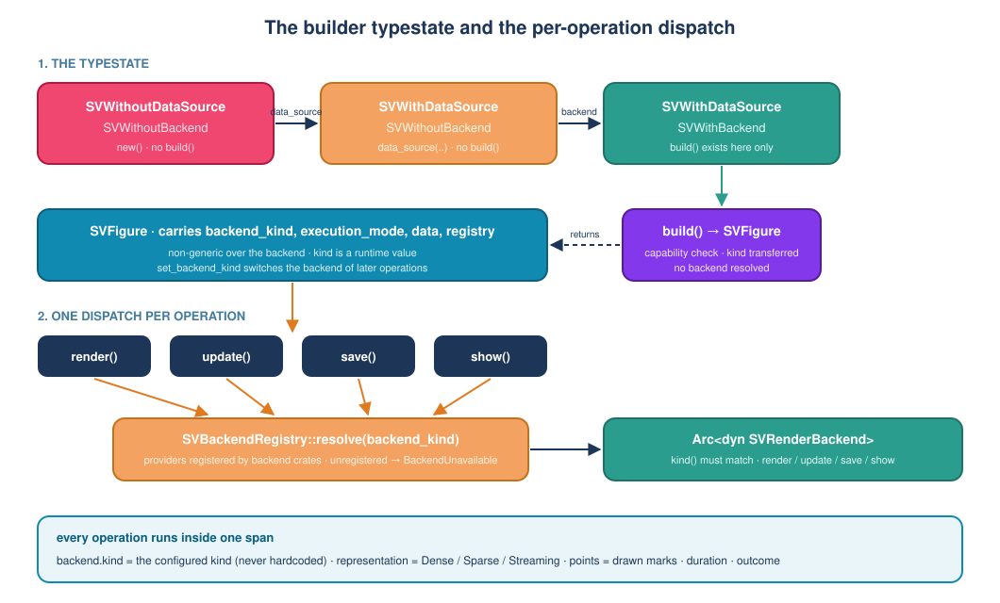

# Chapter 5 — The figure builder and the explicit backend

> This chapter explains the substrate every other chart in `scienceview` stands
> on: how a figure is configured, why the backend is a required choice, why the
> concrete renderer is picked *when the figure is drawn* rather than when it is
> built, what the library does when it fails, and what it records while it
> works.
>
> It assumes no Rust background. It follows the third code change of the
> project, after the product foundation (chapter 1) and the workspace
> (chapter 2). The theme work landed separately; this change is about the
> figure itself.

## 1. The problem: fifty charts and ten ways to draw them

By the time this change started, `scienceview` could be compiled but could not
draw anything. The product requirements promised fifty-two changes: line plots,
histograms, heat maps, dashboards, ten rendering backends. Each of them would
be written by a different agent, at a different time.

If every chart invented its own way of choosing a renderer, the library would
fall apart in a month. One chart would default to SVG, another would guess from
the environment, a third would let the Cargo feature list decide. A user
enabling the terminal backend would suddenly find their SVG export printing
escape codes. The chatty version of that failure is a bug report; the quiet
version is a library nobody trusts.

So before the first chart, the project fixed the **front door**: one builder,
one explicit backend choice, one error type, one observability shape. This
chapter is the story of that front door.

## 2. Three words to know

**Builder.** Instead of a giant function with fifteen arguments, the caller
configures an object step by step and finishes with `build()`:

```rust,ignore
SVFigureBuilder::new()
    .data_source(data_view)
    .backend(SVBackendKind::Svg)
    .build()
```

Each call returns the builder again, so calls chain. This is the pattern the
whole library uses; it is not specific to figures.

**Typestate.** A builder is just a struct. Nothing stops a careless
implementation from letting `build()` run with no backend and returning an
error at runtime. A *typestate* builder moves that rule into the type system:
the builder carries type parameters that record which required steps are done,
and `build()` exists only on the state where all of them are done. Writing the
wrong program becomes a compile error, not a test you have to remember to run.

**Runtime value.** A value that exists while the program runs, as opposed to a
type parameter that is baked in when the program is compiled. The backend kind
is deliberately a runtime value: a dashboard can hold one figure for SVG and one
for the terminal in the same list, and a single figure can even switch backends
between two calls.

## 3. Why there is no "automatic" backend

Most libraries accept a feature flag or an environment variable and pick a
renderer for you. `scienceview` does not, and the reason is a product decision,
not a technical one: the rendering form changes what the user can do with the
figure. An SVG file has no callbacks and no live updates. A terminal rendering
cannot be embedded in a web page. Choosing the form is a deliberate act, so the
library makes the caller perform it.

The `SVBackendKind` enumeration therefore has one variant per backend and
nothing else:

```rust,ignore
pub enum SVBackendKind {
    Svg, Html, Tui, Native, Wasm, React, Vue, Angular, Tauri, Dioxus,
}
```

There is no `Automatic`, no `Default`, and no fallback. Enabling the
`render-svg` Cargo feature makes the SVG backend *available*; it does not select
it. The companion test states the rule in the way a computer can check:

```rust,ignore
// crates/scienceview_core/src/backend/backend_kind_tests.rs
#[test]
fn there_is_no_automatic_or_default_variant() {
    for spelling in ["automatic", "auto", "default", "Automatic", "Default"] {
        assert!(SVBackendKind::from_name(spelling).is_none());
    }
}
```

## 4. The builder state machine

The builder has two required steps — attach data, select a backend — and a set
of optional ones: the execution mode, a title, the capabilities the figure
requires, and (for tests) an alternative registry. The two required steps are
encoded as type parameters:

- `SVWithoutDataSource` / `SVWithDataSource`
- `SVWithoutBackend` / `SVWithBackend`

`SVFigureBuilder::new()` starts in the doubly-missing state. `data_source(...)`
moves the first parameter, `backend(...)` moves the second, and `build()` is
implemented only for `SVFigureBuilder<SVWithDataSource, SVWithBackend>`.

Because the two steps are independent type parameters, the caller may perform
them in either order. A figure that skips either one simply has no `build`
method to call:



The compiler is the first test. The builder's documentation carries two
`compile_fail` doctests, which `cargo test` runs like any other test and which
fail the build if the missing-step program ever starts compiling:

```rust,ignore
// crates/scienceview_core/src/figure/builder.rs (documentation example)
// Missing backend: `build` does not exist on this state.
let figure = SVFigureBuilder::new()
    .data_source(SVColumnView::Dense(&values))
    .build();
```

## 5. What `build` does — and what it refuses to do

Three things happen in `build`, and one important thing does not.

**It validates the configuration.** The data source and the backend are taken
out of the builder; if either is absent (which the typestate already prevents,
but the code never trusts an invariant it cannot see) the error is returned, not
a panic.

**It checks the capability matrix.** The selected backend declares what it can
host: events, scripting, streaming, in-place update, export, presentation. If
the figure asks for something the backend cannot do, `build` fails now. This is
the difference between "the library told me my backend cannot run callbacks"
and "my callback never fired and I spent an afternoon on it". A streaming data
binding implies a streaming requirement automatically.

**It transfers the kind into the figure.** The new `SVFigure` stores the kind,
the execution mode, the data binding, the static requirements it validated and
a handle to the backend registry. Its constructor is private to the crate; the
builder is the only way in.

**It does not dispatch.** No concrete backend is looked up, instantiated or
called while building. The test is blunt about it:

```rust,ignore
// crates/scienceview_core/src/figure/figure_builder_tests.rs
let _figure = SVFigureBuilder::new()
    .data_source(SVColumnView::Dense(&values))
    .backend(SVBackendKind::Svg)
    .backend_registry(Arc::new(sv_registry_with_recording_backend(&recorder)))
    .build()
    .expect("the configuration is complete");

assert_eq!(recorder.provider_lookups(), 0);
assert_eq!(recorder.render_calls(), 0);
```

## 6. Why dispatch happens per operation

A backend crate depends on `scienceview_core`. If the core had to call
`scienceview_svg` directly, the dependency would run the other way too and the
two crates would form a cycle — and the core would name every backend, which is
exactly what the project forbids so that a third-party crate can add a backend
without touching the core.

The solution is a seam. The core defines the rendering contract as a trait:

```rust,ignore
pub trait SVRenderBackend: Send + Sync {
    fn kind(&self) -> SVBackendKind;
    fn capabilities(&self) -> SVBackendCapabilities;
    fn render(&self, request: &SVRenderRequest<'_>) -> Result<SVRenderOutput, SVError>;
    // update, save and show have defaults that report the missing capability
}
```

and a registry of *providers* that answer "give me an implementation for this
kind". Backend crates register a provider; the core never names them. Each
operation asks the registry at the moment it runs:

```rust,ignore
// crates/scienceview_core/src/figure/core_implementation.rs (render)
let backend = sv_resolve_render_backend(&self.registry, self.backend_kind)?;
backend.render(&SVRenderRequest { /* ... */ })
```

The registry also checks that the implementation it received really reports the
kind it was asked for. A provider returning the wrong backend is a
configuration bug, and rendering with the wrong renderer silently would be
worse than failing.

The consequence for the user is a property no other design gives for free: the
same `SVFigure` type serves every backend, and `set_backend_kind` changes which
backend the *next* operation uses. The switch is validated, not blind: the
figure keeps the static requirements `build` checked, and changing the kind
re-runs the same capability check, so a streaming figure cannot be moved to an
export-only backend after the fact. The method returns a `Result` and a rejected
switch leaves the figure on its previous kind. The companion test walks all four
operations and counts them, proving each one dispatches separately:

```rust,ignore
// crates/scienceview_core/src/figure/figure_operation_tests.rs
figure.render().expect("render");
figure.update(1).expect("update");
figure.save(Path::new("figure.svg")).expect("save");
figure.show().expect("show");

assert_eq!(recorder.provider_lookups(), 4);
```

## 7. One error type, no panics on the user's path

Everything fallible returns `SVError`, a `thiserror` enumeration. The variants
that matter in this change:

| Variant | When it happens |
| --- | --- |
| `MissingBackendSelection` | A configuration reached `build` without a backend |
| `MissingDataSource` | A configuration reached `build` without data |
| `UnsupportedBackendCapability` | The backend cannot host what the figure asked for |
| `UnsupportedRepresentation` | A kernel cannot accept the representation it received |
| `BackendUnavailable` | No implementation of the configured kind is registered |
| `BackendFailure` | A registered backend failed during an operation |
| `InvalidConfiguration` | The configuration is internally inconsistent |
| Data-boundary failures | `ColumnNotFound`, `MismatchedLengths` and the sparse/window validation variants, folded into `SVError` |

The error messages are part of the contract, so the tests assert them: the
unsupported-capability error names *both* the backend and the capability, and
the unsupported-representation error names the documented alternative path. A
user who reads the message should not need the source code.

`SVError` is the only public error enumeration of the crate. When the data
boundary landed it brought no second error type: its variants were folded in,
so a caller matching on a failed read and a caller matching on a failed render
use the same type.

Nothing unwraps a user input. Internal invariants use `?` and `ok_or`; a lock
that was poisoned is recovered rather than panicked on, because a panic in a
rendering library takes the host application down with it.

## 8. One span per operation

Observability is not an afterthought bolted onto the render call. Every public
operation — `render`, `update`, `save`, `show` — goes through one helper that
creates a span with a fixed shape:

| Field | Value |
| --- | --- |
| `operation` | `render`, `update`, `save` or `show` |
| `backend.kind` | the kind the figure was configured with |
| `representation` | `Dense`, `Sparse` or `Streaming` |
| `points` | the number of drawn marks |
| `duration` | elapsed microseconds, recorded when the operation finishes |
| `outcome` | `success`, or the error's message |

Two details are easy to get wrong and are therefore tested.

First, the span records the *configured* kind, never a hardcoded one. The
failing-operation test builds a figure for SVG, switches it to HTML, renders,
and asserts that the span says `html`:

```rust,ignore
// crates/scienceview_core/src/observability/operation_span_subscriber_tests.rs
figure
    .set_backend_kind(SVBackendKind::Html)
    .expect("html can host dense data");
tracing::subscriber::with_default(subscriber, || {
    figure.render().expect_err("no html backend is registered");
});

assert_eq!(spans[0]["backend.kind"], "html");
assert!(spans[0]["outcome"].contains("unavailable"));
```

Second, the span is emitted even when the backend renders nothing, and it
records the failure before the error is returned. Uniformity is the point: a
metric exporter sees the same schema for every figure, including one that only
lays out text.

The test installs a real `tracing` subscriber with a small layer that captures
the fields an exporter would read. That is heavier than asserting on a helper's
return value, and it is the only way to prove what actually leaves the library.

## 9. Concurrency comes for free

A built figure is immutable during an operation: rendering takes `&self`, the
data is borrowed, and the backend is reached through an `Arc`. So one figure can
be shared by several threads without a lock. The acceptance test builds a
1024-point figure, shares it across eight threads, renders in all of them, and
checks the counts on the recording backend:

```rust,ignore
// crates/scienceview_core/src/figure/figure_concurrency_tests.rs
let figure = Arc::new(figure);
let outputs = thread::scope(|scope| { /* eight renderers */ });
assert_eq!(recorder.render_calls(), THREAD_COUNT);
assert_eq!(recorder.provider_lookups(), THREAD_COUNT);
```

If a later change adds mutable state to the figure, that test stops compiling
or stops passing — either way the guarantee cannot be lost silently.

## 10. The roads not taken

**Runtime validation instead of a typestate.** Simpler to document, but every
program that forgets a backend fails at runtime, and every test has to re-prove
that it does not. The typestate turns a review checklist into a compiler error.

**A figure generic over the backend.** `SVFigure<B: SVRenderBackend>` reads
elegantly until a dashboard wants a mixed collection of figures, or until a
figure must change backend at runtime. Every such wish becomes a rebuild of the
type. The kind stays a runtime value.

**A global dispatch function naming each backend.** Would have been the
shortest code in this change and the most expensive one later: the core would
depend on every backend crate, and a third-party backend could never exist.

**Logging instead of spans.** A `tracing::info!` per operation writes text; a
span carries structured fields that a metrics or tracing system can filter on.
The extra structure is what makes "which backend is slow for 100 000 points" a
query instead of a grep.

## 11. What this unlocks

Every recipe change in the chart grid now begins the same way:

```rust,ignore
SVScatterPlot::new()
    .data_source(source)
    .backend(SVBackendKind::Svg)
    .build()?
    .render()?
```

The recipe supplies its own builder with the same state machine and the same
required backend; the substrate supplies the dispatch, the errors and the span.
The data the figure carries is the data layer's own `SVColumnView` — one value,
one representation type — so the figure never builds a parallel notion of
"dense, sparse or streaming" and the backend receives that view directly. The
representation is read from the view, never stored twice.

That is the whole idea of the change: put the invariant in one place, encoded
in the type system, so that fifty-two charts written by many agents cannot
disagree about it.
