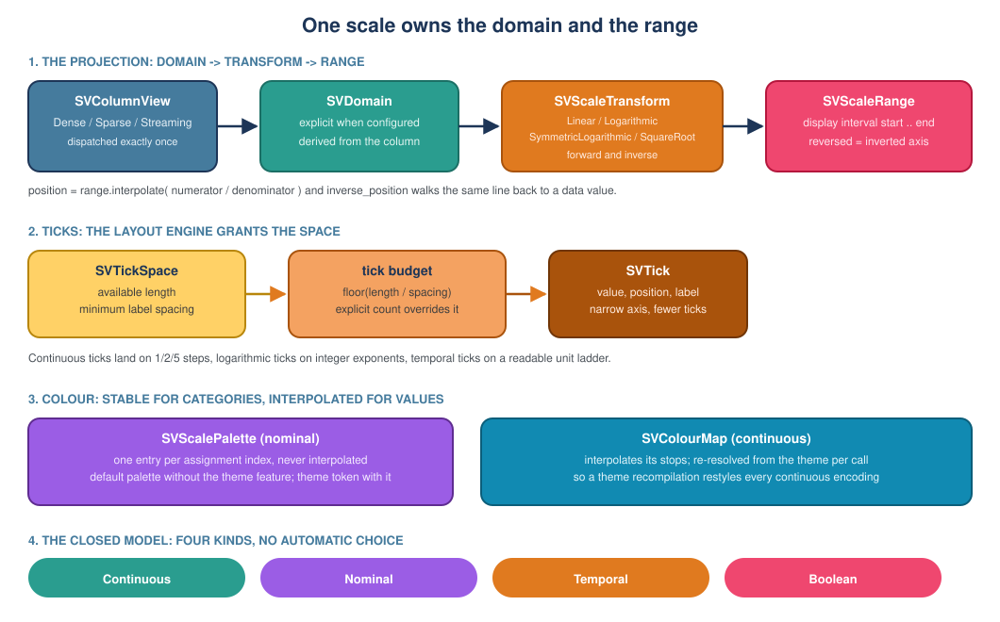

# Chapter 6 — Scales: turning data into positions, colours and ticks

> This chapter explains the kernel every chart stands on: how a data value
> becomes a position on an axis, a colour on a series, or a tick on a ruler. It
> follows the data boundary (chapter 4) and the figure substrate (chapter 5),
> and it assumes no Rust or numerical-computing background.

## 1. The problem: a number is not a pixel

Imagine a column of temperatures: `12, 15, 19, 23, 27`. A chart has to decide
where each of those numbers sits on a piece of paper. The paper is maybe 600
units wide. The data runs from 12 to 27. Somewhere, a decision has to be made:
*12 becomes 0 units, 27 becomes 600 units, and 19 becomes something in between.*

That decision is a **scale**. Without one, a chart knows the numbers and knows
the canvas, but has no bridge between them.

A scale is also the only object that knows what happens when the data moves.
A live chart receives a new maximum every second; the axis has to stretch; the
points have to slide; the tick labels have to change. If the axis and the points
each did that on their own, they would disagree — the axis would say 30 while
the points still pointed at 27. So the scale owns **both** the data interval and
the display interval, in one object. That is the first design decision of this
change:

> **D1 — Domain and range live together.**
> A change of domain reprojects every value through the same object, so a moving
> axis and the marks on it cannot disagree.

The rest of this chapter follows that object from the data to the screen.

## 2. Six words to know

**Domain.** The interval of *data* the scale covers: `12.0 .. 27.0` in the
example. It has a lower bound and an upper bound, both finite, and it is never
reversed — an inverted axis is a reversed *range*, not a reversed domain.

**Range.** The interval of *display space* the scale covers: `0.0 .. 600.0` in
the example. Reverse it (`600.0 .. 0.0`) and the axis is drawn upside down,
which is exactly how a y-axis usually works.

**Transform.** A compression applied to the domain before projecting it. A
linear transform leaves numbers alone. A logarithmic transform turns
`1, 10, 100, 1000` into evenly spaced steps, which is what a chart of values
spanning six orders of magnitude needs.

**Position.** The number the renderer actually draws: the result of projecting
a value through the transform and interpolating it into the range.

**Tick.** A labelled stopping point on an axis: the little mark plus the text
`15`. The scale derives where ticks go and what they say.

**Palette vs. colour map.** Two different colour tools. A *palette* hands out
one fixed colour per category — series A is always blue, series B is always
green. A *colour map* interpolates: a value in the middle of the domain gets a
colour between the map's first and last stops. They are separate types because
they animate differently: a palette must **never** interpolate (a series that
changes colour at every frame cannot be followed by the eye), while a colour map
**must**.

## 3. The pipeline, in one picture



The projection runs left to right: a borrowed `SVColumnView` gives a domain, the
transform compresses it, the range stretches it, and the result is a display
position. The inverse walks the same line backwards, which is how a click on a
chart becomes a data value.

Ticks are a separate hook because the *number* of ticks is not a data question.
It is a layout question: a narrow axis cannot fit ten labels. The layout engine
reports how much space it granted and how much room one label needs, and the
scale turns that into a budget.

## 4. Why four kinds, and why no "automatic"

The model is a closed enumeration, exactly as the chart contract requires
(`docs/FDRs/patterns.md`, P5):

| Kind | Consumes | Produces |
|---|---|---|
| `Continuous` | numeric values | a position, a size, an opacity |
| `Nominal` | category labels | the slot of a category, a series colour |
| `Temporal` | timestamps in milliseconds | a position on a time axis |
| `Boolean` | `true` / `false` | one of two slots |

A new kind would be a change to the kernel itself, not something a third party
adds from outside. This is the same reasoning the backend surface uses: a closed
set behind one dispatch is what lets thirty chart implementations compose into
one library.

For the same reason there is **no automatic kind**. `SVScaleBuilder::new` takes
the kind as its first argument. The library cannot look at a column and decide
whether it means seconds, dollars or categories — and guessing wrong is a silent
corruption, not a helpful default. The builder starts with a deliberate choice:

```rust,ignore
let scale = SVScaleBuilder::new(SVScaleKind::Continuous)
    .domain(0.0, 10.0)
    .range(0.0, 100.0)
    .build()?;
```

`build()` validates every option against the chosen kind. Asking a nominal scale
for a numeric transform is a configuration error, not a setting that is quietly
ignored — the tests in `builder_tests.rs` pin each of those failures.

## 5. Where the domain comes from

There are three provenances, and the scale records which one it used:

- `Explicit` — the caller configured the interval, so it never follows the data.
- `Derived` — the interval was read from the data attached to the scale.
- `Intrinsic` — the interval is the scale's own model (the category list of a
  nominal scale, the two slots of a boolean scale).

Explicit always wins. The tests assert this twice: once for the interval itself
(`an_explicit_domain_overrides_the_derived_one`) and once for the provenance
(`a_derived_domain_records_its_provenance`).

A derived domain is **rounded outwards** by default, because an axis labelled
`0.3 .. 9.7` is harder to read than one labelled `0 .. 10`. The rounding happens
in the transform's own space, so a linear scale lands on 1/2/5 steps and a
logarithmic scale lands on decades. `a_derived_domain_is_nice_by_default` walks
through the first case; `nice(false)` keeps the exact interval.

### The data boundary, honoured

The scale is the first real kernel to consume the data boundary (chapter 4), and
it follows its rules literally:

- it dispatches on `SVColumnView` **exactly once**, with the sanctioned
  `dispatch` call;
- a sparse column is scanned over its **stored entries** and is never expanded;
- a streaming column is read from the **bounded snapshot** it already carries, so
  derivation never waits for new data.

The subtle part is the sparse case. A sparse view holds only the non-zero
entries, but it also *means* something about the positions it does not store:
they are zeros. If the scale only looked at stored values, a sparse column
holding `4` at position 0 would claim a domain of `4 .. 4`, while its dense twin
`[4, 0, 9, 0]` claims `0 .. 9`. Two representations of the same data would
produce two different axes. So the derivation includes the implicit zero
whenever any position is unstored — without allocating a dense buffer:

```rust,ignore
if sparse.number_of_stored_values() < sparse.length() {
    // every unstored position is an implicit zero
    (stored_lower.min(0.0), stored_upper.max(0.0), true)
}
```

`a_sparse_column_accounts_for_its_implicit_zeros_without_densifying` checks both
halves of that sentence: the domain is `0 .. 9`, **and** the sparse view still
holds only its two stored values afterwards.

The payoff is representation parity, and this change is where the parity harness
finally gets a real kernel to prove:

```rust,ignore
let harness = SVRepresentationParityHarness::new(&DENSE_DATASET);
harness.assert_kernel_parity(|view| {
    let domain = SVDomain::from_column_view(view)?;
    vec![domain.lower(), domain.upper()]
});
```

`the_first_real_kernel_proves_representation_parity` runs the same derivation on
the dense dataset, on the sparse view derived from it, and on the rolling-window
snapshot of it. Dense against sparse must agree **exactly**; streaming is allowed
the harness tolerance. A second test, `positions_agree_across_representations`,
repeats the exercise for the projected positions, so a regression in the
projection cannot hide behind a correct domain.

## 6. Transforms, and the inverse that makes charts clickable

`SVScaleTransform` has four variants, spelled out rather than abbreviated:

| Transform | Forward | Defined on |
|---|---|---|
| `Linear` | the value itself | every finite value |
| `Logarithmic` | base-10 logarithm | strictly positive values |
| `SymmetricLogarithmic` | a sign-preserving logarithm | every finite value, including zero |
| `SquareRoot` | square root | non-negative values |

Each one answers `None` where it has no value, instead of producing a `NaN` that
would poison a whole path. That is what makes a configuration mistake a build
error: asking for a logarithmic scale on a domain that starts at zero is rejected
by `a_logarithmic_scale_rejects_a_domain_that_crosses_zero`.

The symmetric logarithm deserves a sentence of its own. A plain logarithm cannot
show negative values, but plenty of data is signed (growth rates, residuals,
profit and loss). The symmetric variant treats magnitudes below a linear
threshold of one almost linearly and compresses the rest, mirrored around zero:
`forward(-x) == -forward(x)`, and `forward(0) == 0`. That is why a chart of
signed values can still have a readable axis.

Every transform also exposes its inverse, and `an_inverse_position_restores_the_value`
walks all four through a round trip. This is not an academic property: it is what
turns a pointer coordinate back into a data value when a chart is clicked.

## 7. Colour: stable for categories, interpolated for values

The two colour tools are deliberately separate types.

`SVScalePalette` gives each category a fixed entry. The assignment index is the
order in which the category was **first seen**, and it never changes:

```rust,ignore
let alpha = scale.as_nominal().unwrap().colour("alpha")?;
scale.assign_categories(&["gamma", "alpha"])?;
assert_eq!(scale.as_nominal().unwrap().colour("alpha")?, alpha);
```

`a_nominal_scale_keeps_each_category_colour_when_categories_arrive` is the test
behind that snippet, and `a_nominal_scale_colours_by_assignment_and_not_by_display_order`
adds the second half of the rule: sorting the categories alphabetically moves
their **slots** but not their **colours**. This is design decision D3, and it is
why an animated chart stays readable.

`SVColourMap` interpolates between ordered stops. `a_colour_map_interpolates_its_stops`
checks that `0.0` is the first stop, `1.0` the last, `0.5` halfway, and that an
out-of-range or non-finite fraction never panics. `SVContinuousColourScale`
combines that map with a numeric domain and transform, so a value first becomes
a fraction of the map and only then a colour — which is why
`a_continuous_colour_scale_respects_its_transform` can assert that
`10` on a logarithmic `1 .. 100` domain lands on the middle colour.

### The theme is optional

The core crate is dependency-light on purpose, so the scale does not import the
theme crate unconditionally. It has its own small colour value, `SVSrgbColour`,
and two dependency-free defaults that mirror the default theme's colours:

- `sv_default_scale_palette()` for categories,
- `sv_default_colour_map()` for continuous colour.

With the **`theme` feature**, two constructors resolve a token instead:
`SVScalePalette::from_theme(&theme, "default")` and
`SVColourMap::from_theme(&theme, "viridis")`. The resolved map keeps the token,
and the `*_with_theme` methods re-resolve it on every call, so a theme change —
including a runtime recompilation — restyles every continuous encoding without
rebuilding the figure. That behaviour is pinned by
`a_theme_bound_map_re_resolves_against_the_theme`.

When the feature is off, asking for a theme token is not possible: the
constructors do not exist, so the compiler enforces the choice instead of a
runtime fallback that could silently pick the wrong colours.

## 8. Ticks follow the space, not the chart

Tick count is a layout decision (D4). The scale never invents one. The layout
engine hands it a `SVTickSpace`:

- how long the axis is (in display units),
- how much room one label needs.

From that the scale computes a budget — `floor(length / spacing)`, at least
one — and derives ticks that fit. `a_wide_axis_gets_more_ticks_than_a_narrow_one`
is the whole requirement in one assertion, and
`a_nominal_axis_strides_its_categories_when_the_space_shrinks` shows the nominal
version: five categories on a narrow axis become two labelled ticks, evenly
spaced.

An explicit `tick_count` overrides the budget, for a chart that has a reason to
demand a specific number; `an_explicit_tick_count_overrides_the_space` proves the
override wins even when the axis is huge.

Each kind derives its own ticks:

- **Continuous** — 1/2/5 steps in the transform's space.
- **Logarithmic** — integer exponents, so the ticks land on `1, 10, 100, 1000`.
- **Temporal** — a ladder of readable steps (milliseconds, seconds, minutes,
  hours, days, months, years), choosing the first step that fits the budget.
- **Nominal** — the category labels themselves, strided when space is short.
- **Boolean** — both slots, labelled `false` and `true` by default, or whatever
  the caller configured.

The hook is expressed as a trait, `SVTickDerivation`, so the decoration layer can
accept any scale through one bound:

```rust,ignore
fn derive(scale: &impl SVTickDerivation, space: SVTickSpace) -> usize {
    scale.ticks(space).len()
}
```

`the_layout_engine_derives_ticks_through_the_hook_trait` is the test that keeps
that interface honest.

## 9. What was deliberately left out

Three things are worth naming, because a reader will look for them:

1. **Calendar-aware time labels.** The core carries no calendar, so a temporal
   tick returns a numeric timestamp labelled in its unit (`90 min`, `2 h`). The
   decoration layer may reformat it later with a calendar; the scale does not
   pretend to know about leap years.
2. **A sticky streaming range.** The FDR leaves open a domain that only grows,
   never shrinks, to stop a live axis from jumping. It is not implemented here;
   the domain keeps following the data exactly.
3. **Calendar months as fixed steps.** The temporal ladder uses the mean month
   and year lengths, which is honest for a tick ladder but not a date
   arithmetic library.

## 10. Where to read the code

| File | What it owns |
|---|---|
| `crates/scienceview_core/src/scale/mod.rs` | The module dispatcher and the public surface |
| `.../scale/kind.rs` | The closed kinds and the closed value model |
| `.../scale/domain/` | The domain value, its derivation and its nice rounding |
| `.../scale/transform.rs` | The four transforms and their inverses |
| `.../scale/continuous.rs`, `nominal.rs`, `temporal.rs`, `boolean.rs` | The four scales |
| `.../scale/scale_definition.rs` | `SVScale`, the exhaustive dispatch |
| `.../scale/builder/` | The option surface and the validation pass |
| `.../scale/colour/` | Colour values, stable palettes, colour maps, colour scales |
| `.../scale/ticks/` | The tick hook, the budget, the formats and the per-kind derivation |

The companion `*_tests.rs` modules beside those files are the executable
specification: `kind_tests.rs` for the four kinds, `domain_tests.rs` for the
parity harness, `domain_policy_tests.rs` for explicit, derived and rounded
domains, `transform_tests.rs` for the transforms,
`colour_value_tests.rs` and `colour_map_tests.rs` for colour,
`tick_space_tests.rs` and `tick_kind_tests.rs` for ticks, and `builder_tests.rs`
for every rejection the builder performs.

The product record for this kernel is
[`docs/FDRs/core/core-scale.md`](https://github.com/neurono-ml/scienceview/blob/main/docs/FDRs/core/core-scale.md);
the engineering contract it obeys is
[`docs/FDRs/patterns.md`](https://github.com/neurono-ml/scienceview/blob/main/docs/FDRs/patterns.md).
