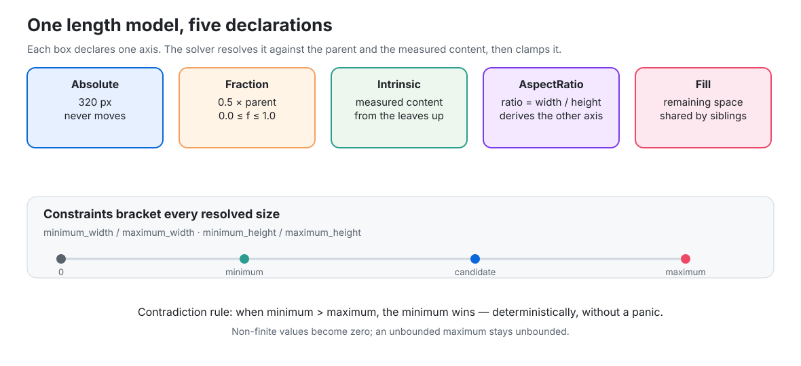
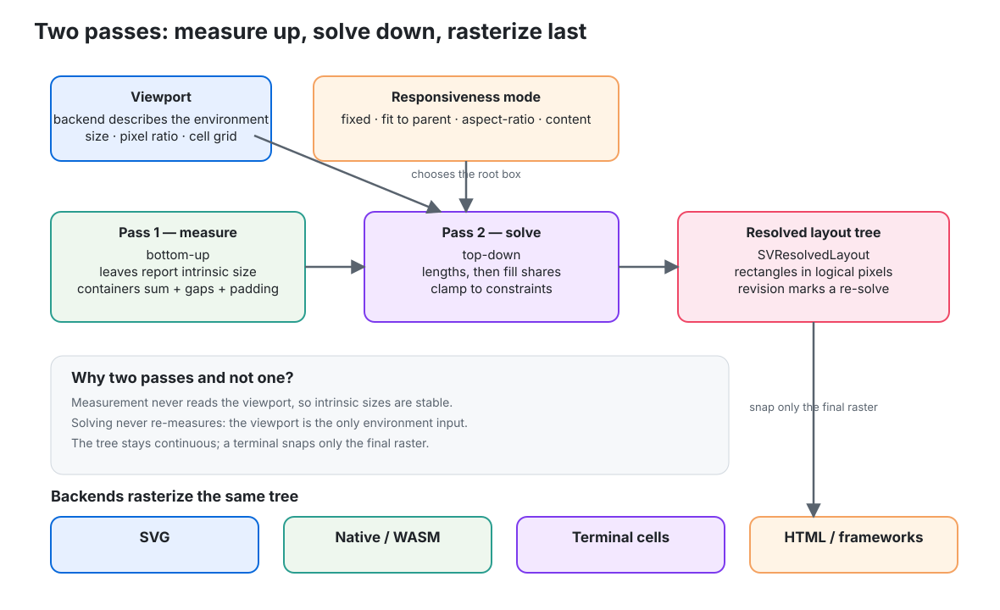

# Chapter 7 — Place before you paint: the layout solver

> This chapter explains how a `scienceview` figure gets its geometry before any
> backend draws a single pixel. It follows the layout change, the second change
> of wave 2, after the figure builder (chapter 5) and the design tokens
> (chapter 3). No Rust background is assumed.
>
> A figure is not "a picture"; it is a model with a plot area, axes, a legend
> and other decorations. Each of those needs a position and a size. If every
> backend computed them on its own, the same figure would drift between a
> browser, a native window and a terminal. The layout solver exists to make
> that impossible.

## 1. The problem: ten painters, one geometry

Imagine the same line chart rendered four ways: an SVG file, a native window, a
WebAssembly canvas and a terminal made of character cells. The plot line is the
same data. But where does the axis go? How wide is the legend? How much room
does the title take?

If the SVG backend answers those questions with one rule and the terminal
backend with another, the figure is not one figure any more. Users notice: the
axis label that fits in the browser is clipped in the terminal; the legend that
sits bottom-right in one target sits bottom-left in another. Worse, the
divergence is invisible until someone compares two screenshots.

The project drew a boundary instead:

- **one solver**, in the dependency-light core, owns all geometry;
- **each backend** supplies a *viewport* and rasterizes the solved result;
- **no backend** re-derives a position.

That is the whole contract. This chapter explains how the solver meets it.

## 2. Three words to know

**Length.** A declaration such as "320 pixels", "half of my parent", "as big as
my content needs", "twice as wide as tall" or "whatever is left".

**Measure.** A first pass that walks the tree from the leaves upward and asks:
*what size does this content intrinsically need?* Measurement never looks at
the window.

**Solve.** A second pass that walks from the root downward with the real
viewport and decides the actual rectangle of every node. It resolves lengths,
shares leftover space, and clamps everything to its constraints.

Why two passes? Because the two questions are independent. "How big is this
text?" does not depend on the window. "Where does it go?" does. Mixing them
would force a backend to know the environment while walking the tree, which is
exactly the coupling this change removes.

## 3. The length model



`SVLength` has five variants, one per way a figure can state a size:

| Declaration | Meaning | Example |
| --- | --- | --- |
| `Absolute { pixels }` | a fixed number of logical pixels | a 320-pixel-wide panel |
| `Fraction { fraction }` | a share of the parent, clamped to `0.0..=1.0` | half the window |
| `Intrinsic` | the measured content size | a title as wide as its text |
| `AspectRatio { ratio }` | derived from the opposite axis, `ratio = width / height` | a 16:9 plot |
| `Fill` | the space left after the other siblings | the plot between two fixed sidebars |

The conversion is a method, not a secret:

```rust,ignore
let half = SVLength::fraction(0.5);
assert_eq!(half.resolve_width(800.0, 0.0, 0.0), 400.0);

let wide = SVLength::aspect_ratio(2.0);
assert_eq!(wide.resolve_height(0.0, 0.0, 400.0), 200.0);
```

`SVLayoutConstraints` adds a floor and a ceiling on each axis:

```rust,ignore
let bounded = SVLayoutConstraints::unbounded()
    .with_minimum_width(200.0)
    .with_maximum_width(640.0);
assert_eq!(bounded.clamp_width(100.0), 200.0);
```

### The contradiction rule

Real configurations contradict themselves. A minimum of 300 pixels and a
maximum of 100 cannot both hold. The solver has one deterministic answer: **the
minimum wins**.

```rust,ignore
let inverted = SVLayoutConstraints::unbounded()
    .with_minimum_width(300.0)
    .with_maximum_width(100.0);
assert_eq!(inverted.clamp_width(1000.0), 300.0);
```

Nothing panics, nothing returns an error and nothing depends on iteration
order. The rule is documented in `sv_layout` and asserted by
`an_inverted_constraint_pair_lets_the_minimum_win_deterministically` in
`crates/scienceview_core/src/layout/length_tests.rs`.

Non-finite input is normalized rather than trusted: an infinite or `NaN`
length resolves to zero, while an infinite *maximum* simply means "no ceiling".
That is the second half of the totality promise.

## 4. The tree

A layout tree is built from `SVLayoutNode`s. Each node has a name, a width
declaration, a height declaration, constraints, a stacking direction, spacing,
padding and children:

```rust,ignore
let figure = SVLayoutNode::new("figure")
    .with_direction(SVLayoutDirection::Vertical)
    .with_padding(10.0)
    .with_spacing(8.0)
    .child(SVLayoutNode::new("header").with_height(SVLength::absolute(40.0)))
    .child(SVLayoutNode::new("plot").with_height(SVLength::fill()))
    .child(SVLayoutNode::new("footer").with_height(SVLength::intrinsic()));
```

The tree is pure data. Solving it does not mutate it, which makes the solver
easy to test and safe to call twice.

## 5. The two passes, in order



`SVLayoutTree` holds the root, the viewport and the cached solution.

### Pass 1 — measure

`sv_measure_tree` walks the tree from the leaves upward. A leaf reports the
intrinsic content size it declared. A container:

- sums its children along the stacking direction;
- takes the maximum across that direction;
- adds sibling gaps and its own padding.

The test `measure_sums_children_along_the_layout_direction` makes this concrete.
Two leaves measure `100×30` and `50×20`, the container is vertical, its gap is
4 and its padding 5:

- width = max(100, 50) + 2×5 = 110;
- height = 30 + 20 + 4 + 2×5 = 64.

No viewport appears in that calculation. That is the point.

### Pass 2 — solve

`sv_solve` starts with the root rectangle and walks down. For each container it
creates a content box (the rectangle minus padding), resolves each child's size
along the stacking direction, then places the children one after another with
the gap between them.

The rules, in order:

1. **The mode decides the root box** (next section).
2. **Non-fill lengths resolve first**: absolute, fraction and intrinsic sizes
   are computed and clamped to each child's constraints.
3. **Fill children share the remainder**: the leftover after the non-fill
   children and the gaps is divided equally, and the last fill child receives
   the exact remainder. That last detail is what keeps fractional layouts from
   accumulating rounding drift.
4. **Every child is clamped again** to its own constraints.
5. **The cross axis is resolved from the main axis**: an aspect-ratio
   declaration on the cross axis uses the already resolved main size.

The representative test `solve_places_a_stack_from_the_padding` uses a
800×600 viewport, 10 pixels of padding, 8 pixels of gap, a 40-pixel header, a
fill plot and a 24-pixel footer. It asserts the resolved geometry:

- header at `(10, 10)`, `780×40`;
- plot at `(10, 58)`, `780×500`;
- footer at `(10, 566)`, `780×24`.

Those numbers are not guesses; they are the executable specification.

Idempotence is also asserted. Solving the same tree twice yields exactly the
same layout (`solving_twice_yields_the_same_tree`), which matters because
backends re-solve on resize and must not get slightly different pixels each
time.

## 6. Responsiveness is declared, not inferred

`SVResponsivenessMode` names the four behaviours from the product requirements:

| Mode | What it does |
| --- | --- |
| `Fixed` | keeps its absolute size, or its measured content when a declaration is not absolute; the viewport is ignored |
| `FitToParent` | adopts the viewport size, bounded by the root constraints |
| `AspectRatioConstrained { ratio }` | fits the largest box of the ratio inside the viewport, then applies constraints |
| `ContentDerived` | uses the measured content size, bounded by the constraints |

The mode is a value on `SVLayoutTree`, so two figures with identical
declarations can still behave differently only because they *say* they do. A
fixed figure that sees a new viewport keeps its size
(`fixed_ignores_the_viewport`); a fit-to-parent figure adopts the new size
inside its constraints
(`fit_to_parent_adopts_the_new_viewport_within_its_constraints`).

For `AspectRatioConstrained`, the solver fits the largest box inside the
viewport, then bounds each axis. A constraint can therefore win over the ratio
— the test `aspect_ratio_constrained_obeys_constraints_over_the_ratio` pins
that ordering down.

## 7. The viewport and the invalidation path

A backend never describes "the environment" in general. It passes an
`SVViewport`:

- a logical width and height;
- a device pixel ratio, for physical pixels;
- a cell grid, for a terminal or any coarse raster.

```rust,ignore
let terminal = SVViewport::new(160.0, 48.0).with_cell_grid(8.0, 16.0);
assert_eq!(terminal.cells_wide(), 20);
```

The solved tree is continuous. `snap_horizontal` and `snap_vertical` round a
coordinate to the nearest cell only when a backend rasterizes, so a coarse grid
can never change the logical layout — it can only change how that layout is
painted.

The cache has an explicit invalidation path:

```rust,ignore
let mut tree = SVLayoutTree::new(root).with_viewport(viewport);
let first = tree.resolved_layout();          // revision 1
assert!(tree.set_viewport(SVViewport::new(400.0, 300.0)));
let second = tree.resolved_layout();         // revision 2
```

`set_viewport` returns `false` when the viewport did not change, so a resize
storm that repeats a size does not re-solve. `invalidate()` drops the cache
without changing the viewport. The revision on `SVResolvedLayout` gives a
backend a cheap way to know whether the geometry it is looking at is stale.

Because ticks are part of the solved space, they re-derive too. The
`readable_tick_count_along` method on `SVResolvedRectangle` answers "how many
ticks fit on this axis at this minimum spacing?" — horizontal uses the width,
vertical the height — and
`a_viewport_change_recomputes_the_tick_count` asserts that narrowing the
viewport from 800 to 200 logical pixels reduces the count from 9 to 3. The
decoration layer consumes that count instead of guessing.

The count is total like the rest of the solver: an absurdly large extent paired
with a tiny finite spacing saturates at the largest representable count instead
of overflowing or wrapping to zero, and the test
`an_enormous_extent_saturates_instead_of_overflowing` in `resolved_tests.rs`
pins that boundary down.

## 8. Spacing comes from the theme, but never requires it

Spacing is layout data whose values belong to the design system. The theme
supplies the scale:

```rust,ignore
let tokens = sv_default_theme().tokens();
let spacing = SVLayoutSpacing::from_theme_tokens(&tokens);
```

That constructor exists only with the `theme` feature. Without the feature —
and whenever a caller does not pass a theme — `SVLayoutSpacing::built_in()`
provides the documented defaults: an 8-pixel gap and 16-pixel padding. The
test `theme_tokens_seed_the_same_default_scale` proves the two paths agree for
the shipped theme, so a default build and a themed build do not diverge.

The `theme` feature was added to `scienceview_core` for exactly this bridge,
and the root facade's `theme` feature enables it together with the theme crate.

## 9. Why not the alternatives?

- **Per-backend layout.** The quickest first backend, and the reason the
  terminal would disagree with the SVG. Rejected.
- **Single-pass layout while drawing.** Fewer allocations, but a backend would
  need the environment while walking the tree. Rejected.
- **A CSS-style constraint solver in the core.** Powerful, but a large
  dependency and far more than a figure tree needs. Rejected in favour of the
  explicit two passes.
- **Errors for contradictory constraints.** A layout is not a request that can
  be rejected: the backend must draw something. Clamping deterministically —
  minimum wins — is more useful than failing a render.

## 10. The property tests: the rules hold for *any* tree

Unit tests cover specific trees. The module `property_tests.rs` covers
thousands of shapes generated by a tiny deterministic generator (a linear
congruential generator, so a failure can be replayed from its seed without
adding a dependency).

`random_trees_always_satisfy_their_constraints` builds trees up to depth three
with random lengths, constraints (including inverted ones), directions,
padding and spacing, then walks the tree and the solved tree together. For
every node it asserts:

- the resolved size is finite and non-negative;
- `constraints.clamp_width(size) == size` and the same for the height — which
  is exactly the statement "the result respects the bounds, and the minimum
  wins when they contradict".

It runs over 64 seeds and both responsive and content-derived trees.

`fractional_children_never_accumulate_rounding_drift` builds horizontal trees
with 1 to 17 equal fractional children and asserts the widths add up to 1000
within `1e-9`. That is the guarantee behind the last-fill-child remainder rule.

## 11. What the next chapters inherit

The solver is deliberately narrow: it returns rectangles and a tick count, and
nothing else. The decoration change consumes the solved tree to place axes,
labels, legends and colour bars. The backends consume it to rasterize. Because
the solver is backend-independent, all of them can be tested against the same
numbers — and the terminal can keep agreeing with the browser.
