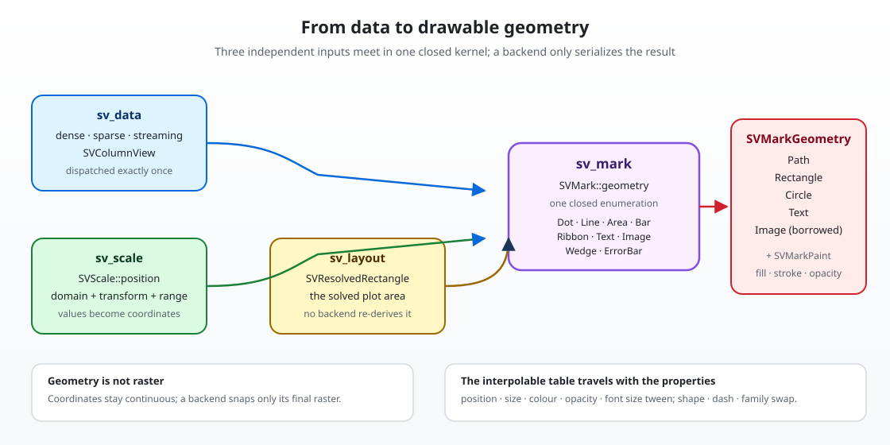

# Chapter 8 — Marks: the geometry every recipe draws with

> This chapter explains `SVMark`, the closed vocabulary of shapes a figure is
> built from. It follows the mark change, the first change of wave 3, after the
> data boundary (chapter 4), the scale kernel (chapter 6) and the layout solver
> (chapter 7). No Rust background is assumed.
>
> A recipe such as a scatter plot or a histogram decides *what* to draw. It does
> not decide *how a dot looks*. That second question is answered once, here, so
> that thirty recipes and ten rendering backends cannot disagree about it.

## 1. The problem: thirty recipes, ten backends, one dot

Picture a scatter plot in a browser, the same scatter plot in a native window
and the same scatter plot in a terminal. The data is identical and the scales
are identical, but the dot is drawn three times: as an SVG `<circle>`, as a
rasterized disc and as a `•` glyph in a character cell.

If each of those implementations also decided the dot's radius, colour, opacity
and shape, the three pictures would diverge the first time someone changed a
default. The project drew a boundary instead:

- **the mark kernel** turns display-space values into backend-independent
  geometry;
- **a backend** serializes or rasterizes that geometry, and re-derives nothing;
- **a recipe** composes a mark with data, scales and moves, and never
  implements geometry of its own.

This chapter is about the middle box.

## 2. Three ideas to learn first

**A mark is geometry plus paint, never data.** A dot's shape is geometry; its
fill and stroke are paint. A mark receives *values already placed in display
space* — a pair of coordinates, not a column of measurements and not a scale.
Keeping data out is what lets the same mark serve every recipe and lets a live
figure redraw an existing mark when a stream pushes a new sample.

**Display space is continuous.** The coordinates a mark produces are logical
pixels, not character cells and not device pixels. A terminal will snap them to
its grid, a retina screen will multiply them by the device pixel ratio, and
neither decision reaches the mark. This is the same "solve once, rasterize
last" rule the layout solver established in chapter 7.

**The vocabulary is closed.** There are exactly nine marks. A recipe never adds
a tenth, and a backend never receives a mark it cannot name. If a new shape is
genuinely needed, that is a change to the core kernel with its own
specification — not a quiet addition inside one chart.

## 3. From data to something drawable



The picture shows the four inputs and the one output:

| Stage | Owns | Arrives at the mark as |
| --- | --- | --- |
| data boundary | dense, sparse or streaming storage | `SVColumnView` |
| scale kernel | domain, transform, range | `SVScale` |
| layout solver | the solved plot rectangle | `SVResolvedRectangle` |
| theme | default size, colour, opacity, typography | `SVMarkTheme` |

The mark calls `SVScale::position` for every value, places the resulting pair
inside the solved rectangle and formats the result as primitives. That is the
entire pipeline, and it is deliberately short: every stage before it has
already made its decision.

```rust,ignore
let request = SVMarkRequest::new(
    SVColumnView::Dense(&horizontal_values),
    SVColumnView::Dense(&vertical_values),
    &horizontal_scale,
    &vertical_scale,
    SVResolvedRectangle::new(0.0, 0.0, 100.0, 100.0),
);

let mark: SVMark = SVMark::dot().shape(SVDotShape::Triangle).into();
let geometry = mark.geometry(&request)?;
```

## 4. The closed vocabulary

`SVMark` is one enumeration with nine variants. Each variant carries its own
option struct, and each struct is assembled with the same builder style the
rest of the library uses:

| Variant | Option surface |
| --- | --- |
| `Dot` | shape, size, size mode (diameter or area), stroke width, fill mode |
| `Line` | width, dash pattern, join, cap, simplification tolerance |
| `Area` | baseline (`Zero`, `Minimum`, `Maximum` or an explicit value), opacity |
| `Bar` | orientation, width fraction, corner radius, baseline, group gap |
| `Ribbon` | boundary (`Both`, `Upper`, `Lower`), opacity |
| `Text` | font family, size, horizontal align, vertical baseline, format |
| `Image` | interpolation, opacity, tint (the recipe has already mapped values to pixels) |
| `Wedge` | start angle, end angle, inner radius (zero is a pie sector), radius |
| `ErrorBar` | direction, cap size, stroke width |

Two of those deserve a note.

**The error bar is a mark, not a helper.** Bar charts, point plots and
regression plots all need an interval segment. Making it a private helper would
have produced three divergent implementations with three opinions about caps;
making it a mark gives all three recipes one implementation.

**The image mark does not own a colour map.** A heatmap recipe maps values to
pixels and hands the mark an already-mapped raster. That keeps `Image` reusable
for an actual photograph, and it keeps the colour decision where the data is.

Every variant gets a `From` conversion into `SVMark`, so a recipe can write
`let mark: SVMark = SVMark::bar().group_gap(0.1).into();`.

## 5. The data boundary, honoured once

Representation parity is a project-wide rule (chapter 4): dense, sparse and
streaming data must produce the same picture. A mark does not re-implement the
three cases in each of its nine builders. It resolves the representation once,
in `SVColumnAccessor`:

```rust,ignore
pub(crate) fn resolve(view: SVColumnView<'a>) -> Self {
    view.dispatch(Self::Dense, |sparse| Self::Sparse(*sparse), |streaming| {
        Self::Streaming(*streaming)
    })
}
```

Three properties follow from that shape:

- **dispatch happens exactly once** per column: every later read is a plain
  match on the already-resolved accessor;
- **sparse storage is never densified**: a sparse read answers from its stored
  entries, and an unstored position is its implicit zero — the same value the
  dense twin holds, which is exactly why the two drawings agree bit for bit;
- **a stream never blocks**: a streaming read uses the bounded snapshot the
  window already carries, so drawing a live figure returns immediately with
  whatever data has arrived.

Once both channels are resolved, `sv_plot_positions` places every pair through
the two scales. A length mismatch is a value — `SVError::MismatchedLengths` —
never a panic.

### The nominal-axis rule

A mark places *numeric* values. A category axis is drawn by placing the
category's slot number through a numeric slot scale. Handing a mark a nominal
scale therefore reports that scale's own configuration error instead of
inventing a placement. The recipe chooses the slot scale; the mark stays
ignorant of labels.

## 6. What comes out: primitives, not pixels

The result of `SVMark::geometry` is an `SVMarkGeometry`, a list of primitives:

| Primitive | Used by |
| --- | --- |
| `SVGeometryPath` (move, line, arc, close) | line, area, ribbon, polygon dots, wedge, error bar |
| `SVGeometryRectangle` with a corner radius | bar, square dot |
| `SVGeometryCircle` | circle dot |
| `SVGeometryText` | text |
| `SVGeometryImage` | image |

The path vocabulary is intentionally tiny. Three commands plus "close" cover
every mark in the closed set, and each maps to one instruction in a serialized
format — which is what "an SVG backend serializes without extra logic" means in
practice.

Two design details matter for correctness:

- **the image primitive borrows its pixels.** `SVGeometryImage<'a>` holds a
  slice, never an owned buffer, so a large heatmap is not copied into the
  geometry.
- **nothing is snapped here.** A circle keeps its exact radius and a path keeps
  its exact coordinates; grid snapping belongs to the backend's rasterization
  step.

Paint travels beside each shape in `SVMarkPaint`: fill colour, stroke colour,
stroke width, opacity, dash pattern, join and cap. Separating paint from shape
is what makes animation expressible (section 9).

## 7. Defaults from the theme, overrides from the caller

No mark hard-codes a colour or a size. `SVMarkTheme` carries the defaults under
the token names the Feature Description Record records:

| Token | Default |
| --- | --- |
| `mark.size` | 6 logical pixels |
| `mark.line_width` | 1.5 logical pixels |
| `mark.area_opacity` | 0.35 |
| `mark.palette` | the theme's accent colour |
| `text.font` | `system-ui` |
| `text.size` | 12 logical pixels |
| `text.colour` | the theme's text colour |

With the `theme` feature enabled, `SVMarkTheme::from_theme` reads the typography
family, the body size, the text colour and the default categorical palette from
a compiled theme. The theme stylesheet does not carry `mark.*` tokens yet, so
those three values keep the documented built-ins until it does — the bridge is
in place and the note is written down rather than hidden.

An explicit option always wins:

```rust,ignore
let mark: SVMark = SVMark::dot().colour(explicit_red).opacity(0.25).into();
```

That precedence is itself a test: `an_explicit_colour_overrides_the_token` and
`an_explicit_opacity_overrides_the_token` assert it, while
`a_theme_changes_every_default_a_mark_uses` proves that changing the theme
changes the dot radius, the line width, the area opacity, the text family, the
text size and the text colour in one go.

## 8. Fail at build time, not at render time

An option that cannot be honoured is rejected by `SVMark::validate`, which a
recipe calls while building — before a single pixel exists. Examples the tests
pin down:

- a stroked dot with a stroke width of zero (`a_stroked_dot_needs_a_stroke_width`);
- a mark size declared as `Intrinsic` or `Fill` — a mark has no layout parent
  to resolve those against (`a_dot_size_must_be_a_resolvable_positive_length`);
- a bar width or group gap outside `0.0..=1.0`, including a gap of exactly one,
  which would leave the bar with no width;
- a dash sequence with an odd number of segments, a negative segment or a
  non-numeric token (`a_dash_pattern_is_parsed_and_validated`);
- a ribbon or error bar without its lower or upper channel;
- an image raster whose byte count does not match its declared size;
- a wedge whose inner radius is not below its radius.

Every one of those returns `SVError::InvalidConfiguration` with a message that
says what to fix. Nothing panics, and nothing silently degrades.

Contrast this with a trait-per-mark design, where a backend that cannot express
a wedge discovers it at render time. Here the backend declares the missing
capability in its matrix and the build stops with
`SVError::UnsupportedBackendCapability` — the same error model chapter 5
established.

## 9. The interpolable table belongs where the properties live

Wave 5 adds transitions: a mark that moves from one state to another animates
instead of jumping. A transition can only animate what the mark kernel says may
be animated, so the table is declared next to the properties:

| Property | Interpolable | Why |
| --- | --- | --- |
| position | yes | linear between two display positions |
| size | yes | a radius can grow |
| colour | yes | colours blend |
| opacity | yes | a fade is a number |
| shape | no | a triangle becoming a square is a swap |
| dash pattern | no | a pattern has no meaningful midpoint |
| font family | no | a typeface is not a number |
| font size | yes | text can grow |

`sv_mark_property_table()` exports the table in the recorded order, and
`SVMarkProperty::is_interpolable` answers for one property. The transition
kernel consumes this declaration instead of keeping a second copy that could
drift.

## 10. The tests are the specification

The companion modules next to the implementation are the executable version of
this chapter.

**`geometry_tests.rs`** draws each variant once and asserts the primitive it
produced: a dot is a circle at the scale position, a line is one open path, an
area closes against the zero baseline, a bar has the requested fraction of the
slot width, a ribbon fills between its boundaries, a text run carries the
formatted value, an image borrows its raster, a wedge switches from one arc to
two when the inner radius appears, and an error bar draws its interval with
caps.

**`option_tests.rs`** exercises the option surface and its validation, including
the dash parser, the four area baselines, the bar orientation, the text formats
and the wedge radii.

**`paint_tests.rs`** proves the theme precedence in both directions.

**`parity_tests.rs`** is the one to read twice. It builds the same mark from
dense, sparse and streaming columns, asserts dense and sparse are *exactly*
equal and every representation combination agrees, feeds the mark kernel to the
project's representation-parity harness, checks that a short window draws what
it holds, and finally builds the same mark from shared views on four threads:

```rust,ignore
std::thread::scope(|scope| {
    for _ in 0..4 {
        scope.spawn(move || {
            let geometry = SVMark::from(SVMark::dot()).geometry(&request)?;
            assert_eq!(&geometry, reference);
        });
    }
});
```

A mark holds no interior state, borrows its inputs and allocates only the
geometry it returns; that is why sharing it across threads needs no lock.

## 11. Roads not taken

**A trait with one implementation per mark.** Extensible, and wrong for this
boundary: a plugin could add a variant no backend dispatches on, and exhaustive
matching — the mechanism that turns "unsupported mark" into a build error —
would disappear.

**Marks that own their data.** Convenient at first, catastrophic later: every
recipe would re-implement scale resolution, an axis could disagree with the
marks drawn on it, and a streaming update would re-run statistics instead of
redrawing geometry.

**Marks that resolve their own scales.** The same problem one step smaller, and
it duplicates chapter 6's kernel.

**A separate `SVTransitionProperty` enum.** A second copy of the same eight
properties, kept in sync by hope. The table lives here instead.

## 12. What comes next

With marks in place, wave 4 can implement the statistical transforms that
produce their inputs, the positional moves that arrange them and the SVG
backend that serializes their primitives. Wave 5 adds transitions and
animations, which consume the property table defined above. The recipes, in
wave 6, finally compose all of it — and none of them will contain a single line
of geometry.


