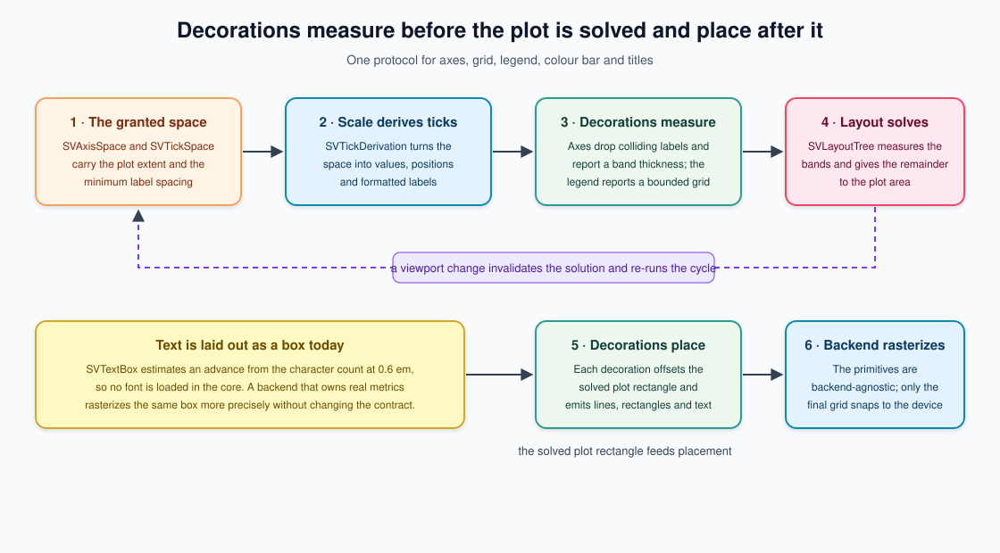

# Chapter 9 — Decorations: axes, legends and the two-pass cycle

A chart is not only its marks. The dots of a scatter plot say *where* values
are, but the axes say *what the values mean*, the ticks say *how much*, the
legend says *which series*, and the colour bar says *which colour is which
number*. Without those objects, a figure is a picture of unlabelled ink.

This chapter tells the story of `sv_decoration`, the core module that owns
those objects. It explains why decorations had to wait for the layout solver
and the scale kernel, how the measure/solve cycle makes an axis draw fewer
ticks in a narrow space, what a legend entry *is* as a model object, why the
colour bar is literally the same scale the cells use, and why the core measures
text as a box instead of loading a font. Every claim is grounded in the code
under `crates/scienceview_core/src/decoration/` and in its `*_tests.rs`
companions.



## Why decorations came third

Two earlier changes had to land first, and the order matters.

The **layout solver** (chapter 7) established that a figure is resolved in two
passes: the content is measured bottom-up, then the viewport is solved
top-down, and the solver hands back rectangles in a backend-independent
coordinate system. The **scale kernel** (chapter 6) established that a scale
owns its domain and range together and that the number of ticks is a *layout*
decision: `SVTickSpace` takes the length granted to the axis and the minimum
spacing a label needs, and divides to obtain a budget.

A decoration is precisely the object that sits between those two kernels. It
needs the scale to know what to write, and it needs the layout to know how much
space it has. Neither can be faked beforehand. That is why this change is wave
three in the change grid, after both.

The other reason decorations are a shared module instead of something each
backend draws itself: ten rendering backends each drawing their own axes would
be ten places where an axis can disagree with the marks beside it. The
decoration kernel makes one axis and lets each backend rasterize it.

## The two-pass protocol, from zero

Imagine you are laying out a page by hand. You pick up the x-axis title, ask
"how tall is this line at this font size?", and put a sticky note on the page:
*reserve this much height*. You do the same for the tick labels and the title.
Only when every decoration has claimed its space do you draw the plot area in
whatever is left. Then — and only then — you go back to each sticky note and
write the labels in their final positions.

That is the protocol. Every decoration has two methods with the same shape:

- `measure(...)` returns a measurement: the intrinsic size it needs (an axis
  band thickness, a legend width and height, a title line height) plus the
  content it will later draw (the ticks that fit, the measured entry boxes).
- `place(rectangle, ...)` receives the rectangle the solver returned and emits
  the final geometry.

For an axis, the measurement is `SVAxisMeasurement`:

```rust
pub struct SVAxisMeasurement {
    side: SVAxisSide,
    ticks: Vec<SVAxisTickMeasurement>,
    band_thickness: f64,
    title_box: Option<SVTextBox>,
}
```

The thickness is what the solver consumes. `SVAxis::layout_node` turns the
measurement into an `SVLayoutNode`: a vertical axis declares its band as width
and fills the height, while a horizontal axis declares its band as height and
fills the width. The node carries the measurement as its *intrinsic* size, so
the solver does not re-measure the decoration.

The test `measurement_feeds_the_layout_tree_and_placement_uses_the_solved_rectangle`
in `axis/axis_placement_tests.rs` proves the wiring end to end: it builds a
figure node with a plot child and an axis child, solves it, asserts that the
axis node's height equals the measured band thickness, and then places the
axis against the solved plot rectangle. The decoration is a layout participant,
not a post-processing step.

## Ticks: the count is a layout decision

The scale kernel exports a trait, `SVTickDerivation`, and a structure,
`SVTickSpace`. The axis does not decide how many ticks to draw. It builds the
space from what the layout granted and lets the scale derive the ticks:

```rust
let tick_space =
    SVTickSpace::new(space.plot_extent(), self.resolved_minimum_tick_spacing(style))?;
let ticks = self.derive_ticks(scale, tick_space);
```

The default minimum spacing is a documented multiple of the label font size:
four em-widths for a horizontal axis (room for a label and the gap beside it)
and one and a half line heights for a vertical axis. A caller can pin it with
`SVAxisBuilder::minimum_tick_spacing`.

`narrow_axis_draws_fewer_ticks_than_wide_axis` in `axis/axis_tests.rs` asserts
exactly the scenario the layout-engine spec describes: the same scale measured
against 80 logical pixels yields fewer ticks than against 400, and the narrow
axis still has at least one readable tick.

The count alone is not enough. Two labels can each fit in the budget and still
collide because the *first* is wide. The collision pass in `axis/labels.rs` is
deliberately simple and deterministic: iterate the ticks in position order,
compute each label's half extent along the axis (half its width horizontally,
half its height vertically), and keep a label only when its start is at least
the previous kept label's end plus half the style gap.

Two tests pin that property. `horizontal_axis_labels_never_overlap` and
`vertical_axis_labels_never_overlap` force a tiny minimum spacing, place the
axis, and assert that consecutive label rectangles do not touch. Because the
pass is greedy and ordered, the same data and viewport always keep the same
ticks — determinism is a property, not a coincidence.

## Labels are formatted, never concatenated

`SVScale` already knows the difference between a continuous value and a
timestamp. The axis passes an `SVTickFormat` through to the scale:
`Automatic` for the shortest reasonable representation and `Fixed(n)` or
`Integer` when the caller knows the unit. `temporal_axis_labels_use_the_temporal_format`
checks that a temporal axis labels its ticks with the unit suffix from the
scale's temporal ladder (`"1 d"`, not `"86400000"`), while
`explicit_tick_format_pins_the_decimals` checks that `Fixed(2)` produces exactly
two decimals. The date axis and the numeric axis share one machinery; only the
format differs.

Degenerate data is a first-class case, not an error. `degenerate_domain_draws_a_single_tick`
builds a domain where both bounds are `5.0`; the scale yields one tick at the
middle and the axis draws one. `nominal_axis_ticks_are_the_category_labels`
checks that a categorical axis labels slots with their category names, exercising
the stride that keeps a crowded category axis readable.

## Grid lines share their ticks' coordinates

The grid is the simplest decoration: it reserves nothing and draws lines at the
tick positions of the placed axes. It does not own a scale. `SVGrid::place`
takes the optional horizontal and vertical `SVAxisPlacement` values and reads
`tick_positions()`, so a grid line and its tick physically cannot disagree.

`grid_lines_share_the_tick_coordinates` asserts the equality of the two
coordinate lists, not just that lines were drawn. `a_grid_without_axes_reserves_nothing_and_draws_nothing`
pins the degenerate case: zero measurement, zero primitives.

## The legend is a model, not a row

A legend looks like a list of rows, but it is really a list of *series*. Each
`SVLegendEntry` carries the stable series key, the label, the colour the
encoding assigned and the visibility flag. `SVLegend` owns those entries and
follows their lifecycle:

- `add_series` returns `true` when an entry entered and `false` when an
  existing series was updated in place, keeping its position;
- `remove_series` returns the removed entry, so a caller can animate its exit;
- `set_visible` flips the hidden state without removing the entry, and refuses
  an unknown key instead of silently creating one.

`a_hidden_series_keeps_its_entry_and_reflects_the_state` is the spec scenario:
the hidden series still appears, but its swatch is drawn translucent and its
label muted, so the reader can see *that* it is hidden.

Many series must not blow up the layout. The legend bounds itself: it draws at
most `maximum_number_of_entries` rows and wraps them into at most
`maximum_number_of_rows` columns, and the final row summarizes the rest as
`+N more`. `many_series_produce_a_bounded_deterministic_layout` adds one
hundred series, measures twice, asserts the two measurements are equal, asserts
the drawn count plus the overflow count equals the entry count, and asserts the
width stays finite and under 400 logical pixels. `the_overflow_row_summarizes_the_remaining_series`
checks the exact summary string.

Placement keeps the entry rectangles, so an interactive layer can hit-test a
click on a swatch and toggle visibility without re-deriving the geometry.

## The colour bar is a scale view

The colour bar could have been a gradient image with hand-written numbers.
Instead it holds the very `SVContinuousColourScale` the cells use. Each band's
colour comes from that scale's colour map at the band's midpoint:

```rust
let fraction = (index as f64 + 0.5) / number_of_bands as f64;
let colour = colour_map.colour_at(fraction);
```

`every_band_colour_agrees_with_the_colour_scale` asserts that equality for
every band against `SVContinuousColourScale::colour_map().colour_at(fraction)`.
`changing_the_colour_map_changes_the_bar` builds two bars over identical
domains with different maps and asserts their primitive lists differ. The bar
cannot drift from the encoding because there is only one encoding object.

The bar's ticks come from the same kernel as an axis: it rebuilds a continuous
scale over the same domain and transform, with the bar length as the range, and
calls `SVTickDerivation`. That is why a horizontal bar and a vertical bar share
one tick implementation and one collision pass. `a_degenerate_domain_draws_a_readable_bar`
covers the single-valued scale, and `the_bar_spans_the_domain_of_its_scale`
asserts every tick position stays inside the granted length.

## Titles, captions, and why text is a box

The core does not load a font. Loading and rasterizing glyphs is a backend
concern — SVG has text elements, a terminal has cells, a native renderer has its
own rasterizer — and a core font dependency would drag a font engine into every
consumer.

So `SVTextBox` measures a label as a box: the character count times a
documented advance factor (0.6 em) times the font size. That is enough to
reserve space, to avoid collisions and to place a label. A backend with real
metrics draws the same box more precisely without changing the layout
contract. `multibyte_characters_count_once` pins that the estimate counts
characters, not bytes, and `a_malformed_metric_falls_back_to_a_measurable_box`
pins that a `NaN` font size never produces a non-finite layout.

`SVTitle` wraps one box with a role. `Title` is title-sized, bold and primary;
`Subtitle` and `Caption` are body-sized, regular and muted.
`a_title_is_large_bold_and_primary` and
`a_subtitle_and_a_caption_are_body_sized_and_muted` read the emitted text
primitive and assert its size, weight and colour. A vertical axis title is a
rotated text primitive (-90 degrees), which the backend applies when it
rasterizes.

## Themed, with documented defaults

Decorations never read a token name. They read `SVDecorationStyle`, which is
either `built_in()` or `from_theme_tokens(&tokens)`.

With the core `theme` feature enabled, the style copies the theme's semantic
colours, the three type sizes, the weights, the line height and the spacing
tokens. Without the feature, `built_in()` mirrors the same values as constants,
so a default build produces the same decorations as a themed build and imports
no stylesheet compiler. No second `theme` feature was added; the existing one is
reused. `the_built_in_style_mirrors_the_default_theme` asserts the two
constructions are equal under the feature, and `a_themed_style_adopts_the_tokens`
asserts the style adopts specific token values.

## Backend-agnostic primitives

`place` never writes SVG or terminal escape codes. Every decoration emits
`SVDecorationPrimitive` values:

- `Line { start, end, stroke }` for axis lines, tick marks and grid lines;
- `Rectangle(SVRectanglePrimitive)` for legend swatches and colour bands;
- `Text { position, text, font_size, weight, colour, anchor, rotation_degrees }`
  for every label and title.

The primitive carries geometry, colour and metrics only. A backend converts
them to its own notation and snaps only the final raster to its device grid.

## Parity and concurrency

Decorations touch data only through the scale, and the scale already guarantees
representation parity. `dense_sparse_and_streaming_data_produce_the_same_axis`
builds three scales from the same values — a dense slice, a sparse view with
implicit zeros and a streaming snapshot — and asserts the three axis
measurements are identical. There is no densification and no blocking: the
decoration never sees the storage.

Decorations are immutable models, so measuring and placing them from many
threads is safe. `concurrent_legend_measurement_and_placement_is_deterministic`
and `concurrent_colour_bar_measurement_is_deterministic` run eight threads
against a shared `Arc` and assert every result equals the single-threaded one.

## What this chapter asks you to remember

1. **Measure, then solve, then place.** A decoration reserves space before the
   plot area exists and draws only after the solver returns a rectangle.
2. **The tick count belongs to the layout; the tick values belong to the
   scale.** `SVTickSpace` is the handshake.
3. **A legend entry is a series object.** It enters, leaves and keeps the
   hidden state, which is what makes an animated legend possible.
4. **The colour bar is a view of its scale.** One encoding object, no drift.
5. **Text is a box until a backend owns glyphs.** The layout contract does not
   change when real metrics arrive.
6. **Theme tokens are the only styling input,** with documented built-in
   defaults when the feature is off.

The chapter on the mark vocabulary explains what is drawn *inside* the plot
rectangle these decorations frame.
