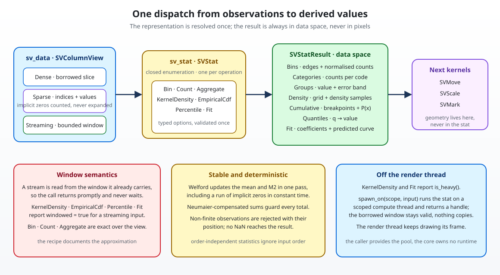

# Chapter 10 — Statistical transforms: what the chart says about the data

A scatter plot draws every observation it is given. A histogram does not. It
first *bins* the observations, counts how many fall into each interval, and
draws those counts. A box plot computes quartiles, a density plot estimates a
distribution, a regression plot fits a curve. Between the data and the mark,
there is a computation that turns observations into derived values.

This chapter tells the story of `sv_stat`, the core module that owns that
computation. It explains why the statistical transforms are a separate kernel
instead of code inside each chart, how one column can be dense, sparse or a
live window and still produce the same histogram, why a density over a stream
is honestly labelled *windowed*, and how the kernel stays numerically stable
without pulling a statistics crate into the core. Every claim is grounded in
the code under `crates/scienceview_core/src/stat/` and in its `*_tests.rs`
companions.



## Why a stat kernel came before the distribution charts

The change grid puts `statistical-transforms` in wave four, after the data
boundary (chapter 4), the scales (chapter 6) and the marks (chapter 8). The
order is not arbitrary.

The **data boundary** established that a kernel receives exactly one of three
representations — dense, sparse or streaming — and dispatches on it exactly
once. It also established the parity harness: one dataset, three views, one
answer. A histogram is the first real consumer of that rule. If binning lived
inside each chart, nine distributional recipes would each re-implement sparse
handling and each could get it subtly wrong.

The **scale kernel** established that a value becomes a position only inside a
scale. That is why a stat never returns pixels. It returns bin edges, counts,
coefficients and density samples in **data space**; the recipe then hands
those to `SVMove`, `SVScale` and `SVMark`. This separation is design decision
D3 of the change: a statistical kernel stays backend-independent and can be
tested without a renderer.

The **mark kernel** established that a mark owns geometry and paint, never
data. It expects values, not questions. The stat kernel is what answers the
question first.

## The closed set, and why exactly one stat per operation

`SVStat` is a closed enumeration (patterns P5) with exactly seven variants:

| Variant | Question it answers |
| --- | --- |
| `Bin` | How many observations fall into each interval? |
| `Count` | How many observations have each category? |
| `Aggregate` | What is the mean (or median, sum, min, max, deviation, count) per group? |
| `KernelDensity` | What does the distribution look like, smoothly? |
| `EmpiricalCdf` | What fraction of observations is at most each value? |
| `Percentile` | Which values bound the requested fractions? |
| `Fit` | Which curve describes the relationship between two columns? |

A recipe composes **one** variant per operation. Stats do not compose in one
pass: "bin, then take the median of the counts" is a different computation
from "take the median, then bin", and a derived view that silently mixed them
would be impossible to test or to animate. Design decision D1 fixes the
composition at one stat, applied once.

Each variant carries its own typed options. `SVBinOptions`, `SVCountOptions`,
`SVAggregateOptions`, `SVKernelDensityOptions`, `SVEmpiricalCdfOptions`,
`SVPercentileOptions` and `SVFitOptions` are assembled through builders and
validated when the stat is applied. An invalid configuration is an `SVError`,
never a silent degradation: a negative bandwidth, a quantile outside `[0, 1]`
or a polynomial with degree zero all fail before a single observation is read.

```rust
use scienceview_core::sv_data::SVColumnView;
use scienceview_core::sv_stat::{SVBinOptions, SVNormalisation, SVStat, SVStatInput, SVStatResult};

let values = [1.0, 2.0, 2.0, 3.0, 4.0];
let stat = SVStat::bin(
    SVBinOptions::new()
        .bin_count(2)
        .normalise(SVNormalisation::Probability),
);

match stat.apply(SVStatInput::new(SVColumnView::Dense(&values))) {
    Ok(SVStatResult::Bins(bins)) => assert_eq!(bins.counts(), &[0.4, 0.6]),
    other => panic!("the bin stat produces bins: {other:?}"),
}
```

## One column, three representations

Every stat reads its columns through `SVColumnView::dispatch`, so the
representation is resolved exactly once per column. The interesting part is
what happens *after* the dispatch.

### Sparse storage is counted, not expanded

A sparse view stores only its non-zero entries; every other logical position
is an implicit zero. The naive implementation would build a dense buffer full
of zeros and then bin it. That is exactly what the data boundary forbids.

Instead, the kernel reads the stored entries and asks the sparse view how many
implicit zeros it carries. Binning adds the stored values one by one, then adds
the whole zero multiplicity to the bin that contains zero:

```text
stored: (1, 2.0), (3, 4.0)          implicit zeros: 4
edges:  [0, 3, 5]

bin 0 ← 2.0, and 4 implicit zeros   → 5
bin 1 ← 4.0                         → 1
```

`a_sparse_column_counts_its_implicit_zeros_without_expanding` in
`bin_tests.rs` asserts exactly that. The same idea, with a multiplicity instead
of a single visit, powers counting: `a_sparse_column_counts_its_implicit_zero_category_in_data_order`
asserts that the zero category appears first and carries the correct count.

### Streaming storage is a window, never a wait

A streaming view already carries a bounded snapshot. The kernel reads that
snapshot and returns; it never asks the producer for more and never waits.
`a_streaming_column_is_binned_over_its_current_window` builds a view whose
sequence number is far ahead of its three retained samples and asserts that the
counts describe those three samples.

For the kernels whose mathematics needs the whole dataset — density, CDF,
percentile and fit — the result carries an explicit `windowed` flag. A density
over an unbounded stream is not the density of the data; it is the density of
the current window, and the API says so. `a_streaming_percentile_reports_that_it_is_windowed`
and `a_streaming_density_reports_that_it_is_windowed` pin the contract.

### Parity is asserted, not assumed

The parity harness from chapter 4 is adopted directly by the binning kernel.
`the_binning_kernel_agrees_across_the_three_representations` replays one
dataset through a dense slice, sparse storage and a rolling window, and asserts
that the counts are identical. A second test shrinks the window and compares
against the retained tail. Dense against sparse must be **exact**, because the
same `f64` values sit at the same positions; dense against streaming uses the
documented tolerance of one part in a trillion.

`a_sparse_count_never_densifies_its_input` adds a second guard: ten logical
positions with two stored entries produce a zero category of eight
observations, and no dense buffer exists at any point.

## Binning from zero

A histogram answers "how many values fall between `a` and `b`?" The kernel
needs three things: edges, membership, and normalisation.

**Edges.** Explicit edges win over everything. Otherwise a `bin_width` derives
contiguous edges, otherwise a `bin_count` splits the range evenly, otherwise
the documented default of thirty bins is used. The precedence is tested by
`explicit_edges_win_over_a_requested_bin_count` and
`a_bin_width_derives_contiguous_edges`.

**Membership.** Every interval is closed on the left and open on the right,
except the last one, which is closed on the right. A value outside explicit
edges is excluded and still counted in `number_of_observed_values`, so a chart
can report how much data the histogram did not cover. `values_outside_explicit_edges_are_excluded`
pins that behaviour.

**Normalisation.** `Count` returns raw counts, `Probability` divides by the
observations inside the edges, and `Density` divides by both the total and the
bin width, so the area under the histogram is one. `cumulative(true)`
accumulates afterwards. The three tests
`probability_normalisation_divides_by_the_observed_total`,
`density_normalisation_divides_by_total_and_bin_width` and
`the_cumulative_mode_accumulates_the_normalised_counts` are the executable
specification.

Two edge cases deserve their own tests. All-equal observations would derive a
zero-width range; the kernel expands it and still produces a valid bin
(`all_equal_observations_still_produce_one_bin`). An empty column is an error,
not an empty histogram (`an_empty_column_is_rejected`).

## Counting categories

`Count` answers a different question: categories are values, not intervals.
The default `DataOrder` keeps the order in which each category first appears,
which is what a categorical axis usually wants. `Ascending` and `Descending`
sort the values. Category identity is exact: `1.0` and `2.0` are different
categories, and `-0.0` is folded into `0.0` by the same key helper the
aggregate uses.

For a sparse column, first appearance is computed without expanding the
zeros. The kernel finds the first logical position that is *not* stored, emits
the zero category there with its whole multiplicity, and then walks the stored
entries. `the_first_appearance_order_injects_the_implicit_zero_once` in
`observations_tests.rs` asserts the order and the multiplicity.

## Aggregation: one pass, stable variance

An aggregate reduces a group to one value plus — optionally — an uncertainty
band. `SVAggregateOptions::method` chooses `Mean`, `Median`, `Sum`, `Minimum`,
`Maximum`, `StandardDeviation` or `Count`; `.error(...)` chooses a band.

The naive variance formula, `Σx²/n − mean²`, subtracts two large nearly equal
numbers and loses most of its precision. The kernel uses **Welford's one-pass
update** instead: it keeps the count, the mean and the sum of squared
deviations, and each new value updates all three with a formula that never
subtracts large quantities. `welford_matches_the_hand_computed_variance` checks
the result against the hand-computed variance of eight numbers.

Welford has a second gift: it can fold a *run of identical values* in constant
time. That is how a sparse column with a million implicit zeros contributes to
a mean or a standard deviation without a million iterations.
`welford_folds_repeated_values_in_constant_time` compares the folded result
with the one-by-one loop.

`every_aggregate_method_produces_its_hand_computed_value` walks through all
seven methods on `[1, 2, 3, 4]`, including the sample standard deviation
`sqrt(5/3)`.

### Weights

`SVStatInput::with_weights` attaches a non-negative weight column. A weighted
mean is `Σwx / Σw`; a weighted sum is `Σwx`. The feature is deliberately narrow
— only `Mean` and `Sum` accept weights — and the other methods fail with a
configuration error naming the restriction instead of silently ignoring the
column. `weights_turn_the_mean_into_a_weighted_mean` and
`weights_on_a_method_that_cannot_use_them_are_rejected` pin both sides. A
negative weight and a weight column that sums to zero are rejected too.

### The uncertainty band

A band is not a second statistic; it is a range around the value:

- `StandardDeviation` puts one sample deviation on each side;
- `StandardError` divides that deviation by `sqrt(n)`;
- `Percentile(p)` returns the centred interval from `(1−p)/2` to `(1+p)/2`,
  so `Percentile(0.5)` on four values spans the 25th to the 75th percentile.

The band type is `SVAggregateErrorInterval`, with explicit `lower()` and
`upper()` bounds, because a percentile band is not symmetric. With one
observation there is no sample deviation, so the band is `None` rather than a
fake zero.

Grouping uses `SVStatInput::with_groups`, a numeric group-code column.
Groups follow first-appearance order, matching the category order, and each
result carries its code. `the_groups_follow_their_first_appearance_and_carry_their_code`
asserts the order and the two group means.

## Percentiles without expansion

A quantile needs sorted data. Sorting a dense column costs one copy; sorting a
sparse column naively would cost a copy of its *implicit zeros* too. The kernel
instead keeps three things: the sorted negative values, the multiplicity of
zeros, and the sorted positive values.

Rank lookup is then a matter of arithmetic: a rank below the negative segment
reads it directly, a rank inside the zero run is `0.0`, and the rest reads the
positive segment. Quantile interpolation (the same linear rule as NumPy's
default) works on top of that lookup. `a_sparse_column_quantile_includes_its_implicit_zeros`
asserts the median of three zeros and a four is zero.

The result keeps the requested quantiles next to their values, and reports
`windowed` for a streaming input.

## Kernel density: the bandwidth is the whole story

A density estimate places a small bump — the kernel — at every observation,
adds the bumps, and divides by the sample count. The result is a smooth curve
whose shape depends on one free parameter: the **bandwidth**. Too small and
the curve is noise; too large and every feature disappears.

When the caller does not fix it, the kernel derives it with Silverman's rule of
thumb: `0.9 · min(σ, IQR/1.34) · n^(−1/5)`. The interquartile range is robust
to outliers; the standard deviation is not; the minimum of the two keeps a
single wild value from inflating the bandwidth.

Zero spread is the degenerate case. A column of identical values has no
interquartile range and no deviation, so the rule would produce zero — and
dividing by a zero bandwidth produces `NaN`. The kernel falls back to a spread
derived from the mean's magnitude.
`all_equal_observations_do_not_produce_a_nan_density` asserts finite density
values for three equal observations.

The three kernel shapes are the Gaussian, Epanechnikov and uniform kernels,
each with its own normalisation constant. `a_gaussian_density_at_the_centre_of_one_observation_is_the_hand_computed_value`
checks `1/sqrt(2π)` at the centre; the Epanechnikov and uniform tests check
`0.75` and `0.5`.

The grid extends `cut` bandwidths beyond the data on each side, which is why a
density does not stop abruptly at the smallest observation.
`the_density_grid_spans_the_data_plus_the_requested_cut` pins the endpoints,
and `a_density_integrates_to_approximately_one` computes the trapezoid
integral over 512 samples and checks that the area is one. That last test is
the real proof that the normalisation is right.

A sparse column contributes its stored values plus `implicit_zeros ×
kernel(distance from zero)` — one multiplication, no expansion.
`a_sparse_density_includes_its_implicit_zeros` compares the sparse result with
the equivalent dense one value by value.

Because a density is expensive and a stream is unbounded, this is a **heavy**
kernel: `is_heavy()` returns true, and `spawn_on` can run it on a scoped
compute thread (see below).

## Empirical CDF: the step function of the sample

The empirical cumulative distribution answers "what fraction of observations is
at most `x`?" Its graph is a step function that rises at every distinct value.
The kernel sorts once, folds equal values into one breakpoint with a cumulative
count, and divides by the total when normalisation is on.

`the_cumulative_curve_has_one_breakpoint_per_distinct_value` checks
`[3, 1, 3, 2]` → points `[1, 2, 3]` and probabilities `[0.25, 0.5, 1.0]`.
`disabling_the_normalisation_returns_cumulative_counts` shows the same curve as
counts. Sparse zeros become one breakpoint at zero with their multiplicity
(`a_sparse_column_cdf_includes_its_implicit_zeros`).

## Fitting: from a line to a power law, and the uncertainty around it

The fit kernel pairs one independent column (`x`, attached with
`with_secondary`) with one value column (`y`). Five models are supported, all
reduced to a linear least-squares problem:

| Model | Form | Transformation |
| --- | --- | --- |
| `Linear` | `y = a + b x` | none |
| `Polynomial` | `y = a₀ + a₁x + … + aₖxᵏ` | none; degree `order` |
| `Exponential` | `y = a exp(b x)` | `ln y = ln a + b x` |
| `Logarithmic` | `y = a + b ln x` | none on `y`; `ln x` |
| `Power` | `y = a x^b` | `ln y = ln a + b ln x` |

The transformations impose domain requirements: exponential and power fits
need positive `y`, logarithmic and power fits need positive `x`. Violations
are configuration errors naming the position, not `NaN`s.

The normal equations are assembled once and solved by Gauss-Jordan elimination
with partial pivoting. A singular design — all `x` equal, or a degree larger
than the data can support — is reported as a configuration error. The
coefficient vector is ordered from the constant term upwards; the exponential
and power models convert their logged intercept back with `exp`.

`a_linear_fit_recovers_the_line_that_generated_the_data` checks
`y = 1 + 2x`, and the polynomial, exponential, logarithmic and power tests
check their own hand-generated curves.

### The confidence band

A confidence band is the region in which the *mean* prediction is expected to
lie. For a linear model it comes from the covariance of the least-squares
estimate: `σ² (XᵀX)⁻¹`, where `σ²` is the residual variance. At a grid point
`x`, the standard error is `sqrt(dᵀ C d)` with `d = [1, x, …]`, and the band is
the prediction plus or minus the normal quantile times that standard error.

The normal quantile is Acklam's rational approximation, implemented in
`numeric.rs`, so the core needs no statistics dependency. Its reference values
are checked in `the_normal_quantile_matches_the_reference_values`.

`a_confidence_band_brackets_the_predicted_curve` asserts lower ≤ predicted ≤
upper at every grid sample, and `a_wider_confidence_produces_a_wider_band`
compares 50% and 99% bands. Bands are computed for linear and polynomial
models; asking for one on an exponential fit is a configuration error rather
than a made-up interval.

### Sparse columns and the estimator trait

A paired fit rejects sparse input with `UnsupportedRepresentation`. The
alternative path is named in the error: bind dense or streaming columns, or
pre-aggregate the sparse view. The reason is mathematical, not lazy: two
independently sparse columns describe implicit zeros at *different* positions,
and a regression through that origin mass is a different question from the one
the user asked. `a_sparse_column_is_rejected_with_an_alternative_path` pins the
error.

A caller who needs a model outside the closed set — robust regression, a
domain-specific curve — implements `SVFitEstimator` and calls
`sv_fit_with_estimator`. The trait receives data-space columns and returns
coefficients and an evaluation, so the core stays dependency-light while the
stat set stays closed. `a_custom_estimator_recovers_the_line_it_fits`
implements a hand-written least-squares line and checks the recovery.

## Stability, determinism and the compute pool

Three properties cut across every kernel.

**No `NaN` leaks.** Every observation is checked for finiteness before it is
used, and the error carries the logical position of the offending value
(`a_non_finite_value_is_rejected_with_its_position`). Zeros are always finite,
so sparse storage needs no extra pass for its implicit entries.

**Determinism.** A statistic that is order-independent must not depend on the
input order. Means, variances, sums and quantiles use order-independent
accumulators or a sort, and
`the_aggregate_is_independent_of_the_input_order`,
`the_quantiles_are_independent_of_the_input_order`,
`the_cumulative_curve_is_independent_of_the_input_order` and
`the_fit_is_independent_of_the_input_order` assert it. Floating-point addition
is not associative, so the compensated sum and Welford update are what make
"independent of order" true in practice as well as in theory.

**Never on the render thread.** A density over a large sample or a fit over a
long window is expensive. `SVStat::is_heavy()` reports whether the variant is
one of those two, and `SVStat::spawn_on(scope, input)` hands it to a scoped
compute thread:

```rust
use scienceview_core::sv_data::SVColumnView;
use scienceview_core::sv_stat::{SVKernelDensityOptions, SVStat, SVStatInput};

let values: Vec<f64> = (0..256).map(|position| position as f64).collect();
let stat = SVStat::kernel_density(SVKernelDensityOptions::new());
std::thread::scope(|scope| {
    let job = stat.spawn_on(scope, SVStatInput::new(SVColumnView::Dense(&values)));
    // The render thread can draw a frame here.
    let density = job.join().expect("the compute thread did not panic");
    assert!(density.is_ok());
});
```

The borrowed window stays valid for the whole scope, so nothing is copied and
no runtime is added to the core. `a_heavy_stat_can_run_on_a_scoped_compute_thread`
asserts that the spawned result equals the direct one, and
`every_stat_runs_concurrently_over_the_same_borrowed_columns` runs all six
borrowed-column stats from four threads at once.

## The tests are the specification

| Companion module | What it proves |
| --- | --- |
| `bin_tests.rs` | edges, width, count, normalisation, cumulative, sparse zeros, streaming window, invalid options |
| `count_tests.rs` | category order, exact identity, sparse first appearance |
| `aggregate_tests.rs` | every method against hand-computed values, weights, error bands, groups, sparse input |
| `percentile_tests.rs` | quartiles, extremes, sparse zeros, window flag, invalid quantiles |
| `density_tests.rs` | grid span, kernel constants, bandwidth rule, unit area, sparse parity, degenerate spread |
| `empirical_cdf_tests.rs` | breakpoints, cumulative counts, sparse zeros, window flag |
| `fit_tests.rs` | five models, confidence bands, sparse rejection, domain errors, order independence |
| `estimator_tests.rs` | the user-supplied estimator trait |
| `parity_tests.rs` | the parity harness adopted by binning, and counting parity |
| `concurrency_tests.rs` | thread-safe application and scoped compute threads |
| `numeric_tests.rs` | compensated sums, Welford and the normal quantile |
| `observations_tests.rs` | non-densifying sparse reads and first-appearance order |
| `sorted_observations_tests.rs` | quantiles over an analytic zero multiplicity |

## What this chapter asks you to remember

1. **A stat answers a question; a mark draws the answer.** Results are data
   space, never pixels.
2. **Exactly one stat per operation.** Stats do not compose in a single pass.
3. **The representation is resolved once.** Sparse zeros are multiplicities,
   streaming data is a bounded window, and neither is ever densified or waited
   on.
4. **Windowed results say so.** Density, CDF, percentile and fit over a stream
   carry the flag; bin, count and aggregate are exact over the view.
5. **Stability is a feature.** Welford, compensated sums and explicit
   finiteness checks are why the same data always produces the same answer.
6. **Heavy kernels belong off the render thread.** `is_heavy` and `spawn_on`
   make the compute pool the caller's decision without adding a runtime to the
   core.

The next wave composes these derived values into positional moves and the
animation timeline; chapter 11 follows `SVMove` from a stacked bar to a
streaming transition.
