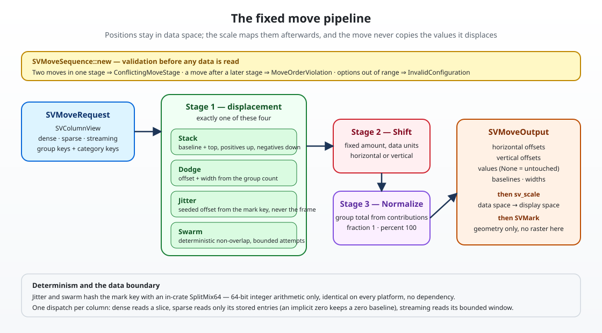

# Chapter 11 — Moves: making overlapping marks readable

> This chapter explains `SVMove`, the closed kernel that stacks, dodges,
> jitters, shifts, swarms and normalises marks. It is the positional-move change
> of wave 4, and it assumes only what earlier chapters established: the data
> boundary (chapter 4), the scale kernel (chapter 6) and the mark kernel
> (chapter 8). No Rust background is assumed.
>
> A scale answers *where does this value sit*. A mark answers *what shape do I
> draw there*. A move answers a question in between: *if several marks land on
> the same place, how do I keep them legible without lying about their values?*

## 1. The problem: two bars, one slot

Imagine a bar chart of revenue per country, split by product. The countries are
categories on one axis and revenue is a value on the other. Without help, the
three product bars of "Brazil" are drawn on top of each other: the tallest one
hides the other two, and the picture silently reports the wrong total.

The fix could live in the bar chart. It could also live in the histogram, the
area chart, the box plot and the strip plot — and then five chart types would
each own a slightly different copy of "stack the values", with five opinions
about negative numbers and five rounding behaviours. The project drew a
boundary instead: the displacement of marks is a kernel of its own, `SVMove`,
and a recipe composes it.

The FDR (`docs/FDRs/core/core-move.md`) places the kernel exactly here:

```text
data -> [SVStat] -> values -> [SVMove] -> [SVScale] -> SVMark
```

A move works **after** the statistic has produced values and **before** the
scale maps them to pixels. That position is not cosmetic. Because the stack
runs before the scale, it changes the *value a bar represents* and the scale
then maps that new value honestly. Because the dodge runs before the scale, it
changes the *category position* and the scale maps that position like any
other category. A move that ran after the scale would have to speak pixels, and
the terminal backend — which has no pixels — could not honour it.

## 2. Three ideas to learn first

**A move does not change the data.** It changes where a mark sits, how wide it
is, and — for stacking and normalising — the value the mark is drawn to. The
original column stays borrowed from the request, untouched, so a tooltip or an
event still reports what the statistic produced. This is design decision D1 in
the change's `design.md`, and it is why `SVMoveOutput::values()` returns `None`
when the sequence only displaced marks: there is nothing to copy.

**Composition order is part of the answer, not an implementation detail.**
Dodging after normalising and normalising after dodging produce different
charts. If the library accepted both silently, two recipes written a month
apart could disagree about which one is "the" chart. The order is therefore
normative, enforced at construction, and documented.

**Determinism is a testable property, not an accident.** A strip plot animates:
values arrive, frames are drawn, values change. If each frame drew fresh random
jitter, the points would wander sideways while their values changed — a
disorienting effect that looks like noise. The jitter offset is a function of
the mark's *key* (its group code and its index), never of the frame, so a point
keeps its place. The same property makes the swarm layout reproducible: the same
data in the same order always produces the same arrangement, which is what a
snapshot test can assert.

## 3. The pipeline



The left box is the request: one borrowed `SVColumnView` (dense, sparse or
streaming) plus group codes and, optionally, category codes. The middle column
is the fixed order:

1. **displacement** — exactly one of `Stack`, `Dodge`, `Jitter` or `Swarm`;
2. **shift** — a fixed displacement in data units;
3. **normalize** — a rescale against the group total.

The right box is the output: horizontal and vertical offsets, optionally new
values with their baselines, optionally narrowed widths. The scale then maps
those numbers onto the viewport and the mark draws them. No raster, no pixels
and no backend appears anywhere in the move.

```rust,ignore
let sequence = SVMoveSequence::new(vec![
    SVMove::stack().into(),
    SVMove::normalize().into(),
])?;

let request = SVMoveRequest::new(SVColumnView::Dense(&values), &group_keys);
let moved = sequence.apply(&request)?;

let tops = moved.values().expect("normalize writes new values");
```

`SVMoveSequence` is the only public entry point. The direct constructors of the
option structs are assembled the same consuming way the mark options are:
`SVMove::dodge().gap(0.2).width(0.8).into()`.

## 4. The six moves

| Move | What it computes | Options |
| --- | --- | --- |
| `Stack` | a cumulative baseline and the value on top of it, per group | `mode`: `Full` or `Center` |
| `Dodge` | a slot offset and a narrowed width, from the group count | `gap`, `width` |
| `Jitter` | a displacement inside the category slot | `amount`, `mode` (`Uniform`/`Gaussian`), `seed` |
| `Shift` | a fixed displacement on one axis | `amount`, `direction` |
| `Swarm` | a collision-free arrangement inside a category | `width`, `marker_extent` |
| `Normalize` | each contribution divided by its group total | `target`: `Fraction` or `Percent` |

The variants are closed (patterns P5). A recipe never adds a seventh; a genuine
new move is a change to the core kernel with its own specification. The full
kind list lives in `SVMoveKind::ALL`, and every backend capability matrix that
iterates it must say how it hosts the move.

### Stacking is diverging

Values of both signs are common — profit and loss, temperature anomalies,
inflow and outflow. A stack that simply summed everything would draw a negative
bar on top of a positive one and produce a baseline that means nothing.

`Stack` therefore keeps two accumulators per group. A positive value grows the
positive accumulator upward from zero; a negative value grows the negative
accumulator downward from zero. The test
`mixed_signs_diverge_from_the_same_baseline` pins it:

```rust,ignore
let values = [2.0, -1.0, 3.0, -2.0];
let groups = [0, 0, 0, 0];
// baselines: [0.0, 0.0, 2.0, -1.0]
// tops:      [2.0, -1.0, 5.0, -3.0]
```

`Center` then shifts the whole group so that the midpoint of its full extent
sits on zero — useful when the chart is a diverging composition rather than a
bar chart growing from a floor.

A zero is special: it keeps a zero baseline and advances neither accumulator.
The test `a_zero_keeps_its_own_baseline_and_does_not_advance_the_stack` exists
because the sparse representation treats an unstored position as exactly that
zero. Without the rule, a sparse chart and a dense chart of the same data would
disagree.

### Dodge derives the width from the group count

`Dodge` divides a category slot among the groups that category actually has.
Three groups in one category and two in the next produce three narrower bars and
two wider ones; the width is derived, never assumed. The default slot is 0.8 of
the category width and the default gap is zero. `three_groups_divide_the_slot_evenly`
and `the_group_count_is_per_category` pin the arithmetic, and the gap test pins
the rule that a gap shrinks each bar inside its slot without moving its centre.

### Jitter is keyed, not framed

`Jitter` hashes the mark key into a 64-bit word and turns it into a displacement
in the amount's band. The test `the_offset_follows_the_mark_key_not_the_value`
applies the same keys to two completely different value arrays and asserts that
the offsets are identical — the property the FDR calls "does not drift over
time".

The `Gaussian` mode is a sum of twelve uniforms, scaled into the same band.
That looks unusual next to a textbook Box–Muller transform, and the reason is
portability: the sum uses only addition and multiplication, so it is bit-for-bit
identical on every platform, while a logarithm or a square root is not required
to be. A jitter that reproduces on one machine and not another would fail its
own specification.

### Swarm resolves collisions deterministically

`Swarm` visits the points of a category in ascending value order, breaking ties
by original index. Each point tries candidate offsets outward — `0`, `+1`, `-1`,
`+2`, `-2` marker extents — and takes the first one that does not overlap an
already placed point. Two points overlap when they are closer than one marker
extent on *both* axes, so touching is allowed and the arrangement packs as
tightly as a beeswarm should.

Two guarantees fall out of the visiting order and the candidate order, and both
are tested:

- `the_layout_is_deterministic` applies the same data twice and compares;
- `no_two_points_of_a_category_overlap` checks every pair in a dense category;
- `the_layout_finishes_in_bounded_time` lays out two thousand points and asserts
  the run stays inside a time budget. The cap
  (`SV_SWARM_MAXIMUM_ATTEMPTS`) is what makes the naive quadratic form finite;
  a sweep-line bound remains an open question in the FDR.

`Swarm::width` bounds the displacement to the category width, and the bound is
validated before any data is read: a width narrower than **two marker extents**
leaves a colliding point no candidate on either side of zero, so
`SVMoveSequence::new` rejects it with `InvalidConfiguration`. The narrowest
valid bound is exactly two extents, because it still offers the offsets `0`,
`+1` and `-1`. `a_width_narrower_than_two_marker_extents_is_rejected` asserts
the rejection and that exactly two extents is accepted.

Even inside a valid bound, a cluster can be too dense for the search: a width of
two extents offers only five offsets, so six identical points cannot all be
placed. The layout no longer reuses a colliding candidate — it returns
`InvalidConfiguration` naming the group and the position, and
`a_cluster_the_bounded_search_cannot_place_is_a_typed_error` pins the message.
A cluster that fits still succeeds, which
`a_dense_cluster_that_fits_still_succeeds` asserts for exactly five points.

## 5. The order contract and its typed errors

`SVMoveSequence::new` validates the whole pipeline before a single value is
read, which is where the project's "fail at build time" rule (patterns P7)
applies to moves. It returns the crate's single `SVError` with two dedicated
variants:

| Situation | Error |
| --- | --- |
| two moves claim one stage (two dodges, two shifts) | `ConflictingMoveStage { stage }` |
| a move follows a later stage (normalize, then dodge) | `MoveOrderViolation { position, preceding_stage, found_stage }` |
| an option is outside its range | `InvalidConfiguration { message }` |

`a_normalize_before_a_dodge_is_rejected` asserts the exact variant, not just
"an error": a caller matching on the typed value can tell a user *which* two
moves conflict and *where*. The empty sequence is the identity, so a recipe
that has no move to apply pays nothing and special-cases nothing.

The same variant covers non-finite data. A NaN in a stack would otherwise flow
silently into every top and baseline it touches, and an infinity would only
fail far from its cause. The working state validates the stored values once,
before any move reads them, and returns `InvalidConfiguration` naming the value
and the position; a sparse column is checked only at its stored entries, so the
pass stays proportional to what it holds. `non_finite_tests.rs` applies NaN and
both infinities to all six moves, checks the sparse path, and keeps a finite
zero accepted.

## 6. Normalise, and the totals it divides by

`Normalize` turns a group into a composition: each contribution becomes a
fraction (or a percentage) of the group total. The subtlety is what "the total"
means after a stack. The top of the last bar is the group total, but the sum of
all tops is not. Normalise therefore divides by the sum of the **contributions**
— `value - baseline`, which is the original magnitude of each segment — so a
stacked and normalised chart keeps its segment heights and reaches exactly one.
`a_stack_then_a_normalize_reaches_the_whole_group` asserts the last top is
`1.0` within `1e-12`, and `one_group_sums_to_one` asserts the sum of a plain
normalised group.

Positive and negative contributions are totalled separately, so a diverging
stack reaches `+1` upward and `-1` downward independently. Giving both sides one
shared scale would squash the smaller side into a corner; that decision is
recorded in the change's design, and
`a_diverging_stack_normalises_both_directions` pins the numbers.

## 7. The data boundary, honoured once

Moves consume `SVColumnView`, the only representation type in the project
(chapter 4), and dispatch exactly once per operation. `SVMoveValueAccessor`
resolves the representation once and is the only place a move reads values:

- a dense column is read as a borrowed slice;
- a sparse column is read at its stored entries, and every unstored position is
  its implicit zero — the accessor never expands the view;
- a streaming column is read from the bounded window snapshot it already
  carries, so a live figure never waits for a producer.

Reading is not the same as producing. Stacking and normalising change the value
a mark represents, so they must write a new column; every other move —
dodge, jitter, shift and swarm — only reads, and it shares the borrowed column
instead of copying it. `lazy_buffer_tests.rs` turns that into an assertion: its
test-only counter records zero value-column materialisations and exactly one
representation resolution for each purely positional move, on dense and sparse
input, including the empty sequence.

When a value-changing move does materialise, the output keeps the shape of the
input. `SVMoveColumn` is either dense (one slot per logical point) or sparse
(the stored indices, their values, and one documented **implicit
contribution**). Stack and normalize walk only the positions the column stores,
and their value, baseline and displacement columns keep that sparse shape; an
untouched displacement column has no stored entry at all. The consequence is the
guarantee `sparse_boundary_tests.rs` asserts: a sparse column of ten million
logical points with four stored entries produces four stored values and four
stored baselines, never a dense buffer. An implicit zero contributes nothing to
a stack and stays zero after a normalisation, and it keeps the zero baseline
when a centred stack translates its group.

`Stack` and `Normalize` need a group total. Over a stream the total is the total
of the window the snapshot carries — the data a live render can show — and
`a_streaming_stack_uses_the_window_total` asserts that the window, not some
notional full history, is what the stack normalises against.

The parity suite applies every move, and the full pipeline, through all three
representations of one logical column that contains a zero:

```rust,ignore
const DENSE_VALUES: [f64; 5] = [2.0, 0.0, 3.0, -1.0, 4.0];
const SPARSE_INDICES: [usize; 4] = [0, 2, 3, 4];
```

Dense, sparse and streaming produce the same offsets, values, baselines and
widths. `a_sparse_stack_preserves_the_implicit_zero` goes further and checks
that the unstored position *is* zero after the stack, rather than a baseline
invented for it.

## 8. Concurrency and the span

A move sequence borrows its request and owns only its working buffers, so it
holds no shared mutable state. `one_sequence_applies_concurrently_without_sharing_state`
runs one sequence on eight threads over the same borrowed data and asserts every
worker produced the identical output;
`different_seeds_jitter_independently_across_threads` checks that the seeds do
not leak into each other.

Every sequence runs inside one span (`scienceview.move`), carrying the
representation, the number of moves, the number of points and the elapsed time.
Moves are backend-independent, so the span records `backend-independent` for
the backend kind — the same convention the mark kernel uses, and the reason a
terminal and an SVG figure produce the same move metrics.

## 9. What is deferred

Two questions in the FDR stay open, and the change records them rather than
answering them by accident:

- **Stack of dodged groups.** Each stage runs at most once in this version, so a
  stack of dodged groups cannot be expressed. It would need a new stage model,
  not a silent second displacement.
- **A sweep-line swarm.** The naive layout is quadratic with a bounded attempt
  count. A sweep-line bound would let very large categories lay out faster
  without changing the guarantee the tests assert.
- **A visual example for the FDR.** The record's example program is deferred
  until the bar recipe can consume `SVMoveOutput` and draw it; shipping an
  assertion-only example would not show a move, so the example and its
  tool-generated figure land with that recipe.

Both are candidates for their own change with their own specification — which
is the point of a closed kernel: the next capability is a reviewed decision
instead of a local shortcut.
