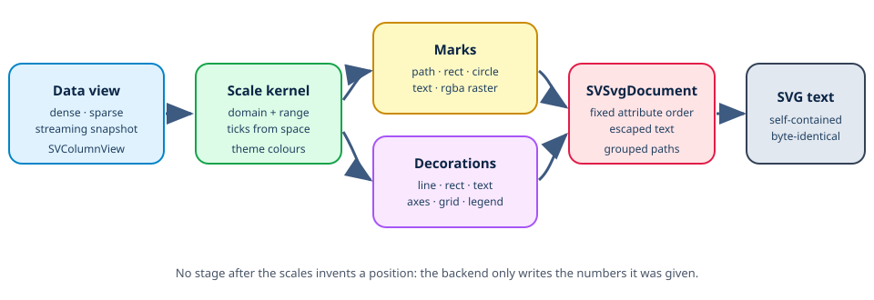

# Chapter 12 — SVG: turning a figure into a file nobody has to install

Every chapter so far built something that lives in memory: data views, scales,
a layout tree, marks and decorations. None of them produced a picture. This
chapter closes that gap with `scienceview_svg`, the first real rendering
backend, the crate the documentation itself uses to draw every figure in this
book.

The story is deliberately told from zero. It explains what an SVG document
actually is, why "self-contained" and "deterministic" are engineering
requirements instead of nice words, how a backend-agnostic primitive becomes
one XML element, and how a ten-thousand-point scatter stays one element. Every
claim is grounded in the crate under `crates/scienceview_svg/` and in the
companion `*_tests.rs` modules that are its executable specification.



## What an SVG file is, from zero

An SVG file is a text file. It is XML, and a viewer parses the text and paints
the shapes it describes. Three consequences follow, and all three shape the
design.

First, a shape is an *element*: `<circle cx="10" cy="20" r="3"/>` means a circle
centred at `(10, 20)` with radius `3`. Second, an attribute is a *name and a
value*: `fill="#0969da"` means a blue-ish fill. Third, the document is an
*ordered list*: whatever is written later is painted on top, exactly like
pushing sheets of paper onto a desk. There is no hidden state, no z-buffer and
no clock.

That last point matters. A rendered document is a snapshot, so an animated
figure has no timeline to replay; the backend writes the final state and the
capability matrix keeps saying that a static document has no animation support.
We did not lose a feature: the figure still animates in backends that own a
clock, and the SVG file shows where it arrived.

## Why the first backend is the documentation target

The architecture claims that rendering is commanded by the `SVRenderBackend`
trait and that no backend is special. The cheapest way to test that claim is
to build the backend whose output can be inspected with `cat`, embedded in a
README and compared byte for byte in CI. SVG is that backend.

It is also the strictest. Because the documentation figures are checked in and
CI reruns every example and fails on any diff, the SVG backend cannot have a
hidden source of variation: no timestamps, no random ordering, no
platform-dependent number formatting. Determinism is therefore not a polish
step; it is the acceptance criterion.

## The contract: one trait, four operations, two of them refused

`SVSvgBackend` is a zero-sized value implementing the core trait:

```rust
impl SVRenderBackend for SVSvgBackend {
    fn kind(&self) -> SVBackendKind { SVBackendKind::Svg }
    fn capabilities(&self) -> SVBackendCapabilities {
        sv_backend_capabilities(SVBackendKind::Svg)
    }
    fn render(&self, request: &SVRenderRequest<'_>) -> Result<SVRenderOutput, SVError> { ... }
    fn save(&self, request: &SVSaveRequest<'_>) -> Result<(), SVError> { ... }
}
```

The capability row for `Svg` is `export_only()`: no events, no scripting, no
streaming, no in-place update and no presentation surface. The trait's default
implementations already report a missing capability as
`SVError::UnsupportedBackendCapability`, and the tests assert the exact value
for `update` and `show`:

```rust
assert_eq!(
    update_error,
    SVError::UnsupportedBackendCapability {
        backend_kind: SVBackendKind::Svg,
        capability: SVBackendCapability::InPlaceUpdate,
    }
);
```

That is the whole point of one error enumeration (pattern P7): a caller matches
on a value instead of interpreting a string, and a backend that cannot host an
operation says so *before* the user believes it worked.

`save` is implemented by rendering the same document and writing it, mapping an
I/O failure to `SVError::BackendFailure { operation: "save", .. }`. It never
panics. `render` and `save` therefore share one serializer; there is no second
path that could drift.

## Registration: the core never names a backend crate

The core owns the `SVRenderBackend` trait and a process-wide
`SVBackendRegistry`, but it has no dependency on `scienceview_svg`. The backend
plug itself in:

```rust
pub fn sv_register_svg_backend() {
    static REGISTRATION: OnceLock<()> = OnceLock::new();
    REGISTRATION.get_or_init(|| {
        sv_backend_registry().register(Arc::new(SVSvgBackendProvider::new()));
    });
}
```

`SVSvgBackendProvider` answers only for `SVBackendKind::Svg`; every other kind
is `None`, so the registry keeps asking the next provider. Registration is
idempotent: `OnceLock` means the first call wins and later calls are no-ops, so
tests and programs can both call it without accumulating providers.

Once registered, a built figure renders end to end:

```rust
sv_register_svg_backend();
let figure = SVFigureBuilder::new()
    .data_source(SVColumnView::Dense(&samples))
    .backend(SVBackendKind::Svg)
    .title("Sine wave")
    .build()?;
let bytes = figure.render()?.bytes;
```

`build` records the kind and dispatches nothing; `render` resolves the kind at
that moment, runs the operation inside the shared observability span and calls
the backend. The companion `observability_tests.rs` installs a real
`tracing-subscriber` and asserts that the captured span carries
`backend.kind=svg`, `operation=render` and `outcome=success` — the configured
kind, never a hardcoded one.

## The document builder: notation separated from geometry

The crate has two layers, and the split is the reason a recipe can compose a
rich figure without knowing any SVG syntax.

- **`SVSvgDocument`** owns *notation*: the root element, accessibility
  metadata, the background and the ordered element list. It accepts mark
  geometry, mark primitives and decoration primitives.
- **The serializers** own *translation*: one backend-agnostic value becomes one
  text element.

A decoration never writes `<line>`. It emits
`SVDecorationPrimitive::Line { start, end, stroke }`, and the serializer writes
the element. A mark never writes a path string. It emits
`SVMarkShape::Path(SVGeometryPath)`, and the serializer maps each command:

| Core value | SVG notation |
| --- | --- |
| `SVPathCommand::MoveTo(p)` | `M x y` |
| `SVPathCommand::LineTo(p)` | `L x y` |
| `SVPathCommand::ArcTo(a)` | `A r r 0 large sweep x y` |
| `SVPathCommand::Close` | `Z` |
| `SVMarkShape::Circle(c)` | `<circle cx cy r .../>` |
| `SVMarkShape::Rectangle(r)` | `<rect x y width height [rx] .../>` |
| `SVMarkShape::Text(t)` | `<text ...>escaped</text>` |
| `SVMarkShape::Image(i)` | `<image href="data:image/png;base64,..."/>` |

The arc deserves a sentence because it is the only non-obvious mapping. The
core stores a centre, a radius and two angles. SVG wants an endpoint and two
flags. The serializer computes the endpoint with `centre + radius * (cos θ,
sin θ)`, sets the large-arc flag when the sweep exceeds π and sets the sweep
flag from the direction of the angle comparison. No geometry is re-derived;
only the representation changes.

## Determinism: one attribute order, one number format

Two renders must be byte identical. Three rules make that true.

1. **Attribute order is fixed in code.** The serializer writes `fill` first,
   then the stroke group (`stroke`, `stroke-width`, `stroke-linecap`,
   `stroke-linejoin`, `stroke-dasharray`), then `opacity`. A renderer never
   iterates a hash map to decide what comes next.
2. **Numbers use one representation.** `sv_format_number` formats with at most
   three decimals, trims trailing zeros and normalizes negative zero to `0`.
   Non-finite values become `0`, because an attribute must always parse.
   Scientific notation never appears, so a value's magnitude cannot change the
   shape of the document.
3. **Nothing environmental enters.** There is no clock, no randomness, no
   locale and no file-system probe in the render path.

The golden snapshot in `crate_tests/snapshot_tests.rs` is the executable form
of those rules: a small document is compared against the exact expected string,
so any change in order or formatting shows up as a reviewable diff. The
determinism test renders the same thousand-point figure twice and compares the
complete `SVRenderOutput` values, and `concurrency_tests.rs` renders the same
figure on eight threads and asserts every thread produced the same bytes — the
backend is a value with no interior state, so it is trivially `Send + Sync`.

## Self-contained: a raster becomes a PNG data URI

"Self-contained" means the file displays with no network access and no sibling
assets. Vector shapes are already self-contained. A borrowed RGBA raster is
not: SVG has no raw-pixel element.

The crate therefore writes a minimal PNG encoder using only the standard
library. It emits the PNG signature, an `IHDR` chunk, one `IDAT` chunk and
`IEND`. The image data is wrapped in a zlib stream made of *stored* deflate
blocks: the file is not compressed, but the bytes are a pure function of the
pixels, which is exactly what determinism needs. The encoder computes the
CRC-32 and Adler-32 checksums itself, and the bytes are base64-encoded into
`data:image/png;base64,...`. The image element uses
`preserveAspectRatio="none"` and `image-rendering="pixelated"` for nearest
neighbour sampling, so a heatmap keeps sharp cells instead of being smoothed
by the browser.

The test `a_raster_becomes_a_base64_png_data_uri` asserts the data URI prefix
and — importantly — that the text contains no `http` reference.

## Escaping: five characters, one function

XML is text, so text can break the document. One function escapes every value
used in a text node or an attribute:

| Character | Escaped form |
| --- | --- |
| `&` | `&amp;` |
| `<` | `&lt;` |
| `>` | `&gt;` |
| `"` | `&quot;` |
| `'` | `&apos;` |

The ampersand is escaped first, so an entity already present is escaped exactly
once instead of being double-decoded. Escaping one set for both contexts is a
deliberate simplification: a text node does not need `&quot;`, but escaping it
there costs nothing and removes the possibility of a context-dependent bug.

The tests drive a title, a description, a mark text run and a decoration label
through the same function, including a string that contains all five
characters.

## Grouping: ten thousand circles, one path

A scatter of ten thousand values, drawn naively, is ten thousand `<circle>`
elements. The document is not just large; it is slow to parse and heavy to
scroll.

The serializer groups *consecutive* circles that share the same paint into a
single `<path>`. Each circle contributes one compact subpath:

```
M cx cy m -r 0 a r r 0 1 0 2r 0 a r r 0 1 0 -2r 0 Z
```

Two arcs draw a full circle. The run closes when the paint changes or a
non-circle shape appears, so the draw order is preserved exactly. Grouping is
intentional about equality: two circles with different opacity or stroke
widths are not merged.

The tests assert the observable consequences: ten thousand equal circles
produce exactly one element, the document stays below 120 bytes per point, two
paints produce two paths, and a rectangle breaks a run. The end-to-end test
renders ten thousand points through the backend and checks both the single
`<path>` and a two-second budget.

## Accessibility is part of the document, not an afterthought

The root element always carries `role="img"` and an `aria-label`. The label
falls back to the title and then to a generic name, so a screen reader always
has something to announce. Two metadata children follow:

```xml
<title>Sepal width against petal length</title>
<desc>Two series of a scatter plot generated by scienceview</desc>
```

`width`, `height` and `viewBox` are written together, because an SVG that
scales must declare both the intrinsic size and the coordinate system. The
document test asserts all of them, and a separate test asserts the fallback
chain of the label.

## Walking through the real example

`examples/scatter_svg.rs` is the figure embedded in the README and in this
book, and it is generated by the tool itself. It composes the whole pipeline in
five stages.

1. **Layout.** A plot rectangle is chosen in logical pixels and a viewport is
   created: `SVViewport::new(640.0, 400.0)`.
2. **Scales.** Two continuous scales own their domains and ranges together.
   The horizontal scale maps `0..9` onto the plot's left-to-right range; the
   vertical scale maps the same domain onto bottom-to-top, which is why the
   range is written `plot.bottom()..plot.y`.
3. **Marks.** Each series becomes one `SVMark::dot()` geometry. The mark
   receives the two columns, the two scales and the plot rectangle, and returns
   primitives. The example calls the mark twice — once per series — so each
   series has its own colour. The backend then groups the circles of one series
   into one path; two series, two paths.
4. **Decorations.** A bottom axis and a left axis measure themselves against
   the plot extent, place themselves against the solved rectangle, and emit
   their primitives. The grid reuses the placed tick coordinates. The legend is
   a model object with two entries; it measures and places itself beside the
   plot. A title is measured and centred.
5. **Serialization.** The document receives the grid first, then the marks,
   then the axes, then the legend and the title. That order is the draw order.
   `to_svg()` writes the text and the example writes it to
   `docs/figures/scatter_plot.svg`.

The other two examples exercise different entry points. `line_plot_svg.rs`
builds a bare `SVFigure`, registers the backend and calls `render()`, which is
the registry path a user program takes. `bar_chart_svg.rs` remains a
hand-composed document and is kept as a minimal, dependency-free reference for
the figure format.

## The tests are the specification

Six companion modules hold the executable claims:

| Test module | What it proves |
| --- | --- |
| `backend/backend_tests.rs` | capability row, empty figure, `save`, `update`/`show` errors, provider and registry dispatch |
| `document/document_tests.rs` | viewport mapping, metadata, background, escaping, byte-identical serialization |
| `serialize/serialize_tests/` | one snapshot per shape and decoration, every mark variant, path commands, PNG embedding |
| `figures/default_figure_tests.rs` | bare-figure rendering for dense, sparse and streaming views |
| `crate_tests/snapshot_tests.rs` | the golden document string |
| `crate_tests/determinism_tests.rs` | two renders identical, 10k points one path within budget |
| `crate_tests/concurrency_tests.rs` | eight threads, identical bytes |
| `crate_tests/observability_tests.rs` | the span carries `backend.kind=svg` |

The default-figure tests deserve a note on the data boundary. A sparse column
contributes only the entries it stores, and its logical length still sets the
horizontal domain, so a gap stays a gap and the sparse storage is never
densified. A streaming column contributes the bounded snapshot it already
carries, so the render thread never waits for a producer. The representation is
resolved exactly once, in `sv_collect_series`.

## Roads not taken

**An XML crate.** A library such as `quick-xml` would remove the escaping
function, but it would also add a dependency to the one backend that must build
everywhere, including a docs pipeline with no network. The vocabulary is small
and closed; writing it by hand is cheaper than auditing a dependency.

**Compressed PNGs.** A real deflate implementation would shrink embedded
rasters, but it would introduce state and subtle non-determinism in the
compressor. Stored blocks are larger and perfectly reproducible, which is the
trade this backend wants.

**Rasterizing vectors into pixels.** The backend could paint the whole figure
into an RGBA buffer and embed one big PNG. That would throw away scalability,
text selection and accessibility, and it would make the output depend on a
rasterizer. The backend writes shapes; it never becomes one.

**A second error type.** The SVG crate returns the core `SVError` for every
failure, including I/O, so a caller still matches one enumeration.

## What comes next

The SVG document surface is the figure-generation contract of the rest of the
project. A recipe change composes the same primitives the scatter example
composes; it only chooses different marks and decorations. The next backends —
HTML, terminal, native, WebAssembly and the framework components — receive the
same primitives and translate them into their own notation, which is why they
can be added without touching the core or any recipe.
