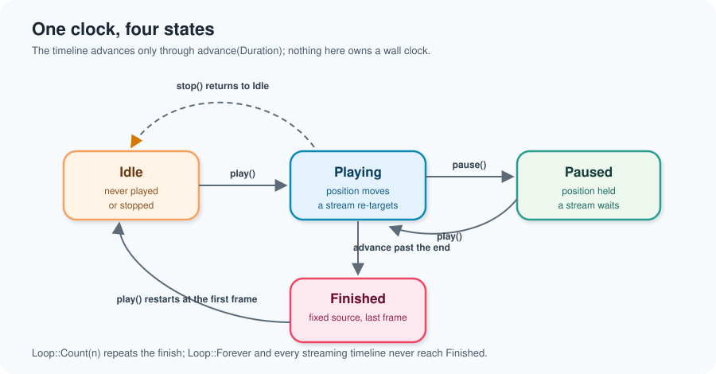
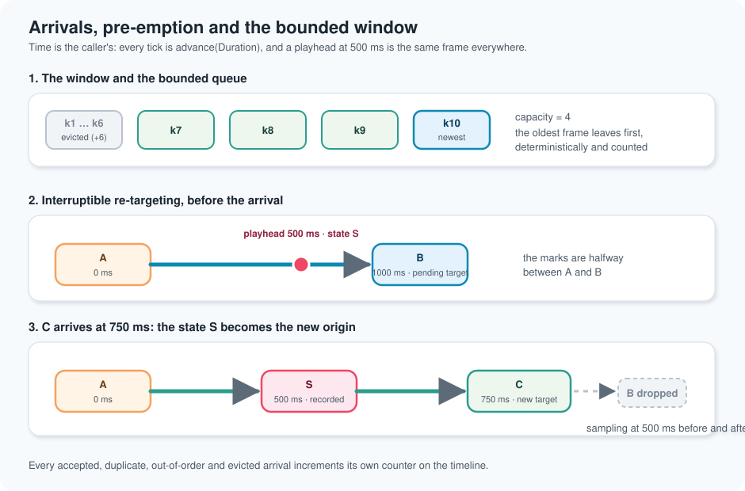

# Chapter 14 — Animation: one clock, two keyframe sources

> This chapter explains `SVAnimation`, the temporal layer of the chart model.
> It is the `animation-timeline` change of wave 5, and it assumes the data
> boundary (chapter 4) and the mark kernel (chapter 8). No Rust background is
> assumed.
>
> A scale answers *where does this value sit*. A mark answers *what shape do I
> draw there*. Animation answers a third question: *which state am I looking at
> right now, and how do I get smoothly to the next one?*

## 1. The problem: the same chart, one second later

Imagine a bar chart of three countries that updates as new measurements
arrive. When the bars change height, the change can be instantaneous — a jump
that hides which bar moved where — or it can be a short, controlled movement.
A presentation may also want to play a scripted sequence: state A, then state
B, then state C, at one second per step, looping.

The naive way to build both is to write two features. "Animated charts" holds a
list of frames and a timer; "live charts" holds a streaming buffer and repaints
on arrival. They quickly disagree: the animated chart's clock is in JavaScript,
the live chart's clock is in Rust, and a terminal backend runs at yet another
rate. The same figure shows a different frame in each backend.

The project chose the opposite shape, recorded in
`docs/FDRs/core/core-animation.md`: **there is one timeline**. A live chart is
an animation whose keyframe source is a stream. Scripted animation and live
updates are the same data structure with different arrival rules.

## 2. Four ideas to learn first

**A keyframe is a delta.** A keyframe does not carry a whole figure. It carries
the properties that change, expressed with the vocabulary the mark kernel
already exports (`SVMarkProperty`: position, size, colour, opacity, font size,
shape, dash pattern, font family). The timeline therefore keeps no parallel
state representation: it keeps an ordered list of deltas, which is exactly what
the `model-events` capability serializes.

**One clock lives in the model.** The backend renders `sample()`; it never owns
the timing. Time is supplied by the caller through `advance(Duration)`. There
is no wall clock, no timer and no async runtime in the crate, so a test can
walk a timeline in microseconds and two runs always produce the same frames.

**A stream is a bounded keyframe source.** A stream is not an infinite list.
The timeline retains at most `capacity` keyframes and drops the oldest. Memory
does not grow with the stream, and the drop is deterministic — the newest frame
always survives, the oldest always leaves.

**Re-targeting must not jump.** If a keyframe arrives while the marks are
halfway between two states, the animation re-aims from where the marks are,
not from the state it was heading to. Otherwise the marks would snap to the old
target and then slide to the new one.

## 3. The vocabulary, object by object

### `SVDuration`

A finite, non-negative span of time. `from_milliseconds(-1)` and
`from_seconds(f64::NAN)` return `SVError::InvalidAnimationDuration`; zero is
valid and means "swap instantly". The default is 1000 ms, the value the FDR
documents.

### `SVKeyframeChange` and `SVKeyframeDelta`

One change is a property plus a value. A delta is an ordered set of changes.
`SVKeyframeDelta::new` rejects a non-finite value
(`SVError::NonFiniteAnimationValue`) and a property declared twice
(`SVError::DuplicateAnimationProperty`), and counts the position so the caller
knows which change was wrong.

`SVKeyframeDelta::interpolate(&target, progress)` is the heart of the timeline
and the **seam to the transition kernel** (`sv_transition`, landing in the same
wave): it takes the two neighbouring deltas plus an eased progress and returns
the state in between. The transition layer will decide *whether* and *how* a
property tweens; the timeline only decides *when*. Because the seam is a pair
of deltas and a number, the two features can evolve independently.

An interpolable property (`is_interpolable`) is tweened linearly in the
delta's own units. A discrete property — shape, dash pattern, font family —
keeps the start value until the very end of the segment and then swaps. A
property declared by only one side is adopted as it is: the delta never invents
a value it was not given.

### `SVKeyframe`

A timestamp and a delta. `SVKeyframe::new(timestamp, delta)` is the unit the
fixed source stores and the streaming source accepts.

### `SVKeyframeSource`

`Fixed` or `Streaming`. Both feed the same `SVAnimation` and the same sampling
code; the source decides how keyframes arrive, never how they are sampled.

### `SVAnimationBuilder` and `SVAnimation`

The builder is the only constructor. `deltas(...)` appends deltas one default
duration apart; `keyframe(...)` appends an explicit timestamp; `duration`,
`capacity`, `interpolation`, `loop_mode`, `direction`, `speed` and
`execution_mode` refine the timeline. `build()` validates everything once
(patterns P7): a fixed list must be non-empty and non-decreasing in time —
an equal timestamp is a zero-length segment that swaps instantly, which is how
a reduced-motion theme collapses durations to zero;
a streaming timeline must start empty and have room for at least one segment.
A stream, by contrast, drops an equal timestamp as a duplicate, because two
arrivals at the same instant are ambiguous.

`SVAnimation` exposes the playback state (`source`, `state`, `position`,
`normalised_position`, `speed`, `loop_mode`, `direction`, `interpolation`,
`execution_mode`), the window (`length`, `capacity`, `is_empty`,
`retained_keyframes`) and the observable arrivals (`accepted_keyframes`,
`duplicate_keyframes`, `out_of_order_keyframes`, `evicted_keyframes`).

### `SVPlaybackState`, `SVAnimationLoop`, `SVAnimationDirection`, `SVInterpolation`

`SVPlaybackState` is the four-state clock: `Idle`, `Playing`, `Paused`,
`Finished`. `SVAnimationLoop` is `None`, `Count(n)` or `Forever`; `Count(n)`
means "play n times in total". `SVAnimationDirection` is `Forward`, `Reverse`
(starts at the last frame) or `Alternate` (reverses each pass).
`SVInterpolation` is `Linear`, `EaseIn`, `EaseOut`, `EaseInOut` or `Step`; the
curve is applied to the segment progress before the deltas are interpolated,
so every backend sees the same easing.

### `SVKeyframeAdmission` and `SVAnimationAction`

`push_keyframe` returns `Accepted`, `DroppedDuplicate` or `DroppedOutOfOrder`.
Ordering never fails the live path: a keyframe that cannot advance the clock is
dropped and counted. `SVAnimationAction` is the animation slice of the semantic
action vocabulary — `Play`, `Pause`, `Toggle`, `Stop`, `Step { forward }`,
`Seek`, `SetSpeed`, `SetDirection` — so the UI kit drives playback exactly as
it drives every other control.

## 4. The clock, drawn

`advance(Duration)` is the only way time moves. It multiplies the elapsed time
by the speed and by the current direction, walks towards the boundary, and
handles a loop by wrapping into the next pass. Two rules keep the walk honest:

- **A fixed source finishes.** Reaching the last frame with no pass left sets
  `Finished` and the last frame stays visible.
- **A streaming source never finishes.** It waits at its newest keyframe; the
  next arrival extends the timeline and the sample continues from there. That
  difference is the one observable asymmetry between the two sources, and the
  parity test asserts it explicitly.

A large `advance` does not walk one pass at a time. `sv_skip_whole_passes`
divides the remaining distance by the pass length and skips the whole loops at
once — the test
`a_counted_loop_skips_whole_passes_when_the_elapsed_time_is_large` advances
twenty seconds over a ten-pass, one-second timeline and lands exactly on the
last frame.

`Seek` clamps to `[0, end]` and leaves a finished timeline paused at the new
position. `Step` pauses a playing timeline and moves to the neighbouring
keyframe; from `Idle` it only moves, leaving the state untouched. Neither owns
a clock.

## 5. The bounded window and the interrupt

A streaming timeline starts empty. `push_keyframe` applies three checks in
order:

1. If the timeline is playing strictly inside a transition and the arrival is
   newer than the playhead, it **pre-empts**: the interpolated state at the
   current position is recorded as a keyframe, every future target is dropped,
   and the arrival becomes the destination. This is why sampling immediately
   before and after the arrival agrees — the new segment starts at the state
   the viewer is already looking at.
2. Otherwise a timestamp before the newest retained frame is
   `DroppedOutOfOrder`, and an equal timestamp is `DroppedDuplicate`; both are
   counted, neither is an error.
3. An accepted frame is appended, and the window keeps at most `capacity`
   frames by popping from the front and incrementing `evicted_keyframes`.

The repository's rolling window (`SVRollingWindow`) uses the same discipline
for numeric samples; the animation window applies it to keyframes.

## 6. Walking the real tests

The companion modules are the executable specification. A few worth reading in
order:

- `keyframe_tests.rs` — the vocabulary. `a_delta_rejects_a_non_finite_value`,
  `interpolation_hits_both_endpoints_exactly`,
  `interpolation_reaches_the_midpoint_of_an_interpolable_property` and
  `interpolation_swaps_a_discrete_property_only_at_the_end_of_the_segment`.
- `timeline_tests.rs` — the fixed source and the clock. `sv_fixed(&[0.0, 10.0])`
  builds two keyframes one second apart;
  `a_fixed_source_samples_every_keyframe_in_order` checks the endpoints and
  `a_fixed_source_interpolates_the_midpoint_of_a_segment` checks 5.0 at 500 ms.
  `a_fixed_source_rejects_out_of_order_timestamps` proves the build-time
  failure, `a_duplicate_timestamp_is_a_zero_length_segment_that_swaps_instantly`
  proves the instant swap, and `a_counted_loop_finishes_after_the_last_pass` proves that
  reaching the end is a pass boundary, not an error.
- `streaming_tests.rs` — the window. `the_keyframe_window_stays_bounded_under_a_long_stream`
  feeds ten thousand frames into a window of eight and checks eight retained,
  nine thousand nine hundred and ninety-two evicted.
  `a_paused_streaming_timeline_ignores_an_arriving_keyframe` checks the FDR's
  decision that a paused timeline does not re-target.
  `fixed_and_streaming_sources_sample_identically` proves parity with the same
  three keyframes fed both ways.
- `retargeting_tests.rs` — the interrupt. `a_keyframe_arriving_mid_transition_retargets_without_a_jump`
  samples at 500 ms, pushes a target at 750 ms, asserts the sample is unchanged
  and then advances to 750 ms to find the new target.
- `animation_concurrency_tests.rs` — four threads share one timeline behind a
  mutex, and `playback_is_reproducible_from_the_same_sequence_of_ticks` plays
  the same timeline in two threads and compares every position and sample.
- `animation_span_tests.rs` — one `scienceview.animation` span per operation,
  carrying `backend.kind = "backend-independent"`, the source kind, the
  retained keyframe count, the position and the outcome (patterns P8).

## 7. Decisions and the roads not taken

**No backend on the timeline.** A figure selects a backend because the
rendering form is a deliberate choice (spec `backend-selection`). An animation
is model state shared by every backend, so it carries `SVExecutionMode` but no
`SVBackendKind`; giving it one would contradict the single clock. The span
records the literal `backend-independent` kind, exactly as the mark kernel does.

**No wall clock.** Reading `Instant::now()` inside `advance` would make the
timeline untestable and platform-dependent. The caller passes the elapsed
time; a native loop, a browser animation frame and a terminal tick all feed the
same clock.

**One window, not two sources.** A separate `SVStreamingAnimation` would
duplicate sampling, looping and interpolation. A single `SVAnimation` with a
source enum keeps the parity test trivial and the API uniform.

**Deltas, not snapshots.** Storing whole figure states per keyframe would make
the stream's memory proportional to the figure as well as to the window. A
delta is also the exact unit the model already emits as a serializable change.

**A dropped frame is counted, never silent.** A paused timeline that does not
re-target an arriving stream can look like data loss. The counters make the behaviour observable, so
a UI can show the queue depth instead of guessing.

## 8. What comes next

The transition kernel (`sv_transition`) consumes the same property table and
the same pair of deltas; the timeline hands it `sample()` and the eased
progress. The UI kit will dispatch `SVAnimationAction` from its controls, and
every backend will read `sample()` each frame. None of those changes needs to
touch the clock.

The FDR's remaining acceptance items — a backend rendering a mid-animation
frame, and a reduced-motion theme collapsing durations to zero — belong to the
changes that add backends and theme-driven motion. The timeline already
supports them: `SVDuration::zero()` is a valid duration, a fixed list may repeat
a timestamp to create a zero-length segment, and such a segment — like a
timeline whose every frame shares one instant — samples its final state at
once.
