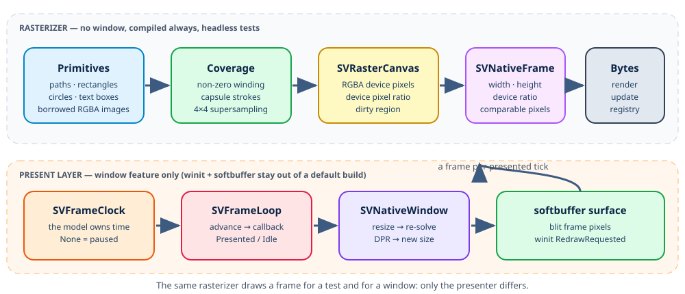

# Chapter 15 — Native: drawing pixels yourself, without a GPU

Chapter 12 turned a figure into a text file. That was the cheapest way to prove
that rendering is commanded by one trait, but a file cannot animate, cannot
respond to a resize and cannot own a clock. This chapter builds the backend the
project uses to validate every figure before it is ported anywhere else:
`scienceview_native`, a from-scratch CPU renderer that draws a figure into a
real window using nothing but pixels.

The story starts from zero — what a pixel is, why an edge needs more than one
colour, why a window has two sizes at once — and then walks through the code in
`crates/scienceview_native/` and the companion `*_tests.rs` modules that are its
executable specification.



## Why a CPU renderer, and why two layers

A GPU would be faster on very large point sets, but it would drag a graphics
stack into a library whose core is deliberately dependency-light. More
importantly, a GPU renderer is hard to test: the result lives on a device that a
CI machine may not have. A CPU renderer produces an array of bytes, and an array
of bytes can be asserted on.

That single property — *the frame is a value* — dictates the architecture. The
crate is split in two layers:

- the **rasterizer**, a pure value that owns an RGBA buffer and knows nothing
  about windows, events or GPUs;
- the **present layer**, which opens a `winit` window and blits the buffer
  through `softbuffer`.

Only the second layer depends on a GUI stack, and only when the crate's `window`
feature is enabled. The root `render-native` feature turns that feature on, so a
default build of `scienceview` pulls neither `winit` nor `softbuffer`. A test, a
CI job and a future WebAssembly target all drive the first layer directly.

## Pixels, channels and blending, from zero

A frame is a rectangular grid of pixels. Each pixel here is four bytes — red,
green, blue and alpha — stored row by row, from the top-left corner. Alpha is
*straight* (not premultiplied), which means a colour keeps its own channels even
when it is transparent.

Drawing is compositing. To place a source colour over a destination colour with
a coverage fraction, the rasterizer premultiplies both by their alpha, mixes
them, and divides the result back by the output alpha:

```text
out_alpha = source_alpha + destination_alpha × (1 − source_alpha)
out_colour = (source × source_alpha + destination × destination_alpha × (1 − source_alpha)) / out_alpha
```

`sv_blend_pixel` in `canvas/colour.rs` is that formula. Folding *coverage* into
the source alpha is what lets one blend function serve both a filled shape and a
stroked line: a shape that owns 40% of a pixel is a colour with 40% opacity.

## Anti-aliasing: why a diagonal cannot be black or white

A pixel is either painted or not, but a geometric edge rarely falls exactly on
the pixel grid. If the renderer snapped every edge to whole pixels, a circle
would grow visible stairs and a thin diagonal would flicker as the figure moved.

The fix is to give each pixel the fraction of its area the shape covers. Two
strategies are used together:

- **distance coverage** for rectangles, circles and strokes. The signed distance
  from the pixel centre to the shape is converted to coverage with
  `sv_coverage_from_distance`: half a pixel inside is full coverage, half a
  pixel outside is none, and the boundary is a ramp.
- **sampling** for filled paths. Four samples per axis — sixteen per pixel —
  are tested against the non-zero winding rule, and the fraction inside becomes
  the coverage (`coverage.rs`).

Sixteen samples are enough for a stable ramp and, crucially, deterministic: no
jitter table, no floating-point ordering surprises. The same primitives always
produce the same bytes, which is what lets the tests compare whole frames.

A path is first *flattened*: each arc becomes a run of short segments whose
count derives from its radius and sweep, never from a clock. `path_flattening.rs`
owns that walk and the dash splitter; `path_rasterizer.rs` fills the result and
`path_stroking.rs` stamps capsules along it. Caps and joins are geometry, not
special cases in the blend: a butt cap clips the capsule at the endpoint, a
square cap extends it by half the stroke width, and a round cap or join adds a
disc.

Text has no glyph rasterizer yet. The decoration layer already lays text out as
a measured box, so `text_rasterizer.rs` draws one filled box per character with
the alignment, baseline, weight and rotation the caller asked for. It is a
legible placeholder behind the same interface a real font will replace.

## The two sizes of a window: logical and device pixels

A window has a size in *logical* pixels — what the layout engine reasons about —
and a size in *device* pixels. On a high-density display one logical pixel is
two device pixels, and the ratio between them is the device pixel ratio.

The layout never sees the device grid: it solves a logical viewport, exactly as
it does for SVG. The backend applies the ratio once, when it allocates the
buffer and when it turns a logical coordinate into a device coordinate:

```rust
let canvas = SVRasterCanvas::new(&SVViewport::new(640.0, 400.0).with_device_pixel_ratio(2.0));
assert_eq!((canvas.width(), canvas.height()), (1280, 800));
```

That is the subject of `canvas_definition_tests.rs`. It also fixes the resize
contract: resizing to a different logical size or ratio reallocates the buffer,
makes it transparent and marks it wholly dirty, because the layout has to
re-solve rather than stretch the previous frame. Resizing to the same viewport
reports `false` and leaves the dirty region empty.

## Dirty regions: repainting only what changed

A full repaint of a large window on every update is wasteful. Every drawing
operation therefore unions its bounding rectangle into an `SVDirtyRegion`, a
rectangle in device pixels with exclusive right and bottom edges, or nothing at
all. A background fill or a resize marks the whole frame; a circle marks its
bounding box, padded by one pixel so the anti-aliased rim is inside it.

`dirty_region_tests.rs` pins the arithmetic: two rectangles union, an empty one
changes nothing, a logical rectangle is scaled by the ratio, padded and clamped,
and a region without extent is not a bounding box at all. The present layer uses
the same value to decide what to blit.

## The frame loop belongs to the model

A native backend is the first one with a real clock, so it is where animation
must be proven. The tempting design is for the renderer to own a timer. The
project deliberately rejects it: a paused figure would still wake up and do
work, and the renderer would need to know about animation types that are being
written in a different change.

The seam is a single trait in `backend/frame_loop.rs`:

```rust
pub trait SVFrameClock: Send {
    fn advance(&mut self) -> Option<f64>;
}
```

A closure `FnMut() -> Option<f64>` implements it. `SVFrameLoop::run_frame` asks
the clock for the next playback position and calls the caller's frame callback
only when there is one. `None` means "paused or unchanged", so the turn is
`SVFrameOutcome::Idle`, the callback is not invoked and no repaint is requested.
A callback that draws nothing also reports `Idle`. `frame_loop_tests.rs` covers
all four cases and counts presented and idle turns.

Because the trait speaks in positions rather than animation objects, the crate
compiles before `SVAnimation` and `SVTransition` exist and never depends on
them. The window's event loop, in `window/native_application.rs`, is one caller:
on `about_to_wait` it advances the clock, records the position and requests a
redraw; on `RedrawRequested` it asks the painter for a frame and blits it.

## Resize, scale change and in-place update

The event loop handles three environment events:

- `Resized` recomputes the logical viewport from the new physical size and the
  window's scale factor, then requests a redraw;
- `ScaleFactorChanged` does the same when the window moves to a display with a
  different density;
- `RedrawRequested` renders the current request at the current viewport and
  blits the result.

`SVNativeBackend::render_frame_with_viewport` is the call behind that redraw:
the layout re-solves for the new viewport instead of scaling the old pixels.
`backend_tests.rs` asserts exactly that, including that a device ratio of two
produces a frame twice as wide and tall.

## The contract: render, update, show, and one refusal

`SVNativeBackend` implements `SVRenderBackend` for `SVBackendKind::Native` and
is registered by `sv_register_native_backend`, so `figure.render()` works end to
end through the process-wide registry.

`render` and `update` rasterize the figure and return its RGBA bytes; the
comparable-frame surface is `render_frame`, which carries the dimensions and the
device ratio next to the pixels. `show` presents the frame in a window.

`save` returns the typed `UnsupportedBackendCapability` error for export. This
is not an omission: the capability matrix declares that a native window has no
export format, and pretending to write a PNG would either add a dependency or
grow an unrelated capability. The frame is still exposed, so a future export
change can build on the rasterizer without changing the declared row.

The declared row is the interesting part of `crate_tests/capabilities_tests.rs`:
events, scripting, streaming, in-place update and presentation are all `true`,
export is `false`, and the build-time checks accept a figure that requires
streaming and in-place updates. Every mark variant is supported, including the
borrowed raster that the terminal backend rejects.

## What the tests prove

The acceptance story of the native backend is unusually concrete because every
claim is a pixel assertion:

- `canvas_definition_tests.rs` — sizing, the device pixel ratio, transparent
  defaults, resize behaviour, frame dimensions.
- `rasterizer_tests.rs` — rectangle and circle interiors, anti-aliased edges,
  rounded corners, a ring that is not a disc.
- `rasterizer_path_tests.rs` — non-zero winding fills, stroked segments, arcs,
  dashes, and every cap and join pair.
- `rasterizer_text_tests.rs` — text boxes with alignment, baselines, weight and
  rotation.
- `rasterizer_composition_tests.rs` — nearest and bilinear image sampling,
  decoration primitives, and the dirty region a mark reports.
- `figure_tests.rs` — the default figure: background, plot outline, data, and a
  resized viewport that re-solves instead of stretching.
- `backend_tests.rs`, `frame_loop_tests.rs` — the trait surface and the clock
  seam.
- `crate_tests/` — determinism, representation parity across dense, sparse and
  streaming views, concurrent renders from eight threads, the capability row,
  and the operation span that records `backend.kind=native`.

The interactive window test is `#[ignore]`d and gated behind
`SCIENCEVIEW_NATIVE_DISPLAY_TESTS`, so CI without a display stays green while a
developer can opt in.

## What is deliberately still missing

No glyph rasterizer, no GPU, no PNG export, no scroll or zoom interaction. Each
of those is a separate capability with its own change; this one establishes the
frame, the pixels and the clock seam they will build on.

The next chapters use this backend as the validation target: a figure that
renders here is allowed to be ported to HTML, WebAssembly, the terminal or a
framework component.
