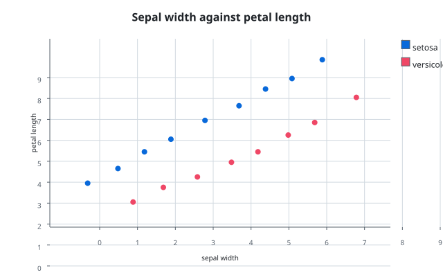
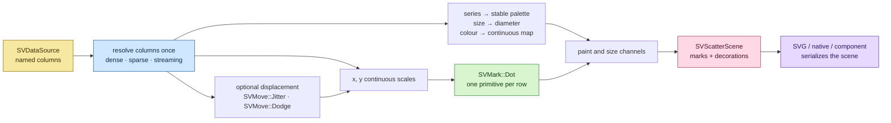

# Chapter 16 — A scatter plot from zero: how a recipe composes the kernels

This chapter tells the story of the first **recipe** in `scienceview`:
`SVScatterPlot`, the chart that draws two continuous columns as points. The
recipe is small on purpose. It is the reference every later chart follows, so
it shows how the pieces built in the previous chapters fit together without
adding a single new primitive.

By the end you will know what a recipe owns (channels, validation and a scene),
what it deliberately does not own (geometry, scales, decoration layout) and
where each of those lives in the code.

## The picture a scatter draws

A scatter plot answers a simple question: *where do two measurements sit
together?* Each row of data becomes one dot. The horizontal position is one
column, the vertical position another, and grouping, colour and size are
optional channels layered on top.



The public path of the recipe is
`scienceview::sv_recipes::sv_relational::sv_scatter_plot::SVScatterPlot`. The
folder on disk stays `src/recipes/relational/scatter_plot/`; the `#[path]`
attributes only change the public names.

The chart is specified in `docs/FDRs/recipes/relational-scatter-plot.md`
(FDR-101). The engineering contract in `docs/FDRs/patterns.md` fixes how a
recipe is built: one capability, one chart, one change (P1), the builder
surface (P2), the folder layout (P3), registration by family (P4), closed
kernels (P5), the data boundary (P6), one error type (P7), observability (P8),
tests (P9), the eight tasks (P10) and naming (P11).

## The pipeline



The important shape is the middle. `SVMark::Dot` owns geometry and paint;
`SVScale` owns data-to-position; `SVMove` owns displacement; `SVDecoration`
owns axes and legends. The recipe owns only the *mapping* from its named
columns onto those kernels.

## Channels are the recipe's real surface

The builder names columns, not arrays:

```rust,ignore
let scene = SVScatterPlot::builder()
    .data_source(&table)
    .x("sepal_width")
    .y("petal_length")
    .series("species")
    .size("body_mass")
    .alpha(0.85)
    .backend(SVBackendKind::Svg)
    .build()?
    .compose()?;
```

`x` and `y` are required. `series` groups the rows and gives each group one
palette colour and one legend entry. `size` maps a continuous column onto the
marker diameter. `colour` is a continuous override that wins over the series
palette point by point. `alpha` is constant and exists for overplotting: a
translucent dot reveals density where opaque dots would hide it.

The builder never guesses a backend. `backend(SVBackendKind::Svg)` is required;
`execution_mode(...)` defaults to `Automatic`. `build()` validates and carries
the kind into the built scatter; `compose()` builds the backend-agnostic scene,
and `render()` resolves the configured kind to the serializer it actually has.
This is the same rule the figure builder follows in Chapter 5.

## Missing columns fail before pixels

A recipe reads a named source, so it can fail at build time for a reason a user
can fix:

- no `x` or `y` name → an `InvalidConfiguration` naming the missing call;
- a name the source does not expose → `ColumnNotFound`;
- columns of different lengths → `MismatchedLengths`;
- any move other than `Jitter` and `Dodge` → an explicit configuration error,
  because those two displacement moves are the only ones FDR-101 accepts;
- an impossible alpha, size interval or marker → the dot kernel's own
  validation error.

The tests assert each of these paths, including
`the_builder_requires_the_documented_columns`,
`a_missing_optional_column_fails_with_an_explicit_error` and
`columns_of_different_lengths_fail_at_build_time`.

## The data boundary is crossed once

The recipe calls `SVDataSource::column(name)` once per configured column. Each
call resolves a `SVColumnSnapshot`, and `column_view()` exposes exactly one
`SVColumnView`: dense, sparse or streaming. The scale, move and mark kernels
then dispatch on that representation themselves.

The tests prove the three representations agree:

```rust,ignore
let dense = sv_scene_to_svg(&sv_build_default(&dense_source).compose()?);
let sparse = sv_scene_to_svg(&sv_build_default(&sparse_source).compose()?);
let streaming = sv_scene_to_svg(&sv_build_default(&streaming_source).compose()?);
assert_eq!(dense, sparse);
assert_eq!(dense, streaming);
```

`dense_sparse_and_streaming_inputs_draw_the_same_scene` is the parity claim.
`a_sparse_input_is_never_densified` asserts that a sparse view renders through
the sparse path — a call to `dense_values()` would have returned
`UnsupportedRepresentation`, so success is evidence. `a_streaming_input_returns_promptly_and_shows_the_window`
renders a streaming scene on another thread and reads the result with a
two-second timeout, which is how the chapter states "never blocks the render
thread" as an executable claim.

## The displacement move, and nothing else

Jitter and dodge are the displacement moves FDR-101 accepts. They belong to
`sv_move`, not to the recipe: the move kernel derives a deterministic displacement from the mark key,
so the same seeded jitter gives the same picture on every render. The recipe
adds the displacement to the horizontal column before the scale is built:

```rust,ignore
let moved = SVMoveSequence::new(vec![SVMove::jitter().seed(7).into()])?
    .apply(&SVMoveRequest::new(horizontal, &keys))?;
```

`jitter_displaces_points_deterministically` asserts that two renders of the
seeded scatter are byte-identical and that the jittered figure differs from the
plain one. The keys are the series codes, so points inside one group move
within that group's band. Jitter needs the displaced values as one column, so
a sparse horizontal column is rejected with `UnsupportedRepresentation`
rather than silently densified; the alternative the error names is to disable
jitter or supply a dense column.

## Size and colour meet the mark kernel

The dot kernel produces geometry with one default size and one default colour.
The recipe cannot ask `SVMark::Dot` for a per-point size, because the mark
vocabulary is closed (P5) and adding a field would be a core change.

Instead, the recipe applies the channels to the geometry the kernel returned:

- each point's colour is placed on its primitive's paint;
- each point's diameter becomes a scale factor applied around the primitive's
  own centre, for circles, squares, paths and text alike;
- the edge colour becomes the stroke and `edge_width` its width.

No position is recomputed; the mark kernel remains the single owner of
placement. The test `the_size_column_sizes_points_individually` reads the
circle radii back from the scene and asserts they grow with the column;
`the_colour_column_overrides_the_series_colour_per_point` asserts the
continuous override wins.

## Overplotting: transparency and one path

Two policies keep a dense scatter readable and its document small:

1. `alpha` is applied to every paint, so overlapping dots reveal density.
2. Above `SV_LARGE_SCATTER_THRESHOLD` (512) circles, the recipe groups its
   circles by paint and emits one compound `<path>` per group. Every circle is
   still drawn, as two half arcs and a close command.

`a_large_scatter_groups_its_circles_into_one_path` draws two thousand points and
asserts that the scene holds a single mark primitive.

## Decorations are measured, not guessed

The recipe does not draw an axis. It asks `SVAxis` to measure itself against the
plot extent, places the measurement against the solved rectangle, and asks
`SVGrid` to reuse the placed tick coordinates. The title and the legend follow
the same measure-then-place protocol from Chapter 9.

The scene keeps the primitives in draw order: a `before_marks` list (title,
grid, border) and an `after_marks` list (axes, legend). A backend serializes
them in that order, so a legend sits above the marks and a grid below them
without a z-index.

## What the SVG backend receives

`SVScatterScene` is backend-agnostic on purpose. It carries a viewport, a plot
rectangle, a background, the two decoration lists, the mark geometries and the
kind it was composed for. The recipe exposes one serializer per path that
exists: `to_svg()` behind `render-svg`, and `to_native_frame()` behind
`render-native`. Each serializer first checks the scene's configured kind, so a
scene composed for `Native` can never be silently drawn as SVG, or the reverse.

`render()` is the kind-aware entry point. It resolves the configured kind and
dispatches to the matching serializer:

```rust,ignore
let scene = SVScatterPlot::builder()
    .data_source(&table)
    .x("sepal_width")
    .y("petal_length")
    .backend(SVBackendKind::Svg)
    .build()?
    .compose()?;
let document = scene.to_svg()?;
```

- `Svg` serializes the SVG document;
- `Native` rasterizes the native frame;
- any other kind returns `SVError::UnsupportedBackendCapability`, because the
  recipe has no serializer for it yet;
- a compiled-out backend returns `SVError::BackendUnavailable` instead of
  degrading silently.

The example uses the public `to_svg()` method — it contains no serializer of
its own — and writes the result to `docs/figures/scatter_plot.svg`; the SVG is
mirrored into this book under `docs/src/assets/scatter_plot.svg` and embedded
above. The code pipeline regenerates the figure and fails on drift, and the
companion test `the_public_svg_method_matches_the_checked_in_figure` compares
the public method's output with the checked-in file byte for byte.

## Concurrency and observability

The built scatter holds a shared reference to its source and no mutable state
of its own, so rendering it from several threads is safe. The test
`several_threads_render_the_same_scatter_identically` renders the same scatter
from eight threads, sixteen times each, and compares the serialized SVG byte
for byte.

Every `compose()` and every `render()` runs inside one `scienceview.operation`
span carrying `backend.kind`, `representation`, `points` and, when it finishes,
`duration` and `outcome`. The test
`a_compose_records_the_backend_representation_and_point_count` installs a
subscriber and asserts those fields, including a non-SVG configured kind, which
proves the span records the choice instead of a hardcoded backend. The span
starts with the build-time count and is corrected after the columns are
resolved for the current operation:
`the_span_reports_the_points_the_current_operation_drew` builds from a source
whose window then shrinks and asserts the span reports the three points drawn,
not the five `build` probed.

## Roads not taken

- **A recipe-specific renderer.** Rejected: it would duplicate placement and
  paint logic and break P5.
- **Extending `SVMark::Dot` with per-point size and colour.** Rejected for the
  same reason. The channel mapping belongs to the recipe.
- **A scatterplot matrix mode.** Rejected: a matrix of scatters is
  `SVSplomPlot`, a different composition.
- **A regression layer.** Rejected here: FDR-101 is the plain scatter; the
  regression recipe composes `SVStat::Fit` separately.
- **A keyed transition surface.** Deferred. The transition kernel already
  exists, but FDR-101's animation acceptance is not satisfied yet; the recipe
  exposes no match key and the acceptance list records that gap honestly.

## The tests are the specification

The recipe ships eight companion test modules plus the shared mock data and
helpers in `test_support.rs`:

| Module | What it proves |
| --- | --- |
| `scatter_plot_tests.rs` | defaults, the required backend and columns, the default composition |
| `option_tests.rs` | one executable claim per public option: marker, alpha, size, series, colour, edge, legend and axis labels |
| `parity_tests.rs` | dense/sparse/streaming parity, non-densification, missing and mismatched columns, seeded jitter, dodge and the implicit-zero sparse case |
| `streaming_tests.rs` | a streaming window renders promptly and exports as SVG |
| `large_scatter_tests.rs` | the overplotting policy groups circles into one path |
| `concurrency_tests.rs` | eight threads render byte-identical scenes |
| `observability_tests.rs` | the operation span carries the kind, representation and the resolved point count |
| `render_tests.rs` | SVG and native dispatch, compiled-out and unsupported backends, serializer mismatches and the figure-drift snapshot |
| `test_support.rs` | borrowed mock sources for every representation plus scene readers; not a test module |
| the module doctest | the public builder composes a three-point scene |

Read them in that order: they are the executable version of this chapter.

## Summary

`SVScatterPlot` is a thin, deliberate layer:

- it **owns** the column contract, the channel mapping and the scene;
- it **borrows** the data boundary, the scales, the move, the mark and the
  decorations from the kernels;
- it **returns** a backend-agnostic scene so the SVG backend and every later
  backend draw the same picture.

That division is the template for the rest of the chart surface.
