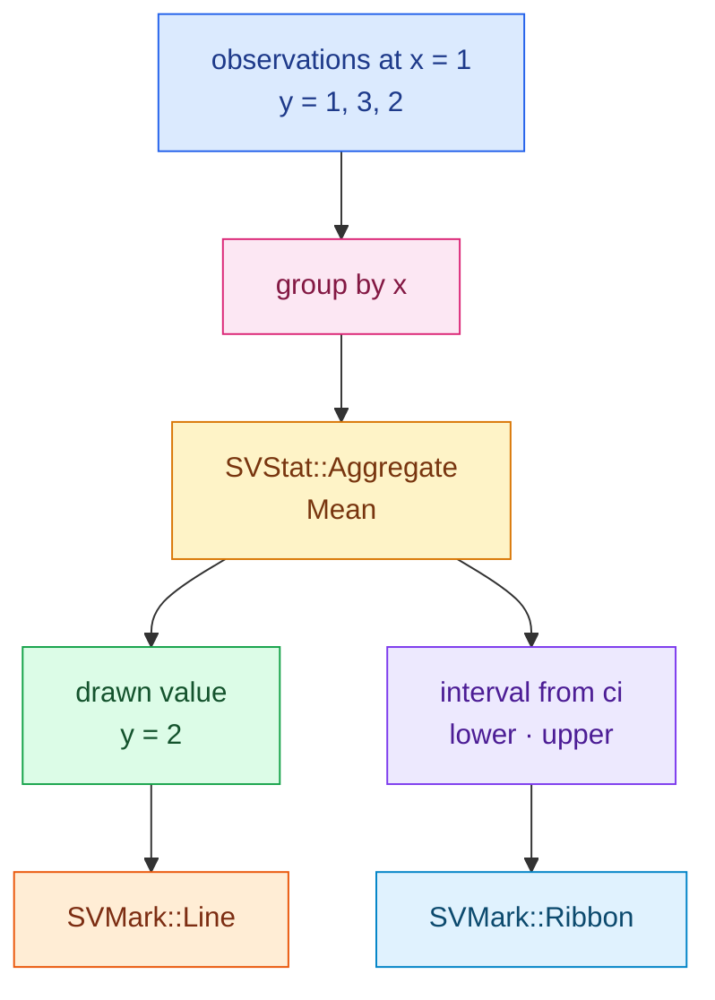

# Chapter 17 — A line plot: turning columns into a composed chart

A line plot answers a deceptively simple question: *how does a value change as
we move along an ordered axis?* The axis is usually time, but it can be any
continuous measurement. The chart draws one line per series and, when several
observations share the same position, it can summarise them before drawing.

This chapter follows `SVLinePlot`, one of the relational recipes.
It is a *recipe*: it introduces no new statistical, geometric or rendering
kernel. It arranges the kernels that already exist into one named chart, the
same way a kitchen follows a recipe with ingredients it did not invent.

```mermaid
flowchart LR
    A["x, y, series, group<br/>dense · sparse · streaming"] --> B["SVStat::Aggregate<br/>(optional)"]
    B --> C["ordering by x<br/>gaps or bridging"]
    C --> D["SVLineInterpolation<br/>linear · step · spline"]
    D --> E["SVScale<br/>x and y"]
    E --> F["SVMark::Line<br/>+ Dot markers<br/>+ Ribbon interval"]
    F --> G["SVDecoration<br/>axes · grid · legend · title"]
    G --> H["SVSvgDocument<br/>self-contained SVG"]
    style A fill:#dbeafe,stroke:#2563eb,color:#1e3a8a
    style B fill:#fef3c7,stroke:#d97706,color:#78350f
    style C fill:#fce7f3,stroke:#db2777,color:#831843
    style D fill:#ede9fe,stroke:#7c3aed,color:#4c1d95
    style E fill:#dcfce7,stroke:#16a34a,color:#14532d
    style F fill:#ffedd5,stroke:#ea580c,color:#7c2d12
    style G fill:#e0f2fe,stroke:#0284c7,color:#0c4a6e
    style H fill:#f3e8ff,stroke:#9333ea,color:#581c87
```



## The data contract: long format, not wide format

A line plot does not receive a matrix of series. It receives *long-format*
columns that share one logical length:

| Column | Role | Required |
|---|---|---|
| `x` | the ordered position | yes |
| `y` | the value drawn | yes |
| `series` | grouping; one line per distinct code | no |
| `group` | extra grouping for aggregation | no |

Two series therefore look like this, with every `x` repeated once per series:

```text
x     y     series
0.0   0.0   0
0.0   1.0   1
1.0   0.4   0
1.0   0.9   1
```

The builder validates that every column has the same length before any mark is
built. That is why the example duplicates the phase column when it appends the
sine and cosine observations.

## Same chart on three representations

The recipe reads named columns from any `SVDataSource`. The in-memory
`SVDataTable` adapter works for borrowed dense slices, and the core's sparse and
streaming adapters present the same trait, so the recipe itself never knows
which representation it received. It resolves a sparse column by visiting only
its stored entries — never by expanding it into a dense buffer — and it reads a
streaming column from the snapshot the source already published, so the render
thread never waits for new data.

The companion test
`a_sparse_input_is_never_densified` proves the sparse path draws three points
from a logical column of length ten. `dense_sparse_and_streaming_agree_within_the_documented_tolerance`
proves the three representations produce the same series within the documented
tolerance. A streaming chart is accepted by a backend that declares support for
streaming; an export-only backend rejects it at build time, which the test
`an_export_only_backend_rejects_a_streaming_column_at_build` asserts.

## Ordering: the line must know which point comes next

A polyline is an ordered sequence. If the observations arrive shuffled, drawing
them in arrival order produces a scribble. `SVLinePlot` therefore sorts each
series by `x` by default, with a *stable* sort: equal `x` values keep their
arrival order. Setting `sort_by_x(false)` preserves the incoming order for
callers that already know it.

Ordering is also what makes a live line cheap to grow. Each line keeps a stable
`(series, group)` identity, so an appended observation is placed at its own `x`
without moving the points already drawn. The geometry is transition-ready, but
this recipe does not yet wire a keyed transition surface; point-position
interpolation and dash swapping are deferred to the animation recipe change.

## Missing values: a gap or a bridge

A non-finite `x` or `y` is not a value on the canvas. By default such an
observation ends the current segment, and drawing resumes after it:

```text
y:  1     2    NaN    4     5
    ●────●           ●────●
```

`bridge_missing(true)` drops the missing observation and connects the
neighbours instead. The test
`missing_values_break_the_line_unless_bridging_is_requested` walks both paths
and asserts two segments versus one.

## Aggregation: many observations at one position

Seaborn's `lineplot` estimates a value per `x`; plotly and bokeh draw the
observations as given. Both behaviours are useful, so aggregation is an
explicit option, not a hidden default.

The recipe first splits the observations into one line per `(series, group)`
pair, then groups that line's observations by `x` and calls the existing
`SVStat::Aggregate`. The estimator (`Mean` by default, or median, sum, minimum,
maximum, standard deviation, count) decides the drawn value. An optional `error`
or `ci(probability)` asks for an interval; the recipe draws it with
`SVMark::Ribbon` underneath the line.

Keeping the group in the line identity is essential. If two groups observed at
the same `x` stayed in one line, the aggregate would emit two vertices at that
`x` and the polyline would draw a vertical spike. The regression test
`a_group_splits_into_one_line_per_series_and_group` covers exactly that case,
and `two_groups_over_several_x_values_keep_independent_lines` proves each group
keeps its own ordered vertices.



The test `aggregation_reports_the_estimator_and_draws_the_interval` feeds two
observations at `x = 1` and two at `x = 2`, asserts the drawn values are the
means `2` and `3`, and asserts both a ribbon and a line become primitives.

## Interpolation without a second line kernel

Plotly exposes `line_shape`: `linear`, `spline`, `hv`, `vh`, `hvh`, `vhv`.
`SVLinePlot` mirrors those shapes as `SVLineInterpolation`. The important design
choice is *where* the shape is applied: the recipe expands the observations into
the vertices a polyline needs, in data space, and then hands those vertices to
the existing line mark. The line mark is never reimplemented.

- `StepStart` (`hv`) holds the old value, then jumps.
- `StepEnd` (`vh`) jumps at the current `x`, then holds.
- `StepMiddle` (`hvh`) jumps at the midpoint.
- `StepCentered` (`vhv`) uses a vertical–horizontal–vertical transition around
  the midpoint.
- `Spline` samples a Catmull-Rom curve through each pair of observations.

Because markers are drawn from the original observations, not from the
interpolated vertices, a spline does not turn into a field of dots. The test
`step_interpolation_inserts_the_corner_vertices` asserts the expected five
vertices for three step observations.

## Multi-series colour, markers and the legend

When the `series` column is present, the recipe assigns each distinct code the
next entry of the scale kernel's stable categorical palette. A series keeps its
colour when a new series appears, because the palette index is assigned at first
appearance. The test
`series_divides_the_lines_and_assigns_a_stable_colour_each` asserts two series,
two different colours and a non-empty legend.

Without an explicit `dash`, the recipe also cycles the documented dash patterns
across the series, so two lines remain distinguishable without colour alone.
`legend` takes an `SVLegendPlacement`: `Auto` is the default, and
`legend(false)` is shorthand for `SVLegendPlacement::Hidden`. The test
`legend_false_hides_the_legend` proves the legend contributes no decoration while
the lines still draw.

`markers(true)` adds `SVMark::Dot` on top of every line, one circle per
observation. `line_width` and an explicit `dash` flow straight into
`SVMark::Line`'s paint, which `line_width_and_dash_reach_the_stroke_paint`
verifies on the produced primitives. Setting `x_scale_kind(Temporal)` (with an
optional `temporal_unit`) builds a time axis; the test
`a_temporal_x_scale_is_built_from_the_option` asserts the scale kind and unit.

## Composition, observability and rendering

`SVLinePlot::compose()` resolves the series, the scales and the decorations and
returns an `SVLinePlotComposition`. A backend then visits the mark geometries in
draw order: intervals first, lines next, markers last. This visitor shape keeps
the recipe independent of any document type while still letting the real SVG
backend serialize every geometry. The composition is the scene: `to_svg()`
serializes it and `to_native_frame()` rasterizes the very same decorations and
marks with the from-scratch CPU renderer, so the two backends cannot drift. A
backend the recipe does not wire yet is rejected explicitly with
`UnsupportedBackendCapability`.

Every public operation runs inside the one operation span from the figure
substrate. `composing_records_the_backend_representation_and_drawn_marks`
captures that span and asserts `backend.kind = svg`, `representation = Dense`
and `points = 3`. The `points` field counts the marks actually drawn: with
aggregation the test
`aggregation_reports_drawn_marks_not_the_logical_length` shows four input rows
collapsing to two drawn marks. `concurrent_renders_produce_byte_identical_documents`
renders one chart from eight threads and compares the bytes, and
`the_svg_backend_matches_the_checked_in_figure_through_the_public_path` proves
the checked-in figure is exactly what `render()` produces.

## The example and its figure

The runnable program is `examples/line_plot.rs`. It builds a damped sine and
cosine, one series each, through the named in-memory data source and renders
with the configured backend:

```rust,ignore
use scienceview::sv_recipes::sv_relational::sv_line_plot::SVLinePlotBuilder;
use scienceview_core::sv_data::{SVColumnRole, SVDataTable};

let table = SVDataTable::builder()
    .with_column("x", SVColumnRole::X, &x)
    .with_column("y", SVColumnRole::Y, &y)
    .with_column("series", SVColumnRole::Grouping, &series)
    .build()?;

let plot = SVLinePlotBuilder::new()
    .data_source(&table)
    .x("x")
    .y("y")
    .series("series")
    .markers(true)
    .line_width(SVLength::absolute(2.0))
    .title("Damped oscillation by series")
    .backend(SVBackendKind::Svg)
    .build()?;

let bytes = plot.render()?.bytes;
```


The figure name, `line_plot_recipe.svg`, is deliberately distinct from the
existing `line_plot.svg` produced by the `line_plot_svg` example.
