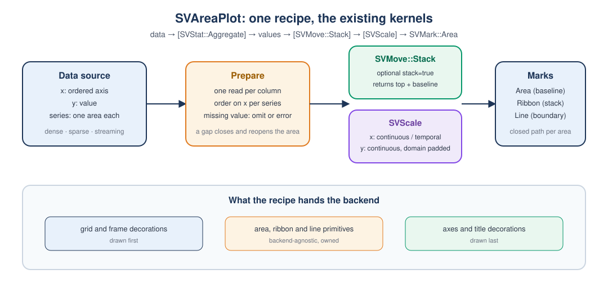
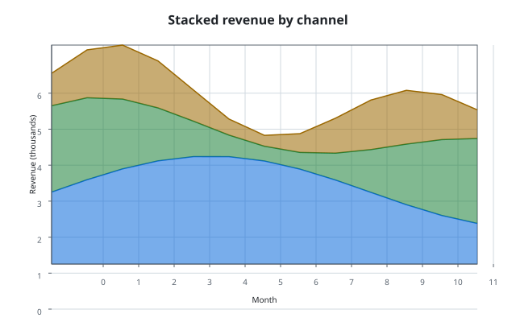

# Chapter 18 — Areas: filling the space between a line and a baseline

An area chart answers a simple question that a line chart cannot: *how much is
there*, not only *how high is the line*. The filled region makes magnitude
visible at a glance, and when several series are stacked, the total height of
the stack is the sum of the parts.

This chapter follows the `area-plot` change. It explains what an area chart
is, how `SVAreaPlot` is built from the kernels the previous chapters described,
and how its companion tests prove the behaviour. No Rust or numerical
computing background is assumed.



## What an area chart is

A line chart joins a sequence of points with a stroke. An area chart takes the
same sequence and *closes* it against a second line — the **baseline**. The
space between the two becomes a filled polygon.

Three ideas make the chart useful:

- **Order.** The horizontal axis is ordered. Area charts are about an ordered
  quantity, usually time or a continuous measurement, not about arbitrary
  categories.
- **Baseline.** The region has to close somewhere. The most common choice is
  zero, but a chart may close against the bottom or the top of its vertical
  domain, or against an explicit value.
- **Series.** Several areas can share the horizontal axis. Without stacking,
  each one closes against the same baseline and they overlap. With stacking,
  each area starts where the previous one ended, so the areas tile.

The stacked area chart is the reason the stack kernel of
[Chapter 11](ch11-positional-moves.md) exists. Stacking is not an area-chart
feature; it is a positional move that any chart can compose.

## The pipeline

`SVAreaPlot` is a **recipe**: a named chart assembled from the existing
kernels. It adds no kernel variant. In the notation of the FDRs, the pipeline is

```text
data -> [SVStat::Aggregate] -> values -> [SVMove::Stack] -> [SVScale] -> SVMark::Area
```

The square brackets mean *optional*. The chart in this change uses the
aggregate step only as a documented extension point; the stack is composed
when `stack(true)` is selected.

Each stage is a real type in the library:

| Stage | Type | What it does |
|---|---|---|
| Data | `SVDataSource` → `SVColumnView` | Reads `x`, `y` and the optional `series` once |
| Move | `SVMove::Stack` | Produces a cumulative top and a per-point baseline |
| Scale | `SVScale` | Turns data coordinates into display coordinates |
| Mark | `SVMark::Area`, `SVMark::Ribbon`, `SVMark::Line` | Produces the filled paths and the boundary stroke |
| Decoration | `SVAxis`, `SVGrid`, `SVTitle` | Draws the axes, the grid and the title |
| Serializer | `SVSvgDocument` | Writes the primitives as a self-contained SVG |

The recipe's job is to route values between these stages and to make the
choices explicit. It never re-derives a position and never reimplements a
kernel.

## Building the chart

The builder follows the same rules as every other figure builder in the
library: it is the only public constructor, the backend is required, the
execution mode defaults to `Automatic`, and `build` performs no backend
dispatch.

```rust
use scienceview::recipes::relational::SVAreaPlot;
use scienceview_core::sv_backend::SVBackendKind;
use scienceview_core::sv_data::{SVColumnRole, SVDataTable};

let x = [0.0, 1.0, 2.0, 3.0];
let first = [1.0, 2.0, 1.5, 2.5];
let second = [0.5, 1.0, 1.2, 0.8];
let table = SVDataTable::builder()
    .with_column("month", SVColumnRole::X, &x)
    .with_column("first", SVColumnRole::Y, &first)
    .with_column("second", SVColumnRole::Y, &second)
    .build()?;

let plot = SVAreaPlot::new()
    .data_source(&table)
    .x("month")
    .y("first")
    .backend(SVBackendKind::Svg)
    .build()?;
```

The type state is deliberate: `build` exists only on the builder that already
carries a backend selection. A program that forgets `.backend(...)` does not
fail at run time — it does not compile.

### The options

| Option | Type | Default | Meaning |
|---|---|---|---|
| `x` | column name | required | Ordered horizontal axis |
| `y` | column name | required | Vertical value |
| `series` | column name | none | One area per distinct code |
| `stack` | `bool` | `false` | Stack areas on each other |
| `baseline` | `SVBaselineMode` | `Zero` | Where a non-stacked area closes |
| `opacity` | `f32` | theme token | Fill opacity |
| `line` | `bool` | `true` | Draw the boundary stroke |
| `interpolate` | `SVAreaInterpolation` | `Linear` | Boundary interpolation |
| `missing_value_policy` | `SVMissingValuePolicy` | `Omit` | Omit or reject a gap |
| `theme` | `SVMarkTheme` | built-in | Mark defaults |
| `title`, `x_title`, `y_title` | strings | none | Figure and axis titles |
| `x_scale_kind` | `SVScaleKind` | `Continuous` | Continuous or temporal |
| `viewport` | `SVViewport` | 640 × 400 | Logical figure size |

`build` rejects an incomplete configuration, a column the source does not
declare (`SVError::ColumnNotFound`), an opacity outside `0.0..=1.0`, a
non-finite explicit baseline, and an axis kind that cannot order samples. The
backend capability matrix is consulted for every composed mark.

## Baselines, and why stacking needs a ribbon

The area mark closes a sequence against a **single scalar baseline**. That is
exactly right for the unstacked chart: every point of every series closes
against the same zero (or the same explicit value).

A stack changes the picture. Each series now has its own lower boundary at
every horizontal position: the running total of the series below it. Those
lower boundaries differ from point to point, so a scalar baseline cannot
express them.

The recipe therefore composes two different marks:

- **Unstacked:** `SVMark::Area` with the configured `SVBaselineMode`.
- **Stacked:** `SVMark::Ribbon` between the cumulative baseline and the
  cumulative top.

Both are existing kernel variants; the recipe adds neither. Crucially, the
recipe does not compute the stack itself. It builds the interleaved value
column and hands it to `SVMove::Stack`, which returns both the new top and the
baseline for every point:

```rust
let sequence = SVMoveSequence::single(SVMove::stack().into())?;
let moved = sequence.apply(&SVMoveRequest::new(
    SVColumnView::Dense(&values),
    &group_keys,
))?;

// For every point, the stack answers both questions.
let top = moved.value_at(index);
let baseline = moved.baseline_at(index);
```

A `group_keys` entry identifies one horizontal position; the values of the
series at that position accumulate in series order. The result is a diverging
stack: positive values pile upward, negative values downward, and a zero
contributes nothing.

## Missing values

Real data has holes. A missing sample is expressed as a non-finite `f64`, and
the recipe makes the handling explicit:

- `SVMissingValuePolicy::Omit` (default) drops the sample and splits the area.
  Two finite runs on either side of the gap become two filled regions, so the
  chart never draws a straight line across data it does not have.
- `SVMissingValuePolicy::Error` rejects the render with
  `SVError::InvalidConfiguration`, naming the column and the position.

When the chart is stacked, an omitted sample contributes zero to the stack.
The series keeps its slot in the cumulative baseline, which is what keeps the
areas above it from collapsing.

## Dense, sparse and streaming

The data boundary of [Chapter 4](ch04-data-source-layer.md) presents a column
in one of three representations. A recipe reads each column exactly once and
never calls a dense-buffer accessor on a sparse view.

For the area chart, the value column decides the representation recorded in
the operation span. The preparation reads the logical positions of a sparse
column, so implicit zeros remain logical points of the area; a streaming column
is drawn from the bounded window snapshot it already carries, so a live update
never blocks the render thread.

This is what makes the parity test meaningful:

```rust
let dense = build_plot(&SVTestSource::dense()).rendering()?;
let sparse = build_plot(&SVTestSource::sparse(true)).rendering()?;
let streaming = build_plot(&SVTestSource::streaming()).rendering()?;

// Dense and sparse agree exactly; streaming agrees within the
// representation tolerance of one part in a trillion.
assert_points_within(
    &path_points(dense.primitives()),
    &path_points(sparse.primitives()),
    0.0,
);
assert_points_within(
    &path_points(dense.primitives()),
    &path_points(streaming.primitives()),
    1e-12,
);
```

The test source is a small borrowed fixture that can answer the same column as
dense, sparse or streaming. The scattered `path_points` helper is a reminder
that the comparison is about *geometry*, not about the bytes of a document.

## The tests as the executable specification

The companion module `area_plot_tests.rs` is the source of truth for this
chapter. The most important tests read as a checklist of the FDR:

| Test | What it proves |
|---|---|
| `builds_with_the_documented_defaults` | Every documented default is present |
| `a_missing_column_fails_at_build_time` | A column the source does not declare is a typed error |
| `a_missing_required_option_fails_at_build_time` | `y` is required |
| `an_out_of_range_opacity_fails_at_build_time` | Option validation happens before a pixel |
| `every_option_that_changes_output_is_reflected` | Each option reaches the output |
| `dense_sparse_and_streaming_representations_agree` | Representation parity |
| `each_column_is_resolved_exactly_once_per_operation` | One read per column |
| `a_missing_value_splits_the_area_into_runs` | The gap policy closes and reopens regions |
| `a_strict_missing_value_policy_rejects_the_render` | The strict policy is loud |
| `the_configured_baseline_moves_the_area` | The baseline is real geometry |
| `the_line_option_adds_a_stroked_boundary` | The optional stroke is composed |
| `the_stacked_areas_tile_against_the_cumulative_baseline` | Stacking uses the move kernel |
| `the_operation_span_carries_the_backend_representation_and_points` | Observability is part of the operation |
| `concurrent_renders_agree` | The figure is safe to render from several threads |
| `large_data_draws_every_point` | Ten thousand points are not silently dropped |

The concurrency test is not decorative. A recipe carries borrowed column
names and a shared data source; if it cached mutation state between renders,
two threads would disagree. The test renders the same chart eight times in
parallel and compares the path points.

## What the backend receives

`rendering()` returns `SVAreaRendering`, an owned, backend-agnostic
composition with three ordered layers:

1. `grid_and_frame` — the grid lines and the plot border;
2. `primitives` — the filled areas and the boundary strokes;
3. `axes_and_title` — the tick labels and the title.

The order matters: the marks must paint over the grid and under the axes.
Because the primitives are owned geometry, a backend serializes them without
re-deriving anything. With the `render-svg` feature, `render()` and `save()`
push the layers into `SVSvgDocument`; the example program uses the same surface
directly.

## A generated figure

`examples/area_plot.rs` builds a stacked three-series chart and writes the
figure the book displays. Run it from the repository root:

```sh
cargo run --example area_plot
```

```rust,ignore
let plot = SVAreaPlot::new()
    .data_source(&table)
    .x("month")
    .y("revenue")
    .series("channel")
    .stack(true)
    .opacity(0.55)
    .line(true)
    .title("Stacked revenue by channel")
    .backend(SVBackendKind::Svg)
    .build()?;
```



The figure is generated by the tool itself: the code pipeline reruns the
example and fails on any diff, and the book's pipeline compares the mirrored
copy, so the displayed figure cannot drift from the code.

## Roads not taken

- **One area mark with a per-point baseline.** It would make the stacked path
  one mark call, but it changes the closed mark vocabulary. The FDR fixes the
  vocabulary; a new baseline channel would be a core change with its own spec
  delta. The ribbon already expresses exactly the geometry.
- **Stacking inside the recipe.** Sorting the series and summing them by hand
  is short, but it duplicates the move kernel and it would diverge the moment
  normalisation or a different stack mode is composed. The recipe hands the
  values to `SVMove::Stack` and reads the answer.
- **Clipping the viewport in the recipe.** The scale already maps values to
  the range, and the backend already rasterizes. The recipe does not clip.
- **Animating the stack in the recipe.** The transition kernel owns
  interpolation between frames. The recipe recomputes the stack on each render,
  so the areas take their new positions frame by frame; wiring the transition
  plan into the recipe is a future change.

## Where to go next

The relational family continues with the line plot, which shares the data
contract and the aggregation question, and with the band plot, which shares the
ribbon mark. The area chart is the first recipe, so it also fixes the folder
layout every later recipe follows: a pure dispatcher in `mod.rs`, the builder,
its validated configuration, the preparation, the renderer and the companion
tests.

The next chapters walk other families. The same discipline applies: the recipe
names a chart, composes the kernels, and earns its place with tests that read
like the FDR.
