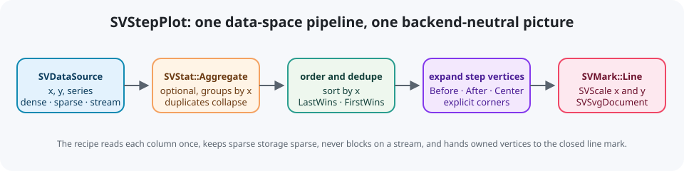
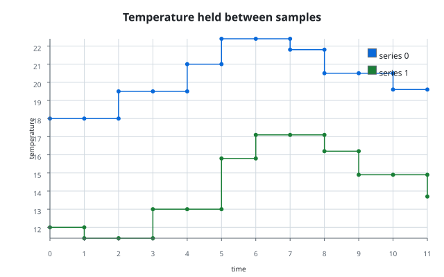

# Chapter 19 — Step plots: honesty about a value that does not interpolate

A line plot joins two samples with a straight segment. That is a claim: it says
the value passed smoothly through every point between the samples. For a
temperature read once a minute, a price that updates per order or a state
machine that jumps between modes, the claim is false. The value did not travel;
it stayed put until the next event and then changed all at once.

`SVStepPlot` draws that truth. It is the relational recipe introduced by the
`step-plot` change, specified by
[`FDR-104`](../../FDRs/recipes/relational-step-plot.md) and implemented in
`src/recipes/relational/step_plot/`. The public path is
`scienceview::sv_recipes::sv_relational::sv_step_plot`: the folders keep their
names and the module aliases carry the mandatory `sv_` prefix. This chapter
starts from zero — what a step is, why it needs its own geometry, what "dense,
sparse and streaming" mean here — and then walks through the real code and its
companion tests.



## What a step plot is

Take three samples: `(1, 10)`, `(2, 20)` and `(3, 30)`. A line plot draws
`(1, 10) → (2, 20)` with a slope. A step plot instead draws a horizontal run at
`10` until the moment the value changes, a vertical riser, and then a horizontal
run at `20`. The value is a function of `x` that is *constant between events* and
discontinuous at them.

There are three sensible places to put the riser:

- **Before** — the value changes at its own `x` (a *pre* step).
- **After** — the previous value holds until the next `x` (a *post* step; the
  default, and the form most sampling instruments report).
- **Center** — the riser sits halfway between the two `x` values (a *mid* step).

Those three are `SVStepPosition`. The FDR's provisional `where` column would
have selected the same corner a second time, so it was folded into the position
rather than shipped as a redundant control.

## Why the geometry lives in the recipe, not in the line mark

The chart is a composition of existing kernels: `SVDataSource`, optionally
`SVStat::Aggregate`, `SVScale` and `SVMark::Line`. Patterns.md P5 says a recipe
never adds a mark, stat, move or scale variant. A step is not a new *mark*: it
is the same stroked polyline with extra vertices. So the recipe expands each
sample into the explicit corners the line mark already draws:

```text
After   (1,10) (2,10) (2,20) (3,20) (3,30)
Before  (1,10) (1,20) (2,20) (2,30) (3,30)
Center  (1,10) (1.5,10) (1.5,20) (2.5,20) (2.5,30) (3,30)
```

That expansion is the chart's own logic, so it belongs in
`core_implementation/` and `extraction/`, not in the mark kernel. The payoff is
that every backend and every transition already knows how to draw and
interpolate those vertices.

## Reading the data once

A column is a sequence of `f64` values presented in one of three
representations:

- **dense** — a borrowed contiguous slice;
- **sparse** — borrowed indices and values, where every unlisted position is an
  implicit zero and is never expanded into memory;
- **streaming** — a borrowed snapshot of a bounded live window.

`extraction/cursor.rs` dispatches on a column exactly once with
`SVColumnView::dispatch`, then iterates the representation through a small
cursor. An operation resolves `x`, `y` and `series` once and hands the views to
the composition, so a live channel is drained once and the span's count matches
the snapshot it drew. Nothing is densified, and nothing waits for new data. A
sparse ordering column needs one extra thought: every unlisted position has
`x = 0`, and the duplicate-`x` policy collapses those positions to a single
observation, so a single-series chart visits the stored entries plus that one
representative position instead of expanding the column (scanning for a
representative with a finite `y` while skipping non-zero stored positions). A
`series` column or an aggregate needs the observations grouped per series, so
those paths fall back to the full logical length.

Non-finite values are *missing*, not errors: the pair is skipped. If every row
is missing, the operation reports `SVError::EmptyInput` instead of drawing a
silent empty frame.

## Ordering, duplicates and aggregation

The `x` axis is an ordering axis, so samples are sorted by `x` before the step
is expanded. Two rows can still share the same `x`. The recipe makes the choice
explicit with `SVStepDuplicatePolicy`:

- `LastWins` (default) keeps the last observation in input order, which matches
  a source that overwrites a sample at the same position;
- `FirstWins` keeps the first.

A caller who wants a statistic instead of a winner passes
`SVStat::Aggregate`:

```rust
SVStepPlot::builder()
    .data_source(&table)
    .x("time")
    .y("temperature")
    .aggregate(SVStat::aggregate(SVAggregateOptions::new()))
    .backend(SVBackendKind::Svg)
    .build()?
```

The aggregate groups each series by `x` in data space, so duplicate positions
collapse to their mean (or median, sum, minimum, maximum, standard deviation or
count) before any geometry is produced. The builder rejects any non-aggregate
stat up front with `SVError::InvalidConfiguration`.

## One line per series

The optional `series` column splits the samples into groups. Each group gets its
own colour from the default scale palette, its own markers and its own legend
entry. Markers sit on the original samples, never on the expanded corners: a
step corner is geometry, not a measurement. The first-appearance order is
preserved, so a live figure does not reshuffle its series when a new sample
arrives.

The horizontal axis is continuous by default and can be declared temporal with
`.x_scale(SVScaleKind::Temporal)`; the scale kernel and the axis decoration
consume either kind unchanged.

## The builder and the explicit backend

`SVStepPlot::builder()` is the only public constructor. It requires a data
source, an `x` and a `y` column, and an explicit `backend(SVBackendKind)`; there
is no automatic backend. `execution_mode(...)` defaults to `Automatic`, the
horizontal scale defaults to `Continuous` and accepts `Temporal`, and the built
figure carries the configured kind so every operation can record it.

`build()` is where every invalid **configuration** fails — before any pixel is
drawn. It checks that the columns exist, that a numeric channel is not a
`Label` column, that the columns share a length, that a configured stat is an
aggregate, and that the line options are valid. It does not reject the
configured backend: the composition is backend-neutral, so the scene can be
hosted by any kind. Whether a serializer for that kind exists is decided per
operation, not at build time.

## Composition, spans and the SVG document

`compose()` reads the current window and returns an `SVStepPlotComposition`: the
scales, the expanded vertices per series, the decoration primitives and the
resolved viewport. It is backend-neutral, so a backend only serializes. That is
the recipe-level scene contract: every operation composes the same scene, then
dispatches the serializer from the configured `SVBackendKind`. `render`,
`update` and `save` each run inside one `scienceview.operation` span carrying the
configured `backend.kind`, the `representation` and the number of observations
the scene actually draws — not the logical column length. A sparse column with
100k logical positions and two surviving samples reports `points = 2`.

`update(appended_points)` documents how many samples the source appended since
the previous render. This change owns no incremental buffer: the operation
re-resolves the source and recomposes the current window, so an appended sample
changes the output while the prior samples are preserved. An incremental append
path is deferred to the transition integration, and the FDR keeps that
acceptance item unticked until it exists.

The SVG path pushes the composition's title and grid, then each mark geometry,
then the axes and legend, into `SVSvgDocument` from `scienceview_svg`. That is
the real backend, not a hand-written string: the example
`examples/step_plot.rs` produces the checked-in
[`step_plot.svg`](../assets/step_plot.svg):



## Walking through the tests

The companion tests are the executable specification:

- `option_tests::the_documented_defaults_are_applied` checks the FDR defaults:
  `After`, markers on, token line width, no dash, no aggregate.
- `option_tests::each_step_position_expands_different_vertices` asserts the
  exact vertex lists for `Before`, `After` and `Center`.
- `data_contract_tests::ordering_tests` covers ordering, the duplicate policy,
  aggregation, missing values and multi-series colouring.
- `data_contract_tests::errors_tests` covers a missing column, a mistyped label
  column, a non-aggregate stat, the missing backend and a configured kind
  without a serializer, which fails at operation time with
  `BackendUnavailable` instead of degrading to SVG.
- `parity_tests::dense_sparse_and_streaming_agree` builds the same data in all
  three representations and compares the resulting series; the large-data test
  does the same for ten thousand samples.
- `concurrency_tests::concurrent_compositions_agree` composes one figure from
  eight threads and compares every result.
- `observability_tests` captures the real span fields through a subscriber,
  including the drawn point count of a large sparse column.
- `svg_tests` asserts a self-contained `<svg>` with a `<path>`, byte-identical
  repeated renders, a live append that `update` re-renders while preserving the
  prior samples, and `save`.

## Roads not taken

- **A new step mark variant.** Rejected by patterns.md P5, and unnecessary: the
  line mark already draws arbitrary polylines.
- **A `where` control next to `step`.** Two controls for one corner would drift;
  the three positions already describe the full geometry.
- **Interpolating the raw samples and letting the renderer snap corners.**
  Interpolation would reintroduce the very claim a step plot denies.
- **Making the recipe depend on the SVG crate unconditionally.** The
  composition stays backend-neutral, so the default build carries no backend and
  the example uses the SVG document surface directly.

This change ships the SVG path. The recipe-aware native, terminal and web
backends arrive with their own changes; until then an operation whose
configured kind has no serializer returns the typed
`SVError::BackendUnavailable` naming that kind, instead of degrading silently
to SVG.

## What to remember

A step plot is a *data-shape* decision: hold the value, then change it. The
recipe owns the ordering, deduplication and vertex expansion because those are
chart decisions; the kernels own the representation boundary, the scales, the
mark geometry and the serialization. That split is what keeps six relational
charts in one family without any of them reimplementing a kernel.
