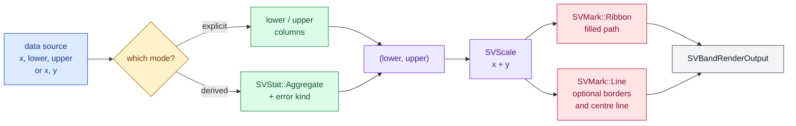

# Chapter 20 — Band plots: filling the space between two lines

A band plot draws a *region*, not a set of points. It is how a chart says "the
value is around here, and here is how sure we are": the filled strip between a
lower and an upper boundary. The same picture answers three questions that look
different but share one geometry — an uncertainty interval, a confidence band
around an estimate, and the range between two observed series.

This chapter tells the story of `SVBandPlot`, the fifth recipe of the
relational family and the implementation of FDR-105. It starts from zero, walks
through the decisions, and ends in the real companion tests that make the
claims executable.

## The idea, from zero

Imagine a table with one row per measurement:

| time | load | scenario |
|---|---|---|
| 0 | 2.1 | 1 |
| 0 | 2.4 | 1 |
| 1 | 2.6 | 1 |
| … | … | … |

A line plot would draw the mean at each time. A band plot draws two lines
instead — the lower and the upper edge of an interval — and fills everything
between them. The fill is a *path*: a sequence of points along one edge,
followed by the same points along the other edge in reverse, closed back to the
start. Nothing about the picture is new geometry: it is the same polygon the
SVG backend has drawn since chapter 12.

Two ways produce the two edges:

1. **Explicit bounds.** The table already carries a `lower` and an `upper`
   column. The recipe draws them exactly.
2. **Derived bounds.** The table carries observations. A statistical transform
   computes a mean per group and an interval around it; that estimate and
   interval become the edges. This is the mode a line plot uses for its
   confidence interval, and it is why the recipe composes the stat kernel
   rather than re-deriving a standard deviation by hand.

## The composition

The FDR fixes the composition before any code exists:



The rectangle at the end is deliberate. A recipe does not know how to write an
SVG file, and it must not: it places values through the scale kernel and asks
the mark kernel for paths. `SVBandRenderOutput` is that backend-agnostic
answer — viewport, plot rectangle, mark geometries, decoration primitives. The
example serializes it with `SVSvgDocument`; a native or terminal backend can
walk the very same primitives later.

## The public surface

`SVBandPlotBuilder` is the only constructor, and `backend(...)` changes its
type state: `build` does not exist until a backend is selected. That is the
same typestate chapter 5 introduced for figures, reused here so no recipe can
quietly fall back to a default backend.

| Method | Meaning | Default |
|---|---|---|
| `data_source(...)` | the multi-column source | required |
| `x(...)` | the ordering column | required |
| `lower(...)`, `upper(...)` | explicit boundaries | explicit mode only |
| `derive()` | select the derived mode | off |
| `values(...)` | the column the derived mode aggregates | derived mode only |
| `series(...)` | one band per series | one band |
| `error(...)` | `SVAggregateErrorKind` of the derived interval | standard deviation |
| `confidence(...)` | centred percentile interval at a probability | selects `Percentile` |
| `opacity(...)` | overrides `mark.area_opacity` | theme token |
| `fill(...)` | draw the filled region | `true` |
| `border(...)` | draw the two boundary lines | `false` |
| `dashed_borders(...)` | dash the boundary lines | `true` |
| `centre_line(...)` | compose a line through the middle | `false` |
| `missing_value_policy(...)` | omit-and-split or fail | omit |
| `x_scale_kind(...)`, `temporal_unit(...)` | continuous or temporal x | continuous, days |
| `viewport(...)` | logical figure size | 640 × 400 |

The two modes are mutually exclusive by construction: `build` rejects an
explicit configuration without both boundaries, a derived configuration
without a value column, and any attempt to mix them. A missing or mistyped
column is an `SVError::ColumnNotFound` or an `SVError::InvalidConfiguration`
with the role that was expected — before a pixel is drawn (P7).

### Why `derive()` is a mode, not a stat value

The FDR's configuration table names `derive: Option<SVStat>`. An arbitrary
`SVStat` can produce bins, quantiles, densities or a fitted curve, and only
`Aggregate` produces the pair `(value, interval)` a band needs. Accepting any
stat and then guessing which result shape arrived would move a silent failure
into render time. The recipe therefore selects the derived mode explicitly and
builds the one stat it can decompose — `SVStat::Aggregate` — from the `error`
and `confidence` options. This is a deliberate narrowing of the surface, not a
new kernel capability.

## Explicit bounds

The explicit path keeps the source columns in their original representation.
It asks each column for a snapshot once, derives the domains, and passes the
views to `SVMarkRequest`:

```rust,ignore
let request = SVMarkRequest::new(x, lower, horizontal, vertical, plot)
    .with_lower(lower)
    .with_upper(upper);
let ribbon = SVMark::from(
    SVMark::ribbon().colour(colour).boundary(SVRibbonBoundary::Both),
);
let geometry = ribbon.geometry(&request)?;
```

The `Ribbon` mark builds the closed polygon: the upper boundary forward, the
lower boundary backward, then `Close`. The recipe adds nothing to that
geometry. If a future backend draws a band differently, it changes the ribbon
once, for every recipe.

## Derived bounds

In the derived mode the recipe groups rows by the `x` value within each series,
hands the values and the group codes to `SVStat::Aggregate`, and reads back one
`SVAggregateGroup` per group:

```rust,ignore
let stat = SVStat::aggregate(
    SVAggregateOptions::new()
        .method(SVAggregateMethod::Mean)
        .error(configuration.error),
);
let input = SVStatInput::new(SVColumnView::Dense(&group_y))
    .with_groups(SVColumnView::Dense(&group_x));
```

The interval is exactly the estimator's: one standard deviation on each side
by default, the standard error of the mean when requested, or the centred
interval covering a probability when `confidence(...)` selected
`SVAggregateErrorKind::Percentile`. Because the grouping happens inside the
stat kernel, a weighted or categorical grouping behaves like every other
aggregate in the library.

A streaming source is read from its bounded window; the resulting band is an
approximation of the full data, and the output says so through
`is_approximate()`. The recipe never waits for the next sample: the window it
was handed is all it reads.

## Missing values

A missing boundary is a non-finite `f64`. Leaving that to the first kernel
that reads it produces a scale error deep inside the composition, so the
policy is explicit:

- `SVMissingValuePolicy::Omit` (default) drops the sample and splits the band:
  the polygon closes before the gap and a new one opens after it, so the fill
  never bridges over data that is not there.
- `SVMissingValuePolicy::Error` rejects the whole render with an
  `InvalidConfiguration` naming the column and the position.

The splitting itself is still composition: every finite run becomes its own
`Ribbon` request. No invisible repair, no interpolation, no invented value.

## Borders and the centre line

`border(true)` draws the two edges explicitly. Dashed is the default because a
solid border competes with the fill; `dashed_borders(false)` composes solid
lines instead. `centre_line(true)` computes the midpoint of each pair of
bounds and draws a `Line` mark through it. Both use the existing `Line` mark,
so the dash patterns, joins, caps and opacity rules are the kernel's, not a
private copy.

## One example, one figure

`examples/band_plot.rs` derives a load interval per scenario from a small
table, enables the dashed borders and the centre line, and writes the figure:


The same geometry is available to any backend: `render()` returns mark
primitives already in logical pixels.

## The tests are the specification

The companion tests are split the way the unit is split:

- `band_plot_tests.rs` — the default composition, exact explicit bounds,
  opacity, fill, border dashes and the centre line. The exactness test reads
  the path commands and compares both edges against the scaled data.
- `band_plot_derived_tests.rs` — the derived mean and standard deviation,
  compared with a hand-computed interval, plus the percentile mode.
- `band_plot_missing_tests.rs` — a `NaN` boundary becomes two polygons under
  `Omit` and an error under `Error`.
- `band_plot_parity_tests.rs` — dense, sparse and streaming sources agree on
  every path vertex within `1e-9`; a counting source proves each column is
  resolved exactly once.
- `band_plot_concurrency_tests.rs` — ten thousand points render, and four
  threads rendering the same built plot produce identical geometry.
- `band_plot_series_tests.rs` — one band per series, in both modes.
- `band_plot_observability_tests.rs` — the render span carries the configured
  backend, the representation and the point count.
- `band_plot_svg_tests.rs` — the SVG is self-contained and byte-identical
  between two renders.

## Roads not taken

- **Hand-rolled paths.** Building the polygon in the recipe would duplicate
  the ribbon mark and make the SVG and native backends disagree as soon as one
  of them changed.
- **A new mark variant.** `Ribbon` already means "region between two
  boundaries"; adding `Band` would split the vocabulary for no new geometry.
- **Densifying a sparse column.** The explicit single-series path hands the
  sparse view to the mark kernel unchanged. The mark reads stored entries and
  implicit zeros without allocating a dense twin.
- **Blocking on a stream.** A derived band always renders the current window.
  It marks the result approximate instead of waiting for a "complete" stream
  that a live source never provides.
- **A stat parameter on the builder.** As explained above, only `Aggregate`
  yields the two boundaries; accepting arbitrary stats would move a type error
  into render time.
