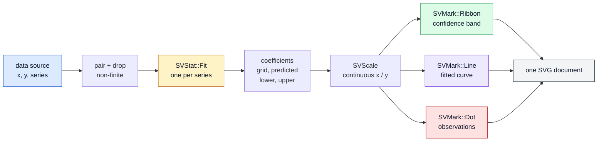
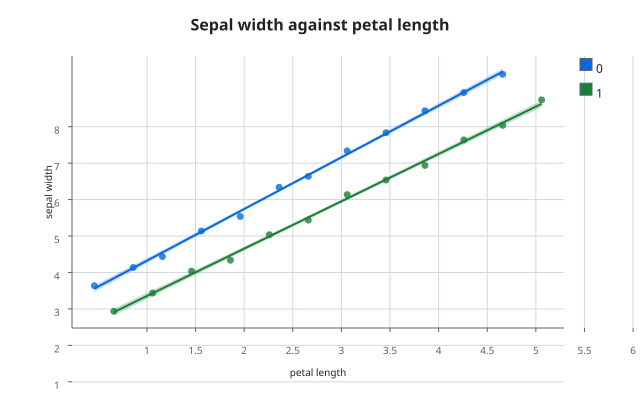

# Chapter 21 — Regression: turning a cloud of points into a statement

A scatter plot shows that two quantities move together. A regression plot goes
one step further: it fits a model to the points and draws that model on top of
them, so the reader sees both the evidence and the claim. This chapter follows
`SVRegressionPlot`, the recipe specified by
[FDR-106](../../FDRs/recipes/relational-regression-plot.md), from the idea of a
fit to the three marks that share one pair of axes.

## The question the chart answers

Imagine measuring a flower: the length of a petal on one axis, the width of the
sepal on the other. Each flower is a dot. The dots drift upward, but they do not
form a perfect line. Two questions follow:

1. **What is the trend?** A straight line through the cloud summarises it.
2. **How sure are we?** A band around that line shows where the true trend
   could plausibly lie.

The recipe draws the dots, the line, and — when asked — the band. Everything
else is configuration.

## The concepts, from zero

**Predictor and response.** The predictor (`x`) is the quantity we read first;
the response (`y`) is the one we explain. The chart never guesses which is
which: the builder requires both columns.

**Least squares.** A line is `y = a + b x`. For every observation the model
makes an error, the *residual*. The ordinary least-squares fit chooses the `a`
and `b` that make the sum of squared residuals as small as possible. A
polynomial of order *n* is the same idea with more terms; a logarithmic,
exponential or power model applies a link transformation first, fits a line in
the transformed space, and converts the coefficients back. All five models live
in `SVFitModel`, and all five are computed by the stat kernel — the recipe
never contains a solver.

**Confidence band.** A fit is an estimate. The band is an interval around the
prediction whose width grows where the data is sparse and shrinks where it is
dense. The kernel computes it from the residual variance and the design matrix;
the recipe only asks for a probability.

**Series.** Often the cloud contains several groups — species, treatments,
batches. Each group deserves its own fit and its own colour. The recipe groups
by the numeric codes of the `series` column and fits once per group.

## The composition

The chart is exactly the composition the FDR records. No new mark, stat, move
or scale variant is introduced (patterns.md P5).



The three marks are deliberately drawn in that order: the band is behind, the
line sits on it, and the observations sit on top. The order of pushes into the
document *is* the draw order; there is no z-index.

## The public surface

`SVRegressionPlotBuilder` is the only constructor. It is a typestate builder:
`build` exists only after both `data_source(...)` and `backend(...)` have been
called, so the explicit backend rule cannot be bypassed. Every other option is
optional and can be applied at any stage.

```rust
use scienceview::recipes::relational::SVRegressionPlotBuilder;
use scienceview_core::sv_stat::SVFitModel;

let plot = SVRegressionPlotBuilder::new()
    .data_source(&table)
    .x("petal length")
    .y("sepal width")
    .series("species")
    .model(SVFitModel::Linear)
    .confidence(0.95)
    .backend(SVBackendKind::Svg)
    .build()?;
let composition = plot.compose()?;
```

`SVRegressionConfiguration` records the FDR's configuration table and exposes
one getter per option. `SVExtrapolationPolicy` chooses whether the curve spans
the fitted range (`FitRange`, the default) or is clipped to an explicit visible
domain (`ClipToVisibleDomain`). `SVRegressionComposition` is the owned result
of an operation: one `SVRegressionSeriesFit` per group, the two domains, the
representation, the number of observations and the number of dropped pairs.
Each series exposes the kernel's coefficients, grid, predictions and bounds —
never a recipe-computed copy.

## The data boundary, once per operation

`compose` resolves every bound column once, through `SVDataSource`. Dense and
streaming columns pair by logical position. Two sparse columns pair only when
they share the identical stored support: the fit kernel rejects sparse storage
because two independently sparse columns describe implicit zeros at different
positions, and the recipe must not quietly densify one to get around that. A
mismatched support is rejected with the same `UnsupportedRepresentation` and
the same alternative path the kernel documents. The parity test
`dense_sparse_and_streaming_agree_within_the_tolerance` compares the three
representations to `1e-9`, and
`a_sparse_view_is_paired_through_its_stored_support_without_zeros` proves that
four stored entries in a length-six column stay four observations, not six.

A pair is dropped when the predictor, the response or the group code is not
finite. The kernel never sees a missing value; the chart counts what it dropped
in `SVRegressionComposition::dropped_pairs`. An input with no finite pair fails
with `EmptyInput`, an explicit error rather than an empty picture.

## The tests are the specification

The companion tests read as the acceptance record of the FDR:

| Test | What it proves |
|---|---|
| `the_linear_fit_recovers_the_generating_line` | the coefficients are `1.0` and `2.0`, exactly the kernel's result |
| `a_polynomial_order_is_fitted_not_interpolated` | order two recovers a quadratic and keeps the 128-sample grid |
| `the_confidence_band_brackets_the_curve` | every prediction lies inside the kernel's lower and upper samples |
| `each_series_receives_its_own_fit_and_colour` | two group codes produce two fits and two palette colours |
| `a_non_finite_pair_is_dropped_before_the_fit` | two invalid pairs leave three observations and the same slope |
| `incomplete_and_inconsistent_configurations_fail_at_build_time` | missing columns, equal columns, a zero order, an invalid confidence and an inverted domain all fail before rendering |
| `the_same_chart_composes_concurrently_with_identical_results` | eight threads compose the same built chart and get identical output |
| `composing_records_the_backend_representation_and_point_count` | the operation span carries `backend.kind`, `representation`, `points`, `duration` and the outcome |

The SVG tests add determinism: rendering twice is byte-identical, the document
is self-contained, an unsupported backend is refused explicitly, and `save`
writes exactly what `render` returned.

## Extrapolation, honestly

A line fitted to data between 1 and 5 should not be drawn at 500 and presented
as a prediction. The kernel evaluates its grid over the observed predictor
range; the recipe can clip that grid further with
`ClipToVisibleDomain`, but it never evaluates a model outside the fitted range.
Doing so would be a second implementation of the fit under a different name.

## Roads not taken

- **Observation weights.** FDR-106 lists a `weight` column, but neither
  `SVStat::Fit` nor `SVFitEstimator` consumes weights. Adding a weighted
  regression inside a recipe would be a kernel change smuggled into a chart;
  the row is deferred to a core-stat change and the recipe exposes nothing it
  would have to ignore.
- **A separate `ci` selector.** The band's shape is the kernel's `confidence`
  parameter. A second interval kind would invent an interval the kernel does
  not compute.
- **A residual plot.** Deferred from seaborn's `residplot`; it is a separate
  chart, not a mode of this one.
- **A point-by-point animation of the curve.** The kernel exposes coefficients,
  so a transition interpolates the coefficients and recomputes the curve. An
  interpolated sample path would pass through nonsense for a polynomial.

## The figure

Run `cargo run --example regression_plot` to regenerate the picture from the
real builder:



Two series, one fit each, one shared legend, and a band that narrows where the
data is dense. The next chapters apply the same recipe pattern to the other
families.
