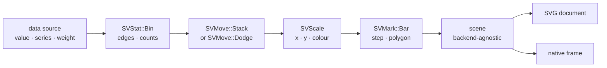

# Chapter 22 — Histograms: counting the shape of a variable

A scatter plot answers *where* observations are. A histogram answers a
different question: **how many observations fall in each interval?** That
question sounds simpler, but it is the first recipe in this book where the
chart does not draw the data it was given. It draws a *statistic* computed
from the data. The recipe that turns observations into bins is
`SVHistogramPlot`, specified by
[FDR-111](../../FDRs/recipes/distribution-histogram-plot.md).

This chapter explains why the histogram is the reference recipe for the stat
layer, how the recipe composes the kernels that already exist, and what the
companion tests prove.

## The pipeline

A histogram is not a new kind of drawing primitive. It is a fixed arrangement
of the kernels from the previous chapters:



Every box is a kernel that already shipped. The recipe adds no mark, stat,
move or scale variant (patterns P1 and P5); its job is to decide **which
kernel runs, in which order, with which configuration**, and to translate
between their data-space contracts.

That is why the histogram is the reference recipe for the stat layer: the
remaining distributional charts — density, ECDF, box, violin, strip, count —
are variations of the same arrangement.

## Reading the data contract

The builder names the columns instead of taking them positionally:

```rust,ignore
use scienceview::sv_backend::SVBackendKind;
use scienceview::sv_data::{SVColumnRole, SVDataTableBuilder};
use scienceview::sv_recipes::sv_distribution::sv_histogram_plot::SVHistogramPlot;
use scienceview::sv_stat::SVNormalisation;

let table = SVDataTableBuilder::new()
    .with_column("sepal_width", SVColumnRole::X, &SEPAL_WIDTH)
    .with_column("species", SVColumnRole::Grouping, &SPECIES)
    .build()?;

let scene = SVHistogramPlot::builder()
    .data_source(&table)
    .value("sepal_width")
    .series("species")
    .bin_count(10)
    .normalise(SVNormalisation::Probability)
    .backend(SVBackendKind::Svg)
    .build()?
    .compose()?;
```

`value` is required. `series` is optional and gives one set of bins per
distinct value. `weight` is optional and names an observation weight column:
the builder aligns it with the value column through series splitting and
missing-value omission and hands it to `SVStat::Bin`, which owns the weighted
fold. Count, probability and density heights then divide by the total weight,
all-ones weights reproduce the unweighted bins exactly, and a negative,
non-finite or misaligned weight column fails with a typed error naming the
operation and position. Chapter 53 explains the kernel and the formulas.

`build` resolves the columns once to validate that they exist and share a
length, and records the number of observations. It performs **no** binning and
**no** backend dispatch: the configured kind is stored on the plot and resolved
again by every operation.

## Binning is the kernel's job

The recipe never counts observations itself. It creates an `SVBinOptions`
value, calls `SVStat::bin(options).apply(SVStatInput::new(view))`, and reads
the edges and the heights back from `SVBinResult`.

The kernel decides the edges with a documented precedence:

| Request | Kernel behaviour |
|---|---|
| `bin_edges(vec![...])` | Uses the explicit, strictly increasing edges |
| `bin_width(width)` | Makes contiguous bins of that width, `ceil(range / width)` of them |
| `bin_count(count)` | Splits the range into `count` equal bins |
| none | Uses the recipe's derived count (see below) |

When the caller requests none of the first three, the recipe derives a count
from its plot extent, the width a layout-driven composition will supply: one
bin per 14 logical pixels, clamped to `4..=40`. The composition owns the width;
the stat kernel still owns the data range. This is the answer the FDR records
to its open question about bin counts in pixels versus data.

Normalisation also belongs to the kernel:

- `Count` returns raw observation counts;
- `Probability` divides by the number of observations **inside the edges**, so
  the heights sum to one;
- `Density` divides by that total *and* by the width of each bin, so the area
  under the bars integrates to one.
- `cumulative(true)` accumulates the normalised heights bin by bin.

The companion tests check all of these properties: `probability_heights_sum_to_one`,
`density_heights_integrate_to_one`, and
`cumulative_heights_are_monotone_and_end_at_the_total`. The last one is worth
reading: it asserts `[3, 6, 8]` for eight observations in three bins, so a
cumulative histogram of probability also proves the order of the accumulation.

## Series, common bins and common normalisation

A `series` column splits the observations into groups. The recipe builds one
observation group per distinct series value, in first-appearance order, and
gives each group a palette colour from `sv_scale`.

Two FDR options control how the groups relate:

- `common_bins(true)` — the default — derives **one** range from every group
  and passes it to each kernel call, so every series has the same edges and a
  bin has the same identity in every series.
- `common_bins(false)` lets each series derive its own edges. That is useful
  for an overview of very different ranges, but stacking and dodging are
  rejected in that mode because both match bins by **index**.

`common_normalisation(true)` changes what the denominator means. By default a
`Probability` histogram sums to one *per series*. With common normalisation it
sums to one *across every series*. The recipe still delegates normalisation to
the kernel: it bins each series with `Count` once to learn the series totals,
then bins again with the requested normalisation and rescales by
`series_total / combined_total`. Scaling a normalised series by a constant
does not duplicate the kernel's arithmetic; it only changes the denominator.

## Stacking and dodging through `sv_move`

The FDR composition mentions `SVMove::Stack | Dodge`. The move kernel works in
**category-space slots**: a dodge offsets a series by a fraction of a slot and
narrows its width. The recipe arranges the bin-major values and passes the raw
counts to `SVMoveSequence`:

- `Stack` uses the **bin index** as the group key, so all series at the same
  bin accumulate on one baseline;
- `Dodge` uses the **series index** as the group key and the **bin index** as
  the category key, so each series gets its own slice of the bin slot;
- `Layer` (the default) applies no move: each series draws a full-width bar in
  draw order.

The dodged offsets come back in category units. The recipe multiplies each
offset by the width of its bin, which is the translation from a slot to data
space. The dodged width fraction is handed straight to the bar mark, whose slot
is exactly one bin. The test
`dodging_narrows_the_bars_and_shifts_them_sideways` checks both halves: the bar
gets narrower and the two series no longer share a left edge.

Stacking and dodging are also why the recipe checks the bin counts before it
runs the move: a stack keyed by bin index cannot align two series that have a
different number of bins.

## Missing and non-finite observations

A `NaN` has no place on a continuous axis. The recipe exposes
`SVHistogramMissingValuePolicy`:

- `Omit` (default) drops the observation and counts the rest;
- `Error` rejects the operation with `SVError::NonFiniteValue` naming the
  position.

A non-finite **series code** is always rejected, because a group with no
identity cannot be labelled or coloured.

The implementation detail that matters is *where* the drop happens. For a
dense or streaming column the recipe scans the values once and, only when it
finds a non-finite value, builds a filtered dense buffer. When every value is
finite the original borrowed view is passed to the kernel untouched. A sparse
column is filtered at its stored entries without ever being densified: every
finite entry keeps its value, and a stored non-finite entry is removed together
with its logical position, so the column is one observation shorter and the
dropped value never reappears as an implicit zero. The companion tests
`a_sparse_non_finite_value_is_omitted_like_its_dense_equivalent` and
`a_sparse_series_non_finite_value_is_omitted_like_its_dense_equivalent` compare
the serialized SVG of the dense and sparse forms.

## Representation parity

The data boundary rule is the same as every other recipe: accept dense, sparse
and streaming input, dispatch once, never densify a sparse column and never
block on a stream.

A sparse histogram is interesting because **the implicit zeros are real
observations**. A sparse view with values at indices 2 and 4 over a logical
length of 5 represents the five values `[0, 0, 2, 0, 4]`; all five must be
binned. The bin kernel already knows how to count the implicit zeros of a
sparse view, so the recipe passes the view through instead of expanding it.
The parity test `a_sparse_input_with_implicit_zeros_matches_its_dense_equivalent`
compares the serialized SVG of both representations byte for byte.

With a `series` column and sparse storage, the recipe builds one sparse view
*per group*: the group's positions become the new logical length and only the
stored entries of that group are kept. That avoids assigning every implicit
zero to every series, which would double count the zeros, and it still never
densifies.

Streaming works on the bounded window snapshot the source already carries. The
test `a_streaming_input_returns_promptly_and_shows_the_window` renders on a
worker thread and waits on a channel with a two-second timeout, so a blocked
render fails the test instead of hanging.

## Drawing the bins

Once the prepared series are in data space, the recipe has four drawing
decisions to make.

**Element.** `SVBarElement::Bar` draws one bar mark instance per bin. The
step and polygon elements draw the bin tops as a stepped line and a filled
area, reusing the line, area and ribbon marks. The step element is an outline,
the polygon element fills the region under the bins; a stacked polygon uses
the ribbon mark with the stack baselines as its lower boundary.

**Exact widths.** The bar mark computes its width from the slot it is given:
`plot_area.width / number_of_points`. A whole-series request would give every
bin the same width, which is wrong for an explicit, non-uniform edge set. The
recipe therefore places one bar per request and gives that request a
`plot_area` whose width is the bin's own pixel width. The slot is then exactly
the bin, and the mark's width fraction is the configured `shrink` (or the
dodged width the move produced). The horizontal orientation swaps the two
axes and uses the bin's pixel height as the slot.

**Scales.** The horizontal scale is continuous over the union of the bin
edges; the vertical scale starts at zero and includes every stacked top and
baseline. For a horizontal histogram the roles swap. The axis decorations use
separate plot-relative scales, because `SVAxis::place` adds the plot origin
itself.

**Colour.** The fill colour encodes the series from the palette. A layered
histogram with more than one series draws at reduced opacity so overlapping
bars remain visible; stacked and dodged bars are opaque.

## The scene and the backend dispatch

`compose()` returns an `SVHistogramScene`: the viewport, the plot rectangle,
the decorations before and after the bins, one mark geometry per series, and a
data-space `SVHistogramSeriesSummary` per series (label, colour, edges and
heights). The summary is what lets a caller or a test read the bins without
inspecting primitives.

`render()` never ignores the configured kind:

- `Svg` serializes the scene through `scienceview_svg`;
- `Native` rasterizes the same scene through `scienceview_native`;
- every other kind returns `SVError::UnsupportedBackendCapability`;
- a compiled-out feature returns `SVError::BackendUnavailable`.

The scene itself refuses a serializer that does not match its kind, so an SVG
document can never be produced from a scene composed for the native backend.

## Observability

Every public operation runs inside the one operation span. The span records
`backend.kind`, `representation`, `points`, `duration` and `outcome`. The
histogram starts with the observation count `build` probed and records the
number of **drawn bars** after the composition, because patterns P8 defines
`points` as drawn marks. The test
`a_compose_records_the_backend_representation_and_drawn_bars` asserts a native
compose of a streaming source reports `points = 3` for three bins.

## Walking the tests

The companion modules are the executable specification:

- `histogram_plot_tests.rs` covers the configuration surface: the three
  boundary modes, all normalisations, cumulative heights, series, common
  normalisation, stacking, dodging, shrink, the step and polygon elements,
  the horizontal orientation, missing-value policies, the weight gap and the
  build-time failures.
- `parity_tests.rs` compares dense, sparse and streaming input (with and
  without series), proves the sparse path is never densified, checks the
  implicit-zero equivalence and the sparse non-finite drop, asserts the
  streaming path is prompt, and bins a ten-thousand-observation column.
- `concurrency_tests.rs` renders the same figure from eight threads and
  compares every SVG byte for byte.
- `observability_tests.rs` reads the operation span fields.
- `render_tests.rs` exercises the SVG and native serializers, both typed
  failures, and compares the public `to_svg()` output with the checked-in
  figure.

## The generated figure

The example program composes the real builder over three flower species, bins
each species into ten probability bins and stacks them:


The figure is produced by `cargo run --example histogram_plot --features
render-svg`; it is not hand-drawn. The `figures` gate of the code pipeline
reruns the example and fails on any diff, which is why the checked-in figure
cannot drift from the tool.

## What is deferred

One boundary is deliberately left open and recorded in the FDR:

- **In-place streaming.** `update` recomposes the current window and returns
  the new artifact. A backend-incremental update that grows bars without
  redrawing the figure belongs to the streaming/transition integration, so the
  acceptance item is not ticked.

Transition wiring is likewise deferred. The recipe produces transition-ready
geometry — bins keep their identity by index and heights live in data space —
but it does not claim an animation path yet.
