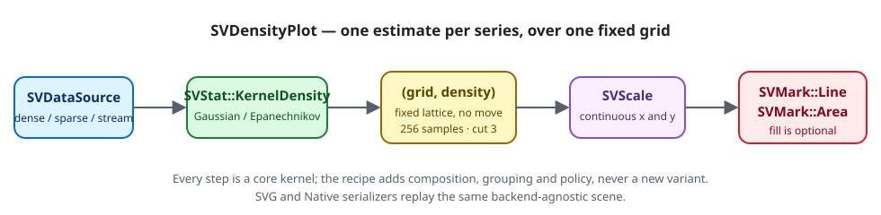

# Chapter 23 — Density plots: the shape of a distribution, smoothed

A histogram answers "how many observations fall in each bin?". A density plot
answers a slightly different question: "what does the distribution look like
if we stop letting the bin edges decide?". Instead of a staircase, it draws a
smooth curve whose area is one. This chapter follows `SVDensityPlot`, the
recipe specified by
[FDR-112](https://github.com/neurono-ml/scienceview/blob/main/docs/FDRs/recipes/distribution-density-plot.md),
from the mathematics of a kernel estimate to the curve the SVG and native
backends draw.

## The question the chart answers

Imagine a column of measurements — body temperatures, reaction times, the
mass of a seed. Sorting them into bins produces a histogram whose shape moves
when you change the bin width. A density plot removes that arbitrary choice:
it replaces every observation with a small bump and adds the bumps together.
The result is a continuous curve, and the only remaining choice is how wide
each bump is — the *bandwidth*.

That trade is the whole chart:

- a **narrow bandwidth** chases every observation and shows noise;
- a **wide bandwidth** smooths so much that real features disappear.

The recipe exposes the bandwidth and, by default, derives it from the data
with Silverman's rule of thumb.

## The concepts, from zero

**Kernel.** A kernel is a small, symmetric bump centred on each observation.
`SVKernelShape` names three of them:

| Kernel | Shape | Support |
|---|---|---|
| `Gaussian` | the familiar bell curve | unbounded |
| `Epanechnikov` | a downward parabola | compact |
| `Uniform` | a flat box | compact |

Each kernel is scaled to integrate to one on its own. The kernel is not a
mark and not a recipe concept: it belongs to the statistical kernel
(`SVStat::KernelDensity`), and the recipe never reimplements it.

**Bandwidth.** The width of the bump. With `n` observations, a spread `s`
(the smaller of the standard deviation and the interquartile range divided by
1.34), Silverman's rule gives

```text
bandwidth = 0.9 · s · n^(-1/5)
```

`bandwidth_adjustment(...)` multiplies that result (seaborn calls the same
option `bw_adjust`). `2.0` doubles the smoothing; `0.5` halves it. An explicit
`bandwidth(...)` replaces the derived value, and is still
scaled by the adjustment so the two options compose predictably.

**Evaluation grid.** A density is a function; to draw it we evaluate it at a
finite set of points. `grid_count` chooses how many (256 by default), and
`cut` chooses how far beyond the data the grid extends, in bandwidths (3 by
default). The grid is a fixed lattice — the same number of samples for every
series — which is exactly what makes the curve transition-ready: two frames
share grid positions, so every point has a partner to interpolate towards.

**Normalisation.** The kernel returns a probability density: the area under
the curve is one. `normalise` chooses how that value reaches the vertical
scale. `Density` keeps it; `Probability` multiplies by the grid spacing so
each sample is a probability mass that sums to one; `Count` additionally
multiplies by the number of observations, so the samples sum to `n`.

**Series.** A `series` column splits the observations into groups and draws
one curve per group, each with the next colour of the categorical palette.
Grouping happens before the kernel, so each curve is a complete estimate of
its own group.

## The composition

The chart is exactly the composition the FDR records. No new mark, stat, move
or scale variant is introduced (patterns.md P5).



There is deliberately **no move** step. A density needs no stacking, dodging
or jitter: the values being placed are already the curve's coordinates. The
scale kernel gives the grid its horizontal position and the density its
vertical position; the mark kernel turns those positions into a path.

## The public surface

`SVDensityPlotBuilder` is the only constructor. It is a typestate builder:
`build` exists only after both `data_source(...)` and `backend(...)` have been
called, so the explicit-backend rule cannot be bypassed. Every other option is
optional and has the FDR's default.

```rust
use scienceview::sv_recipes::sv_distribution::sv_density_plot::SVDensityPlot;
use scienceview_core::sv_backend::SVBackendKind;

let plot = SVDensityPlot::new()
    .data_source(&table)
    .value("measurement")
    .series("group")
    .fill(true)
    .bandwidth_adjustment(1.2)
    .backend(SVBackendKind::Svg)
    .build()?;

plot.save(std::path::Path::new("density_plot.svg"))?;
```

The built `SVDensityPlot` exposes one getter per option — `value_column_name`,
`bandwidth_value`, `bandwidth_adjustment_value`, `kernel_value`,
`grid_count_value`, `cut_value`, `fill_enabled`, `line_width_value`,
`normalisation_value` and `missing_value_policy_value` — so a caller can read
back exactly what the builder accepted. `SVDensityRendering` is the
backend-agnostic scene, and `SVDensityCurve` carries the kernel's grid,
density and bandwidth for each series, which is what the tests assert against
instead of guessing from pixels.

## The data boundary, once per operation

`rendering` resolves the value column once, and the series column once when it
is configured. Then it dispatches on the representation of the value column:

- **Dense:** the slice is passed to the kernel untouched when every value is
  finite.
- **Streaming:** the bounded window is passed untouched when every value is
  finite; the rendering reports `is_windowed()` so a caller knows the estimate
  describes the current window and not an unbounded history.
- **Sparse:** the view is passed to the kernel exactly as it arrived. The
  kernel reads its stored entries and counts its implicit zeros; the column is
  never expanded. A million-slot column with three stored values still costs
  three observations in the estimate loop.

Only a column that actually contains a non-finite value is rebuilt. Even then
the rebuild keeps a sparse column sparse: the surviving stored entries are
filtered and the logical length — and therefore the implicit zeros — stays
intact.

Grouping is the one case where a sparse value column cannot be accepted. To
attribute every implicit zero to a series, the recipe would have to walk the
whole logical lattice, which *is* a densification. It rejects that
combination with `UnsupportedRepresentation`, names the alternative (a dense
or streaming value column, or an ungrouped estimate), and never silently drops
the implicit zeros. The rejection is a test, not a comment:
`a_grouped_sparse_column_is_rejected_with_the_alternative`.

A missing observation — `NaN` or an infinity — is never passed to the kernel.
`SVDensityMissingValuePolicy::Omit` (the default) drops it, exactly like the
reference libraries: a missing value is not a zero observation and must not
pull the curve towards the origin. `Error` rejects the whole render with an
explicit configuration error. When nothing finite remains, the kernel's
`EmptyInput` surfaces unchanged rather than drawing an empty curve.

## The tests are the specification

The companion tests read as the acceptance record of the FDR:

| Test | What it proves |
|---|---|
| `the_density_integrates_to_one` | the trapezoid integral of the emitted curve is one within `1e-3` |
| `the_bandwidth_follows_the_rule_of_thumb_and_scales_with_the_adjustment` | the derived bandwidth is positive and `bandwidth_adjustment(2.0)` doubles it exactly |
| `an_explicit_bandwidth_is_used_verbatim` | an explicit bandwidth is not quietly re-derived |
| `every_option_that_changes_output_is_reflected` | kernel, grid count, cut, normalisation, line width and bandwidth all reach the output |
| `filling_adds_the_area_under_the_curve` | `fill(true)` adds exactly one area primitive per curve on top of its line |
| `a_series_column_draws_one_density_per_group` | two groups produce two independent estimates |
| `dense_sparse_and_streaming_representations_agree` | all three representations agree to `1e-12` |
| `a_million_slot_sparse_column_is_never_densified` | a million logical slots with three stored values still yields a 256-sample grid |
| `a_grouped_sparse_column_is_rejected_with_the_alternative` | the one lossy combination fails loudly instead of dropping implicit zeros |
| `a_streaming_window_is_estimated_and_says_so` | the window is estimated and `is_windowed()` is true |
| `a_missing_observation_is_dropped_or_rejected_by_policy` | `Omit` drops, `Error` rejects |
| `each_column_is_resolved_exactly_once_per_operation` | one read for the value column, one for the series |
| `concurrent_renders_agree` | eight threads produce identical curves |
| `large_data_is_estimated_over_the_fixed_grid` | ten thousand observations still draw 256 samples and integrate to one |
| `the_operation_span_carries_the_backend_representation_and_points` | the `render` span records the backend kind, the representation and 256 points |
| `the_native_backend_rasterizes_the_same_scene` | the native frame is the composed scene, not a second implementation |

## What the chart looks like

The example program `examples/density_plot.rs` draws two groups sampled from
two normal distributions, fills both curves, and writes the figure through the
public `save` operation:

```rust,ignore
let plot = SVDensityPlot::new()
    .data_source(&table)
    .value("measurement")
    .series("group")
    .fill(true)
    .bandwidth_adjustment(1.2)
    .backend(SVBackendKind::Svg)
    .build()?;
plot.save(&destination)?;
```


## What this recipe does not do

Two things are deliberately out of scope, and the chapter says so rather than
implying them:

- **Weights.** The kernel-density kernel applies an unweighted estimate.
  Weighting an observation would be a new kernel variant — a core change with
  its own spec delta — not something the recipe may add on its own
  (patterns.md P5).
- **Animation.** The recipe emits transition-ready geometry: one curve per
  series over a fixed grid, so every frame shares its grid positions. The
  transition kernel owns the interpolation between frames, and this recipe
  does not yet wire it.

Both are recorded in the FDR's amendment, so the acceptance list never claims
more than the tests prove.
