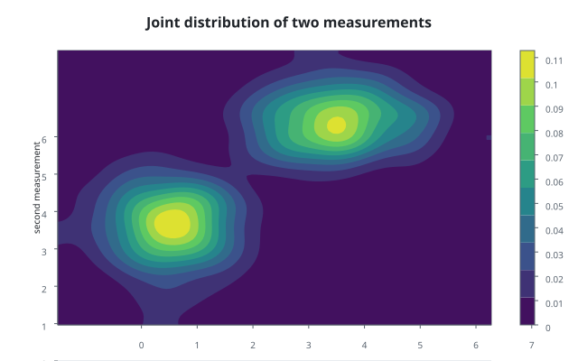
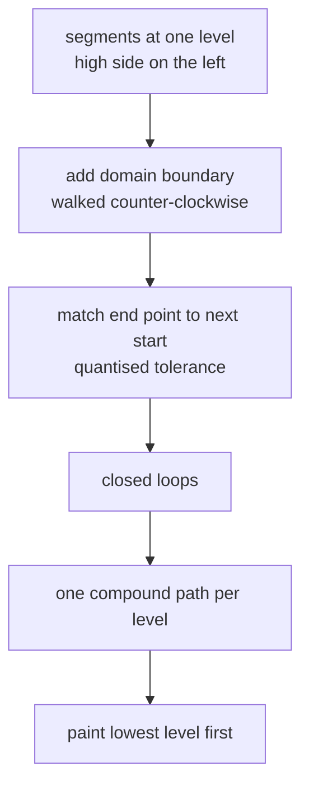

# Chapter 24 — Density contours: drawing a joint distribution honestly

This chapter tells the story of `SVDensityContourPlot`, the chart that shows
where two continuous measurements cluster together. It is the bivariate
counterpart of the density plot: instead of one histogram, it estimates a
two-dimensional field and draws the lines or bands where that field reaches a
given height.

By the end you will know why the recipe builds its density from the ordinary
bin kernel, how a field of numbers becomes closed contour paths, and why the
filled style paints from the lowest level up.



The public path is
`scienceview::sv_recipes::sv_distribution::sv_density_contour_plot::SVDensityContourPlot`.
The folder on disk stays `src/recipes/distribution/density_contour_plot/`; the
`#[path]` attributes only change the public names. The chart is specified in
`docs/FDRs/recipes/distribution-density-contour-plot.md` (FDR-113) and follows
the engineering contract in `docs/FDRs/patterns.md`.

## The question the chart answers

A scatter plot shows every observation as a dot. When the sample is large, the
dots overplot and the shape of the cloud becomes hard to read. A density contour
answers a different question: *at this point of the plane, how much data is
there per unit area?* The answer is a number for every point, a **scalar
field**, and the chart turns equal-height lines of that field into paths.

Three ideas are enough to follow the implementation:

- A **grid** divides the plane into small cells. Each cell gets one density
  number.
- A **level** is a height. The set of points where the field equals that height
  is a **level set**, drawn as a line or used as the edge of a filled band.
- A **band** is the region between two neighbouring levels. Painting bands from
  the lowest level up makes them nest without gaps.

## The pipeline

```mermaid
flowchart LR
    A["SVDataSource<br/>x, y, series, weight"] --> B["resolve columns once<br/>dense · sparse · streaming"]
    B --> C["SVStat::Bin on x<br/>SVStat::Bin on y"]
    C --> D["joint grid<br/>density per cell"]
    D --> E["level selection<br/>and colour scale"]
    E --> F["marching squares<br/>isolate levels"]
    F --> G["closed regions<br/>stitched loops"]
    G --> H["SVScale x, y<br/>SVScale colour"]
    H --> I["backend-agnostic<br/>paths"]
```



The first surprise is step `C`. The closed statistical vocabulary has no
"two-dimensional kernel density" variant, and a recipe is never allowed to add
a kernel variant (patterns P5). The recipe therefore composes the existing
one-dimensional `SVStat::Bin` kernel twice: once for the horizontal domain and
once for the vertical domain. Those two calls produce the edge vectors. The
recipe then folds every observation pair into the joint grid. This is a
composition of existing machinery, and it has a useful consequence: a histogram
and a density contour of the same column can never disagree about where a bin
starts.

The density in a cell is the observation weight in that cell divided by the
total weight and the cell area. That division is why the field integrates to
one over the grid: it is a probability density, not a count.

## What the public surface looks like

```rust
use scienceview::sv_recipes::sv_distribution::sv_density_contour_plot::SVDensityContourPlot;

let plot = SVDensityContourPlot::builder()
    .data_source(&table)
    .x("first measurement")
    .y("second measurement")
    .grid_count(96)
    .bandwidth(0.35)
    .levels(9)
    .backend(SVBackendKind::Svg)
    .build()?;
let composition = plot.compose()?;
```

| Option | Meaning | Default |
|---|---|---|
| `x`, `y` | the two continuous columns | required |
| `series` | one density field per distinct code | `None` |
| `weight` | observation weight column | `None` |
| `levels` | number of contour levels | `10` |
| `level_range` | explicit height interval | observed range |
| `bandwidth`, `bw_adjust` | optional Gaussian smoothing in data units | no smoothing |
| `grid_count` | cells per axis | `256` |
| `style` | `Filled` or `Lines` | `Filled` |
| `colour_map`, `colour_scale` | colour encoding of a level | theme map, linear |
| `backend`, `execution_mode` | rendering form and run mode | backend required, `Automatic` |

`bandwidth` deserves a note. It is not a hidden kernel-density implementation:
it requests one Gaussian pass over the already binned field. The FDR describes
the chart through the conceptual `KernelDensity (2D)` label; the implementation
uses the bin kernel and writes that difference down.

## Turning a field into closed regions

Marching squares looks at one cell at a time. Each of the four corners is either
above or below the threshold, which gives sixteen cases. A case tells us where
the level set crosses the cell edges; the crossing point is interpolated
linearly between the two corner values. The result is a list of short directed
segments.

Direction matters. Every segment is oriented so that the high side is on its
left. When the segments are walked from an end point to the next start point,
they form closed loops. An outer boundary and a hole then run in opposite
directions, which is exactly what the non-zero fill rule needs to cut the hole
instead of painting over it.



For the **filled** style, the region above a level is the union of its closed
loops. The recipe paints the background band first, then the region above the
lowest level, then the region above the next level, and so on. Each later region
is nested inside the previous one, so no gap can appear and the bands read as
nested contours.

The **lines** style skips the boundary and stitches nothing: each segment
becomes a short subpath of one stroked compound path per level. The two styles
therefore share the same level set and differ only in notation.

## The data boundary

The recipe accepts dense, sparse and streaming input on the same operation.

- A dense column is a borrowed slice.
- A sparse column is never densified. The pair walker merges the stored indices
  of both columns and reports the run of positions implicit in both once, with
  its multiplicity.
- A streaming column is read from its current window. It never blocks the
  render thread, and the build checks that the chosen backend declares the
  streaming capability.

Non-finite pairs are skipped rather than poisoning the grid; an input with no
finite pair is rejected with `EmptyInput`. A sparse weight column still works,
because the weighted path walks logical positions through a cursor instead of
materialising a value buffer.

## The tests are the specification

The companion test modules are the executable version of this chapter.
`density_contour_plot_tests.rs` walks the configuration surface: defaults,
every documented option, build-time errors, the weight and series columns,
non-finite handling, the integral of the density and the two contour styles.
`parity_tests.rs` asserts that dense, sparse and streaming input produce the
same grid and the same contours, and that a structurally sparse column never
becomes a dense array. `concurrency_tests.rs` serializes the same composition
from eight threads byte for byte. `observability_tests.rs` asserts that the
operation span carries the configured backend kind, the representation and the
number of drawn contour primitives. `render_tests.rs` checks that the SVG path
and the composed document agree and that an unsupported backend is a typed
error, never a silent empty figure.

## What is deliberately not claimed

Contour paths are not animated. Matching two contour sets across a topology
change — when one loop splits into two — remains the open question recorded in
the FDR. The geometry is transition-ready, but this change claims no morphing.
