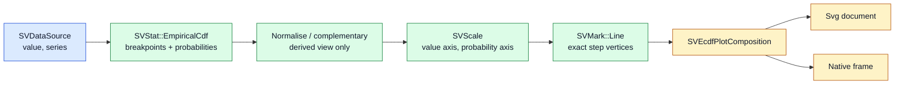

# Chapter 25 — ECDF plots: describing a distribution without choosing a shape

A histogram and a density estimate both answer "what does this variable look
like?" by drawing a *shape*. The shape depends on choices: the bin width, the
kernel, the bandwidth. The **empirical cumulative distribution function**
(ECDF) answers the same question without any of those choices. This chapter
follows `SVECdfPlot`, the recipe specified by
[FDR-114](https://github.com/neurono-ml/scienceview/blob/main/docs/FDRs/recipes/distribution-ecdf-plot.md),
from the idea of a cumulative proportion to the exact step geometry that the
SVG document and the native rasterizer both draw.

## The question the chart answers

Sort a sample of observations from smallest to largest. At any value *x*, ask:
**what fraction of the sample is at or below x?** That fraction starts at zero,
never decreases, and reaches one at the largest observation. Plotting it gives
the ECDF.

It is the honest alternative to a density estimate: no smoothing, no parameter,
nothing invented between the observations. When two distributions are compared,
a reader sees immediately which one is stochastically larger, and by how much.

## The concepts, from zero

**Cumulative proportion.** With four observations `3, 1, 2, 3`, the sorted
distinct values are `1, 2, 3`. At `1` the proportion is `1/4`; at `2` it is
`2/4`; at `3` it is `4/4`, because both threes count. Those three pairs are the
whole curve.

**A step function, not a line.** Between `1` and `2` the ECDF does not slide
from `1/4` to `2/4`. Nothing was observed between them, so the proportion stays
at `1/4` and jumps at `2`. The curve is horizontal, then vertical — *never*
sloped. Drawing an interpolation would claim knowledge the sample does not
have.

**Normalisation.** By default the vertical value is a probability in `[0, 1]`.
With `normalise(false)` it is a count: the curve reaches the number of
observations. The kernel supports both, and the chart exposes the same switch.

**Survival function.** `1 - F(x)` is the proportion *above* a value. It is the
same information read from the other side, and it is useful when the tail is the
interesting part. FDR-114 left it as an open question; this recipe resolves it
with `complementary(true)`, which subtracts each kernel probability from the
curve's total instead of computing a second distribution.

**Series.** A `series` column splits the observations into groups, and the chart
draws one ECDF per group in its own colour. Comparing groups is the main reason
to prefer an ECDF over a density: the curves never overlap into an unreadable
blur of shapes.

## The composition

The recipe is exactly the composition the FDR records. It introduces no new
mark, stat, move or scale variant (patterns.md P5).



The important line is `B -> C`: the kernel owns the distribution. The recipe
only decides how to present it. `complementary` is a subtraction applied to the
probabilities the kernel returned; it never sorts or counts the data again.

## The public surface

`SVECdfPlotBuilder` is the only constructor. `backend(...)` is required — there
is no automatic backend — and `execution_mode(...)` defaults to `Automatic`.

```rust
use scienceview::sv_recipes::sv_distribution::sv_ecdf_plot::SVECdfPlotBuilder;

let composition = SVECdfPlotBuilder::new()
    .data_source(&table)
    .value("error")
    .series("model")
    .title("Residual distribution by model")
    .backend(SVBackendKind::Svg)
    .build()?
    .render()?;
```

The surface follows FDR-114:

| Option | Meaning | Default |
|---|---|---|
| `value` | the observed column | required |
| `series` | one curve per group | none |
| `normalise` | probabilities or counts | `true` |
| `orient` | which channel carries the value | `Vertical` |
| `complementary` | draw `1 - F(x)` | `false` |
| `line_width` | stroke width | `mark.line_width` token |
| `viewport`, `title` | canvas and caption | `640×400`, none |

Every other option is a builder call, and `build()` validates them once:
a missing `value`, a missing data source, a missing backend selection, an
unknown column, a label-role column or a mismatched series length fails there,
with a typed `SVError`, never later with a silently wrong picture.

## The exact step geometry

The kernel returns ascending breakpoints and their cumulative probabilities.
The recipe expands them into vertices. For the four observations above the
horizontal channel is:

```text
1.0, 1.0, 2.0, 2.0, 3.0, 3.0
```

and the vertical channel is:

```text
0.0, 0.25, 0.25, 0.5, 0.5, 1.0
```

Read in pairs: a vertical riser at the minimum from zero, then a horizontal run
to the next breakpoint, then a riser, and so on. This is the exact meaning of
the curve, and the companion test
`the_curve_reaches_one_at_the_maximum_and_is_a_step` walks every pair to prove
that each riser shares an `x` and each run shares a `y`.

A complementary curve starts at the total instead of zero and descends with the
same geometry; horizontal orientation swaps which channel carries the value and
which carries the probability. In both cases the axes titles follow the
orientation, so the reader is never told to read a vertical value on the wrong
axis.

## Series and missing values

`series` is read through the numeric codes of its column. Groups appear in
first-appearance order, which makes the colour assignment deterministic: the
same input always paints the same group with the same palette entry, and a
legend appears only when there is more than one curve.

Missing data is omitted, not interpolated: a non-finite observation, or a row
whose series code is non-finite, simply does not enter its group. If nothing
finite remains, the kernel returns `EmptyInput` and the render reports it. The
test `non_finite_observations_are_omitted` checks that the surviving curve's
probabilities are normalised over the surviving observations, not over the
original row count.

## Three representations, one curve

The data boundary is the same as every recipe (spec `data-view-boundary`):

- **Dense** columns are borrowed slices.
- **Sparse** columns borrow their indices and stored values. Without a `series`
  column the sparse view reaches `SVStat::EmpiricalCdf` unchanged: the kernel
  sorts the stored entries and folds the implicit zeros analytically, so a
  column with a million logical zeros is never expanded. The test
  `a_sparse_column_is_never_expanded` uses a logical length of `1_000_000` with
  three stored values and checks that only four breakpoints are drawn.
- **Streaming** columns expose the bounded window they already hold. The
  operation reads that snapshot and returns promptly; `update(appended_points)`
  re-reads the advanced window, and
  `a_streaming_window_extends_with_the_append` proves that `update` and
  `render` agree on the same window.

Grouping needs the series code of every row, so it partitions the observations
once into per-group vectors. The whole logical column is still never
materialised as a single dense buffer: each group owns only its own values.

## Observability and the two backends

`render`, `update` and `save` each emit one operation span carrying the
configured backend kind, the widest representation of the resolved columns and
the number of finite observations. The span is created before the geometry is
composed, so the count is the real number the scene draws;
`render_span_records_backend_representation_and_points` and
`render_span_counts_only_finite_observations` read the fields through a real
subscriber.

The composition owns its vertices and scales, so serialization is a separate,
explicit act. `to_svg()` writes one `<path>` per curve through
`scienceview_svg`; with `render-native`, `to_native_frame()` rasterizes the very
same primitives through `scienceview_native`. A figure configured for a
different kind is rejected with a typed error instead of being silently drawn as
another backend. Transition and animation wiring is deferred to the transition
integration; the recipe claims transition-ready geometry only.

## The generated figure

`examples/ecdf_plot.rs` builds two groups of deterministic pseudo-samples,
composes the real builder and writes the document through the public
serializer. The figure is therefore tool output, never hand-drawn:


The figure shows the property that motivates the chart: the curves never
interpolate between observations, and the group that is shifted to the right is
stochastically larger at every visible probability.

## Roads not taken

**A weighted ECDF.** FDR-114 lists an optional `weight` column. The
`SVStat::EmpiricalCdf` kernel does not consume observation weights, and patterns
P5 forbids adding kernel behaviour inside a recipe. The recipe therefore exposes
`value` and `series` only; a weighted ECDF is a change to the stat capability
first.

**A confidence band.** The FDR asks for none. A pointwise binomial band is a
statistical transform in its own right, and inventing it in the recipe would be
the same violation as a weighted sum. The curve is the honest, parameter-free
claim; the band would be a separate capability.

**A density estimate.** It is a different recipe (`SVDensityPlot`), with its own
bandwidth decision. The ECDF is the alternative when that decision is unwanted.

**Smoothing the steps.** Never. The only honest line between two observations
is a horizontal one.
