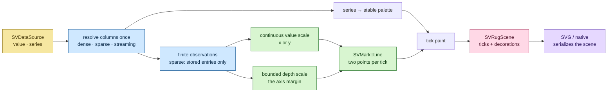
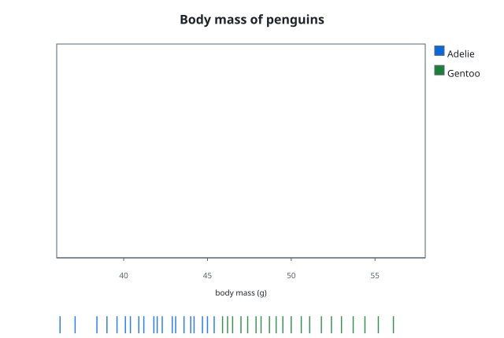

# Chapter 26 — Rug plots: keeping the raw sample visible

A summary chart answers a question by throwing data away. A histogram says
"most values sit here"; a box plot says "the middle half lives between these
two numbers". Both are useful, and both hide the same thing: the individual
observations. A *rug plot* gives those observations back. It draws one small
tick per observation along a single axis, in the margin, so the density of the
sample stays visible without changing the shape of the chart it accompanies.

This chapter follows the `rug-plot` change. It explains what a rug is, why the
chart is composed from the existing line kernel rather than a new mark, how a
dense, sparse or streaming column becomes a row of ticks, and which tests pin
the behaviour down.

## The idea, from zero

Imagine measuring the body mass of forty penguins and writing the forty numbers
on a ruler. A rug plot is that ruler: every measurement is a tick at its value.
Where the ticks crowd together, the sample is dense; where they thin out, it is
sparse. Nothing is binned, smoothed or averaged — the picture is the sample.

The chart is deliberately one-dimensional. It has no y variable of its own to
place values on, so the *other* direction is used for the tick itself: a short
segment, a few pixels long, that hangs off the axis the values live on. That
short segment is the whole geometry, and it is the reason the line mark — not a
new mark — is the right kernel.

## The pipeline



The middle is again the whole story. `SVScale` owns data-to-position, the
`SVMark` kernel owns geometry and paint, `SVDecoration` owns the axis, and the
recipe owns only the mapping from two named columns onto those kernels. No
kernel gained a variant for this chart (patterns P5).

## Why a line segment, not a new mark

FDR-115 describes the geometry as `SVMark::Line (segment geometry)`. A line
mark normally draws a polyline through all its points; a rug needs independent
segments, not a zig-zag. The recipe resolves that tension by composing **one
two-point line operation per observation**: the kernel is asked to draw a
segment from `(value, 0)` to `(value, 1)` in the margin's coordinate system,
which is exactly a tick.

Two consequences follow, and both are visible in the code:

- the recipe never re-derives a position — the line kernel calls the value
  scale and the depth scale itself;
- a tick owns its path, so the scene stays valid after the source window it
  was read from is released.

The alternative was an `SVMark::ErrorBar` over the whole column, because that
kernel already draws one interval per observation. It was rejected: the
error-bar request needs two full-length boundary channels, which would force a
dense constant buffer even for a sparse column and would place implicit zeros
as if they were observations. Densifying a sparse input to reuse a mark is
exactly what the data boundary forbids.

## The two scales

A rug needs two coordinate systems, and neither is the plot's data region:

- the **value scale** turns an observation into a position along the axis the
  values occupy (`x` for a vertical rug, `y` for a horizontal one);
- the **depth scale** turns `0` and `1` into the two ends of the tick inside
  the axis margin.

The depth scale is built with an explicit `0.0..=1.0` domain and `nice(false)`.
That second call matters: the default "nice rounding" would widen the domain to
`-0.2..=1.2`, and the tick would no longer end exactly at `height` pixels.
`the_height_option_changes_the_tick_length` would catch that regression.

`orientation` decides which axis carries the values and therefore which margin
holds the ticks. `Vertical` puts the values on `x` and draws vertical ticks in
the bottom margin; `Horizontal` puts them on `y` and draws horizontal ticks in
the left margin. The ticks sit in the *outer* part of the margin so they never
cover the plot area's data region — a tick can touch the canvas edge, but it
never enters the rectangle a companion chart would paint.

`height` is a fraction of the plot's perpendicular extent, but the recipe also
caps the result at the depth of the margin. Without that cap, `height = 1.0`
would ask for a tick as long as the whole plot and the far end would land
inside the data region. The cap keeps the acceptance rule true for every
accepted `height`; `an_extreme_height_is_capped_at_the_margin` checks both
orientations at `height = 1.0`.

## Dense, sparse and streaming

The data boundary is enforced once, in `channels.rs`. The value column
dispatches on its representation exactly once:

```rust
value.dispatch(
    |values| sv_collect(values.iter().copied().enumerate(), series, labels),
    |sparse| sv_collect(sparse.stored_entries(), series, labels),
    |streaming| sv_collect(streaming.values().iter().copied().enumerate(), series, labels),
)
```

The three closures feed the same collector with `(logical index, value)` pairs,
so everything downstream is representation-blind. Two properties fall out of
this shape:

- **Sparse storage is never expanded.** A sparse view with two stored entries
  and a logical length of six draws two ticks, not six. This is the documented
  rug semantics: a rug marks observations, and an unstored sparse position is
  not an observation. `a_sparse_input_marks_only_its_stored_entries` asserts it,
  and also checks that the implicit zeros do not widen the value axis: the two
  stored entries land at the same positions they would in a dense column that
  held only those two observations. `a_huge_sparse_column_marks_only_its_stored_entries`
  repeats the check with a logical length of one million.
- **Streaming never blocks.** The collector reads the bounded snapshot the
  streaming view already carries. `a_streaming_input_shows_its_current_window_without_blocking`
  hands it a window that dropped two of its six samples and checks that four
  ticks are drawn.

The series column uses `SVColumnView::value_at`, which answers from the dense
slice, the sparse binary search or the streaming window without a second
dispatch. A full sparse series therefore agrees with its dense twin
(`a_series_represented_sparsely_agrees_with_its_dense_twin`).

## Missing observations

A non-finite value (`NaN`, `+∞`, `−∞`) has no place on an axis, so it draws no
tick. The collector skips it before any scale runs, and the rest of the sample
is drawn normally — `non_finite_observations_are_skipped` feeds six values,
three of them invalid, and gets three ticks. A non-finite *series* value marks
the whole observation as missing: a tick whose colour group is unknown cannot
be assigned honestly, so it is dropped rather than painted with an invented
group.

A column with no drawable observation at all — the empty column, or one whose
values are every one non-finite — renders an empty scene instead of failing on
a domain it never needed. `an_all_missing_source_renders_an_empty_scene`
asserts it. A single observation has a degenerate domain, so the scale places
its only tick at the centre of the axis
(`a_single_observation_sits_at_the_centre_of_the_value_axis`).

## The document stays small

One line primitive per observation would mean one `<path>` per tick. For a
large sample that is a large document. Above `SV_LARGE_RUG_THRESHOLD` (512
ticks) the geometry pass groups primitives by paint and concatenates their path
commands into a single compound path per series colour. Every tick is still
drawn; the document simply shares one element between them, exactly the way the
scatter recipe groups a large point cloud.

`a_large_sample_draws_every_tick_in_one_compound_path` builds 2000 ticks,
checks that 2000 segments are present, that the mark kernel produced one
primitive, and that the serialized document stays under 200 kB.

## The public surface

`SVRugPlot::builder()` is the only constructor. `backend(...)` is required —
there is no automatic backend — and `execution_mode(...)` defaults to
`Automatic`. The builder validates everything before a figure exists:

| Option | Type | Default | Effect |
|---|---|---|---|
| `value` | column name | required | the observed value |
| `series` | column name | none | one colour group per distinct value |
| `orientation` | `SVBarOrientation` | `Vertical` | which axis holds the values |
| `height` | `f32` | `0.05` | tick length as a fraction of the plot extent |
| `alpha` | `f32` | `1.0` | constant tick opacity |
| `line_width` | `SVLength` | `mark.line_width` token | tick stroke width |
| `title`, `value_label` | text | none | figure and axis titles |

The built figure carries the backend kind and never dispatches in `build`.
`compose()` returns the backend-agnostic `SVRugScene`; `render()` serializes it
through the configured kind. `Svg` produces the document and `Native`
rasterizes the frame; a kind with no recipe serializer returns the typed
`UnsupportedBackendCapability` carrying that kind, and a compiled-out backend
returns `BackendUnavailable` instead of degrading silently.

Every operation goes through `sv_run_operation`, so its span carries
`backend.kind`, `representation`, `points` and `duration`. `points` starts as
the build-time logical length and is corrected after composition to the number
of ticks actually drawn — the streaming test proves the correction.

## The tests are the specification

| Test | What it proves |
|---|---|
| `the_default_configuration_draws_one_tick_per_observation` | one tick per observation, with the documented defaults |
| `vertical_ticks_sit_in_the_bottom_margin_and_never_enter_the_plot` | the tick is vertical, in the bottom margin, outside the data region |
| `horizontal_orientation_places_the_ticks_in_the_left_margin` | `Horizontal` moves the ticks to the left margin |
| `the_height_option_changes_the_tick_length` | four times the height gives four times the length |
| `the_alpha_option_is_applied_to_every_tick` | the constant opacity reaches the paint |
| `the_line_width_option_changes_the_stroke_width` | the stroke width reaches the paint |
| `the_series_colours_form_stable_groups` | repeated series values share one palette colour |
| `non_finite_observations_are_skipped` | missing values draw no tick |
| `an_all_missing_source_renders_an_empty_scene` | a sample with no drawable value renders empty |
| `a_single_observation_sits_at_the_centre_of_the_value_axis` | a degenerate domain centres its tick |
| `an_extreme_height_is_capped_at_the_margin` | `height = 1.0` still never enters the plot |
| `dense_sparse_and_streaming_inputs_draw_the_same_scene` | representation parity |
| `a_sparse_input_marks_only_its_stored_entries` | sparse is not densified and implicit zeros do not widen the axis |
| `a_huge_sparse_column_marks_only_its_stored_entries` | a million logical positions with two stored entries stay bounded |
| `a_streaming_input_shows_its_current_window_without_blocking` | the bounded window is drawn |
| `several_threads_render_the_same_rug_identically` | concurrency |
| `a_compose_records_the_backend_representation_and_tick_count` | the operation span |
| `a_large_sample_draws_every_tick_in_one_compound_path` | bounded document |
| `the_public_svg_method_matches_the_checked_in_figure` | the figure is real tool output |

## The figure

Run `cargo run --example rug_plot --features render-svg` to regenerate the
picture through the public `to_svg()` path from the real builder:



Two species colours, forty ticks and no smoothing: the sample is the chart. The
empty data region is deliberate — a rug is normally placed under or beside
another chart, and the scene exposes its plot rectangle so a later composition
change can align the two.

## Roads not taken

- **A `SVMark::Tick` variant.** The mark vocabulary is closed (patterns P5); a
  new geometry is a core change with its own spec delta. Two-point lines
  express the same segment with the kernel that already exists.
- **Jitter or strip mode.** A rug has one value per tick and no categorical
  axis to spread within, so a displacement move would have nothing to displace.
  The FDR specifies no jitter option, and the recipe adds none.
- **Ticks inside the plot.** The FDR's acceptance is explicit: the ticks live
  in the margin and never overlap the data region. seaborn draws a rug inside
  the axes; this recipe chooses the marginal reading and documents it.
- **Transition wiring.** Every tick owns a two-endpoint path and its match key
  is the observation index, so a future transition can interpolate the tick
  endpoints. Wiring the kernel into the public operations is deferred to the
  transition integration; this change claims transition-ready geometry only.
- **Embedding the rug into a histogram.** The FDR leaves "a `rug` option on
  `SVHistogramPlot`" as an open question. It is a composition concern for a
  later change, not a second code path in this recipe.
