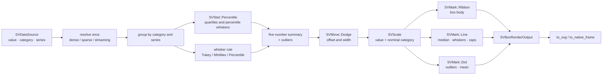

# Chapter 27 — Box plots: five numbers that describe a whole distribution

A scatter plot shows every observation. A box plot makes a different promise:
it compresses a distribution into five numbers and a handful of outliers, so
several categories fit on one axis without hiding the centre, the spread or the
tails. This chapter follows `SVBoxPlot`, the recipe specified by
[FDR-116](https://github.com/neurono-ml/scienceview/blob/main/docs/FDRs/recipes/distribution-box-plot.md),
from the statistics to the marks that draw them.

## The question the chart answers

Imagine a laboratory measures the same quantity at three stations, under two
scenarios. Plotting every observation would produce a cloud of overlapping
dots. The questions are simpler:

1. **Where is the middle?** The median says where a typical observation sits.
2. **How wide is the bulk?** The lower and upper quartiles bound the middle half
   of the data.
3. **How far do the tails reach?** The whiskers and the outliers say how far the
   distribution stretches before the values become exceptional.

A box plot answers exactly those three questions for each group, side by side.

## The concepts, from zero

**Quantile.** Sort the observations. The *p*-quantile is the value below which
a fraction *p* of them lie. The median is the 0.5 quantile; the quartiles are
the 0.25 and 0.75 quantiles. `scienceview` uses linear interpolation between the
two neighbouring ranks, exactly the definition implemented by
`SVStat::Percentile`.

**Interquartile range (IQR).** The distance between the upper and lower
quartiles. It measures the width of the middle half and is not affected by a
few extreme values.

**Whiskers.** The whiskers show how far the bulk reaches. Three rules are
available:

| Rule | Whisker ends | Outliers |
|---|---|---|
| `Tukey` (default) | the most extreme observations inside `q1 - 1.5·IQR` and `q3 + 1.5·IQR` | observations outside those fences |
| `MinMax` | the minimum and the maximum | none |
| `Percentile(p)` | the `p` and `1-p` quantiles | observations outside that interval |

**Notch.** A notched box narrows around the median. The notch is a visual
confidence interval computed from `1.58 · IQR / √n`, clamped to half the IQR so
it can never invert the box.

**Dodge.** When a category contains several series, their boxes must sit side
by side instead of on top of each other. `SVMove::Dodge` produces the offset and
the narrowed width; the recipe never computes them itself.

## The composition

The chart is exactly the composition recorded by the FDR. It adds no mark,
stat, move or scale variant (patterns.md P5).



The FDR writes the box as `SVMark::Box`. The mark vocabulary is closed and does
not contain a `Box` variant, so the recipe realises the same drawing with the
existing vocabulary: a filled ribbon for the body, lines for the median,
whiskers and caps, and dots for the outliers and the mean. The draw order is
the order the geometries are pushed: body first, then median and whiskers, then
the markers on top.

## The public surface

`SVBoxPlotBuilder` is the only constructor. It requires an explicit
`backend(...)`; there is no automatic backend. Every other option has the
documented default.

```rust
use scienceview::sv_recipes::sv_distribution::sv_box_plot::{
    SVBoxPlotBuilder, SVWhiskerRule,
};
use scienceview_core::sv_backend::SVBackendKind;
use scienceview_core::sv_mark::{SVBarOrientation, SVDotShape};

let plot = SVBoxPlotBuilder::new()
    .data_source(&table)
    .value("measurement")
    .category("station")
    .series("scenario")
    .quartiles(vec![0.25, 0.5, 0.75])
    .whisker(SVWhiskerRule::Tukey)
    .show_outliers(true)
    .outlier_marker(SVDotShape::Circle)
    .notch(false)
    .show_mean(false)
    .width(0.8)
    .orient(SVBarOrientation::Vertical)
    .backend(SVBackendKind::Svg)
    .build()?;

let output = plot.render()?;
let document = output.to_svg()?;
```

`SVBoxRenderOutput` is the owned, backend-agnostic result. It carries the
configured backend kind, the representation, the number of observations and
drawn outliers, the viewport, the solved plot rectangle, one `SVBoxSummary` per
box and the mark and decoration primitives. `SVBoxSummary` exposes the five
numbers, the mean, the notch half-width, the category position and the outliers
— the same values the chart drew, so a caller can inspect them without parsing
geometry.

The builder validates at `build`: a missing data source or backend, a missing
column, a column of the wrong role, quantiles that are not three strictly
increasing values inside `(0, 1)`, a percentile whisker outside `(0, 0.5)` and a
width outside `(0, 1]` all fail before a pixel is drawn.

## The data boundary, once per operation

`render` resolves the columns once through `SVDataSource`. The value column
decides which positions are observations:

- a dense column contributes every row;
- a sparse column contributes only its stored entries — the implicit zeros are
  never expanded;
- a streaming column contributes its current bounded window.

The category and series columns are read at those same positions. A missing or
non-finite value is skipped, never passed to the percentile kernel, and an input
with no finite observation fails with `EmptyInput` instead of drawing an empty
chart.

The parity test `dense_sparse_and_streaming_agree` compares the geometry of the
three representations point by point. `a_sparse_column_is_never_densified` gives
a sparse column one million logical positions and five stored entries and
asserts that exactly five observations are summarised. A streaming result sets
`is_approximate`, because it describes the window the source currently carries,
not the whole history.

## The render span

Every public operation records the configured backend, the representation and
the number of finite observations in one span:

| Field | Example |
|---|---|
| `backend.kind` | `svg` |
| `representation` | `Dense` |
| `points` | `10` |
| `duration` | filled by the span |

`render_span_counts_only_the_finite_observations` proves that a skipped missing
value is not counted as a drawn point.

## The tests are the specification

The companion tests read as the acceptance record of the FDR:

| Test | What it proves |
|---|---|
| `default_summary_matches_the_percentile_estimator` | the quartiles, median and whiskers are exactly the percentile kernel's values |
| `tukey_rule_marks_points_outside_the_fences_as_outliers` | the Tukey fences select `9` as the whisker end and `100` as the only outlier |
| `min_max_rule_draws_the_extremes_and_no_outliers` | the min/max rule stretches the whiskers and drops the outlier set |
| `percentile_rule_uses_the_requested_percentiles` | the percentile whiskers are `1.9` and `9.1` for `p = 0.1` |
| `show_outliers_can_be_turned_off` | the summary keeps the outliers while the drawing hides them |
| `quartiles_option_moves_the_box_edges` | an explicit quantile triple changes the box |
| `notch_option_draws_three_stacked_segments` | the notch half-width is positive, smaller than half the IQR, and drawn as three ribbons whose middle segment is narrower |
| `series_draws_one_box_per_group` | two series produce two boxes with different dodge offsets |
| `a_single_category_box_keeps_its_slot_width` | one category still owns a full slot instead of collapsing to a line |
| `horizontal_orientation_places_the_summary_along_x` | the box swaps its width and height when the value axis moves to x |
| `outlier_marker_changes_the_marker_shape` | a square outlier becomes a rectangle primitive |
| `dense_sparse_and_streaming_agree` | parity within `1e-9` |
| `a_sparse_column_is_never_densified` | five stored entries, five observations |
| `concurrent_renders_are_identical` | four threads render identical geometry |
| `an_all_missing_input_fails_with_empty_input` | non-finite observations are skipped and an empty result is an `EmptyInput` error, not an empty chart |
| `svg_output_is_self_contained_and_deterministic` | two renders produce the same SVG document |

The documentation figure is generated by the example itself, never drawn by
hand:


## What is deferred

The drawn primitives are transition-ready — every box is geometry in data
space — but the animation and transition wiring belongs to the transition
integration, exactly as FDR-116's temporal table describes. This recipe claims
only that the geometry can be interpolated; it does not own a timeline.
