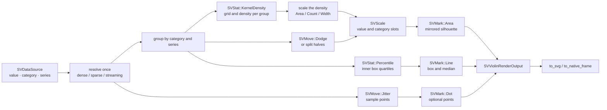

# Chapter 28 — Violin plots: the whole shape of a distribution

A box plot compresses a distribution into five numbers. A violin plot keeps the
shape: it estimates the density of the observations and draws that density as a
symmetric silhouette, one violin per category. Multimodality, skew and a heavy
tail stay visible, at the cost of one choice — the bandwidth of the estimate.
This chapter follows `SVViolinPlot`, the recipe specified by
[FDR-117](https://github.com/neurono-ml/scienceview/blob/main/docs/FDRs/recipes/distribution-violin-plot.md).

## The question the chart answers

A box plot can hide a bimodal distribution behind a median and an interquartile
range. A violin plot asks instead:

1. **Where does the sample concentrate?** The widest part of the silhouette is
   the value the observations cluster around.
2. **How many modes are there?** Two bulges mean two clusters; the box plot
   would show one wide box.
3. **How heavy is each tail?** The silhouette tapers instead of stopping at a
   fence, so the shape of the tails remains visible.

## The concepts, from zero

**Density.** A density estimate turns observations into a smooth curve whose
area integrates to one. A value where many observations sit gets a high
density; an empty region gets a low one.

**Kernel density estimate (KDE).** Place a small bell-shaped kernel at every
observation and add the bells. The width of each bell is the *bandwidth*: too
small and the curve is spiky, too large and distinct modes merge. When no
bandwidth is supplied, `SVStat::KernelDensity` derives one with Silverman's rule
of thumb and the recipe scales it by `bandwidth_adjustment`.

**Violin.** Reflect the density curve around the category centre. The distance
from the centre at a given value is the density there, scaled so the widest
violin fills the category slot. The result is one closed path per half, or two
halves that meet at the centre.

**Scale.** The FDR offers three ways to size the violins:

| Mode | What is equal | What changes |
|---|---|---|
| `Area` (default) | the area of every violin | the maximum width |
| `Count` | the area is proportional to the sample count | both width and area |
| `Width` | the maximum width of every violin | the area |

## The composition

The chart is exactly the composition recorded by the FDR:



The `Area` mark closes its path against a horizontal baseline. A vertical
violin needs the closed edge on the category centre, which is a vertical line,
so the recipe composes the area in a transposed frame and transposes the
resulting path back into display space. No mark variant is added: the geometry
is still the `Area` kernel's, and the recipe only chooses the frame.

## The public surface

`SVViolinPlotBuilder` is the only constructor. It requires an explicit
`backend(...)`; every other option has the documented default.

```rust
use scienceview::sv_recipes::sv_distribution::sv_violin_plot::{
    SVViolinPlotBuilder, SVViolinScale,
};
use scienceview_core::sv_backend::SVBackendKind;
use scienceview_core::sv_mark::SVBarOrientation;

let plot = SVViolinPlotBuilder::new()
    .data_source(&table)
    .value("measurement")
    .category("station")
    .bandwidth(0.4)            // optional; the rule of thumb applies otherwise
    .bandwidth_adjustment(1.0)
    .width(0.8)
    .scale(SVViolinScale::Area)
    .show_box(true)
    .show_points(false)
    .split(false)              // two series share one violin when true
    .orient(SVBarOrientation::Vertical)
    .backend(SVBackendKind::Svg)
    .build()?;

let output = plot.render()?;
let document = output.to_svg()?;
```

`SVViolinRenderOutput` is the owned, backend-agnostic result: the configured
backend kind, the representation, the number of observations, the viewport, the
solved plot rectangle, one `SVViolinSummary` per violin, and the mark and
decoration primitives. `SVViolinSummary` exposes the evaluation grid, the
density, the bandwidth, the maximum half-width and the quartiles and median of
the optional inner box.

## Data, series and split mode

A sparse column contributes only its stored entries; the implicit zeros are
never expanded. A streaming column renders the bounded window it carries and
reports `is_approximate`. The representation is resolved once per operation.

When a `series` column is present, `SVMove::Dodge` gives every series its own
narrowed slot. `split(true)` instead draws two series against each other, one
on each side of the same category centre; three or more series are rejected in
favour of the dodge layout. The dodge and the jitter come from the move kernel,
so the recipe never computes an offset itself.

## The inner box and the sample points

`show_box(true)` draws the quartile edges, the box outline and the median line
with the `Line` mark; the quartiles come from `SVStat::Percentile`. The
silhouette is unchanged by the inner box. `show_points(true)` draws the
observations as small dots, displaced by the deterministic `SVMove::Jitter` so
overlapping points stay distinguishable.

## The render span

Every public operation records the configured backend, the representation and
the number of finite observations in one span:

| Field | Example |
|---|---|
| `backend.kind` | `svg` |
| `representation` | `Dense` |
| `points` | `10` |
| `duration` | filled by the span |

## The tests are the specification

| Test | What it proves |
|---|---|
| `default_estimate_matches_the_kernel_density` | 256 grid samples, a derived bandwidth, and the percentile kernel's quartiles and median |
| `bandwidth_option_changes_the_silhouette` | an explicit bandwidth changes the estimate |
| `bandwidth_adjustment_scales_the_derived_bandwidth` | `2.0` doubles the derived bandwidth |
| `width_option_scales_the_maximum_half_width` | `0.4` is exactly half of `0.8` |
| `width_scale_mode_makes_every_violin_the_same_width` | the `Width` mode equalises the maximum width |
| `count_scale_mode_grows_the_area_with_the_sample_count` | the `Count` mode grows the larger sample |
| `vertical_violin_is_symmetric_about_the_category_centre` | the silhouette is mirrored about the slot centre |
| `inner_box_and_points_add_geometry_without_moving_the_silhouette` | the optional decorations do not change the density |
| `split_series_share_a_category_and_opposite_halves` | split mode draws one area per half |
| `dense_sparse_and_streaming_agree` | parity within `1e-9` |
| `a_sparse_column_is_never_densified` | five stored entries, five observations |
| `concurrent_renders_are_identical` | four threads render identical geometry |
| `svg_output_is_self_contained_and_deterministic` | two renders produce the same SVG document |

The documentation figure is generated by the example itself:


## What is deferred

The drawn primitives are transition-ready — the width at each grid point is
geometry in data space — but the animation and transition wiring belongs to the
transition integration, exactly as FDR-117's temporal table describes. This
recipe claims only that the geometry can be interpolated; it does not own a
timeline.
