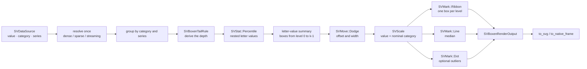

# Chapter 29 — Boxen plots: a nest of letter values

A violin plot can show the shape of a distribution, but it needs a density
estimate and a lot of observations. A box plot is compact, yet its four
boundaries throw away the tails. The boxen plot — the *letter-value plot* —
sits between the two: it draws a nest of boxes, each one holding the middle of
what remains after the outer boxes are peeled away, so a large sample reveals
its tails without a density estimate.

This chapter follows `SVBoxenPlot`, the recipe specified by
[FDR-118](https://github.com/neurono-ml/scienceview/blob/main/docs/FDRs/recipes/distribution-boxen-plot.md),
from the statistics to the marks that draw the nest.

## The question the chart answers

Imagine a laboratory measures the same quantity at three stations, under two
scenarios, with nearly a hundred observations per group. A box plot answers
where the middle and the middle half are; it does not say whether the tails
are heavy. A histogram would answer that but would need one panel per group.
The boxen plot answers both at once:

1. **Where is the middle?** The central box spans the interquartile range and
   a line marks the median.
2. **How heavy are the tails?** Each outer box covers the next half of the
   remaining data, so a long tail produces several visible outer levels.
3. **Which observations are exceptional?** Anything beyond the outermost
   letter value can be drawn as an outlier.

## The concepts, from zero

**Quantile.** Sort the observations. The *p*-quantile is the value below which
a fraction *p* of them lie. The median is the 0.5 quantile, the quartiles are
the 0.25 and 0.75 quantiles. `scienceview` uses linear interpolation between
the two neighbouring ranks, the definition implemented by `SVStat::Percentile`.

**Letter value.** Start with the median of the whole sample. The median of the
lower half is the next letter value, the median of the lower quarter the next,
and so on; the upper half mirrors the sequence. Each pair of neighbouring
letter values bounds one box, so the boxes are nested and every outer box
describes the half of the data left after the previous one is removed.

The recipe expresses the same sequence directly as quantiles:
`0.5^(k+1), …, 0.25, 0.75, …, 1 - 0.5^(k+1)`. A depth of `k` therefore gives
`2k` boundaries and `2k - 1` boxes. The quantiles come from
`SVStat::Percentile`; the recipe never reimplements the estimator.

**Depth and tail stopping.** How deep the nest goes is a trade-off between
resolution in the tails and noise in the outermost boxes. `SVBoxenTailRule`
selects the rule:

| Rule | Depth | Meaning |
|---|---|---|
| `Tukey` (default) | `floor(log2(n)) - 3`, at least 1 | Henderson's rule of thumb; the tail keeps roughly as many observations as a box plot leaves as outliers |
| `Proportion(p)` | `floor(log2(n)) - floor(log2(n·p)) + 1` | expect about a fraction `p` of the data beyond the outermost level |
| `Full` | `floor(log2(n)) + 1` | extend the nest to the sample minimum and maximum; nothing is an outlier |

`depth(usize)` overrides any rule with an explicit number of levels.

**Nested width.** The central box is the widest. Every outer level is half as
wide, which makes the nest read as a sequence of letter values rather than a
stack of unrelated rectangles.

**Dodge.** When a category contains several series, their nests sit side by
side. `SVMove::Dodge` produces the offset and the narrowed width; the recipe
never computes them itself.

## The composition

The chart is exactly the composition recorded by the FDR. It adds no mark,
stat, move or scale variant (patterns.md P5).



The FDR writes the box as `SVMark::Box`. The mark vocabulary is closed and does
not contain a `Box` variant, so the recipe realises the drawing with the
existing vocabulary, exactly as the box plot does: a filled ribbon for each
level, a line for the median and dots for the outliers. The draw order is the
order the geometries are pushed: outer boxes first, then the central box, then
the median and the markers on top.

## The public surface

`SVBoxenPlotBuilder` is the only constructor. It requires an explicit
`backend(...)`; there is no automatic backend. Every other option has the
documented default.

```rust
use scienceview::sv_recipes::sv_distribution::sv_boxen_plot::{
    SVBoxenPlotBuilder, SVBoxenTailRule,
};

let plot = SVBoxenPlotBuilder::new()
    .data_source(&table)
    .value("measurement")
    .category("station")
    .series("scenario")
    .tail_rule(SVBoxenTailRule::Tukey)
    .show_median(true)
    .show_outliers(true)
    .width(0.8)
    .backend(SVBackendKind::Svg)
    .build()?;
```

`render()` returns an `SVBoxenRenderOutput`. Its `summaries()` expose one
`SVBoxenSummary` per nest. Each summary reports the depth, the median, the
outliers and a slice of `SVBoxenLevel`, whose `level()`, `lower()`, `upper()`
and `relative_width()` describe one box. The output also offers `to_svg()`
under `render-svg` and `to_native_frame()` under `render-native`.

## Walking the tests

The companion tests are the executable specification. They live beside the
implementation in `src/recipes/distribution/boxen_plot/`.

- `default_summary_uses_the_percentile_kernel` draws ten observations with the
  default configuration. The derived depth is one, so the single box spans
  `3.25` to `7.75` — the quartiles the percentile kernel returns — and the
  points outside become the stored outliers.
- `depth_option_adds_nested_levels` forces depth two. The nest then has three
  boxes with relative widths `0.5, 1.0, 0.5`, and the bounds are exactly the
  four nested quantiles the kernel produced.
- `derived_depth_follows_the_henderson_rule` uses 64 observations and asserts
  five boxes, because `floor(log2(64)) - 3 = 3` levels.
- `the_proportion_rule_changes_the_derived_depth` shows a proportion rule
  producing a deeper nest than Henderson's rule for the same sample.
- `the_full_rule_extends_to_the_observed_extremes` checks that `Full` reaches
  the sample minimum and maximum and leaves no outlier.
- `dense_sparse_and_streaming_agree`, `a_sparse_column_is_never_densified` and
  `a_streaming_window_renders_without_expanding_the_stream` verify
  representation parity: the same observations in three representations give
  the same geometry, a sparse column contributes only its stored entries, and
  a streaming window renders without blocking and reports `is_approximate`.
- `concurrent_renders_are_identical` renders the same figure from four threads
  and compares every placed point.
- `render_span_records_backend_representation_and_points` asserts that the
  observability span carries the configured backend, the representation and
  the finite point count.
- The SVG and native tests serialize the same geometry twice (deterministic
  document) and rasterize it into a frame, and they assert that a serializer
  asked for the wrong configured kind fails with a typed error.

## The figure

The example program composes the real builder, asks for outliers and writes
the document through the public serializer:


## Roads not taken

- **A density estimate.** A violin smooths the data; the boxen plot keeps the
  quantiles exact. That is why the recipe can reuse `SVStat::Percentile`
  unchanged and why the nest is deterministic.
- **A new `Box` mark.** The vocabulary is closed. Reusing `Ribbon`, `Line` and
  `Dot` keeps every backend unchanged and is the same choice the box plot made.
- **A width derived from the plot width.** The FDR leaves the width rule to the
  layout engine; the recipe only narrows the levels exponentially and lets the
  builder choose the maximum fraction.
- **Transition wiring.** The geometry is transition-ready — the level list and
  the median are plain data — but attaching the transition kernel is deferred
  to the transition integration, so this chapter claims nothing more.
