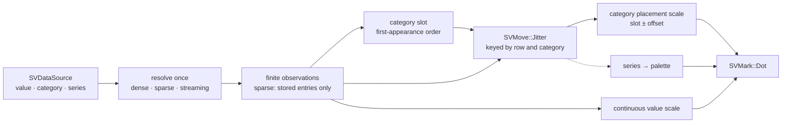
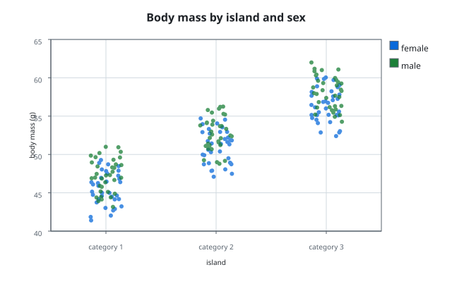

# Chapter 30 — Strip plots: every observation, never a summary

A box plot answers "where does the middle half live?" and hides the rest. A
strip plot makes the opposite bet: it draws **every observation** and lets the
sample speak for itself. Each point sits over its category, and a small random
displacement pushes overlapping points apart so that a crowd reads as a crowd
instead of as one thick dot.

This chapter follows the `strip-plot` change. It explains what the chart is,
why the displacement belongs to the move kernel rather than to the recipe, how
a dense, sparse or streaming column becomes a row of dots, and which tests pin
the behaviour down.

## The idea, from zero

Imagine three islands and a pile of measured body masses, one number per bird.
Sort the numbers by island. Now, for each island, draw a vertical line and put a
dot on it at each bird's mass. Values that repeat land on top of each other and
become invisible, so the chart nudges each dot sideways by a tiny random amount
— *jitter* — inside a narrow band around the island's centre.

The horizontal position therefore means "which island, plus a nudge"; the
vertical position is the measurement itself. Turn the chart ninety degrees and
the roles swap: categories run down the vertical axis and values across the
horizontal one.

## The pipeline



The recipe adds no kernel variant. It is exactly the composition of FDR-119:
`data -> [no stat] -> values -> [SVMove::Jitter] -> [SVScale] -> SVMark::Dot`.

## The module, file by file

| File | Responsibility |
|---|---|
| `mod.rs` | Pure dispatcher: module declarations and re-exports only |
| `builder.rs` / `builder_options.rs` | The option surface and its defaults |
| `build.rs` | The single validation point (`backend`, columns, mark, jitter) |
| `data_contract.rs` | Column resolution, missing-value policy, categories and series |
| `jitter.rs` | The `SVMove::Jitter` call and the displaced category slots |
| `scales.rs` | Value scale, category placement scale and nominal axis |
| `geometry.rs` | The dot mark and the per-series repaint |
| `decorations.rs` | Title, grid, border, axes and legend |
| `composition.rs` | One render, from columns to scene |
| `scene.rs` / `render_output.rs` / `operations.rs` | Backend-agnostic scene, SVG/native dispatch |
| `core_implementation.rs` | The built figure and its read-only surface |

## Why the jitter is a move

The displacement is a position change in data space, and the project already
owns a kernel for exactly that: `sv_move`. Its `SVMove::Jitter` draws a
deterministic offset from three numbers — the seed, the group code and the
point index — and never from a frame index. That property is the whole point of
an animated strip plot: while the *values* change between frames, the dots must
not slide sideways, because a sliding dot reads as a moving measurement.

The recipe therefore builds a synthetic column of **category slots** — `0.0`
for the first category, `1.0` for the second, and so on — and asks the move to
jitter it. The group key is the category slot, so every category gets its own
phase, and the offset comes back in slot units (the move's category slot is
`0.8` wide, one figure category is `1.0` wide). The displaced position is just
`category_index + offset`.

The slot column keeps the representation of the value column. For a sparse
value column the recipe builds a sparse slot view over the same stored indices,
so a column with a million logical positions and two stored entries hands the
kernel only those two values and those two slots. The only per-logical-row
allocation left is the group-key word the move request requires (four bytes per
logical position); no value, slot or offset is materialised for an unstored
entry. That is what
`parity_tests::a_huge_sparse_column_marks_only_its_stored_entries` protects.

## Orientation without a second kernel

`SVMove::Jitter` speaks of a horizontal displacement. A strip plot's
categorical axis is that horizontal axis *of the move*, whatever the figure
looks like. When `orient(Horizontal)` is chosen, the recipe simply maps the
displaced slot onto the vertical axis and the value onto the horizontal one.
No second jitter path exists, and `option_tests::the_orientation_swaps_the_value_and_category_axes`
pins the swap: the first two observations share a category and differ only in
value, so the value axis must be the one that separates them.

## Channels: value, category, series

`data_contract.rs` resolves the three documented columns once per operation.
The value column decides which positions are observations: a dense column
contributes every row, a sparse column only its stored entries, a streaming
column its current window. The category and series columns are read at exactly
those positions, so the recipe never expands a sparse input.

Categories are numbered in first-appearance order. That order is stable across
a re-render of the same source, which is what makes the axis and the colours
stable too. The optional `series` column becomes a stable palette assignment
through `sv_default_scale_palette`, and the legend shows the series labels in
the same order.

```rust,ignore
let scene = SVStripPlot::builder()
    .data_source(&table)
    .value("body_mass")
    .category("island")
    .series("sex")
    .series_labels(&["female", "male"])
    .jitter(0.18)
    .seed(42)
    .backend(SVBackendKind::Svg)
    .build()?
    .compose()?;
```

## Marker size, alpha and missing values

The dots are the closed `SVMark::Dot` vocabulary: `Circle`, `Square`,
`Triangle`, `Diamond`, `Cross` and `Hexagon`. `size` takes an `SVLength`; when
it is absent the `mark.size` theme token applies. `alpha` reaches the paint of
every primitive, which is how a dense sample stays readable.

A non-finite value or category cannot be placed. The default
`SVStripMissingValuePolicy::Omit` drops the observation; `Error` rejects the
render and names the position with `SVError::NonFiniteValue`. Both paths are
tested — `strip_plot_tests::a_missing_category_or_value_composes_an_empty_scene_without_failing`
and `strip_plot_tests::the_strict_missing_value_policy_rejects_a_non_finite_observation`.

## The scene and its two serializers

`compose()` returns an `SVStripScene`: a viewport, a plot rectangle, the
decoration primitives before and after the marks, and one `SVMarkGeometry` per
render. It carries the configured backend kind but no notation. `render()`
dispatches on that kind: `SVBackendKind::Svg` produces a self-contained SVG
document, `SVBackendKind::Native` rasterizes the same scene into an RGBA frame,
and any other kind fails with `SVError::UnsupportedBackendCapability` instead
of silently drawing something else.

Because both serializers read the same scene, the two backends agree within
rasterization differences. `render_tests` checks the document, the frame size
and the painted pixels; `concurrency_tests` renders the same figure from eight
threads and compares the SVG byte for byte.

## Observability

Every public operation (`compose`, `render`, `update`, `save`) runs inside
`sv_run_operation`, which records `backend.kind`, `representation`, `points`,
`duration` and `outcome`. `build` probes the columns once so a figure that
exists can render; a streaming source may advance afterwards, so the operation
corrects the `points` field from the scene it actually composed. The three
tests in `observability_tests.rs` assert exactly that.

## Transition readiness, honestly

The jitter offset is already keyed by identity, not by frame index, so the
geometry is ready for the transition integration: a value can interpolate while
the offset stays put. The actual transition and animation wiring is deferred to
the transition integration change; this chapter claims transition-ready
geometry only.

## Acceptance

- `strip_plot_tests::the_default_configuration_draws_one_dot_per_observation`
  — one dot per observation.
- `strip_plot_tests::a_seeded_jitter_is_reproducible_across_compositions` —
  the seeded displacement never drifts.
- `strip_plot_tests::the_jitter_offset_follows_the_match_key_and_not_the_value`
  — the offset is keyed by row and category, never by the value.
- `parity_tests::dense_sparse_and_streaming_inputs_draw_the_same_scene` — the
  three representations agree byte for byte.
- `parity_tests::a_sparse_input_is_never_densified_and_marks_only_stored_entries`
  — sparse marks its stored support only.
- `large_strip_tests::a_large_sample_composes_one_dot_per_observation` — ten thousand observations compose and serialize.
- `concurrency_tests::several_threads_render_the_same_strip_plot_identically`
  — concurrent renders agree.
- `render_tests::the_svg_kind_serializes_the_svg_document` and
  `render_tests::the_native_kind_rasterizes_the_native_frame` — both backends.


