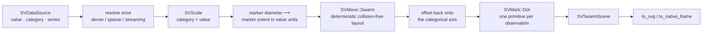

# Chapter 31 — Swarm plots: letting every point find its own space

A strip plot draws every observation of a category on one vertical line. When
the sample is dense, the points pile on top of each other and the chart hides
how many observations sit at a value — the very thing it was supposed to show.
A swarm plot keeps every point visible and moves it sideways, just far enough
that no two points overlap. The width of the resulting shape reads the density
of the sample directly. This chapter follows `SVSwarmPlot`, the recipe specified
by [FDR-120](https://github.com/neurono-ml/scienceview/blob/main/docs/FDRs/recipes/distribution-swarm-plot.md),
from the collision-free layout to the dots that draw it.

## The question the chart answers

Imagine the bill length of penguins measured for three species. The interesting
questions are local:

1. **Where does the sample concentrate?** A wide part of the swarm means many
   observations share that value.
2. **How far do the observations spread?** The swarm's height covers the sample.
3. **Does a group differ?** Two swarms side by side compare directly.

A swarm plot answers them without hiding a single observation and without
choosing a smoothing parameter.

## The concepts, from zero

**Marker extent.** The distance a dot occupies on screen — its diameter. Two
dots overlap when they are closer than one marker extent on *both* axes, so
touching is allowed and the layout packs as tightly as a beeswarm.

**Collision-avoiding displacement.** Points are visited in ascending value
order, ties broken by their original index. Each point tries the nearest offset
that does not collide with an already placed point, in the alternating candidate
order `0, +1, -1, +2, -2, …`. That is what `SVMove::Swarm` implements; the recipe
only calls it.

**Deterministic.** The visiting order and the candidate order are fixed, so the
same data always produces the same swarm. Nothing here depends on a random seed.

**Bounded width.** The displacement never exceeds a configured width. The move
kernel rejects a width narrower than two marker extents, because such a bound
offers a colliding point no candidate on one side of zero.

## The composition

The chart is exactly the composition recorded by the FDR. It adds no mark,
stat, move or scale variant (patterns.md P5).



The move sits between the values and the scales, as the kernel contract
requires. But the kernel works in data-space units, while the non-overlap
guarantee is a pixel-space statement. The recipe bridges the two: it solves the
value scale first, measures the marker diameter in logical pixels, and asks the
kernel for a collision distance equal to the value-axis distance that one
marker covers. The same ratio maps the produced offsets back onto the category
slot. That conversion is the only geometry the recipe owns; the layout itself
stays in the kernel.

## The public surface

`SVSwarmPlotBuilder` is the only constructor. It requires an explicit
`backend(...)`; there is no automatic backend. Every other option has the
documented default.

```rust
use scienceview::sv_recipes::sv_distribution::sv_swarm_plot::SVSwarmPlot;
use scienceview::sv_backend::SVBackendKind;
use scienceview::sv_mark::{SVBarOrientation, SVDotShape};
use scienceview::sv_layout::SVLength;

let scene = SVSwarmPlot::builder()
    .data_source(&table)
    .value("bill_length")
    .category("species")
    .series("sex")
    .series_labels(&["female", "male"])
    .marker(SVDotShape::Circle)
    .size(SVLength::absolute(6.0))
    .orientation(SVBarOrientation::Vertical)
    .swarm_width(0.8)
    .alpha(0.85)
    .backend(SVBackendKind::Svg)
    .build()?
    .compose()?;

let document = scene.to_svg()?;
```

`SVSwarmScene` is the backend-agnostic result: the solved viewport and plot
rectangle, one dot geometry, the decoration primitives before and after the
marks, the category labels and the series legend. `render()` returns
`SVSwarmRenderOutput`, either the SVG document or a native RGBA frame;
`compose()` stops one step earlier when the caller wants to serialize the scene
itself.

The builder validates at `build`: a missing data source or backend, a missing
`value` or `category` column, a column of the wrong role, an opacity outside
`0..=1` and a swarm-width fraction outside `(0, 1]` all fail before a pixel is
drawn. The kernel's own errors arrive later, at `compose`, because they depend
on the solved scales: a width below two marker extents, or a category too dense
for its slot, is reported as a typed configuration error instead of overlapping
dots.

## Two orientations, one layout pass

`Vertical` (the default) puts the categories on the horizontal axis and swarms
horizontally; `Horizontal` puts them on the vertical axis and swarms vertically.
The recipe lays the data out once and only reassigns which axis receives the
category position and which receives the value. The two orientation tests read
the dot centres back and prove that the category coordinate is constant within
a category in both orientations and that the two orientations place the
categories on different axes.

## The data boundary, once per operation

`compose` resolves the columns once through `SVDataSource`. The value column
decides which positions are observations:

- a dense column contributes every row;
- a sparse column contributes only its stored entries — the implicit zeros are
  never expanded;
- a streaming column contributes its current bounded window.

The category and series columns are read at those same positions. A non-finite
value, category or series code is dropped by the default `Omit` policy or
rejected by `Error`; it is never handed to the move, which could not sort it.

The parity tests compare the three representations byte for byte and dot for
dot. `a_sparse_input_is_never_densified` gives a sparse column one million
logical positions and three stored entries and asserts that exactly three dots
are drawn. A streaming render returns promptly and draws the window it holds.

## The render span

Every public operation records the configured backend, the widest
representation and the number of dots the current operation actually drew:

| Field | Example |
|---|---|
| `backend.kind` | `svg` |
| `representation` | `Dense` |
| `points` | `60` |
| `duration` | filled by the span |

`the_span_reports_the_points_the_current_operation_drew` shrinks a synthetic
source between `build` and `compose` and proves the span reports the resolved
count, not the build-time probe.

## The tests are the specification

The companion tests read as the acceptance record of the FDR:

| Test | What it proves |
|---|---|
| `no_two_dots_of_a_category_overlap` | every pair of dots of a clustered category is at least one marker diameter apart on one axis |
| `the_layout_is_deterministic` | two composes produce the same SVG byte for byte |
| `the_configured_width_bounds_the_displacement` | the swarm stays inside the configured fraction of the category slot |
| `a_width_below_two_marker_extents_is_the_kernel_typed_error` | the move's typed error reaches the caller unchanged |
| `the_marker_size_changes_the_radius_and_the_swarm_pitch` | `size` changes the dot and the collision distance |
| `the_marker_shape_changes_the_primitives` | `marker` selects another dot primitive |
| `the_opacity_reaches_every_dot` | `alpha` is painted on every primitive |
| `the_series_colours_the_dots_and_adds_a_legend` | `series` assigns colours and legend labels |
| `dense_sparse_and_streaming_inputs_draw_the_same_scene` | parity for the same stored entries |
| `a_sparse_input_is_never_densified` | three stored entries, three dots |
| `several_threads_render_the_same_swarm_identically` | eight threads agree byte for byte |
| `the_native_frame_paints_every_dot` | the native path draws the same geometry |
| `a_backend_without_a_serializer_fails_explicitly` | an unsupported backend is a typed error, not a silent no-op |

The documentation figure is generated by the example itself, never drawn by
hand:


## What is deferred

The scene is transition-ready geometry, but the animation wiring belongs to the
transition integration, exactly as FDR-120's temporal table describes. The swarm
offset is a layout recomputed per frame, not a stored position, so a transition
must re-run the layout rather than interpolate the offset. This recipe claims
only that the geometry can be recomposed; it does not own a timeline.
