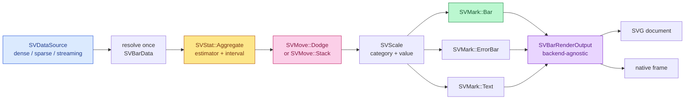

# Chapter 32 — Bar plots: saying one number about each category

A bar plot answers a question that is different from every chart before this
one in the book. A histogram (chapter 22) asks *what shape does one variable
have?* A box plot (chapter 27) asks *how is one variable spread inside each
group?* A bar plot asks something smaller and much more common in reports:
*what single number summarises each category?*

The answer is a bar whose length is that number. The chart is the general
categorical summary: the number can be a mean, a median, a sum, a count, a
minimum, a maximum or a standard deviation, and the little segment on top of the
bar can carry the uncertainty of that estimate. The record that specifies it is
[FDR-121](../FDRs/recipes/distribution-bar-plot.md), and this chapter explains
how the `SVBarPlot` implementation turns that record into code.

## The one-sentence version

`SVBarPlot` is the composition

```text
data -> [SVStat::Aggregate] -> (value per category, optional interval)
     -> [SVMove::Dodge | Stack] -> [SVScale] -> SVMark::Bar (+ error bars)
```

and nothing else. Every step is an existing kernel. The recipe contributes the
decision of *which* kernels to call and how to feed them, never a new mark, a
new statistic or a new scale.



## Why aggregating is mandatory

The first open question in the FDR is whether a bar plot should accept raw
observations and draw one bar per observation. The answer recorded there is
*no*: a bar is a summary, and the raw case is the strip plot or the swarm plot.
So `SVBarPlot` always runs an aggregate. That sounds restrictive until you
realise it also covers the *pre-aggregated* case: if the caller already has one
value per category, the mean of one observation is that observation, and the
same builder draws the summary unchanged. The example program feeds raw
observations to show the more interesting path; the doc comment of
`examples/bar_plot.rs` states the pre-aggregated contract explicitly.

The estimator is `SVAggregateMethod` from the statistical-transform kernel
(chapter 10). `Mean` is the default because that is what seaborn's `barplot`
does. `Median`, `Sum`, `Minimum`, `Maximum`, `StandardDeviation` and `Count`
are one builder call away. Weights are accepted exactly for the two estimators
that can use them — `Mean` and `Sum` — and the builder rejects a weighted
median at build time, before any data is read, because a build failure is
always better than a render-time surprise (patterns P7).

## One column decides what an observation is

The data contract names `category`, `value`, `series` and `weight`. The value
column is what decides which rows are observations:

- a **dense** column contributes every row;
- a **sparse** column contributes only its stored entries, because the implicit
  zeros are not observations and are never expanded;
- a **streaming** column contributes its current window and marks the result as
  approximate.

The category, series and weight columns are then read at those same positions.
This is the same rule the box plot follows, and it is the reason
`parity_tests::a_sparse_column_is_never_densified` can build a sparse column of
logical length one million with five stored entries and still see exactly five
observations and one bar. The representation is resolved once per operation and
recorded in the span.

A non-finite value, category, series code or weight is governed by
`SVBarMissingValuePolicy`. The default `Omit` drops it and counts the rest;
`Error` returns `SVError::NonFiniteValue` naming the position. The test
`a_missing_value_is_omitted_by_default_and_rejected_on_request` exercises both
sides.

## Grouping, dodging and stacking

The aggregate kernel groups by numeric codes. A bar plot has two grouping
dimensions — category and series — so the recipe composes one code per
observation,

```text
code = category_index + series_index * number_of_categories
```

and asks the kernel for one aggregate per code. The code is a small integer, so
it is exact in `f64`; no string ever enters the statistics.

The grouping layout is not computed by the recipe. Two of the closed move
variants do the work (chapter 11):

- **Dodge** receives the series index as the group key and the category index as
  the category key. It returns, for every bar, a horizontal offset inside the
  slot and a narrowed width. Two series in a `0.8`-wide slot therefore sit at
  `-0.2` and `+0.2`, each `0.4` wide.
- **Stack** receives the category index as the group key, so the values of one
  category accumulate. It returns a baseline and a new top per bar and leaves
  the width alone. Positive and negative values accumulate independently, which
  is why a diverging bar chart works without a special case.

The tests `series_dodges_the_bars_inside_the_category_slot` and
`stack_grows_each_series_from_the_previous_top` assert those numbers directly.

## Ordering

`SVBarOrdering` is the one piece of policy the recipe adds on top of the
kernels. `Data` keeps the first-appearance order of the categories. `Ascending`
and `Descending` rank the categories by their **total** aggregate value, which
means the sum over series for a grouped chart and the single value otherwise.
Ties keep the data order, so the result is deterministic. The ordering changes
the axis and the slot indices, never the values; the test
`ordering_rearranges_the_categories` checks the three orders on the same data.

## Drawing the bars

Each bar is drawn by its own `SVMark::Bar` request. That is deliberate: the bar
mark computes its slot as the width of the plot area divided by the number of
points in the request, so giving it one point and one slot-sized area is how
the recipe keeps exact widths while still using the kernel. The request carries
the category position on the category scale, the stacked top on the value
scale, the data-space baseline and the narrowed width from the dodge.

The optional error bar is `SVMark::ErrorBar`, fed the lower and upper bounds
from the aggregate's interval. With `SVAggregateErrorKind::Percentile` the
probability comes from `confidence_interval` (default `0.95`), and the test
`confidence_interval_widens_the_percentile_band` proves that a `0.99` band is
wider than a `0.5` one.

The optional label is `SVMark::Text`, formatted by `SVFormatSpec` and placed at
the top of the bar. A single explicit `colour` overrides the series palette.

## Two serializers, one geometry

`render()` returns `SVBarRenderOutput`, which contains no backend type at all:
mark geometries and decoration primitives already placed in logical pixels. The
output then has two serializers that read the same data:

- `to_svg()` writes a self-contained SVG document (chapter 12);
- `to_native_frame()` rasterizes the same primitives into a native frame
  (chapter 15).

Each one rejects a figure configured for the other backend with
`SVError::InvalidConfiguration`, and `save()` on a `Native` figure reports
`SVError::UnsupportedBackendCapability` because the native row declares no
export format. The tests `svg_tests` and `native_tests` cover both directions
and assert that a bar centre is actually painted in the native frame.

## What this change does not claim

Two lines of the FDR acceptance list stay unticked, on purpose:

- **Fill pattern.** The FDR lists `pattern: Option<SVFillPattern>`, but the core
  kernel has no such type yet. A recipe may not invent a kernel type (patterns
  P5), so the option is documented as deferred and no backend matrix entry is
  claimed. The change that introduces fill patterns will add it.
- **Animation.** The geometry is transition-ready — a state change can
  interpolate the bar height, the interval extent and the colour — but the
  animation driver belongs to the transition integration change. Claiming a
  slide-into-stacked-position behaviour without a test would be exactly the
  overclaim the previous wave's review rejected.

## Reading the code

The module follows the fixed folder layout of patterns P3:

| File | Responsibility |
|---|---|
| `mod.rs` | pure dispatcher: declarations and re-exports |
| `builder.rs` | the only public constructor and its validation |
| `configuration.rs` | the validated configuration the built plot carries |
| `data_contract.rs` | column resolution, roles and observations |
| `statistics.rs` | aggregation, ordering, dodge/stack and `SVBarBin` |
| `scales.rs` | the value domain, the slot scale and the nominal axis |
| `composition.rs` | bar, error-bar and label geometry |
| `decoration.rs` | title, axes, grid and legend |
| `output.rs` | `SVBarRenderOutput` and the two serializers |
| `core_implementation.rs` | `SVBarPlot`, `render` and `save` |

The companion test modules sit beside it: unit tests per option, parity across
the three representations, concurrency over four threads, span assertions, and
an SVG snapshot for the documentation figure. The figure below is produced by
`cargo run --example bar_plot`, not drawn by hand.

```rust
use scienceview::sv_recipes::sv_distribution::sv_bar_plot::SVBarPlotBuilder;

let output = SVBarPlotBuilder::new()
    .data_source(&table)
    .value("measurement")
    .category("station")
    .series("scenario")
    .error(SVAggregateErrorKind::StandardError)
    .width(0.7)
    .label(true)
    .backend(SVBackendKind::Svg)
    .build()?
    .render()?;

let document = output.to_svg()?;
```


## What comes next

The fill pattern and the animation driver are the two follow-ups recorded
above. The chart itself is complete: it renders small and large data,
concurrently, from dense, sparse and streaming sources, and exports the same
geometry to SVG and to the native canvas.
