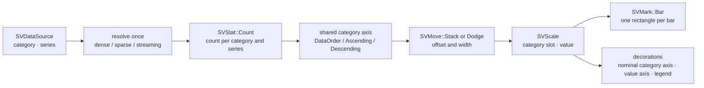
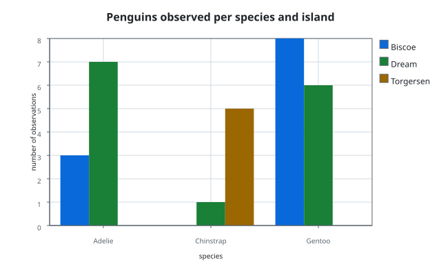

# Chapter 33 — Count plots: how many observations fall into each category

A histogram answers *how many observations fall into each interval of a
continuous variable*. A count plot asks the same question about a categorical
variable: for every category, how many observations carry it? That single
difference removes the hardest part of the histogram — choosing bins — and
turns the chart into a plain bar chart whose height is always a count. This
chapter follows `SVCountPlot`, the recipe specified by
[FDR-122](https://github.com/neurono-ml/scienceview/blob/main/docs/FDRs/recipes/distribution-count-plot.md).

## The question the chart answers

A biologist records the species and the island of every observed penguin. Three
questions follow naturally:

1. **Which species is the most common?** One bar per species, as tall as the
   number of observations of that species.
2. **Is the mix the same on every island?** Split every species bar by island:
   the same categories, several coloured series inside one slot.
3. **Which fraction of the whole sample is each species?** Normalise the counts
   by the grand total.

A count plot answers all three without asking the caller to pre-aggregate
anything. The dataset stays a list of observations; the chart does the counting.

## The concepts, from zero

**Category.** A value that names a group rather than a position on a number
line. Internally the data boundary carries categories as `f64` codes; the chart
takes their human names through `category_labels(...)`. A category without a
supplied label falls back to `category 0`, `category 1`, and so on.

**Count.** The number of observations that carry one category. The kernel
`SVStat::Count` produces, for each category, both the category value and the
number of observations, in the requested order.

**Series.** An optional second categorical column that splits every category
into sub-groups. Each series is counted separately, then the series are arranged
inside the same category slot.

**Stack and dodge.** Two ways to share one category slot between series:

| Arrangement | What it does |
|---|---|
| `Layer` (default) | every series draws a full-width bar over the previous one |
| `Stack` | every series grows from the top of the previous one, so the bar totals the category |
| `Dodge` | every series takes its own slice of the slot, side by side |

The offsets and narrowed widths are never computed by the recipe: `SVMove`
produces them, exactly as it does for the histogram and the box plot.

## The composition

The chart is exactly the composition recorded by the FDR, and it adds no mark,
stat, move or scale variant (patterns.md P5):



Counting one column at a time is what the kernel offers, so the recipe solves
the series case by filtering the category column per series and calling the
kernel once per group. The kernel returns each group's categories in the
requested order; the recipe then aligns those sets on one shared axis so that a
stack or a dodge can match them by index:

```rust
let categories = counting::sv_category_axis(configuration, category, series)?;
let groups = observations::sv_category_groups(category, series, policy, labels, colour)?;
let counted = counting::sv_count_groups(configuration, &groups, &categories)?;
moves::sv_prepare_series(configuration, categories, counted)
```

The only arithmetic the recipe adds is the normalisation the counting kernel
does not carry: with `SVNormalisation::Probability`, every count is divided by
the grand total. A category slot is exactly one unit wide, so probability and
density coincide on this axis.

## The public surface

`SVCountPlot` is built through `SVCountPlotBuilder`. `backend(...)` is required
— there is no automatic backend — and `execution_mode(...)` defaults to
`Automatic`. The documented options are:

| Option | Default | Effect |
|---|---|---|
| `category` | — (required) | the column to count |
| `series` | `None` | splits every category into sub-groups |
| `category_labels` | code names | human names for the axis |
| `series_labels` | code names | human names for the legend |
| `orient` | `Vertical` | bars grow up or to the right |
| `width` | `0.8` | fraction of the category slot a bar occupies |
| `normalise` | `Count` | raw counts, probability or density |
| `order` | `DataOrder` | first appearance, ascending or descending category |
| `colour` | theme palette | one colour for every bar when set |
| `multiple` | `Layer` | layer, stack or dodge the series |
| `missing_value_policy` | `Omit` | drop or reject a non-finite category |

`compose()` returns the backend-agnostic `SVCountScene`; `render()` serializes
it through the configured kind. `update(appended_points)` recomposes the current
window of a streaming source, and every operation records one span with the
backend kind, the representation and the drawn bar count.

The builder rejects a configured `weight` with a typed configuration error that
names the kernel gap: `SVStat::Count` does not consume observation weights, and
the recipe will not reimplement weighted counting to hide that. Weighted
counting remains a follow-up change to `statistical-transforms`.

## The data boundary

The category and series columns resolve once per operation. A dense column
contributes every row, a streaming column its current window, and a sparse
column its logical length — because an implicit zero is a real observation of
category zero, not a gap. Only the stored entries carry a non-zero category,
and no sparse view is ever expanded into a dense buffer:

- `the_sparse_input_is_never_densified` asserts the built figure reports
  `Sparse` and still produces the same counts.
- `a_sparse_input_with_implicit_zeros_counts_them_as_category_zero` compares a
  sparse column of five logical values with two stored entries against the
  equivalent dense column, byte for byte in the scene.
- `dense_sparse_and_streaming_inputs_draw_the_same_scene` proves the parity the
  spec requires, and `a_streaming_input_returns_promptly_and_shows_the_window`
  proves the render never waits on the producer.

The missing policy is explicit. `Omit` drops a non-finite category and counts
the rest; `Error` returns `SVError::NonFiniteValue` naming the position, so a
caller who expected clean categories learns about the gap.

## The rendered figure

The example program `examples/count_plot.rs` builds the real builder over a
penguin table and writes the figure through the public serializer:

```rust
let scene = SVCountPlot::builder()
    .data_source(&table)
    .category("species")
    .category_labels(&["Adelie", "Chinstrap", "Gentoo"])
    .series("island")
    .series_labels(&["Biscoe", "Dream", "Torgersen"])
    .multiple(SVCountMultiple::Dodge)
    .title("Penguins observed per species and island")
    .backend(SVBackendKind::Svg)
    .build()?
    .compose()?;
```



## How the tests describe the behaviour

The companion tests are the executable specification. Grouped by concern:

| Test | What it pins down |
|---|---|
| `the_default_configuration_counts_every_category` | one bar per category, the count as height |
| `probability_normalisation_divides_by_the_grand_total` | the fractions sum to one |
| `the_ascending_order_sorts_the_categories` | ordering comes from the kernel |
| `the_descending_order_reverses_the_categories` | the reverse rule |
| `a_layered_series_draws_one_bar_per_category_and_series` | series split and shared axis |
| `a_stacked_series_grows_from_the_previous_one` | stacking through `SVMove` |
| `a_dodged_series_narrows_every_bar` | dodging through `SVMove` |
| `the_horizontal_orientation_swaps_the_axes` | orientation |
| `several_threads_render_the_same_count_plot_identically` | thread safety |
| `a_compose_records_the_backend_representation_and_drawn_bars` | the operation span |

Backend dispatch is exercised on both shipped paths: `Svg` serializes a
self-contained document and `Native` rasterizes the very same scene with the
same mark and decoration primitives. Any other configured kind fails with
`SVError::UnsupportedBackendCapability` instead of being silently ignored, and a
compiled-out backend reports `SVError::BackendUnavailable`. Transition and
animation wiring is deferred to the transition integration; the geometry is
transition-ready, because a category is the match key and the bars keep their
identity when the order changes.
