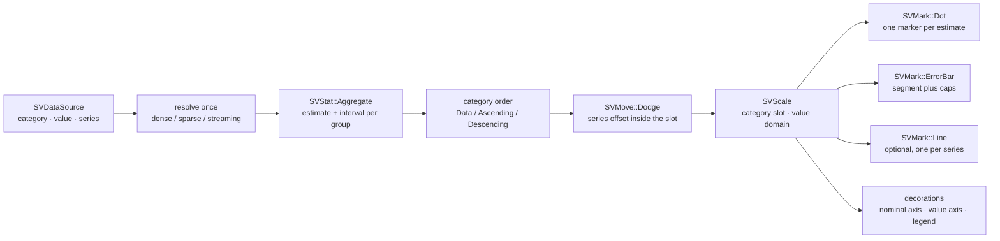

# Chapter 34 — Point plots: one estimate and its uncertainty per category

A bar chart says *one number per category*. A point plot says the same number,
but it refuses to hide what that number is worth: every point carries the
interval it was measured with. It is the figure of the scientific literature —
the mean of a treatment group with its standard error, the median of a station
with its confidence band, several methods compared across the same categories
and joined by a line so the eye can follow one method from left to right.

This chapter follows `SVPointPlot`, the recipe specified by
[FDR-123](https://github.com/neurono-ml/scienceview/blob/main/docs/FDRs/recipes/distribution-point-plot.md),
and the tests that ship with it in
`src/recipes/distribution/point_plot/`.

## The question the chart answers

A laboratory measures the same variable under several scenarios and at several
stations. Three questions follow:

1. **What is the typical value at each station?** One point per station, at the
   mean of its observations.
2. **How sure are we about that value?** An error bar around the point, one
   standard deviation or one standard error wide, or a percentile band.
3. **Which scenario goes up and which goes down?** Colour the points by
   scenario and join the points of one scenario with a line; the slope of that
   line is the story.

The caller never pre-aggregates. The dataset stays a list of observations; the
chart does the statistics.

## The concepts, from zero

**Estimate.** A single number that summarises a group of observations. The most
common estimates are the mean, the median and the sum. In `scienceview` the
estimate is never computed by the recipe: the statistical kernel
`SVStat::Aggregate` computes it for every group.

**Uncertainty interval.** A pair of numbers around the estimate, `lower` and
`upper`. Three kinds are available and all come from the same kernel:

| Error kind | What the interval covers |
|---|---|
| `StandardDeviation` (default) | one sample standard deviation on each side |
| `StandardError` | the standard error of the mean on each side |
| `Percentile(p)` | the centred interval that covers the probability `p` |

A group with a single observation has no sample standard deviation, so the
kernel reports no interval; the recipe draws the point and simply omits the
error bar. That is a real answer, not an error.

**Category.** A value that names a group rather than a position on a number
line. Internally the data boundary carries categories as `f64` codes and the
axis shows their labels.

**Series.** An optional second categorical column that splits every category
into sub-groups. Each series gets its own colour and its own connecting line.

**Dodge.** Two points of two series cannot occupy the same spot inside one
category slot. The recipe asks `SVMove::Dodge` for a horizontal offset and never
computes the displacement itself.

## The composition

The chart is exactly the composition recorded by the FDR, and it adds no mark,
stat, move or scale variant (patterns.md P5):



The recipe is split into small files so each responsibility reads on its own:

| File | Responsibility |
|---|---|
| `builder/` | the public option surface and its validating `build` |
| `data_contract.rs` | resolve the three columns once, preserving the representation |
| `aggregation.rs` | group the observations and call `SVStat::Aggregate` |
| `placement.rs` | dodge the series through `SVMove` |
| `statistics.rs` | the public `SVPointEstimate` and `SVPointSummary` |
| `scales.rs` | derive the value domain and build the three scales |
| `composition/` | turn estimates into dot, error-bar and line geometry |
| `output.rs` | the backend-agnostic render result and its serializers |

The whole render is one operation:

```rust
pub fn render(&self) -> Result<SVPointRenderOutput, SVError> {
    let data = sv_resolve_point_data(&self.configuration)?;
    sv_run_operation(
        "render",
        self.backend_kind,
        data.representation,
        data.number_of_points,
        || self.sv_render_resolved(&data),
    )
}
```

`sv_run_operation` records the configured backend kind, the representation and
the number of finite observations in the span, which is what
`observability_tests::render_span_records_backend_representation_and_points`
asserts.

## Aggregating, without reimplementing the statistics

The recipe maps the observations of one category and one series onto one group
code and hands the kernel a borrowed dense slice:

```rust
let options = SVAggregateOptions::new()
    .method(configuration.estimator)
    .error(sv_error_kind(configuration));
let input =
    SVStatInput::new(SVColumnView::Dense(&values)).with_groups(SVColumnView::Dense(&codes));
let result = SVStat::aggregate(options).apply(input)?;
```

`sv_error_kind` is the only recipe-level decision: a `Percentile` request asks
for the probability configured by `confidence_interval(...)`. Everything else —
the weighted mean, the median of an even group, the sample standard deviation,
the quantile interpolation — lives in the kernel and is tested there.

`estimator_selects_a_different_summary` walks the three common estimates on the
same three observations `[1, 2, 30]`: the mean is `11`, the median is `2`, the
sum is `33`. The point plot only reads the returned value.

## The error bar and its caps

The interval comes back as `SVAggregateErrorInterval { lower, upper }`. The
recipe asks the error-bar mark for a segment between the two values and,
when `caps(true)` (the default), two short cross lines at the ends:

```rust
let mark: SVMark = SVMark::error_bar()
    .direction(direction)
    .cap_size(SVLength::absolute(cap_size))
    .colour(colour)
    .into();
```

`cap_size` is a length in logical pixels. The recipe derives it from the
category slot and the public `cap_width(...)` fraction, so the caps keep their
proportion when the viewport changes. `caps_can_be_switched_off` compares the
number of path commands with and without the caps: the uncapped document draws
two commands per interval, the capped one draws six.

`the_default_error_is_one_standard_deviation` checks the documented default:
for `[1, 2, 3]` the mean is `2` and the interval is `[1, 3]`.
`confidence_interval_widens_the_percentile_band` checks that the requested
confidence level reaches the kernel rather than being ignored.

## Placing the series

When a series column splits a category, the points of one category would
otherwise sit on top of each other. The recipe builds one row per estimate and
asks the move kernel for the offset:

```rust
let move_option = SVMove::dodge().width(SV_POINT_DODGE_WIDTH).into();
let sequence = SVMoveSequence::new(vec![move_option])?;
let request = SVMoveRequest::new(SVColumnView::Dense(&values), &group_keys)
    .with_category_keys(&category_keys);
let moved = sequence.apply(&request)?;
```

`series_dodges_the_points_inside_the_category_slot` asserts the resulting
positions `-0.2` and `+0.2` for two series in the same slot. The same test
asserts that the legend holds two entries.

## Joining the points of one series

With `join(true)`, the recipe groups the estimates by series, sorts them by
category index and asks the line mark for one polyline per series:

```rust
let mut points: Vec<&SVPointEstimate> = summary
    .estimates()
    .iter()
    .filter(|estimate| estimate.series_index() == series_index)
    .collect();
points.sort_by_key(|estimate| estimate.category_index());
```

The line is drawn after the dots, so the markers stay visible on top. `dash`
and `line_width` are passed to the same `SVLineOptions` surface used by the
line plot. `join_draws_one_line_per_series` asserts that turning the option on
adds exactly one geometry per series and leaves every dot in place.

## The data contract and the three representations

The value column decides which logical positions are observations:

- a **dense** column contributes every row;
- a **sparse** column contributes only its stored entries — the implicit zeros
  are never expanded;
- a **streaming** column contributes its current window and never blocks.

The category and series columns are read at those same positions. The
representation of the whole operation is the widest of the three, so a dense
value column with a streaming series column reports `Streaming` and marks the
result as approximate.

`parity_tests::dense_sparse_and_streaming_agree` renders the same six
observations through the three representations and compares the dot centres
within `1e-9`. `a_sparse_column_is_never_densified` uses a logical length of
one million and asserts that only the five stored entries become observations.
`mixed_representations_agree_after_validating_lengths` mixes all three and
checks that the lengths are validated before any value is read.

## Backends and the typed dispatch

`render()` returns geometry, not a file. The same `SVPointRenderOutput` knows how
to serialize itself:

- `to_svg()` writes a self-contained SVG document when the configured kind is
  `Svg`;
- `to_native_frame()` rasterizes into a native frame when the configured kind is
  `Native`;
- any other configured kind returns a typed error instead of silently drawing
  with the wrong backend.

`svg_output_is_self_contained_and_deterministic` renders twice and compares the
documents byte for byte; `native_frame_matches_the_composed_geometry` finds the
first dot centre and asserts that the native frame paints it with a colour
different from the background. `native_has_no_export_and_says_so_with_a_typed_error`
asserts that `save(...)` on a native figure reports the missing export
capability.

The example `examples/point_plot.rs` uses the public builder, renders the same
geometry and writes [`docs/figures/point_plot.svg`](https://github.com/neurono-ml/scienceview/blob/main/docs/figures/point_plot.svg):


## The public surface

| Option | Type | Default |
|---|---|---|
| `category` | column name | required |
| `value` | column name | required |
| `series` | column name | `None` |
| `estimator` | `SVAggregateMethod` | `Mean` |
| `error` | `SVAggregateErrorKind` | `StandardDeviation` |
| `confidence_interval` | `f64` | `0.95` |
| `ordering` | `SVPointOrdering` | `Data` |
| `missing_value_policy` | `SVPointMissingValuePolicy` | `Omit` |
| `orient` | `SVBarOrientation` | `Vertical` |
| `marker` | `SVDotShape` | `Circle` |
| `caps` | `bool` | `true` |
| `cap_width` | `f32` | `0.1` |
| `join` | `bool` | `false` |
| `line_width` | `SVLength` | theme token |
| `dash` | `SVDashPattern` | solid |
| `colour` | `SVColour` | palette |
| `backend` | `SVBackendKind` | required |
| `execution_mode` | `SVExecutionMode` | `Automatic` |

Every option is validated in `build(...)`, before any pixel is drawn. A missing
column, a mistyped column, an invalid cap width, an invalid confidence level or
a mark the backend cannot host all return a typed `SVError`. There is no
automatic backend: the rendering form is always a deliberate choice.

## Roads not taken

**Stacking the points.** A point plot stacks poorly: a point at the top of a
stacked series no longer sits at its own estimate, and the error bar around it
would describe a quantity nobody measured. The FDR composes only
`SVMove::Dodge`, so the recipe exposes no stack option.

**A new error-bar mark.** The FDR asks whether the error bar should be its own
shared mark. The core answered yes in FDR-001: `SVMark::ErrorBar` is a geometric
primitive used by the bar plot and the line plot too. This recipe only composes
it; it never draws a segment by hand.

**Recomputing the statistics.** The recipe could have computed the mean and the
deviation itself in a few lines. It does not: the estimator, the weighted
variants, the percentile interpolation and the single-observation rule are the
kernel's contract, tested once and reused by every chart that aggregates.

**Animation.** The geometry is transition-ready — a state change can
interpolate the point positions and the error-bar extents — but transition and
animation wiring is deferred to the transition integration. This chapter claims
only the geometry.

## What the tests protect

| Test | Contract |
|---|---|
| `the_default_point_is_the_mean_of_its_category` | the point is the estimator over the group |
| `estimator_selects_a_different_summary` | mean, median and sum reach the kernel |
| `the_default_error_is_one_standard_deviation` | the documented default interval |
| `a_single_observation_reports_no_interval` | no invented uncertainty |
| `confidence_interval_widens_the_percentile_band` | the confidence level is applied |
| `series_dodges_the_points_inside_the_category_slot` | dodge through `SVMove` |
| `ordering_rearranges_the_categories` | data, ascending and descending order |
| `join_draws_one_line_per_series` | one line per series, dots preserved |
| `the_marker_shape_changes_the_geometry` | the marker option reaches the dot mark |
| `caps_can_be_switched_off` | the cap option changes the path |
| `orientation_turns_the_points_sideways` | horizontal orientation |
| `a_missing_value_is_omitted_by_default_and_rejected_on_request` | missing-value policy |
| `parity_tests::*` | dense, sparse and streaming equivalence |
| `concurrency_tests::concurrent_renders_are_identical` | four threads, identical geometry |
| `observability_tests::*` | the span carries backend, representation and points |

The next chapter in the distributional family leaves summaries behind and shows
the whole shape of a distribution; this one keeps the summary, but refuses to
hide its uncertainty.