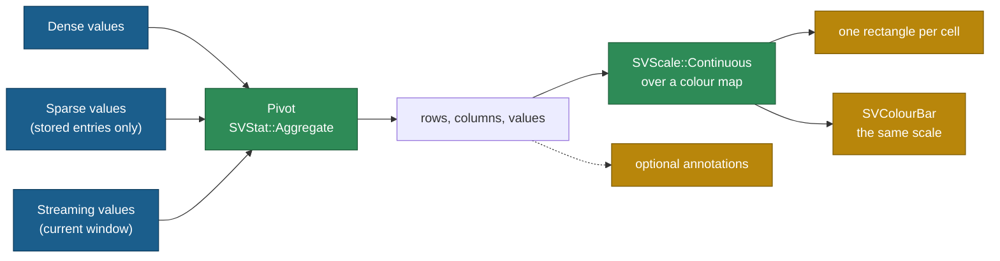

# Chapter 35 — Heatmaps: a matrix where colour is the number

Some data is not a list of observations but a rectangular field. A correlation
matrix, a confusion matrix, a table of temperatures by city and month — all of
them are *rows × columns*, and every cell holds one number. Drawing one point
per observation would lose the shape of the field, so the heatmap turns the
number itself into colour: one rectangle per cell, filled with the colour the
continuous scale assigns to its value.

This chapter follows `SVHeatmapPlot`, the recipe specified by
[FDR-131](https://github.com/neurono-ml/scienceview/blob/main/docs/FDRs/recipes/matrix-heatmap-plot.md),
and the tests that ship with it in `src/recipes/matrix/heatmap_plot/`.

## The question the chart answers

A correlation study measures six body measurements on the same animals. The
caller can ask three things:

1. **Which pairs move together?** One cell per (row, column) pair, coloured by
   the correlation.
2. **What does a colour mean?** The colour bar at the right of the plot, drawn
   from the very same continuous colour scale the cells use.
3. **Which cell is that, exactly?** The row and column labels on the two axes,
   and optionally the value printed inside the cell.

## The concepts, from zero

**Matrix.** A rectangular table of numbers with a row index and a column index.
In `scienceview` a matrix is either a direct `SVHeatmapMatrix` (row-major values
plus a shape) or a *long table*: three columns named `row`, `column` and
`value`. The recipe pivots the long table into a matrix, so a caller never has
to pre-shape the data.

**Pivot.** Turning `(row key, column key, value)` triples into a grid. When two
triples name the same pair, the recipe delegates the collision to
`SVStat::Aggregate`: the mean of the duplicates becomes the cell.

**Colour map.** A continuous function from a fraction in `0.0..=1.0` to a
colour, defined by ordered stops. The default map mirrors the theme's `viridis`.
The colour scale combines the value domain with the map, so `scale.colour(v)`
answers the colour of any value.

**Colour bar.** The legend of a continuous colour scale. It is not a second
scale: `SVColourBar` owns the same `SVContinuousColourScale` the cells were
painted with, which is why the bar can never drift from the cells.

**Missing cell.** A non-finite value. The caller chooses the rule: `Omit` draws
nothing, `Transparent` keeps the cell but fills it fully transparent, and
`Neutral` fills it with the theme surface colour.



## The public surface

`SVHeatmapPlot::builder()` is the only constructor. `backend(...)` is required
— there is no automatic backend — and `execution_mode(...)` defaults to
`Automatic`. The input is either `.matrix(SVHeatmapMatrix::new(...)?)` or
`.data_source(&table).row("row").column("column").value("value")`.

The rest of the surface follows the FDR: `colour_map`, `centre`, `robust`,
`annot`, `annot_format`, `line_width`, `square`, `colour_bar`, `missing`,
`orientation`, `row_labels`, `column_labels`, and the titles. `compose()`
returns a backend-agnostic `SVHeatmapScene`; `render()` dispatches on the
configured kind, serializing SVG for `Svg` and an RGBA frame for `Native`, and
reporting a typed error for a kind without a recipe serializer.

## How one render works

1. **Prepare.** A direct matrix is already row-major. A long table is pivoted:
   the row and column columns become the label axes, and the value column fills
   the cells. A sparse value column contributes only its stored entries, so it
   is never densified; a streaming column contributes its current window and
   never blocks.
2. **Derive the domain.** The finite values give the colour domain. `robust`
   trims it to the 2nd and 98th percentiles, and `centre` symmetrises it around
   a value so that the middle of the colour map lands on that value.
3. **Paint.** One rectangle per drawn cell, filled with `colour_scale.colour(v)`
   and stroked with the background when `line_width` is positive. Missing cells
   follow the configured rule.
4. **Decorate.** Nominal axes label the rows and columns, annotations print the
   formatted value inside the cell, and the colour bar describes the same scale.
5. **Serialize.** The scene is notation-free: the SVG backend and the native
   rasterizer read the same viewport, decorations and rectangle primitives.

## Walking through the tests

`every_cell_takes_the_colour_map_colour_of_its_value` asserts the invariant at
the heart of the chart: for every drawn cell, `cell.colour()` equals
`scene.colour_scale().colour(value)`. The colour bar reads the same scale, so
this single assertion pins both the cells and the legend to one source.

`dense_sparse_and_streaming_inputs_draw_the_same_scene` presents the same nine
cells as a dense slice, a fully stored sparse view and a streaming snapshot;
the three SVG documents must be byte-identical.
`a_sparse_input_is_never_densified` goes further: the value column stores only
three of its nine logical positions, and the scene draws exactly three cells
while the axes keep their full shape.

`the_missing_cell_rule_decides_what_is_drawn` feeds a matrix with one `NaN` and
checks all three rules: `Omit` draws three cells, `Transparent` and `Neutral`
draw four; the transparent cell has no fill colour while the neutral one carries
the theme surface.

`annotations_use_the_requested_format` enables annotations with
`SVFormatSpec::Fixed(1)` and looks for `1.0` and `9.0` among the text
primitives. `square_cells_are_as_tall_as_wide` checks the aspect rule, and
`the_orientation_swaps_the_two_axes` checks that rows can run horizontally.

The concurrency test renders the same built heatmap from eight threads and
compares every document byte for byte, and the observability test asserts that
the single `compose` span records the configured backend kind, the value
representation and the number of drawn cells.

## The example figure

`examples/heatmap_plot.rs` builds a symmetric correlation matrix from a long
table, annotates every cell with two decimals, centres the colour map on zero
and draws the colour bar:

```rust
let scene = SVHeatmapPlot::builder()
    .data_source(&table)
    .row("row")
    .column("column")
    .value("correlation")
    .annot(true)
    .annot_format(SVFormatSpec::Fixed(2))
    .centre(0.0)
    .colour_bar(true)
    .line_width(1.0)
    .title("Correlation matrix of body measurements")
    .backend(SVBackendKind::Svg)
    .build()?
    .compose()?;

let document = scene.to_svg()?;
```


## Roads not taken

A dedicated `SVMark::Cell` was considered and rejected for now: the rectangle
primitive paired with an explicit colour map already covers the SVG and native
backends, and a cell mark with an optional border would be a core change rather
than a recipe. The pivot also stays in the recipe: it is the FDR composition's
`SVStat::Aggregate` step, not a new stat variant. Transition and animation
wiring is deferred to the transition integration; the scene carries
transition-ready geometry only.
