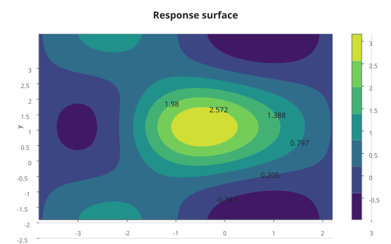
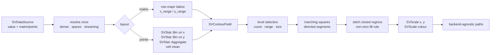

# Chapter 36 — Contours: drawing a field that was handed to you

This chapter tells the story of `SVContourPlot`, the matrix recipe that draws
the level sets of a scalar field over two continuous variables. It is the sibling
of the density contour of chapter 24, but the question is different: the field
is not estimated from a cloud of observations, it is **given**. A physical
potential, a loss surface and a response surface are all matrices of numbers,
and this chart turns those numbers into lines and bands without inventing any
statistics.



The public path is
`scienceview::sv_recipes::sv_matrix::sv_contour_plot::SVContourPlot`. The folder
on disk stays `src/recipes/matrix/contour_plot/`; the `#[path]` attributes only
change the public names. The chart is specified in
`docs/FDRs/recipes/matrix-contour-plot.md` (FDR-132) and follows the engineering
contract in `docs/FDRs/patterns.md`.

## Three ideas from zero

A **scalar field** is a number attached to every point of the plane. Here it
lives on a **regular lattice**: a row-major matrix of samples, each with an
`x` and a `y` coordinate.

A **level** is a height. The set of points where the field reaches that height
is a **level set**; the chart draws it as a line, or uses it as the edge of a
filled band.

A **band** is the region between two neighbouring levels. Painting bands from
the lowest level up makes them nest without gaps, exactly as in the density
contour.

## The pipeline



The first surprise is the two layouts. A chart that has the matrix already does
not need to bin anything: `matrix(rows, columns)` reads the `value` column
row-major and places the samples on a lattice. A chart that only has a point
cloud composes the existing `SVStat::Bin` kernel twice — once per axis — and
then hands the observations of each cell to `SVStat::Aggregate`, which reports
the mean. The recipe never owns a binning or averaging rule; it composes the
kernels that already exist (patterns P5).

Sparse input is never densified. In the matrix layout, a sparse value column
answers an implicit position with zero and keeps its stored entries; the parity
test compares that against a dense matrix whose unoccupied cells are zero. A
streaming input is read from its current window, and the build rejects a backend
that cannot host a stream.

## What the public surface looks like

```rust
use scienceview::sv_recipes::sv_matrix::sv_contour_plot::{
    SVContourPlot, SVContourStyle,
};

let plot = SVContourPlot::builder()
    .data_source(&table)
    .value("response")
    .matrix(41, 41)
    .x_range(-3.0, 3.0)
    .y_range(-3.0, 3.0)
    .levels(6)
    .style(SVContourStyle::Filled)
    .labels(true)
    .backend(SVBackendKind::Svg)
    .build()?;
let scene = plot.compose()?;
```

| Option | Meaning | Default |
|---|---|---|
| `value` | the scalar-value column | required |
| `matrix(rows, columns)` | read the value column as a matrix | point cloud |
| `x`, `y` | the two point-cloud columns | required for points |
| `x_range`, `y_range` | matrix coordinates | sample index |
| `grid_count` | bin cells per axis | `64` |
| `levels` | number of contour levels | `10` |
| `level_range` | explicit height interval | observed range |
| `level_size` | fixed spacing instead of a count | `None` |
| `style` | `Lines` or `Filled` | `Lines` |
| `labels` | draw the value beside every level | `false` |
| `missing_policy` | `Omit` fills a gap, `Error` rejects it | `Omit` |
| `colour_map`, `colour_scale` | colour encoding of a level | theme map, linear |
| `backend`, `execution_mode` | rendering form and run mode | backend required, `Automatic` |

The two styles share the same thresholds, so switching style never changes the
level set. A filled chart paints a background band and then one closed region
per level; a line chart strokes one compound path per level.

## A missing sample is a decision

Marching squares needs four corners in every cell. A non-finite sample therefore
cannot simply stay there, because the cell would have no case. The missing policy
makes the decision explicit:

- `Omit` replaces the gap with the mean of its finite orthogonal neighbours,
  then with the mean of every finite sample, and finally with zero when the
  lattice carries no finite sample at all.
- `Error` rejects the render with `SVError::NonFiniteValue`, naming the position,
  so a caller who expected clean data learns about the gap instead of reading an
  interpolated contour as if it were measured.

A non-finite observation in a point cloud is dropped under `Omit` and rejected
under `Error`; dropping an observation changes the cell mean, so the policy is
visible in the test names.

## Why the extraction lives in `geometry`

`SVStat` is a closed vocabulary (patterns P5) and has no contour variant. The
marching-square table, the directed boundary walk and the region stitcher
therefore live in `src/recipes/matrix/contour_plot/geometry/`, documented as
geometry rather than statistics. The density contour recipe carries its own copy
today; this change does not touch it. When a future core change promotes the
extraction to a shared kernel, both recipes can compose it through the same
stat vocabulary. Level selection stays geometry too: thresholds come from the
field range and the requested count, range or spacing, never from a fitted
model.

Labels follow the same rule. `labels(true)` appends one text run per drawn level,
anchored on the level curve and drawn after every band, so a higher band cannot
cover a lower label. This is a notation feature, not a statistics feature.

## The tests are the specification

`contour_plot_tests.rs` walks the public surface: the documented defaults, one
test per output-changing option (levels, level range and spacing, style, labels,
colour map, colour-scale transform, line width, matrix ranges, grid count and
the titles), the point-cloud cell mean, the nested filled bands, closed
subpaths, the missing policy and the explicit build errors. An option with no
effect on its own output is not faked into the list.
`parity_tests.rs` asserts that dense and sparse point clouds agree, that dense and
streaming clouds produce the same primitives, and that a structurally sparse
matrix is never densified. `concurrency_tests.rs` serializes the same chart from
eight threads byte for byte. `observability_tests.rs` asserts that the operation
span carries the configured backend kind, the representation and the number of
drawn primitives. `render_tests.rs` checks the SVG document, the native frame,
the typed error for a kind without a serializer and the missing-feature error.

## What is deliberately not claimed

Contour paths are not animated here. The geometry is deterministic and
recomputed from the field, so a later transition change can match contours by
vertex order; this change claims transition-ready geometry only. The
`interpolation` option recorded in the FDR is deferred: a point cloud is folded
by cell mean for now, and bilinear resampling is a later refinement. The
extraction is not yet a shared core kernel, and the sibling density contour is
left untouched.
