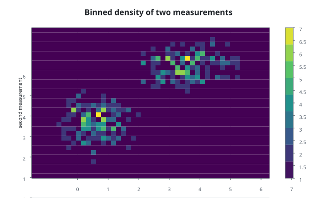
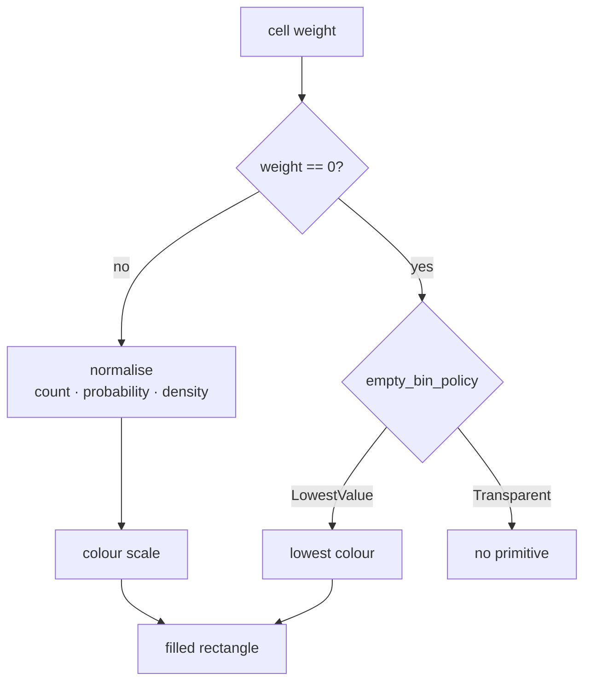

# Chapter 37 — Density heatmaps: the binned field, cell by cell

This chapter tells the story of `SVDensityHeatmapPlot`, the chart that shows
where two continuous measurements cluster together as a raster of coloured
cells. It is the binned counterpart of the density contour: cheaper to compute,
and honest about the sample support instead of drawing a smoothed estimate.

By the end you will know why the recipe asks the bin kernel for two edge
vectors, how the aggregate kernel fills the cells, and why an empty bin is a
real decision rather than an accident.



The public path is
`scienceview::sv_recipes::sv_matrix::sv_density_heatmap_plot::SVDensityHeatmapPlot`.
The folder on disk stays `src/recipes/matrix/density_heatmap_plot/`; the
`#[path]` attributes only change the public names. The chart is specified in
`docs/FDRs/recipes/matrix-density-heatmap-plot.md` (FDR-133) and follows the
engineering contract in `docs/FDRs/patterns.md`.

## The question the chart answers

A scatter plot shows every observation as a dot. A density contour answers
"how much data per unit area at this point?" and draws the answer as level
lines. A density heatmap answers the same question with a simpler instrument: it
divides the plane into a regular grid and colours each cell by how much data
fell into it.

The difference is not cosmetic. A contour interpolates between cells, so it
looks smooth even where the sample is sparse. A heatmap paints exactly the
cells that received data, so the support of the sample is visible. It is also
much cheaper: no marching squares, no stitching, no closed regions.

Three ideas are enough to follow the implementation:

- A **grid** divides the plane into rectangular cells.
- A **count** (or a normalised weight) accumulates inside each cell.
- A **colour scale** maps that number to a colour, so the chart can be read
  without a table.

## The pipeline

```mermaid
flowchart LR
    A["SVDataSource<br/>x, y, series, weight"] --> B["resolve columns once<br/>dense · sparse · streaming"]
    B --> C["SVStat::Bin on x<br/>SVStat::Bin on y"]
    C --> D["cell codes<br/>series × cell"]
    D --> E["SVStat::Aggregate<br/>sum of weights per cell"]
    E --> F["SVNormalisation<br/>Count · Probability · Density"]
    F --> G["SVScale x, y<br/>SVScale colour"]
    G --> H["one rectangle per cell<br/>SVMark rectangle"]
    H --> I["backend-agnostic<br/>scene"]
```



The first surprise is step `C`. The closed statistical vocabulary has no
"two-dimensional binning" variant, and a recipe is never allowed to add a
kernel variant (patterns P5). The recipe therefore composes the existing
one-dimensional `SVStat::Bin` kernel twice — once per axis — and receives the
two edge vectors. Those edges are the same edges a histogram of the same column
would use, so the two charts can never disagree about where a bin starts.

The second surprise is step `E`. The recipe does not count cells in a private
loop. It derives a flat code for every observation — the row-major cell index,
offset by the series index — and hands the codes and the accumulated weights to
`SVStat::Aggregate` with the `Sum` method. The kernel owns the fold; the recipe
owns only the mapping from a pair of values to a code.

## What the public surface looks like

```rust
use scienceview::sv_recipes::sv_matrix::sv_density_heatmap_plot::SVDensityHeatmapPlot;

let plot = SVDensityHeatmapPlot::builder()
    .data_source(&table)
    .x("first measurement")
    .y("second measurement")
    .bin_count_x(48)
    .bin_count_y(32)
    .backend(SVBackendKind::Svg)
    .build()?;
let composition = plot.compose()?;
```

| Option | Meaning | Default |
|---|---|---|
| `x`, `y` | the two continuous columns | required |
| `series` | one raster per distinct code | `None` |
| `weight` | observation weight column | `None` |
| `bin_count_x`, `bin_count_y` | bins per axis | one bin per eight pixels |
| `normalise` | `Count`, `Probability` or `Density` | `Count` |
| `colour_map` | continuous map of the cell value | theme map |
| `colour_bar` | draw the colour legend | `true` |
| `opacity` | cell opacity in `0.0..=1.0` | `1.0` |
| `empty_bin_policy` | `LowestValue` or `Transparent` | `LowestValue` |
| `backend`, `execution_mode` | rendering form and run mode | backend required, `Automatic` |

The derived default is worth saying out loud: one bin per eight pixels of the
480 × 304 plot area resolves to 60 horizontal and 38 vertical bins. The value is
a function of the chart size, not of the data, so the raster has roughly one
cell per screen pixel block regardless of the sample. An explicit count always
wins, and a count below one is rejected at build time.

## Normalisation and empty bins

The raw number in a cell is the sum of the observation weights that landed
there. `SVNormalisation` turns it into the number the colour scale sees:

- `Count` keeps the raw weight;
- `Probability` divides by the total weight of the series, so the cells sum to
  one;
- `Density` also divides by the cell area, so a cell's value is a probability
  density.

An empty cell is the interesting case. Most of a two-dimensional grid is
usually empty, and the FDR offers two honest answers. `LowestValue` paints it
with the colour map's lowest value, which produces a complete rectangle and
makes the grid structure visible. `Transparent` emits no primitive at all, so
the background shows through and the sample support is explicit. The recipe
also exposes both through the composition, so a caller can assert which one it
asked for.



Zero is also the marker of an empty cell: weights are validated as non-negative
and finite, so a cell can only be zero when nothing was accumulated there.

## The data boundary

The recipe accepts dense, sparse and streaming input on the same operation.

- A dense column is a borrowed slice.
- A sparse column is never densified. The pair walker merges the stored indices
  of both columns and reports the run of positions implicit in both once, with
  its multiplicity; that multiplicity becomes the weight the aggregate kernel
  sums for the zero-zero cell.
- A streaming column is read from its current window. It never blocks the render
  thread, and the build checks that the chosen backend declares the streaming
  capability.

A non-finite `x` or `y` cannot be placed in a bin and is rejected by the bin
kernel with a typed `NonFiniteValue` naming the position. A non-finite or
negative `weight` is rejected explicitly; silently dropping it would change the
cell mass.

## The tests are the specification

The companion test modules are the executable version of this chapter.
`density_heatmap_plot_tests.rs` walks the configuration surface: the documented
defaults, every option changing the output, the build-time errors, the exact
grid dimensions, a controlled sample landing in known cells, the three
normalisations, both empty-bin policies, the opacity reaching the paint, one
raster per series, the weight column and a non-finite observation as a typed
error. `parity_tests.rs` asserts that dense, sparse and streaming input produce
the same values and the same rectangles, and that a structurally sparse column
never becomes a dense array. `concurrency_tests.rs` serializes the same
composition from eight threads byte for byte. `observability_tests.rs` asserts
that the operation span carries the configured backend kind, the representation
and the number of drawn cell rectangles. `render_tests.rs` checks that the SVG
path and the composed document agree and that an unsupported backend is a typed
error, never a silent empty figure.

## What is deliberately not claimed

The FDR specifies no smoothing option, so none is exposed: the chart shows the
binned sample, not an estimate. Cells are not animated yet. Cell colour
interpolation and entering or leaving cells are recorded as the intended
temporal behaviour, and the geometry is transition-ready, but this change claims
no morphing.
