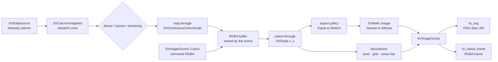

# Chapter 38 — Image plots: showing a raster honestly

Most charts start from a list of numbers. An image plot starts from a
*rectangle*: a grid of values where every cell is a pixel, and the position of
the cell is as much data as its value. This is how a microscopy frame, a
spectrogram, a heat camera reading or a computed field reaches a reader.

This chapter follows `SVImagePlot`, the recipe specified by
[FDR-134](https://github.com/neurono-ml/scienceview/blob/main/docs/FDRs/recipes/matrix-image-plot.md),
and the tests that ship with it in `src/recipes/matrix/image_plot/`.

## The question the chart answers

A scientist has a field sampled on a regular grid — say 36 rows by 48 columns
of intensities. Three questions follow:

1. **What does the field look like as a whole?** Draw every cell, with its value
   translated into a colour.
2. **Which values are large and which are small?** Put the cells on a data
   extent, and place a colour bar beside them that says what a colour means.
3. **Where are the gaps?** A cell with no measurement must be visibly absent,
   never silently painted as if it were a real zero.

## The concepts, from zero

**Raster.** A rectangular array of pixels stored row by row. An RGBA raster keeps
four bytes per pixel (red, green, blue, alpha); a numeric raster keeps one
number per cell and lets a colour map turn it into a colour.

**Colour map.** A list of ordered colour stops interpolated by a fraction from
`0.0` to `1.0`. `SVColourMap` owns the interpolation and `SVContinuousColourScale`
owns the mapping from values to fractions. The recipe never invents colours: it
asks the scale, so the raster and the colour bar can never disagree.

**Extent.** The rectangle of data space the raster covers. By default one cell is
one unit: columns `0..columns` on the horizontal axis and rows `0..rows` on the
vertical axis. An explicit `SVImageExtent` moves the raster somewhere else — a
spectrogram measured in seconds and hertz, for instance.

**Origin.** A raster has its own row order, but plotting coordinates grow
upwards. `SVImageOrigin::TopLeft` (the default) puts the first row at the upper
edge of the extent, like a photograph; `BottomLeft` puts it at the lower edge,
like a field read from the bottom.

**Interpolation.** When the raster is scaled onto more device pixels than it has
cells, the renderer must answer "what colour belongs between two cells?".
`Nearest` repeats the closest cell and keeps the grid crisp; `Bilinear` blends
the four surrounding cells and keeps the field smooth. The mark kernel carries
the choice to the backend: SVG emits `image-rendering="pixelated"` or `auto`,
the native rasterizer samples accordingly.

**Aspect ratio.** Square cells are the honest default: `SVImageAspectRatio::Equal`
letterboxes the raster inside its extent rectangle so one cell is as wide as it
is tall. `Stretch` fills the rectangle and lets cells become rectangles.

**Missing pixel.** A sparse column stores only the positions that carry a value,
and a dense column may hold `NaN`. `SVImageMissingPolicy::Transparent` (the
default) leaves those pixels empty; `DomainLower` paints them with the colour of
the scale's lower bound.

**Streaming window.** A live source keeps a bounded snapshot of the newest
samples. The recipe reads the newest `rows × columns` values as the current
frame; cells the window does not hold yet stay transparent.

## The composition

The chart is exactly the composition recorded by the FDR, and it adds no mark,
stat, move or scale variant (patterns.md P5):



The recipe is split into small files so each responsibility reads on its own:

| File | Responsibility |
|---|---|
| `builder.rs`, `builder_options.rs` | the validating state machine and one setter per option |
| `options.rs` | `SVImageSource`, `SVRasterDimensions`, `SVImageExtent`, origin, aspect, missing policy |
| `rasterise.rs` | numeric values to RGBA, extent to rectangle, the letterbox |
| `composition.rs` | one render: map the raster, resolve the decorations, assemble the scene |
| `decorations.rs` | title, axes, grid, border and the colour bar |
| `scene.rs` | the backend-agnostic result and its two serializers |
| `core_implementation.rs` | the built figure, the operation span and the backend dispatch |

## The public surface

The builder is the only constructor and `backend(...)` is required — there is no
automatic backend. `execution_mode(...)` defaults to `Automatic`.

```rust,ignore
let dimensions = SVRasterDimensions::new(36, 48)?;
let scene = SVImagePlot::builder()
    .data_source(&table)
    .raster(SVImageSource::intensity("intensity", dimensions))
    .colour_map(sv_default_colour_map())
    .minimum_intensity(0.0)
    .maximum_intensity(1.2)
    .interpolation(SVImageInterpolation::Nearest)
    .origin(SVImageOrigin::TopLeft)
    .aspect_ratio(SVImageAspectRatio::Equal)
    .missing_policy(SVImageMissingPolicy::Transparent)
    .extent(SVImageExtent::new(0.0, 48.0, 0.0, 36.0)?)
    .colour_bar(true)
    .title("A computed field shown as an image")
    .backend(SVBackendKind::Svg)
    .build()?
    .compose()?;

let document = scene.to_svg()?;
```

An RGBA raster skips the colour mapping entirely:

```rust,ignore
let pixels: &[u8] = /* four bytes per pixel, row-major */;
let scene = SVImagePlot::builder()
    .data_source(&table)
    .raster(SVImageSource::colour(pixels, dimensions))
    .backend(SVBackendKind::Svg)
    .build()?
    .compose()?;
```

## The data boundary

`SVColumnSnapshot` resolves the representation once, and the recipe dispatches
on it exactly once. The three branches do the same arithmetic on different
storage:

- **Dense** — read the borrowed slice.
- **Sparse** — iterate `stored_entries`; an unstored position is missing, and the
  column is never expanded into a dense buffer. This is what makes a sparse
  raster's absent cells transparent instead of black.
- **Streaming** — read `streaming.values()`, keep the newest
  `rows × columns` values and never wait for producer progress.

The extent pass and the painting pass both walk the same frame view, so the
domain derived from the values and the pixels that use it cannot drift.

## The scene owns the pixels

The mark kernel borrows its raster (`SVImageRaster<'a>`), but the scene must
return an owned value. A self-referential struct would need `unsafe` or a pinning
trick, so the scene stores the RGBA buffer and rebuilds its single image
primitive when a serializer asks for it:

```rust,ignore
pub fn mark_geometry(&self) -> Result<SVMarkGeometry<'_>, SVError> {
    let raster = SVImageRaster::new(self.dimensions.columns(), self.dimensions.rows(), &self.raster);
    let request = SVMarkRequest::new(/* empty channels */, &horizontal, &vertical, self.image_rectangle)
        .with_image(raster);
    SVMark::image().interpolation(self.interpolation).opacity(self.opacity).into()
        .geometry(&request)
}
```

The cost is one cheap allocation-free primitive per serialization; the benefit
is that no unsafe code exists and the pixels stay owned exactly once.

## Rendering

| Backend | What the recipe does |
|---|---|
| `Svg` | embeds the RGBA buffer as a base64 PNG data URI inside `<image>`, so the document is self-contained and deterministic |
| `Native` | samples the same buffer into the native frame, honouring nearest or bilinear |
| `Html`, `Wasm`, `React`, … | fails with `UnsupportedBackendCapability`, because the recipe has no serializer for them yet |
| `Tui` | rejected at build time with `UnsupportedMark`, because the capability matrix says a terminal cannot express a raster |

Two renders of the same configuration are byte-identical, which is what lets the
figure be checked into the repository and compared by CI.

## The tests, walked through

- `image_plot_tests.rs` — the defaults (one image mark, one greyscale map),
  a caller colour map, explicit intensity bounds, the origin flip, the equal and
  stretched aspect ratios, transparent and domain-lower missing pixels, a colour
  raster drawn as stored, the colour bar, and every typed configuration error.
- `parity_tests.rs` — dense, sparse and streaming produce the same buffer; a
  sparse raster is never densified; the newest streaming frame wins; a short
  window fills only the cells it holds; an empty window composes a transparent
  frame.
- `concurrency_tests.rs` — eight threads render the same plot sixteen times each
  and agree byte for byte, and a clone renders identically.
- `observability_tests.rs` — the compose span records the configured backend
  kind, the representation and the pixel count.
- `render_tests.rs` — the SVG document carries the data URI and the sampling
  attribute, bilinear changes that attribute, the native frame has the viewport
  size and painted pixels, and a kind without a serializer reports a typed error.

## The figure

The example computes its field analytically — one Gaussian bump plus a damped
ripple — so no external asset is read and the figure is reproducible.


## Roads not taken

- **Decoding PNG or JPEG in the core.** A decoder would pull a heavy dependency
  into the data layer. Encoded images stay a backend concern; the core handles
  numeric and RGBA rasters only.
- **One `<rect>` per cell in SVG.** A 48 × 36 field would emit 1 728 elements and
  lose the browser's efficient image path. The data URI renders one element and
  keeps the raster resolution.
- **A pixel-level cross-fade.** The natural transition for an image is a
  cross-fade, since two rasters have no meaningful pixel correspondence. That
  belongs to the transition integration; this recipe emits transition-ready
  geometry and claims nothing more.
- **A colour bar for colour rasters.** A bar describes a continuous colour map; an
  RGBA image has no such map, so the combination is a typed configuration error
  rather than a meaningless legend.
