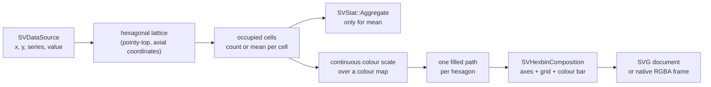

# Chapter 39 — Hexbin plots: a million points read as a few thousand hexagons

A scatter plot is honest about every observation, which is exactly why it stops
working when the sample is large: a million dots overplot one another until the
picture is a solid blob. A **hexbin plot** replaces the cloud of dots with a
lattice of hexagonal cells, colours each occupied cell by how many observations
fell into it, and lets the eye read density instead of individual points.

`SVHexbinPlot` is the matrix recipe of FDR-135. This chapter explains the
geometry, the public surface, the data boundary and the tests that prove the
claim.



## Why a recipe owns the lattice

The core kernel vocabulary is closed (patterns P5). `SVStat::Bin` bins **one**
continuous column; there is no bivariate hexagonal bin kernel, and adding one
inside a recipe would violate the contract. The recipe therefore owns the
lattice geometry — as the density-contour recipe owns its marching-squares
pass — while every other concern is delegated:

- the **scale kernel** maps data coordinates to pixels and maps the count
  through the continuous colour scale;
- `SVStat::Aggregate` computes the per-hexagon mean when the caller asks for
  mean aggregation;
- the **decoration kernel** draws the axes, the grid and the colour bar;
- the SVG and native backends serialize exactly the same geometry.

The composition is therefore:

```
data -> [hexagonal lattice] -> (cells, counts)
     -> [SVScale continuous over a colour map] -> one path per hexagon
```

## The hexagonal lattice from zero

A pointy-top hexagon of radius `r` tiles the plane with horizontal spacing
`sqrt(3) * r` and vertical spacing `1.5 * r`; every other row is offset by half
a horizontal step. A point is assigned to the nearest cell by converting it to
axial coordinates and rounding in cube space:

```
q = (sqrt(3)/3 * x - y/3) / r
r_axial = (2/3 * y) / r
```

`SVHexbinDomain` fixes the radius from the horizontal extent and the requested
grid size, then answers the exact inverse: `cell_of` turns a data point into
`(column, row)`, and `cell_centre` turns the pair back into a data-space centre.
The grid size controls the resolution; `extent(...)` fixes the domain instead of
deriving it from the sample; `min_count(...)` drops cells too sparse to be
meaningful.

## The public surface

`SVHexbinPlot::builder()` is the only constructor and `backend(...)` is
required, exactly as in every other figure. The options are:

| Option | Meaning |
|---|---|
| `x`, `y` | the two required continuous columns |
| `series` | optional grouping column; one lattice per value |
| `value` | optional value column, consumed by mean aggregation |
| `aggregation` | `Count` (default) or `Mean` |
| `grid_size` | hexagons across the horizontal extent (default `20`) |
| `extent` | fixed `(x_lower, x_upper, y_lower, y_upper)` domain |
| `min_count` | minimum observations for a cell to be drawn (default `1`) |
| `orientation` | rotation of each hexagon glyph, in radians |
| `colour_map`, `colour_scale` | continuous fill encoding |
| `normalise` | `Count`, `Probability` or `Density` for count aggregation |
| `missing_value_policy` | `Omit` (default) or `Error` |

Count aggregation accumulates observations directly. Mean aggregation is
delegated to `SVStat::Aggregate`: the recipe builds one group code per occupied
cell and reads the group result back. A value column with count aggregation is
rejected, because it would silently be ignored.

```rust,ignore
let plot = SVHexbinPlot::builder()
    .data_source(&table)
    .x("first measurement")
    .y("second measurement")
    .grid_size(28)
    .min_count(2)
    .title("Hexagonal density of two measurements")
    .backend(SVBackendKind::Svg)
    .build()?;

let document = plot.compose()?.to_svg()?;
```

The example `examples/hexbin_plot.rs` generates the figure below with a
deterministic sample of 1,200 observations.


## The data boundary

The three representations are resolved once per operation:

- a **dense** column is read directly;
- a **sparse** column is read through `value_at`, so its indices are never
  expanded and its implicit zeros remain logical observations at `(0, 0)`;
- a **streaming** column is read as its current bounded window; the render
  returns promptly.

The parity test `dense_sparse_and_streaming_inputs_draw_the_same_hexagons`
proves that the three inputs produce the same SVG document byte for byte on the
same data. `a_sparse_input_is_not_densified` asserts the scene keeps the
representation and still consumes every logical observation.

## Backends and observability

`compose()` returns a backend-agnostic `SVHexbinComposition` that carries the
solved scales, the public `SVHexbinCell` list and the geometry. `render()`
dispatches on the configured kind: `Svg` serializes the document, `Native`
rasterizes the same primitives into an RGBA frame, and any other kind fails with
`UnsupportedBackendCapability` instead of being silently ignored.

One operation span records `backend.kind`, `representation` and the number of
drawn hexagons; the observability tests assert all three fields. The geometry is
transition-ready — cell colour is interpolable and entering or leaving cells are
new or removed primitives — while the transition wiring itself belongs to the
later integration (mark-transitions), not to this recipe.

## The tests that make it concrete

The companion `hexbin_plot_tests.rs` walks the options one at a time: grid size,
extent, minimum count, orientation, colour map, mean aggregation, series
grouping, missing values and an empty source. `parity_tests.rs` owns the data
boundary; `concurrency_tests.rs` renders the same figure from eight threads and
compares the documents byte for byte; `render_tests.rs` covers both serializers,
the typed refusal of other kinds and the checked-in figure.

The next time you read a hexbin plot, remember the chain: every observation is
rounded to one lattice cell, every cell accumulates an aggregate, and the colour
scale is the only place that aggregate becomes visible.
