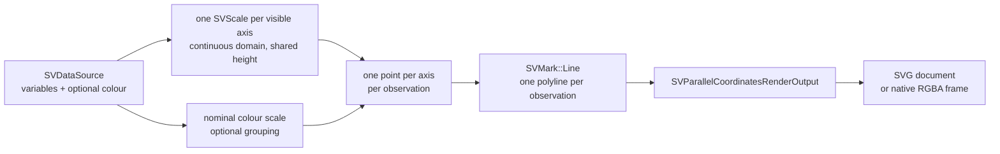

# Chapter 40 — Parallel coordinates: many variables, one polyline per observation

A scatter plot shows two variables. A heatmap shows a matrix of cells. A
**parallel coordinates plot** shows many continuous variables at once: every
variable gets its own vertical axis, the axes stand side by side, and every
observation becomes a polyline that crosses all of them. A row of data that
would need ten scatter plots becomes one readable line.

`SVParallelCoordinatesPlot` is the multivariate recipe of FDR-141. This chapter
explains the geometry, the public surface, the data boundary and the tests that
prove the claim.



## Why a recipe owns the axis slots

The core kernels stay closed (patterns P5). `SVScale` already knows how to map
a domain onto a range and how to derive ticks; `SVMark::Line` already knows how
to turn a list of points into a path; `SVAxis` already knows how to place ticks
and labels. The recipe adds only what is specific to parallel coordinates:

- the **axis slot geometry**: the horizontal position of each variable is a
  nominal scale over the variable names;
- the **per-axis domain**: every visible variable gets its own `SVScale`, so
  one axis may span `0..1` and the next `10..40`;
- the **observation polylines**: one `SVMark::Line` per observation, whose
  vertices are read from every visible column at the same observation index.

Nothing is reimplemented. The composition is exactly:

```
data -> [no stat] -> values
     -> [SVScale nominal for axis slots + SVScale continuous per axis]
     -> SVMark::Line, one per observation
```

## The parallel-coordinate geometry from zero

Place `n` axes evenly across the plot width. Axis `i` sits at
`x_i = plot_left + nominal_position(variable_i)`. Each axis maps its own finite
minimum and maximum onto the plot height, with the range reversed so larger
values sit higher. For observation `j`, read the value at every visible axis,
map it through that axis's scale, and draw a straight segment from
`(x_i, y_i)` to `(x_{i+1}, y_{i+1})`. The result is one polyline with `n`
vertices.

`SVDimension` controls an axis before it is placed. Its `range` overrides the
derived domain, `visible(false)` removes the axis and its value from every
polyline, and `coloured(true)` tints the axis line with the categorical palette.
The order of the dimensions is the axis order.

## The public surface

`SVParallelCoordinatesPlot::builder()` is the only constructor and `backend(...)`
is required, exactly as in every other figure. The options are:

| Option | Meaning |
|---|---|
| `variables` | the continuous columns, in axis order; at least two |
| `colour` | optional nominal grouping column |
| `line_width` | stroke width of every polyline |
| `opacity` | line opacity, default `0.5` |
| `dimensions` | `SVDimension` list: order, range, visibility and axis tint |
| `range` | positional range overrides for every visible axis |
| `label_angle` | rotation of the variable labels above the axes |
| `axis_label` | label of the whole axis band |
| `normalization` | `PerAxis` (default) or `Shared` domains |
| `missing` | `Gap`, `Bridge`, `DropObservation` or `Error` |
| `title`, `execution_mode`, `backend` | figure metadata and the required backend |

`compose()` returns a backend-agnostic `SVParallelCoordinatesRenderOutput` that
exposes the visible `SVParallelCoordinatesAxis` records, the drawn
`SVParallelCoordinatesLine` records (observation index, group, colour and
vertices), the colour groups and the primitive geometry. The example
`examples/parallel_coordinates_plot.rs` generates the figure below.

```rust,ignore
let output = SVParallelCoordinatesPlot::builder()
    .data_source(&table)
    .variables(&["sepal length", "sepal width", "petal length", "petal width"])
    .colour("species")
    .backend(SVBackendKind::Svg)
    .build()?
    .compose()?;
```


## The data boundary

The three representations are resolved once per operation:

- a **dense** column is read directly;
- a **sparse** column is read through `value_at`, so its indices are never
  expanded and an implicit zero is a real observation value;
- a **streaming** column is read as its current bounded window; the render
  returns promptly.

The parity test `dense_sparse_and_streaming_inputs_draw_the_same_polylines`
proves that the three inputs produce the same SVG document byte for byte on the
same data. `a_partially_sparse_column_is_read_through_its_stored_entries`
asserts that a partially sparse variable keeps its implicit zeros and is never
densified.

## Missing values

A non-finite value has no position on its axis, so the recipe makes the policy
explicit. `Gap` breaks the polyline into continuous runs, `Bridge` joins the
neighbouring axes with one straight segment, `DropObservation` omits the whole
observation, and `Error` rejects the render with `NonFiniteValue` naming the
observation. The policy is recorded on the output and asserted by
`the_missing_policies_choose_between_a_gap_a_bridge_and_a_drop`.

## Backends and observability

`compose()` is backend-agnostic. `render()` dispatches on the configured kind:
`Svg` serializes the document, `Native` rasterizes the same primitives into an
RGBA frame, and any other kind fails with `UnsupportedBackendCapability` instead
of being silently ignored. One operation span records `backend.kind`,
`representation` and the number of drawn vertices; the observability tests
assert all three fields. The geometry is transition-ready — vertices and colour
are interpolable — while the transition wiring itself belongs to the later
integration.

## The tests that make it concrete

The companion tests walk the options one at a time: axis order, dimensions,
range overrides, colour grouping, width, opacity, label rotation, shared
normalisation and the missing policies. `parity_tests.rs` owns the data
boundary; `concurrency_tests.rs` renders the same figure from eight threads and
compares the documents byte for byte; `render_tests.rs` covers the SVG and
native serializers, the typed refusal of other kinds and the checked-in figure.

The next time you read a parallel-coordinates plot, remember the chain: every
axis is one scale, every observation is one line, and colour is the only
channel that can carry a second variable without adding another axis.
