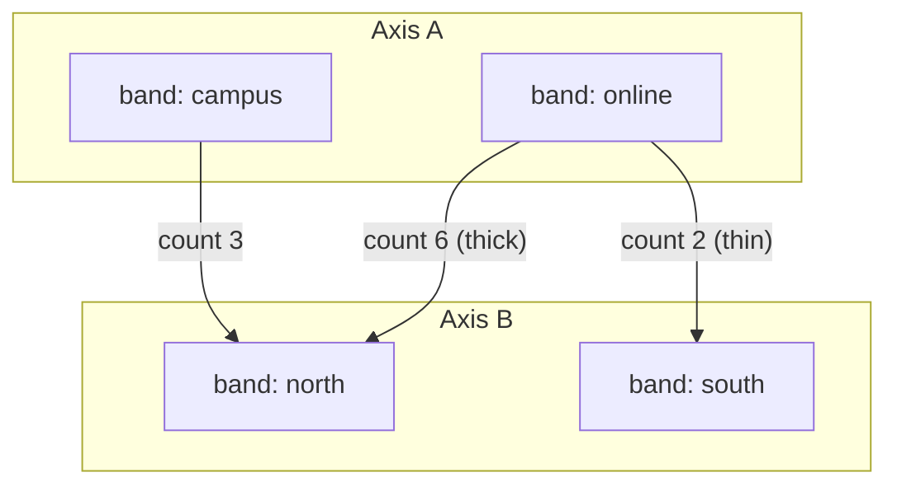

# Chapter 41 — Parallel categories plots: reading combinations of categories

A scatter plot compares numbers; a **parallel categories plot** compares
*combinations of labels*. Each variable gets its own vertical axis, every
category on that axis becomes a band, and each observation becomes a ribbon
that leaves one band and arrives at another. The picture answers questions such
as "do online students in the north complete the course?" without a single
table lookup.

`SVParallelCategoriesPlot` is the multivariate recipe of FDR-142. This chapter
explains the geometry, the public surface, the data boundary and the tests
that prove the claim.


## The composition

The recipe is exactly the composition of the FDR:

```
data -> [SVStat::Count] -> category bands per axis
     -> [SVScale per axis (nominal bands)] -> SVMark::Ribbon
```

It adds no kernel variant (patterns P5). Counting belongs to
`SVStat::Count`, placement to `sv_scale`, geometry to the ribbon mark of
`sv_mark`, and the axes to `sv_decoration`. The recipe is the glue that turns
categorical columns into those kernels' inputs.

## From labels to ribbons

The data boundary carries numeric category codes. The recipe counts each axis
once through `SVStat::Count`, which also applies the requested category order
(`DataOrder`, `Ascending` or `Descending`). That count is the axis definition:
its values are the bands and its order is the display order.

A ribbon connects a band on one axis to a band on the next axis. Counting
observations one by one would draw the same pair many times, so the recipe
aggregates them. It builds one **group code** per observation from the two
axis ranks — `left_rank * categories_on_right + right_rank`, optionally combined
with a colour rank — and hands that derived column to `SVStat::Count` again.
The kernel returns one count per observed combination, in first-appearance
order. The recipe never counts observations itself.

Inside a category band, the incident ribbons are stacked in draw order. A
ribbon's slice thickness is its count divided by the total count on that side
of the band, so the slices tile the band exactly and encode the count visually:



`band_gap` shrinks each band inside its slot and leaves air between categories.
`opacity` controls how strongly the ribbons overlap. `label_angle` rotates the
outer category labels; the two outer axes carry labels, while the interior axes
keep their tick marks so the ribbons stay legible.

## The public surface

`SVParallelCategoriesPlot::builder()` is the only constructor and `backend(...)`
is required, exactly as in every other figure. The options are:

| Option | Meaning |
|---|---|
| `variables` | the categorical columns, one per axis; at least two |
| `variable_labels` | the display title of every axis |
| `category_labels` | the display label of one axis' categories |
| `colour` | optional grouping column that splits the ribbons |
| `colour_mode` | `Count` (default) or `Category` |
| `opacity` | ribbon opacity, default `0.5` |
| `band_gap` | empty fraction of a category slot, default `0.2` |
| `category_order` | `DataOrder` (default), `Ascending`, `Descending` |
| `label_angle` | clockwise rotation of the outer labels, default `0` |
| `missing_value_policy` | `Omit` (default) or `Error` |

Colour is a real channel. With the default `Count` mode the distinct counts are
ranked and the palette assigns one colour per rank, so the heaviest ribbon is
always the last entry. With `Category` mode the ribbon takes the colour of the
configured grouping column, or of its left band when no grouping column is set.

```rust,ignore
let scene = SVParallelCategoriesPlot::builder()
    .data_source(&table)
    .variables(&["delivery", "region", "outcome"])
    .variable_labels(&["Delivery", "Region", "Outcome"])
    .category_labels("delivery", &["online", "campus", "hybrid"])
    .band_gap(0.24)
    .opacity(0.62)
    .title("Course outcomes across delivery, region and result")
    .backend(SVBackendKind::Svg)
    .build()?
    .compose()?;

let document = scene.to_svg()?;
```

The example `examples/parallel_categories_plot.rs` generates the figure below
from the same 24 observations.


## The data boundary

A non-finite value on any axis makes the whole observation unusable, because
every axis shares it. `Omit` drops the observation from every axis at once and
keeps the remaining ribbons aligned; `Error` rejects the operation with
`SVError::NonFiniteValue` and names the position.

The three representations are resolved once per operation:

- a **dense** column is read directly;
- a **sparse** column is read through `value_at`, so its stored entries are
  never expanded and its implicit zeros stay category `0`;
- a **streaming** column is read as its current bounded window, so the render
  returns promptly.

Sparse and streaming colours and variables follow the same rule. When a
non-finite value forces an omission, the recipe compacts the surviving
observations into owned buffers; that is the only path that allocates, and it
is caused by the omission rather than by the representation.

## What the tests prove

The companion tests are the executable specification:

- `dense_sparse_and_streaming_inputs_draw_the_same_scene` compares the three
  SVGs byte for byte, and `mixed_representations_agree_after_validating_lengths`
  does the same for one representation per axis.
- `a_sparse_input_is_reported_as_sparse_and_never_densified` asserts the
  configured representation survives composition.
- `the_default_configuration_aggregates_every_adjacent_axis_pair` checks the
  band categories, the ribbon count and the observation total.
- `the_category_order_sorts_every_axis`, `a_larger_band_gap_narrows_every_band`,
  `the_two_colour_modes_assign_different_colours` and
  `the_missing_value_policy_omits_or_rejects` exercise each documented option.
- `several_threads_render_the_same_plot_identically` renders from eight threads
  and requires byte-identical output.
- `a_compose_records_the_backend_representation_and_drawn_ribbons` checks the
  operation span: backend kind, representation, point count and outcome.

`render()` dispatches on the configured kind: `Svg` serializes the document,
`Native` rasterizes the same scene, and every other kind fails with
`SVError::UnsupportedBackendCapability` instead of being ignored. Transition
and animation wiring is deferred to the transition integration; the ribbon
geometry and colours are already the values a transition interpolates.
