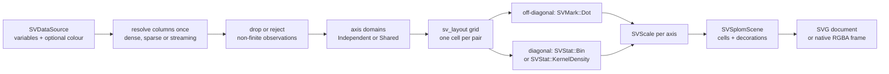

# Chapter 42 — Scatterplot matrices: reading every pair at once

A scatter plot shows the relationship between **two** variables. A data set
usually has more, and the relationships between them are not independent: height
and weight move together, age shifts both, and a group may separate the cloud.
A **scatterplot matrix** — a *splom* — answers the obvious next question: what
does *every* pair look like? It draws a grid of scatter plots, one per pair of
variables, with the same observations in every cell.

`SVSplomPlot` is the multivariate recipe of FDR-143. This chapter explains the
idea from zero, the public surface, the data boundary and the tests that prove
the claim.



## The idea, from zero

Imagine a table with one row per person and one column per measurement:

| height | weight | age |
|---|---|---|
| 168 | 71 | 28 |
| 172 | 80 | 35 |
| … | … | … |

A scatterplot matrix over `height`, `weight` and `age` is a 3 × 3 grid:

- cell **(row, column)** scatters the variable of `row` on the vertical axis
  against the variable of `column` on the horizontal axis;
- the **diagonal** cells would compare a variable with itself, so they show its
  univariate distribution instead;
- the **upper** and **lower** triangles are mirror images, so a reader may keep
  only one of them.

The important property is that the observations are **shared**. Row 17 of the
table is the same person in every cell; a highlight — when the interactivity
wave adds it — should move through every cell at once. The recipe keeps that
promise by resolving the columns once and never reordering them.

## Why the matrix is a recipe, not a new kernel

The kernel vocabulary is closed (patterns P5). A scatterplot matrix adds no
mark, stat, move or scale: an off-diagonal cell is exactly
`SVMark::Dot` over two variables placed by `SVScale`, and a diagonal cell is
`SVStat::Bin` or `SVStat::KernelDensity` drawn with the bar or area mark. What
the recipe adds is **composition**:

- `sv_data` resolves each variable column exactly once;
- `sv_scale` owns the domains and the positions;
- `sv_layout` solves the grid — one row node per variable, one cell node per
  pair — so the cell rectangles are backend-independent;
- `sv_mark` produces the geometry;
- `sv_decoration` draws the borders, the variable labels, the title and the
  legend.

The recipe owns the *arrangement*, not the vocabulary.

## The public surface

`SVSplomPlot::builder()` is the only constructor. `backend(...)` is required
and `execution_mode(...)` defaults to `Automatic`, exactly like every other
figure in the library.

| Option | Meaning |
|---|---|
| `variables(&["a", "b", "c"])` | The variable columns, in matrix order (at least two, no duplicates) |
| `colour("group")` | An optional grouping column; each group gets a palette colour and a legend entry |
| `diagonal(SVSplomDiagonal::…)` | `Histogram` (default), `Density`, or `Empty` |
| `marker(SVDotShape)` | The marker of the off-diagonal cells |
| `size(SVLength)` | The marker size; the `mark.size` token by default |
| `opacity(f32)` | The constant opacity of the dots and diagonal marks |
| `scale_mode(SVSplomScaleMode::…)` | `Independent` (a domain per variable) or `Shared` (one domain for all variables) |
| `cell_aspect(f64)` | The width/height ratio of one cell (default `1.0`) |
| `show_upper(bool)` / `show_lower(bool)` | Keep or drop each triangle independently |
| `show_diagonal(bool)` | Draw the univariate diagonal or leave it empty |
| `missing_value_policy(SVSplomMissingValuePolicy::…)` | `Omit` a non-finite observation everywhere, or `Error` |
| `title(...)` | The figure title |

`compose()` returns a backend-agnostic `SVSplomScene`. It exposes the solved
`cells()`, one mark geometry per cell, the decorations, the number of variables
and observations, the legend labels and colours, and the usual
`to_svg()` / `to_native_frame()` serializers. `render()` dispatches on the
configured kind: SVG, native, or a typed `UnsupportedBackendCapability` error
for a kind with no recipe serializer yet.

## The grid comes from the layout kernel

The matrix could be laid out by multiplying coordinates, but then the SVG and
native backends could drift. Instead the recipe builds a small layout tree and
lets `SVLayoutTree` solve it:

```text
sv-splom-grid          (vertical, padding 56, gap 10)
├── sv-splom-row-0     (horizontal, gap 10)
│   ├── sv-splom-cell-0-0   (128 × 128 × aspect)
│   ├── sv-splom-cell-0-1
│   └── …
├── sv-splom-row-1
└── …
```

Every cell rectangle is then read from the solved tree by name, so both
backends receive exactly the same geometry.

## The example and the figure

The example `examples/splom_plot.rs` builds a deterministic sample of 240
observations over four body measurements and three groups, and renders it with a
kernel-density diagonal:

```rust
let plot = SVSplomPlot::builder()
    .data_source(&table)
    .variables(&["height", "weight", "age", "resting pulse"])
    .colour("group")
    .diagonal(SVSplomDiagonal::Density)
    .scale_mode(SVSplomScaleMode::Independent)
    .cell_aspect(1.0)
    .opacity(0.72)
    .title("Body measurements by group")
    .backend(SVBackendKind::Svg)
    .build()?;

let document = plot.compose()?.to_svg()?;
```


## The data boundary

The three representations are resolved once per operation:

- a **dense** column is read directly;
- a **sparse** column is read through `value_at`, so its indices are never
  expanded and its implicit zeros stay logical observations;
- a **streaming** column is read as its current bounded window; the render
  returns promptly.

A non-finite value makes the **whole observation** unplottable, because the
observation enters every cell together. `Omit` drops it from every cell and
produces a shorter filtered copy — fewer values, never a densification of an
untouched sparse column. `Error` rejects the render with an explicit
configuration error naming the column and the observation.

The parity test `dense_sparse_and_streaming_inputs_draw_the_same_scene` proves
that the three inputs produce the same SVG document byte for byte.
`a_sparse_input_is_never_densified` asserts the representation stays `Sparse`,
and `a_sparse_input_with_implicit_zeros_keeps_its_logical_observations` proves
the logical count is not lost.

## What the tests make concrete

- `the_default_composition_draws_every_pair_and_the_diagonal` — three variables
  produce nine cells, three of them diagonal, and `6 × 6` scatter marks.
- `the_triangles_are_independently_switchable` and
  `the_diagonal_can_be_switched_off` — the visibility options change the cell
  count.
- `an_empty_diagonal_draws_no_diagonal_primitives` and
  `a_density_diagonal_changes_the_rendered_document` — the three diagonal modes
  are real.
- `a_colour_column_groups_the_observations_and_fills_the_legend` — grouping is
  built from a nominal column and the palette.
- `the_cell_aspect_reshapes_the_viewport` and
  `a_shared_scale_changes_the_rendered_document` — layout and scale mode.
- `the_builder_requires_an_explicit_backend`,
  `the_builder_requires_at_least_two_variables`,
  `the_builder_rejects_a_duplicated_variable` and
  `the_builder_rejects_an_impossible_opacity` — the build-time contract.
- `several_threads_render_the_same_matrix_identically` — eight threads compose
  the same document byte for byte.
- `a_compose_records_the_backend_representation_and_point_count` — the
  operation span carries `backend.kind`, `representation` and `points`.
- `render_tests.rs` — SVG and native dispatch, the typed refusal of a kind
  without a serializer, and both serializer-mismatch guards.

## Decisions and roads not taken

- **One scene, not several figures.** FDR-143 leaves open whether the matrix is
  one figure with sub-panels or several composed figures. This recipe keeps one
  `SVSplomScene` with per-cell geometries and solved rectangles: the backend
  still receives one viewport, one background and one serialization, which is
  what makes the matrix usable without the dashboard capability.
- **Independent by default, shared on request.** Reference libraries give each
  variable its own domain, so `Independent` is the default; `Shared` makes the
  cells directly comparable when the variables share a unit.
- **A density or histogram diagonal, never both at once.** The FDR's options
  are mutually exclusive; `Empty` exists for callers who want only the pairwise
  structure.
- **Highlight deferred.** The observations keep one index in every cell, but
  the highlight API belongs to the interactivity wave. The geometry is
  transition-ready; the transition wiring itself is not part of this change.

The next time you read a scatterplot matrix, remember the chain: one column per
variable, one observation shared by every cell, one scatter per pair, and one
distribution on the diagonal.
