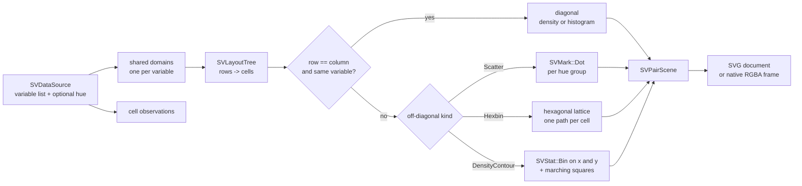
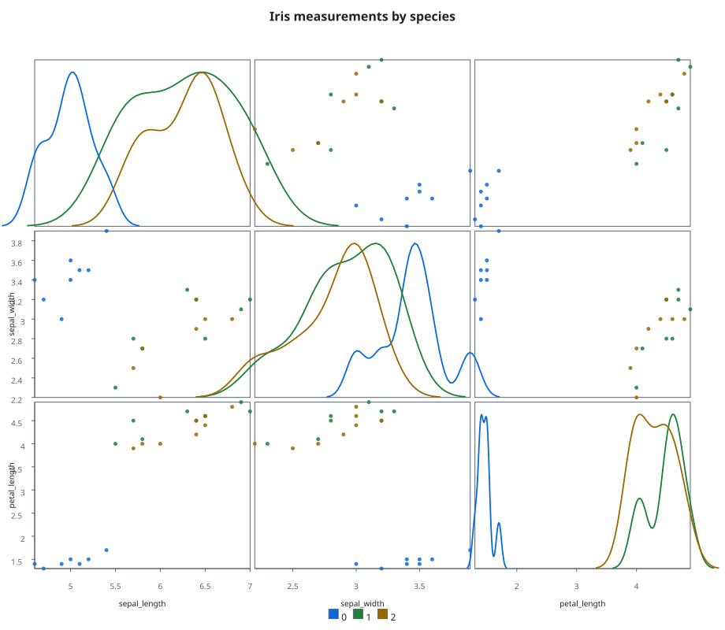

# Chapter 43 — Pair plots: every variable against every other

A scatter plot answers one question: how do two variables move together? A
**pair plot** asks that question for every pair at once. The page is a grid; the
cell at row *i*, column *j* plots variable *i* against variable *j*; the
diagonal shows the distribution of a single variable, and an optional `hue`
column paints the same categories in every cell.

`SVPairPlot` is the multivariate recipe of FDR-144. This chapter explains the
grid, the shared scales, the two diagonal forms, the three off-diagonal forms,
the data boundary and the companion tests that make each claim executable.



## Why a grid is a recipe, not a new kernel

The closed kernel vocabulary already has everything a cell needs: dot, bar and
line marks, the bin and kernel-density statistics, the scale kernel and the
layout engine. `SVPairPlot` does not add a variant to any of them (patterns P5).
It composes the same kernels once per cell and puts the results into one
backend-agnostic scene.

The module layout follows patterns P3 and every file stays under the size that
forces a folder module:

```
src/recipes/multivariate/pair_plot/
  mod.rs                 pure dispatcher
  builder.rs             the builder state machine
  builder_options.rs     one setter per option
  configuration.rs       the validated configuration
  core_implementation.rs the built figure, spans and backend dispatch
  composition.rs         one render: domains, layout, every cell
  layout.rs              the grid solved by SVLayoutTree
  preparation/           domains, hue groups, cell points, column probe
  diagonal.rs            density and histogram cells
  off_diagonal.rs        the three off-diagonal forms
  off_diagonal/hexbin.rs the hexagonal lattice per cell
  off_diagonal/contour/  the joint grid and the marching-squares pass
  decorations.rs         frames, outer axes, title and legend
  scene.rs               the backend-agnostic result
  render_output.rs       SVG bytes or a native frame
```

## The builder surface

`SVPairPlot::builder()` is the only constructor. `backend(...)` is required —
there is no automatic backend — and `execution_mode(...)` defaults to
`Automatic`, exactly as in every other figure (patterns P2).

| Option | Meaning | Default |
|---|---|---|
| `variables(&[&str])` | the same list on both axes | every `X`/`Y` column |
| `x_variables`, `y_variables` | a rectangular grid | the other axis |
| `hue` | the grouping column painted by colour | none |
| `diagonal_kind` | `Auto`, `Histogram` or `Density` | `Auto` → density |
| `off_diagonal_kind` | `Scatter`, `Hexbin` or `DensityContour` | `Scatter` |
| `marker` | the dot shape of scatter cells | `Circle` |
| `jitter` | a displacement move inside each cell | none |
| `missing_value_policy` | `Omit` or `Error` | `Omit` |
| `alpha`, `title` | opacity and figure title | `0.85`, none |

An empty variable list does not fail silently: `build` falls back to the
source's schema, taking every column declared as `X` or `Y` and excluding the
hue column. A named column the source does not expose still fails with
`SVError::ColumnNotFound` at build time.

## The grid comes from the layout engine

The grid is not a hand-written loop over pixel rectangles. `layout.rs` builds an
`SVLayoutTree`: one vertical row per `y_variables` entry, one horizontal cell per
`x_variables` entry, a reserved title band and a reserved legend band. The solver
returns a rectangle per `cell-{row}-{column}`, so changing the viewport, the
margin or the spacing re-solves the whole matrix consistently:

```rust
let root = SVLayoutNode::new("pair-root")
    .with_direction(SVLayoutDirection::Vertical)
    .with_padding(SV_PAIR_MARGIN)
    .child(title)
    .child(grid)
    .child(legend);
let resolved = SVLayoutTree::new(root).with_viewport(viewport).solve(&viewport);
```

Because the cells are filled by the solver, a rectangular grid works without a
special case: `x_variables(&["a", "b"])` with `y_variables(&["c"])` produces two
cells in one row.

## Shared scales

Every cell in column *j* must use the same horizontal domain, and every cell in
row *i* the same vertical domain; otherwise the grid would silently compare
different ranges. Before composing any cell, `preparation::domain.rs` reads each
variable once and derives one `SVPairDomain`. The scatter, hexbin and contour
cells then build their scales from those shared intervals. The diagonal keeps
the variable's own horizontal domain and maps the distribution height to the
cell's own vertical range.

## The diagonal

The diagonal cell is where row and column name the same variable. Its shape is
chosen by `diagonal_kind`:

- **Density** (the `Auto` choice) asks `SVStat::KernelDensity` for a grid and a
  density, maps the grid through the shared horizontal domain and the density
  through a local vertical domain, then draws one `SVMark::Line` per hue group;
- **Histogram** asks `SVStat::Bin` for edges and counts and draws one
  `SVMark::Bar` per occupied bin, again per hue group.

Both forms use the same hue palette as the scatter cells, so a colour means the
same category across the diagonal and the scatter cells. The hexbin and
binned-contour forms encode observation density instead; their cells are painted
through a continuous colour scale, not the hue palette.

## The off-diagonal forms

All three forms read the same `SVPairCellPoints` — the finite observations of
one cell with their hue group index — and differ only in how they turn those
points into geometry.

**Scatter** draws one `SVMark::Dot` per point, grouped by hue so each category
gets one paint. The points are placed through the two shared scales; the marker
shape and opacity are configuration, not a new mark.

**Hexbin** owns a hexagonal lattice. The lattice is chart-owned geometry: a
pointy-top hexagon of radius *r* tiles the plane with horizontal spacing
`sqrt(3) * r` and vertical spacing `1.5 * r`; each point is rounded to the
nearest cell in cube coordinates. Every occupied cell becomes one filled path,
coloured by its count through a continuous colour scale. The geometry mirrors
what `SVHexbinPlot` (FDR-135) owns; `SVHexbinPlot` composes its own figure, so a
pair cell cannot delegate to it without either losing the shared per-variable
domain or widening that recipe's public surface. ADR #182 records this as a
trade-off, and the two lattices must be kept in step.

**DensityContour** has no bivariate density variant in the closed stat
vocabulary, so it derives the horizontal and vertical edges with `SVStat::Bin`,
folds every observation pair into the joint grid, fills the occupied cells
through a continuous colour scale, and runs a chart-owned marching-squares pass
over the threshold crossing. This is a **binned** contour, not a kernel-density
contour: it is a different estimator from `SVDensityContourPlot`, which smooths
the field with a two-dimensional kernel-density grid. The distinction is
deliberate and recorded in ADR #182.

## Grouping and missing values

When `hue` is present, the hue column is resolved once into groups in first
appearance order. The group index follows each observation into every cell and
into the diagonal, so the same category keeps its colour across the matrix. The
index vector is positional: a missing hue keeps its slot, so one absent value
never shifts the category of the observations after it. The legend is built from
the same group list.

A non-finite observation is a missing value, not a zero. `Omit` drops it from
every cell that would read it; `Error` rejects the operation with
`SVError::NonFiniteValue` naming the position. The default matches the reference
libraries: the grid is drawn from what is actually there.

## The data boundary

`SVDataSource` is resolved once per operation. Dense, sparse and streaming
columns go through the same `value_at` path, so a sparse column is walked over
its logical entries without ever being expanded into a dense array, and a
streaming column is read from the bounded window it already carries. The parity
tests compose the same numbers as dense, sparse and streaming and compare the
serialized SVG byte for byte — for the default form and for each off-diagonal
kind.

## Backends

`render()` dispatches on the configured kind. `Svg` serializes a self-contained
document; `Native` rasterizes an RGBA frame; any other kind reports
`SVError::UnsupportedBackendCapability` instead of receiving bytes another
backend produced. A compiled-out feature reports `SVError::BackendUnavailable`.
The operation span records the backend kind, the representation and the number
of drawn marks on both the composition and the render path.

## The example

`examples/pair_plot.rs` builds a three-variable grid over a small synthetic iris
table, colours it by species and asks for the density diagonal:

```rust
let scene = SVPairPlot::builder()
    .data_source(&table)
    .variables(&["sepal_length", "sepal_width", "petal_length"])
    .hue("species")
    .diagonal_kind(SVPairDiagonalKind::Density)
    .off_diagonal_kind(SVPairOffDiagonalKind::Scatter)
    .title("Iris measurements by species")
    .backend(SVBackendKind::Svg)
    .build()?
    .compose()?;

let document = scene.to_svg()?;
```



## Walking the tests

The companion modules are the executable specification:

- `pair_plot_tests.rs` checks the default schema-driven build, an explicit square
  grid, a rectangular grid, both diagonal kinds, every off-diagonal kind, hue
  grouping, the marker option, the jitter option, the missing-value policy and
  the explicit column error;
- `parity_tests.rs` proves dense/sparse/streaming equivalence for all three
  off-diagonal forms, asserts the sparse representation is preserved and that a
  streaming window renders promptly, and exercises `update`;
- `concurrency_tests.rs` renders one grid from eight threads and compares the
  documents byte for byte;
- `observability_tests.rs` reads the `compose` span and asserts the backend,
  representation, point count and outcome;
- `render_tests.rs` checks the typed dispatch for SVG, native and an unsupported
  kind.

Transition and animation wiring is deferred to the transition integration, as in
the other recipes of this wave; the composed geometry is transition-ready.

## What was not added

No kernel variant was introduced. The gait of a pair grid is entirely
composition: layout, scales, marks and statistics. The hexagon lattice and the
marching-squares pass are the two pieces of chart-owned geometry, and both are
documented in their own recipes as well. `SVPairPlot` and `SVSplomPlot` remain
separate recipes for now; the open question about a single recipe with a
type-dependent diagonal is recorded in the FDR and left to a later revision.
