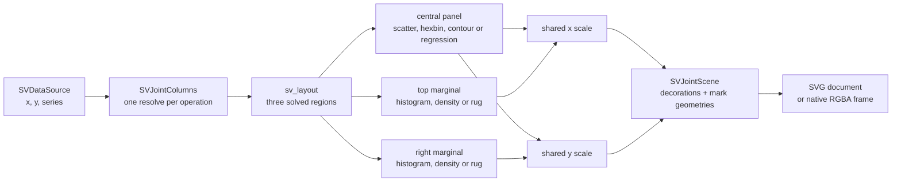

# Chapter 44 — Joint plots: two variables and their marginals, together

A scatter plot answers "how do these two variables move together". A histogram
answers "what does one variable look like on its own". A **joint plot** answers
both at once: the centre shows the bivariate relationship, and the top and the
right show the marginal distribution of each variable. The eye can move from
"the cloud is tilted" to "both variables are bimodal" without opening a second
figure.

`SVJointPlot` is the multivariate recipe of FDR-145. This chapter explains why
the chart is one figure with three layout regions, how each panel is composed
from kernels that already existed, and which tests prove the claim.



## One figure, three regions

The first decision is the one the FDR left open: is a joint plot one figure with
three panels, or three figures the dashboard composes? The implementation
answers **one figure**. Three panels only feel like one chart when they share
their axes, and sharing an axis means sharing one solved layout: the top
marginal must span exactly the horizontal interval of the centre, and the right
marginal must span exactly its vertical interval. Three independent figures
would each solve their own margins and drift by a few pixels.

The recipe therefore names the regions and their relative weights and hands
them to `sv_layout`:

```
root
├── title inset            (40 px)
└── body
    ├── left inset         (64 px, room for the y tick labels)
    └── content
        ├── horizontal-marginal   (fill width, 104 px high)
        ├── middle
        │   ├── central-panel     (fill)
        │   └── vertical-marginal (104 px wide, fill height)
        └── bottom inset    (52 px, room for the x tick labels)
```

`sv_solve_panels` builds that tree with `SVLayoutNode` and reads the three
rectangles back by name. No number in the recipe is a pixel guess: the layout
kernel clamps, distributes and solves, and a viewport change re-solves the whole
figure.

## The composition, panel by panel

The FDR recipe is:

```
data -> [no stat] -> values
     -> central cell:  SVMark::Dot (or a density contour)
     -> marginal cells: the distribution recipe for the variable type
     -> [SVScale per axis] -> three panels sharing a layout
```

Every piece already existed, so the recipe composes instead of reimplementing
(patterns P5):

| Panel form | What it delegates to |
|---|---|
| scatter | `SVMark::Dot`, with the series colour painted per primitive |
| hexbin | `SVHexbinPlot` — its lattice, cells and colour map |
| density contour | `SVDensityContourPlot` — its binning, marching squares and levels |
| regression | `SVStat::Fit` plus `SVMark::Line` |
| histogram marginal | `SVStat::Bin` plus `SVMark::Bar` |
| density marginal | `SVStat::KernelDensity` plus `SVMark::Line` |
| rug marginal | `SVMark::Line`, one short segment per observation |

The hexbin and contour recipes are composed at their own fixed viewport and
their mark geometries are then mapped from their solved plot area onto the
joint's central rectangle by `sv_translate_geometry`. Translation is a pure
affine map over paths, rectangles, circles and text: the marks are never
recomputed, so a hexagon drawn by `SVHexbinPlot` stays exactly the hexagon the
hexbin recipe produced.

## The public surface

`SVJointPlot::builder()` is the only constructor, `backend(...)` is required,
and `execution_mode(...)` defaults to `Automatic`:

```rust
use scienceview::sv_backend::SVBackendKind;
use scienceview::sv_recipes::sv_multivariate::sv_joint_plot::SVJointPlot;

let scene = SVJointPlot::builder()
    .data_source(&table)
    .x("height")
    .y("weight")
    .series("cohort")
    .kind(SVJointKind::Scatter)
    .marginal_kind(SVJointMarginal::Histogram)
    .alpha(0.7)
    .backend(SVBackendKind::Svg)
    .build()?;
let document = scene.compose()?.to_svg()?;
```

| Option | Meaning | Default |
|---|---|---|
| `x`, `y` | the two required columns | — |
| `series` | optional grouping column | `None` |
| `kind` | central form: scatter, hexbin, density contour or regression | `Scatter` |
| `marginal_kind` | top and right form: histogram, density or rug | `Auto` |
| `marker` | scatter marker shape | `Circle` |
| `alpha` | scatter opacity | `1.0` |
| `regression_model` | fit model for the regression panel | `Linear` |
| `missing_value_policy` | drop a non-finite pair or reject the render | `Omit` |
| `title`, `x_label`, `y_label` | text decorations | the column names |
| `backend` | rendering backend, required | — |
| `execution_mode` | execution mode | `Automatic` |

`marginal_kind(Auto)` resolves against the central form: a density contour
gets a density marginal, every other central form gets a histogram. The
resolved value is what `SVJointScene::marginal_kind()` reports.


## The data boundary

The columns are resolved once per operation. `sv_resolve_columns` validates the
lengths, applies the missing-value policy and returns `SVJointColumns`, which
holds either finite-only dense buffers or a sparse view:

- a **dense** or **streaming** column is copied into a finite-only buffer; the
  streaming window is the current window and the render never blocks on it;
- a **sparse** column keeps its stored entries. It is never expanded into a
  dense value buffer. An implicit zero is a real observation and stays implicit.

The missing-value policy is shared by all three panels, so a reader never sees
the same observation dropped from the centre and kept in a marginal. `Omit`
drops the pair from every panel; `Error` rejects the render with a configuration
error naming the column and the position. A sparse column that contains a
non-finite stored value is rejected with `UnsupportedRepresentation` naming the
dense/windowed alternative, because dropping an implicit zero would silently
change the sparse representation.

## What the tests prove

The companion tests are the executable specification:

- `joint_plot_tests::the_default_composition_builds_the_three_panels` asserts
  the expected geometry of the composition: the top marginal sits above the
  centre, the right marginal to its right, and the scene draws marks.
- `joint_plot_tests::the_three_panels_share_the_central_axes` compares the
  scene's horizontal and vertical scale ranges with the central rectangle:
  `x` runs from `central.x` to `central.right()` and `y` from `central.bottom()`
  to `central.y`. That is what "shared axes" means in code.
- `joint_plot_tests::every_central_kind_composes` walks scatter, hexbin, density
  contour and regression.
- `joint_plot_tests::the_omit_policy_drops_a_non_finite_observation` and
  `joint_plot_tests::the_error_policy_rejects_a_non_finite_observation` pin the
  missing-value contract.
- `parity_tests::dense_sparse_and_streaming_agree` builds the same data as
  dense, sparse and streaming and compares the number of mark primitives and
  the decoration lists.
- `concurrency_tests::the_same_figure_renders_from_several_threads` composes
  the same figure on four threads and compares the scenes for equality.
- `observability_tests::a_compose_records_the_backend_representation_and_point_count`
  asserts the operation span carries `backend.kind`, `representation`, `points`
  and `duration`.
- `render_tests` cover the SVG document, the native frame and the typed error
  for a backend with no recipe serializer.

Transition and animation wiring is deferred to the transition integration; the
composed geometry is transition-ready, exactly as in the other recipe chapters.
