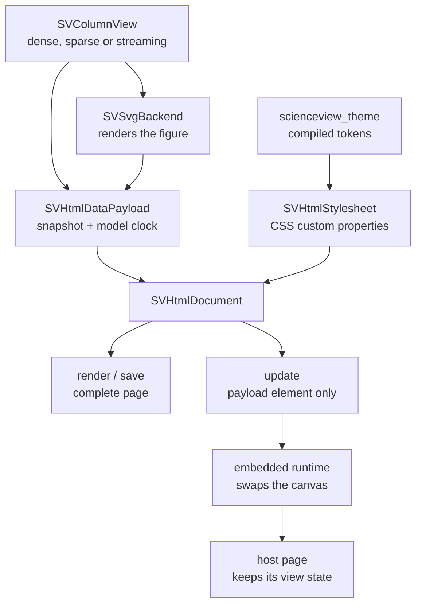

# Chapter 45 — The HTML backend: a figure that lives in a page

The SVG backend answers "give me a picture". A scientist who wants to *send*
that picture needs a file they can open; a dashboard needs a page that keeps
working while data arrives. Those sound like two products, but they are the same
document with different runtime behaviour. `scienceview_html` is that document:
one self-contained page that draws the figure, carries its own stylesheet, and
updates in place without a network connection or a reload.

This chapter explains the decisions behind the crate, how the payload and the
runtime divide the work, and which tests prove that the page is really
self-contained, deterministic and updatable.



## Why one document instead of two formats

The first temptation is to make HTML a thin wrapper: emit an SVG file and put an
`` around it. That fails the reason the backend exists. An `` is
opaque to the page: no style override, no gesture, no in-place data update. The
HTML backend therefore emits the SVG **inline** inside a document it owns. The
figure is still drawn once, by the same SVG serializer the SVG backend uses, so
the two targets cannot disagree about geometry.

The second temptation is to pull in a JavaScript charting library. It would make
the runtime easy and the output fragile: a CDN dependency turns "open the file"
into "be online", and a third-party runtime starts owning figure state. The
crate adds no dependency beyond the workspace itself. The runtime is a small
constant (`runtime.js`) inlined into every page.

## The page and its layers

`SVHtmlDocument` owns notation, never geometry. Its fields are the already
rendered SVG markup, the payload and the emitted stylesheet. Serializing it
produces a fixed skeleton:

```text
<!DOCTYPE html>
<html lang="en">
  <head>  meta charset, viewport, generator, <title>, <style>  </head>
  <body>
    <figure data-scienceview-figure="true" aria-labelledby="scienceview-caption">
      <div data-scienceview-canvas="true">  inline SVG  </div>
      <figcaption id="scienceview-caption">  the title  </figcaption>
      <script type="application/json" data-scienceview-payload="true">
        the payload
      </script>
    </figure>
    <script>  the runtime  </script>
  </body>
</html>
```

Two accessibility details matter. The `<figure>` is labelled by its visible
`<figcaption>`, not by a hidden string, and the inline SVG keeps the `role="img"`
and the `<title>`/`<desc>` the SVG backend already emits. A screen reader
therefore announces the same figure whether it reads the SVG file or the page.

## The stylesheet is emitted and overridable

Design D3 says the theme stylesheet belongs in the document, and a host page
must be able to override one rule. `sv_html_stylesheet` reads the compiled
`SVThemeTokens` and writes only CSS custom properties on the figure element:

```css
.scienceview-figure {
  --sv-colour-background: #ffffff;
  --sv-colour-axis: #333333;
  --sv-font-family: "system-ui";
  --sv-spacing-medium: 12px;
  background: var(--sv-colour-background);
  color: var(--sv-colour-text);
}
```

The base rule has the selector specificity of one class. A host page that writes
`.dashboard .scienceview-figure { --sv-colour-axis: red }` wins without an
`!important`, which is exactly the contract the spec asks for. Nothing in the
emitter parses the authored stylesheet; the values come from the same compiled
tokens every other backend reads.

## The payload: what the runtime is allowed to know

The model stays the authority (design D2). The runtime does not compute a scale,
a tick or a path. `SVHtmlDataPayload` carries:

- the representation the data arrived in, and its snapshot;
- the number of points and the model clock position;
- the SVG markup the Rust model already rendered;
- the reduced-motion flag from the theme.

`update` produces **only** the payload element. That is the in-place contract:
the page skeleton, the stylesheet, the caption and the runtime are untouched, so
the host page keeps its layout and the figure keeps its view transform. A test
slices the data block out of a full document and proves that an update differs
from it only inside that block, while the caption and the runtime remain.

In-place update also means the browser never reloads. The runtime observes the
figure with a `MutationObserver`; when a host replaces the payload element it
parses the new JSON, swaps the canvas markup and records the new revision on
`data-scienceview-revision`. `window.scienceview.update(element, payload)` is the
imperative alternative for a dashboard.

## The model clock, not the browser clock

Design D4 separates two clocks. The browser's `requestAnimationFrame` only says
*when* it is safe to paint; the playback position always comes from the payload.
The runtime schedules an application on the next frame, then applies the
revision and points the payload declared. When the theme asks for reduced
motion, the payload says so and the runtime applies the state immediately
instead of scheduling a frame.

## Gestures become actions, actions become deltas

The runtime never mutates figure state. A pointer drag produces a **pan action**,
the runtime dispatches it as a `scienceview:action` custom event, and then applies
the resulting **view delta** to a CSS transform on the canvas. A wheel gesture
produces a zoom action the same way. The delta is a view transform: the figure's
data and geometry still come from Rust. This is also why the capability row
declares events — a host page can listen to the action stream — while scripting
stays false: the page inlines a runtime, it does not host a user script engine.

## Representation parity

The embedded snapshot keeps the representation it arrived in:

| Input | Embedded payload |
|---|---|
| dense | `{"values":[...]}` |
| sparse | `{"indices":[...],"values":[...],"logical_length":n}` — never densified |
| streaming | `{"values":[window...],"sequence":n,"dropped_samples":n}` — never waits |

The payload dispatches on the representation exactly once, through
`SVColumnView::dispatch`. A sparse gap stays a gap; a streaming window is the
bounded snapshot the producer already published. The tests render all three and
assert the embedded shape, not just the drawn pixels.

## Determinism and the golden document

Every documented figure must be reproducible, so the page is built from fixed
pieces: a constant element order, a constant runtime, and one JSON
representation. Numbers in the payload use the same three-decimal formatting as
the SVG attributes, and non-finite values become `null` rather than a fabricated
zero. Strings are escaped by the JSON writer, including `<`, `>` and `&` as
Unicode escapes, so a title containing `</script>` cannot close the payload
element early.

`crates/scienceview_html/src/crate_tests/golden/empty_figure.html` is the
checked-in golden document for an empty figure. The companion test compares the
backend's bytes with the fixture exactly, which makes any change to the emitted
element order or to the runtime visible in review.

## The tests, module by module

| Test module | What it proves |
|---|---|
| `document_tests` | no `<link>`, `@import`, `src=` or network URL; accessible caption; a title cannot break out; the update fragment is a payload element, not a page |
| `stylesheet_tests` | custom properties are emitted in a fixed order and no rule uses `!important` |
| `payload_tests` / `json_tests` | fixed key order, sparse stays sparse, streaming metadata survives, script-tag escaping |
| `embedded_runtime_tests` | the gesture → action → delta bridge exists; an update is applied without `location.reload` |
| `backend_tests` | capability row, save semantics, update fragment, typed presentation error, registry dispatch end to end |
| `crate_tests` | golden document, byte determinism, eight concurrent renders agree, 10k points under 1 MiB, `backend.kind=html` in the operation span |

The last row is the acceptance criterion of PRD §8.7 applied to a document
backend: small and large data, concurrency, export and the in-place update path,
all observed through the same span helper every backend uses.

## See the generated page

The crate example `crates/scienceview_html/examples/offline_document.rs` prints a
complete page. Redirect its output to a file and open it with the network
disabled: the figure, the stylesheet and the runtime are all inside that file.

## What is deliberately absent

The backend does not present a window, so `show` returns
`UnsupportedBackendCapability { capability: Presentation }` instead of pretending
to succeed. It does not host a script engine, so a figure that calls
`requires_scripting()` fails at build time. Animation wiring is the transition
integration's job; the HTML row updates in place, which is what makes it
transition-ready, but this change does not claim a timeline it did not test.
