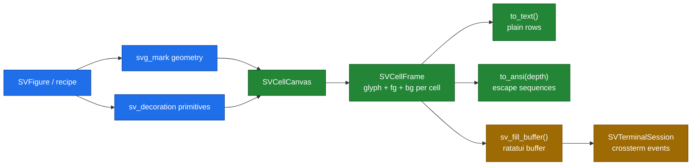

# Chapter 46 — Terminal: drawing a figure on a character grid

Every backend so far had at least one pixel per logical unit. The SVG backend
writes an exact document, and the native backend paints an RGBA buffer. A
terminal is different: its smallest addressable unit is a **character cell**, and
a cell is roughly 8 logical pixels wide and 16 tall. If the layout solver were
not the single source of truth, a decoration would drift by whole characters as
soon as the terminal resized.

This chapter builds `scienceview_tui`, the backend that turns the same
backend-agnostic primitives into a cell grid. It is also the hardest test of the
resolution-independent layout: everything the solver placed must survive a grid
forty times coarser than a pixel.



## Why a terminal, and why two layers

Scientific programs run over SSH and inside containers where no display exists.
A terminal backend makes the same figure available there, with the same theme
tokens and the same solved positions, and it is the cheapest way to prove that
the layout is truly independent of the output device.

The crate copies the native backend's split:

- a **pure cell rasterizer** (`SVCellCanvas`, `SVCellFrame`) that consumes
  `sv_mark` geometry and `sv_decoration` primitives and produces a value;
- an **interactive layer** (`SVTerminalSession`, behind the `terminal` feature)
  that presents that value through ratatui and crossterm.

The rasterizer needs no terminal. Every acceptance test compares golden frames
in CI, and `render`, `update` and `render_frame` work on a headless machine. The
interactive layer is the only part that touches raw mode, the alternate screen
and the event source. The root `render-tui` feature enables it; a default build
pulls neither ratatui nor crossterm.

## The viewport knows the cell size

The layout solver's only environment input is `SVViewport`. It already carries a
cell grid:

```rust
let viewport = SVViewport::new(640.0, 384.0)
    .with_cell_grid(8.0, 16.0);
assert_eq!(viewport.cells_wide(), 80);
assert_eq!(viewport.cells_high(), 24);
```

Those numbers are the conventional 80 by 24 terminal, and
`sv_tui_default_viewport()` builds exactly them. A resize does not scale the
previous frame; `SVTuiBackend::render_frame_for_terminal(request, columns, rows)`
builds a new viewport and re-solves the layout, which is why decorations keep
their relative position at every size. Snapping happens **only** in
`SVCellCanvas::cell_of`: the primitive coordinates stay continuous until the
last moment. Below 32 columns or 12 rows the figure enters a **compact** mode:
the plot frame and the mark are still drawn, while the grid, the tick labels
and the title are dropped, so a tiny terminal never lets a label spill into the
plot. `a_compact_terminal_keeps_the_plot_and_drops_the_labels` asserts exactly
that.

## Cells are values

`SVCell` holds a glyph and optional foreground and background colours. A wide
glyph occupies its own cell and marks the next cell as a **continuation**, so a
row keeps its column alignment. `SVCellFrame::row_text` skips continuation
cells, which is why a row of two CJK ideographs prints two glyphs but occupies
four columns.

The frame is the comparable surface of the backend. `to_text` returns plain
rows for a golden test or a text file; `to_ansi(depth)` returns the escape
sequences a terminal replays; `into_ansi_bytes` is what `render` returns. A
golden test asserts the rows character by character, so a change to the
rasterizer shows up as a readable diff rather than as a pixel hash.

## Braille, blocks and glyphs

A cell has only one glyph, but it can encode more than one dot. The Unicode
braille block gives every character a 2 by 4 dot matrix: eight dots, each
independently addressable. `sv_braille_dot_bit` maps a sub-column and a sub-row
to the right bit, and `sv_stamp_braille_dot` ORs it into the cell's existing
pattern. Paths, circles and filled polygons are rasterized on that sub-grid with
a digital differential analyzer, so a curve keeps four times the vertical
resolution of the character grid.

Filled rectangles use **block** glyphs instead. The eight partial blocks
(`▁▂▃▄▅▆▇█`) encode eighths of a cell, so a bar whose height is 3.5 cells ends
in `▄` rather than being rounded to three or four whole rows. This is the
specification's "partial block character where a height is fractional" scenario,
and `a_fractional_height_becomes_a_partial_block` asserts the exact glyph.

Text is drawn with the glyphs themselves. The label's baseline comes from the
decoration; `draw_anchored_text` converts it to a row, applies the start, middle
or end anchor, and then draws character by character. `sv_cell_display_width`
reports East Asian wide characters as two columns and combining marks as zero,
so `wide_characters_take_two_cells_and_clip_whole` can prove that a wide glyph
that does not fit is dropped whole instead of bleeding into the next row.

Rotated text — the left axis title — cannot be rotated on a cell grid; it is
drawn horizontally at the position the solver gave it. This is an honest
approximation, documented rather than hidden.

## Colour, three depths deep

A colour in the model is `SVColour`, straight RGBA. A terminal understands SGR
escape sequences, and terminals differ in how many colours they accept:

| Depth | Sequence | Used when |
|---|---|---|
| `TrueColor` | `38;2;r;g;b` | the terminal advertises 24-bit colour |
| `Ansi256` (default) | `38;5;n` | the xterm cube and grey ramp |
| `Ansi16` | `30`–`37`, `90`–`97` | only the system colours exist |

`sv_ansi_256_index` maps to the nearest cube or grey entry, and
`sv_ansi_16_index` compares against the sixteen system colours. A colour with no
alpha emits no escape at all, which lets the terminal theme show through. The
tests pin exact sequences for primaries and for a transparent colour.

## The clock is elapsed time, not a tick

A terminal can be slow: an SSH link, a huge scrollback, a busy multiplexer. A
fixed-tick loop would fall behind and then lie about the animation position.
`SVTickClock` accumulates the time the caller passes and yields at most **one**
frame per configured interval:

```rust
let mut clock = SVTickClock::new(Duration::from_millis(16));
assert_eq!(clock.tick(Duration::from_millis(10)), SVTickOutcome::Idle);
assert_eq!(
    clock.tick(Duration::from_millis(10)),
    SVTickOutcome::Frame(Duration::from_millis(20))
);
```

The position includes the sub-interval time, so short polls never lose time.
When a single tick takes 250 ms, the frame is reported at 250 ms — not at one
fixed interval — which is the specification's slow-terminal scenario. The caller
still owns the frames: it renders with `render_frame_for_terminal` and draws
when the clock says a frame is due.

## Resize, presentation and an honest capability row

`SVTerminalSession` opens the terminal, draws a frame, and waits for a resize or
a quit key. A resize event reports the new column and row count; the present
loop re-renders at that size. `sv_fill_buffer` copies a frame into a ratatui
buffer, clipping a frame larger than the terminal instead of panicking.

The capability matrix declares a terminal as:

| Capability | Declared | Why |
|---|---|---|
| events | yes | crossterm delivers keys and resizes |
| scripting | no | the backend hosts no script engine |
| streaming | yes | a streaming column's bounded snapshot is read like any other |
| in-place update | yes | `update` re-renders into the same grid |
| export | **no** | a terminal is not an export format |
| presentation | yes | `show` presents the frame |

The export refusal is the important honesty. `save` returns
`UnsupportedBackendCapability { capability: Export }` rather than writing a file
the matrix never promised. A caller that wants a file uses the frame's own
`to_text` or `to_ansi` value and writes it, which is a deliberate caller
decision, not a backend capability. The mark matrix likewise refuses the borrowed
raster image: a bitmap cannot be shown honestly on a character grid, so the
figure fails while it is configured instead of silently dropping the mark.

## The tests that are the specification

Every claim above has a companion test in the crate:

- `cell/canvas_tests.rs` — partial blocks, box-drawing outlines, braille paths,
  wide characters, legend labels and a degenerate 0 by 0 terminal;
- `cell/ansi_tests.rs` and `cell/cell_frame_tests.rs` — colour depths, escape
  sequences, continuation columns and plain rows;
- `clock/tick_clock_tests.rs` — short ticks, accumulated time, the slow-terminal
  rule, a zero interval and `reset`;
- `backend/backend_tests.rs` — frame dimensions, ANSI bytes, resize, update,
  degenerate sizes and the export refusal;
- `crate_tests/` — determinism, eight concurrent renders, ten thousand points
  and the operation span recording `backend.kind = "tui"`.

The span assertion is the same one every backend carries: rendering through the
registry produces exactly one `render` span whose `backend.kind` is `"tui"`, not
a hardcoded value from the backend crate.

## What the next chapter builds on

The terminal proves that decorations placed by the solver survive a coarse
raster. The HTML and WebAssembly backends reuse the same primitives at a finer
grid, and the framework components wrap the same scene in a host page. None of
them re-derives a position — they only choose a different raster.
