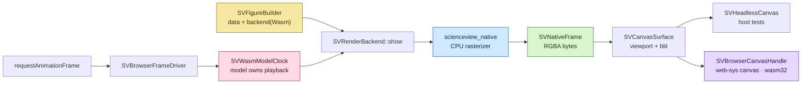

# Chapter 47 — WebAssembly: the same renderer, in a browser tab

Chapter 15 built a from-scratch CPU renderer and deliberately split it in two:
a pure rasterizer that owns bytes, and a present layer that opens a window.
This chapter spends that design. `scienceview_wasm` compiles the same rasterizer
target and blits its frame into an HTML canvas, so a figure on a web page is not
"similar" to the desktop one — it is the desktop one.

It also answers a question every browser charting library gets wrong: who owns
time? Here the browser owns only the *repaint*, and the model owns the clock.




## Why not a second renderer in JavaScript

The tempting shortcut is to draw the figure again with the Canvas 2D API from
JavaScript. It would be faster to start and smaller to ship, and it would drift
within a release: different anti-aliasing, different text metrics, different
rounding when a scale maps a data value to a pixel. A chart that looks almost
the same on two targets is worse than useless, because a user cannot tell a real
difference in the data from a difference in the renderer.

So the crate depends on `scienceview_native` — with its `window` layer switched
off — and calls `SVNativeBackend::render_frame_with_viewport`. That method
already returns an `SVNativeFrame`, a value with width, height, device pixel
ratio and RGBA bytes. The WebAssembly target adds nothing to the drawing; it
adds a destination.

The alternative, extracting the rasterizer into a third crate, was considered
and rejected. It would have moved native's ownership surface and risked the
desktop target for no pixel gain. A dependency is the smaller contract, and it
is documented where it matters: in the crate docs and in `Cargo.toml`.

## A canvas seam, not a browser dependency

A backend that named a DOM type could not compile on the host, and a backend
whose renderer depended on a DOM could never be tested headlessly. The crate
therefore separates *render* from *blit* with one small trait:

```rust
pub trait SVCanvasSurface: Send + Sync {
    fn viewport(&self) -> SVViewport;
    fn blit(&self, frame: &SVNativeFrame) -> Result<(), SVError>;
}
```

`show` asks the surface for the viewport it is sized for, solves the layout for
that viewport, rasterizes, and hands the finished frame back. Nothing else about
the browser reaches the renderer.

Two implementations exist:

- `SVHeadlessCanvas` keeps the last frame in memory. It is what the host tests
  drive, and it is the proof that presentation is a blit: the frame it stores
  is byte-identical to the one the rasterizer produced.
- `SVBrowserCanvasHandle` is compiled only under `cfg(target_arch = "wasm32")`.
  It wraps a `web-sys` canvas and its 2D context, turns the RGBA bytes into an
  `ImageData`, and calls `put_image_data`.

The handle deserves a note. A `web-sys` canvas is **not `Send`**: JavaScript
objects belong to the browser thread. The backend contract, however, is
`Send + Sync`. The obvious escape is `unsafe impl Send`, which this project
forbids. Instead the JavaScript values live in a thread-local registry and the
backend holds a handle whose only field is a token. A blit hops through the
registry on the thread that created the canvas — the only thread the browser
has.

A host build that asks for presentation without a surface gets a typed
`SVError::BackendUnavailable { backend_kind: Wasm }`, never a silent success.
`save` reports the missing export capability from the matrix row, exactly like
the native backend: a canvas is not a file format.

## The clock belongs to the model

`requestAnimationFrame` is a scheduler, not an animation. It tells the page
"about now", sixty times a second. If the renderer treated that as time, a paused
chart would still advance, a slow machine would skip frames of data, and two
tabs would disagree about where the figure is.

The crate keeps the seam explicit:

```rust
pub trait SVWasmModelClock: Send {
    fn advance(&mut self, frame_time: f64) -> Option<f64>;
}
```

The loop never owns a position. `SVWasmFrameLoop::run_frame` passes the browser
timestamp to the clock and draws only when the model answers `Some(position)`.
`None` means the timeline is paused, and the turn is `Idle` — no animation work,
no repaint. The tests drive this directly on the host: one clock pauses and the
draw callback is never called; another records the timestamps it received and
returns half of each, proving the browser time reached the model and that the
drawn position came from the model.

`SVBrowserFrameDriver` is the only code that calls
`request_animation_frame`. It re-schedules itself with the stored callback,
stops on `drop`, and cancels the pending frame. It is compiled and linted only
for the `wasm32-unknown-unknown` target, where it can be checked for real.

## The minimal binding surface

JavaScript gets three operations, not a model: construct a figure from a canvas
id and values, push new values, render. `SVWasmFigure` forwards those values to
`SVWasmBackend`; the figure is never duplicated in JavaScript, so there is no
second source of truth to keep in sync.

```javascript
const figure = new SVWasmFigure("plot", [1.0, 3.0, 2.0, 5.0]);
figure.update([1.0, 3.0, 2.0, 5.0, 4.0]);
```

The rendered result is the figure the SVG serializer produces from the same
data, because both consume the same kernels:


## The capability matrix row

A canvas is interactive and embedded, so the `Wasm` row declares events,
scripting, streaming, in-place update and presentation, and no export. The
crate's tests assert the row against the core matrix rather than against a local
copy, so a change in the matrix cannot drift unnoticed. They also prove that
every mark variant — including the raster image, which a terminal cannot draw —
is supported, and that concurrent renders from one stateless backend produce
identical frames.

## What the tests actually pin down

- `a_headless_wasm_frame_matches_the_native_frame` renders the same request
  through both backends and asserts whole-frame equality.
- `showing_blits_the_frame_into_the_canvas` proves `show` rasterizes for the
  surface viewport and stores that frame.
- `showing_without_a_surface_reports_the_unavailable_backend` and
  `saving_reports_the_missing_export_capability` pin the typed refusals.
- `updating_rerenders_the_same_canvas_in_place` presents twice into one canvas
  and checks the second frame is the update output.
- `pausing_after_a_frame_stops_the_next_one` proves the model, not the browser,
  decides when animation stops.
- The determinism tests replay dense, sparse and streaming views and require the
  same bytes.
- The observability test renders through the figure builder and asserts the
  span records `backend.kind=wasm`.

## What is deliberately not claimed

The wasm artifact size is not measured here; it belongs to release
acceptance. Neither the canvas handle nor the frame driver is exercised in a
real browser by CI — they are compiled and linted for `wasm32-unknown-unknown`,
which is the strongest check available without a headless browser in the
pipeline.

## Takeaway

The browser target is not a port. It is the native renderer with a different
destination and a model-owned clock, which is why the chapter fits in one
sentence: *the same bytes that would have gone to a window go to a canvas.*
