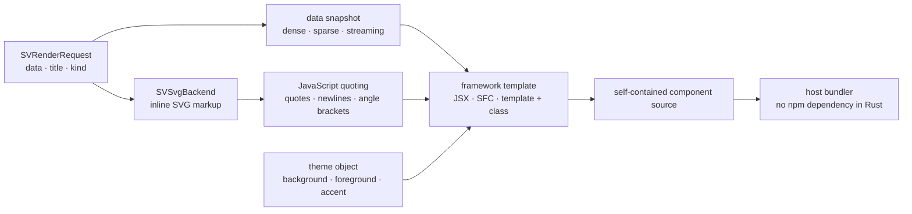

# Chapter 48 — Framework components: a figure that lives inside React, Vue and Angular

Every backend so far produced something the user opens: an SVG file, an HTML
page, a native window, a terminal grid. This chapter is about a different
delivery shape. A team that already owns a React, Vue or Angular application
does not want a file; it wants a component it can drop into a page, pass data
to, theme, and listen to. The `scienceview_react`, `scienceview_vue` and
`scienceview_angular` crates provide exactly that.

The implementation is deliberately small, and that is the point. A framework
component is not a second rendering engine. It is the SVG backend's markup
inside a typed wrapper, plus a contract that is identical in all three
frameworks.



## What a component contract is, from zero

A framework component has three things: **properties** going in, **events**
coming out, and **markup** in the middle. React calls the first `props`, Vue
calls them `props` too, and Angular calls them `@Input`s. The event side has
different syntax in each framework, but the same meaning: the component tells
its host that something happened.

The contract this change fixes is:

| Property | Meaning |
|---|---|
| `data` | the current data snapshot, including its representation |
| `markup` | the inline SVG the component shows |
| `theme` | the colours the host wants the wrapper styled with |
| `title` | the accessible figure title |

The single event is `scienceview-action`. It carries two action types,
`select` and `zoom`, which are forwarded with their coordinates or delta. The
component never interprets a zoom itself: it emits the action and lets the host
decide. That is the difference between a component and a chart framework.

The three crates repeat the same `SV*ComponentContract` value. A test in each
crate compares the property list, the event list, the action list and the
backend kind against the literal contract. Porting an application therefore
changes the wrapper import and nothing about the figure configuration.

## Why the output is source text

A Rust library cannot ship a React package, a Vue single-file component and an
Angular decorator class as compiled artefacts without taking on three
JavaScript toolchains. It also should not: the consuming application already
chose its bundler, its framework version and its package manager.

The backend therefore writes **source text**. `render` returns the component
source as bytes; the application saves it, imports it, or feeds it to its own
build. There is no npm dependency at Rust build time and no JavaScript runtime
inside the library. The generated source is self-contained: the SVG markup, the
data, the theme and the event name are all inside it.

The markup is the SVG backend's real output. `SVSvgBackend::render` is called
with the same request, so a component and a standalone `.svg` file can never
disagree about geometry. The component wrapper only decides how that markup is
embedded.

## The backend trait surface

Each crate exposes one zero-sized backend: `SVReactBackend`, `SVVueBackend` or
`SVAngularBackend`. They all declare the same capability row from the core
matrix:

```rust
fn capabilities(&self) -> SVBackendCapabilities {
    sv_backend_capabilities(SVBackendKind::React) // or Vue / Angular
}
```

That row is `events`, `scripting`, `streaming`, `in-place update` and
`presentation`, with `export` false. A component forwards input, accepts a
streaming snapshot and swaps its markup, so the first five are real. It does
not write a file on its own, so `save` reports
`SVError::UnsupportedBackendCapability { capability: Export }`.

`show` is the interesting one. A component is presented by the page that mounts
it, not by the Rust process. The backend says so explicitly with a typed
`SVError::BackendFailure { operation: "show", ... }` whose message names the
host application, instead of pretending that a window opened. The native
backend behaves the same way when it is compiled without its window feature.

Registration follows the pattern of every other backend:

```rust
sv_register_react_backend();
let figure = SVFigureBuilder::new()
    .data_source(SVColumnView::Dense(&values))
    .backend(SVBackendKind::React)
    .build()?;
let source = figure.render()?.bytes;
```

A provider serves exactly one kind. Registering the React provider never makes
Vue or Angular available, and no provider ever selects itself: the figure's
`backend(...)` call remains the explicit choice.

## Determinism and the golden components

The generated source is compared byte for byte with a checked-in golden file per
framework:

```text
crates/scienceview_react/src/component/golden/figure.jsx
crates/scienceview_vue/src/component/golden/figure.vue
crates/scienceview_angular/src/component/golden/figure.ts
```

Determinism comes from three habits. Attributes come from the SVG serializer,
which already writes them in a fixed order. Numbers go through the SVG number
formatter, so a value never changes representation between runs. And the
template fills its placeholders in a fixed order. There is no hash map, no
clock and no random identifier in the source.

The golden test is intentionally strict: a template or contract change fails
until the file is regenerated on purpose. That is how three wrappers stay
honest about sharing one behaviour.

## Escaping, in two layers

A hostile title must not be able to break out of the generated source. There
are two layers.

The first is the SVG serializer: `<`, `>`, `&`, `"` and `'` become entities
inside the document. A title such as `<script>alert("x")</script>` is already
inert in the markup.

The second is the JavaScript quoting function. User-provided strings (the
title) also get quotes, backslashes, newlines, tabs, control characters and
line separators escaped. The angle bracket `<` is written as `\u003c`, so the
string cannot close an HTML `<script>` element even in a Vue single-file
component. Trusted SVG markup keeps its tags literal, which makes the generated
component readable; it is safe because every user character inside the markup
was already turned into an entity.

The hostile-title test asserts that no `<script>alert` appears, that no
`</script><script` sequence was introduced, and that the original label is
present only as an escaped entity.

## Data without densifying it

The component embeds a data object rather than a bare array:

```json
{"logicalLength":3,"representation":"sparse","points":[[0,1],[2,3]]}
```

`points` are index/value pairs. A dense column stores every point, a streaming
column stores its bounded snapshot, and a sparse column stores only its stored
entries. The logical length is preserved separately, so a gap stays a gap. The
backend never expands a sparse column into a dense array to satisfy the
component format.

The component can show the current point count and representation from those
fields, and the host can hand the same values to its own update path.

## The update path

`update` re-renders the component source from the current view and records how
many points the update appended in `appendedPoints` (React and Vue) or
`appendedPoints` on the Angular class. The markup prop is what makes the
component update in place: the host passes the newly generated `markup` and the
component replaces its inner SVG without remounting.

This is deliberately not an animation engine. The figure's transition-ready
geometry is a separate concern; the component only guarantees that a new
snapshot can be delivered through a property.

## The tests as executable specification

Each crate carries the same test set, adapted to its framework:

- capability and registry tests, including the exporter refusal and the
  host-mount failure;
- a golden-source test per framework;
- a hostile-title escaping test;
- determinism: the same request produces byte-identical source;
- representation tests for dense, sparse and streaming views;
- a ten-thousand-point source test, checking that the output stays bounded and
  self-contained;
- a concurrency test with eight threads rendering the same figure;
- an observability test proving the operation span records `react`, `vue` or
  `angular` as `backend.kind`.

The concurrency test works because the backend is stateless: every operation
derives its output from the request, so one instance can serve many threads.

## Roads not taken

**Shipping npm packages.** It would couple the Rust release cycle to three
JavaScript ecosystems and force the user's bundler to accept our packaging.
Emitting source keeps the choice with the application.

**Implementing chart behaviour in JavaScript.** A component that re-implements
scales and marks would drift from the Rust kernels and from the SVG output. The
component forwards actions; the model keeps owning the chart.

**An automatic framework selection.** There is no `Automatic` variant in
`SVBackendKind`, and this change does not add one. The application states
whether it wants React, Vue or Angular, exactly as it states whether it wants a
file or a window.

## What comes next

The component contract is versioned with the binding crates. When the action
vocabulary grows, all three wrappers and their contract tests change together.
The next chapters cover the remaining delivery targets; the shape stays the
same: one backend, one explicit kind, one operation span, and one contract that
the host can rely on.
