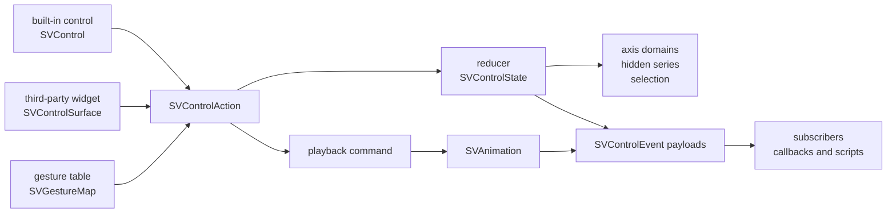

# Chapter 49 — Controls: the figure listens without a user-interface toolkit

A chart that cannot be explored is a picture. The moment a reader wants to zoom
into a cluster, hide a series, drag an axis or scrub an animation, the library
has to decide *where the interaction lives*. The tempting answer is to let each
backend handle its own buttons: the HTML build wires DOM events, the native build
wires window events, the terminal build wires keys. That answer ages badly. Two
backends drift, the same gesture means two different things, and a dashboard
that embeds a figure in React cannot reuse anything.

`sv_control` takes the other road: interaction is **model state** and the
vocabulary is the contract.



## A control is a model object, never an artist

The first decision is the one the specification forces: a control is **not** an
artist. It never enters the mark pipeline, never owns geometry and never appears
in a scene. `SVControl` carries the configuration a person set — identity,
label, size, placement (in the figure frame or in an external host), a style
resolved from theme tokens, an enabled flag, a target axis, a step, optional
bounds and an optional action override — and nothing else. Because it is data,
it can be cloned into a dashboard, serialized by a host, or asserted in a test
without a window.

The builder is still the only public way to build one. `SVControlBuilder` starts
from one of the closed `SVControlKind` values (`ZoomIn`, `ZoomOut`, `Reset`,
`Pan`, `SeriesToggle`, `RangeSlider`, `RegionSelect`, `Playback`) and validates
the configuration at `build`: an extent must be positive, a step must be
positive, a playback speed must be positive and a range must be ordered. The
size and label defaults mirror what `sv_standard_controls` returns, so a figure
that asks for "the standard controls" gets the same objects a person would have
configured by hand.

Two details are easy to miss and both matter. First, a control derives its
action rather than storing it: `zoom_in` with step `0.25` yields
`Zoom { factor: 1 / 1.25, anchor: 0.5 }`, so changing the step changes the
action with no stale copy anywhere. Second, an explicit `action(...)` override
wins over the derivation. That is what lets a host re-purpose a button without
inventing a new kind, and it is the same mechanism a dashboard uses to dispatch
a custom payload.

## One vocabulary, two kinds of adapter

`SVControlAction` is closed and small: `Zoom`, `Pan`, `Reset`, `ToggleSeries`,
`SetSeriesVisibility`, `SetRange`, `SelectRegion`, `ClearSelection`,
`SetPlayback` and `Custom`. Each variant is pure data. Zoom carries a
multiplicative factor (`< 1` zooms in), an anchor fraction (`0.5` keeps the
centre fixed) and an axis; pan carries a signed fraction of the visible span.
Nothing in the vocabulary mentions a window, a DOM node or a key code.

The integration contract is a trait, `SVControlSurface`. A surface supplies a
name, an enabled flag and an action; the trait supplies `activate`, which turns
a disabled surface into the typed `SVError::ControlDisabled`, and
`dispatch_into`, which applies the action to the reducer. `SVControl` implements
it; `SVWidgetAdapter` implements it for a widget from any user-interface
framework. A framework binding therefore writes *no* figure logic: it calls
`dispatch_into` and observes the same events as a built-in control.

```rust
let widget = SVWidgetAdapter::new("framework-zoom", SVControlAction::Zoom {
    axis: SVControlAxis::Horizontal,
    factor: 0.5,
    anchor: 0.5,
});
widget.dispatch_into(&mut state)?;
```

The test `an_external_widget_mutates_the_state_like_a_built_in_control` asserts
exactly this: the built-in control and the adapter, given equivalent actions,
produce the same visible domain. The event origin is the only difference, and
that difference is deliberate — a subscriber can tell where a change came from.

## The reducer: pure state, no clock

`SVControlState` owns three things: the registered axes (each with a transform,
a full domain that acts as its bounds, and a visible domain), the set of hidden
series and the current selection. Its `dispatch` is a pure function of the
previous state and the action. There is no wall clock, no async runtime and no
hidden mutation: the same action sequence always produces the same events,
which `the_same_action_sequence_produces_the_same_payloads` asserts by running
the sequence twice.

The interesting mathematics is zoom and pan. If a logarithmic axis is zoomed
naively in data space, the result is wrong: `1..1000` has its midpoint at
`500.5`, not at `31.6`, and halving the arithmetic span leaves almost all of the
visible data on one side. The reducer therefore converts both the visible and
the full domain into the scale transform's linear space, shrinks or shifts
*that* interval, and converts back through the transform's inverse. For
`Logarithmic`, halving the transformed span of `1..1000` yields
`5.623..177.828`, exactly the test
`a_logarithmic_axis_zooms_in_its_transformed_space` expects. The same code path
serves `SymmetricLogarithmic` and `SquareRoot` with no special case.

Bounds are enforced in the transformed space too, and the caller never sees an
invalid interval. Zoom clamps the target span to the bounds' span and then
shifts the interval back inside; pan shifts the interval and clamps it at both
ends. A domain that would not move at all emits no event, so a no-op action
cannot flood subscribers with empty notifications. Set-range from the slider is
clamped into the registered bounds before it is applied.

A reset restores every visible domain to its bounds but deliberately **does not**
restore hidden series: a user who hid a series while exploring expects it to
stay hidden after pressing "reset view". The test
`reset_restores_every_domain_and_clears_the_selection` pins the distinction.

## Events carry the previous and the current value

Every committed change produces one `SVControlEvent` with an origin and a
change. The change structs carry both sides: `SVRangeChange` has `previous` and
`current`, `SVSeriesVisibilityChange` has the series and both booleans,
`SVSelectionChange` has either side as optional, `SVPlaybackChange` carries the
state, position and speed on both sides, and `SVViewReset` carries the list of
ranges. That is what a callback, a script or a dashboard needs in order to react
without reading the figure back.

The payloads have a canonical textual encoding (`to_text`). The test
`an_event_serializes_to_a_stable_text_form` fixes the exact string:

```text
control=zoom-in;change=range;axis=Horizontal;previous=0,100;current=25,75
```

The encoding is deliberately dependency-free: the core adds no serialization
crate, and a transport layer can wrap the canonical text in JSON or send it over
a socket without changing its content.

## Playback is the animation layer's vocabulary

The kit does not invent a second meaning for "play". `SVPlaybackCommand`
resolves to the animation layer's own `SVAnimationAction`, so play, pause,
toggle, stop, step, seek and speed mean exactly what `sv_animation` already
means. `SVControlState` does not own the timeline; it returns the playback
action in `SVControlDispatch::animation_action`. `SVControlSession` owns the
optional timeline, applies the action there and only then emits a
`SVPlaybackChange` with the real before and after values.

That separation is why the reducer stays pure and why a host can own its clock.
The session also keeps the subscriber registry: `subscribe` returns an
`SVControlSubscription`, `unsubscribe` removes it, and `dispatch` notifies every
observer after the whole action is applied. A failing action — an invalid speed,
a playback action with no timeline — returns a typed error and leaves both the
state and the subscribers untouched (`an_invalid_speed_leaves_the_timeline_untouched`).

## Gestures are a table, not code

A backend receives a key press, a wheel turn or a drag. It translates that into
`SVGesture` data and asks `SVGestureMap` for exactly one action. The default map
is documented in `sv_default_gesture_map`: `+`/`-` zoom horizontally,
`PageUp`/`PageDown` zoom vertically, arrows pan, `Home` resets, `Space` toggles
playback, `[`/`]` step, the wheel zooms in the direction of its delta and a
primary-button drag pans by the dragged fraction.

Resolution is deliberately more than a hash lookup. A wheel binding stores a
zoom factor; a negative delta inverts it, so the same binding zooms both ways and
`a_wheel_gesture_zooms_in_the_direction_of_its_delta` checks that the two factors
are reciprocals. A drag binding stores a placeholder pan; resolution replaces the
fraction with the real dragged distance. Nothing in the map depends on a
toolkit, so a test can assert a resolution with no window open at all.

## Parity, determinism and concurrency

Controls do not consume data themselves, but they do need axis bounds, and the
only honest way to obtain them is the data boundary. `register_axis_from_column`
delegates to `SVDomain::from_column_view`, which resolves dense, sparse and
streaming views exactly once, never densifies sparse storage and never blocks on
a stream. `the_three_representations_register_the_same_axis_bounds` registers a
dense slice, its sparse twin and a streaming window and asserts one identical
domain; `a_large_dense_column_registers_once` proves the registration path on
ten thousand values.

Determinism is asserted at the payload level. Concurrency is asserted at the
state and session level: eight threads toggle eight series through a mutex and
every series ends hidden; four threads dispatch play and pause eighty times
through one session and the single subscriber sees exactly eighty events; and
`SVGestureMap`, `SVControlAction` and `SVControlEvent` are asserted `Send + Sync`.

## What was deliberately left out

The kit does not render a control. Choosing a pixel rectangle, drawing a slider
thumb or mapping a theme radius onto a backend belongs to the backend, which
consumes the control's size, placement and style. The kit also does not run
scripts: it carries the source (`attach_script`) and delivers the same payloads
to every subscriber, so the scripting engine of wave 8 is an observer with no
special vocabulary. Finally, the action vocabulary is closed on purpose; a new
core action must be justified by reuse across the kit and the dashboard, which
is why `Custom { name, payload }` exists as the escape hatch that does not grow
the enumeration.

The chapter's executable source of truth is the module's companion tests in
`crates/scienceview_core/src/control/`: `control_tests.rs`,
`dispatch_tests.rs`, `dispatch_model_tests.rs`, `playback_tests.rs`,
`gesture_tests.rs`, `representation_tests.rs`, `concurrency_tests.rs` and
`integration_tests.rs`.
